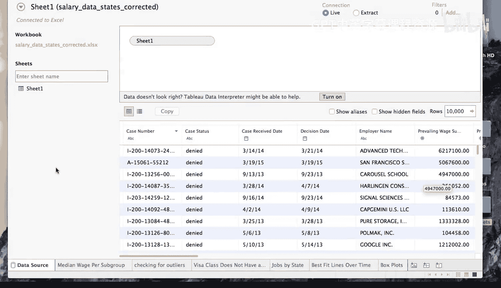
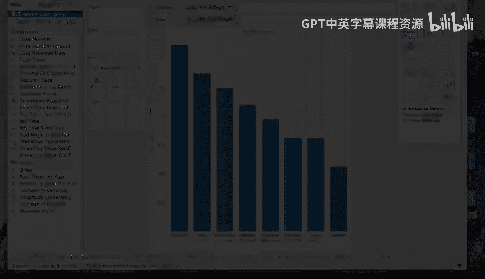
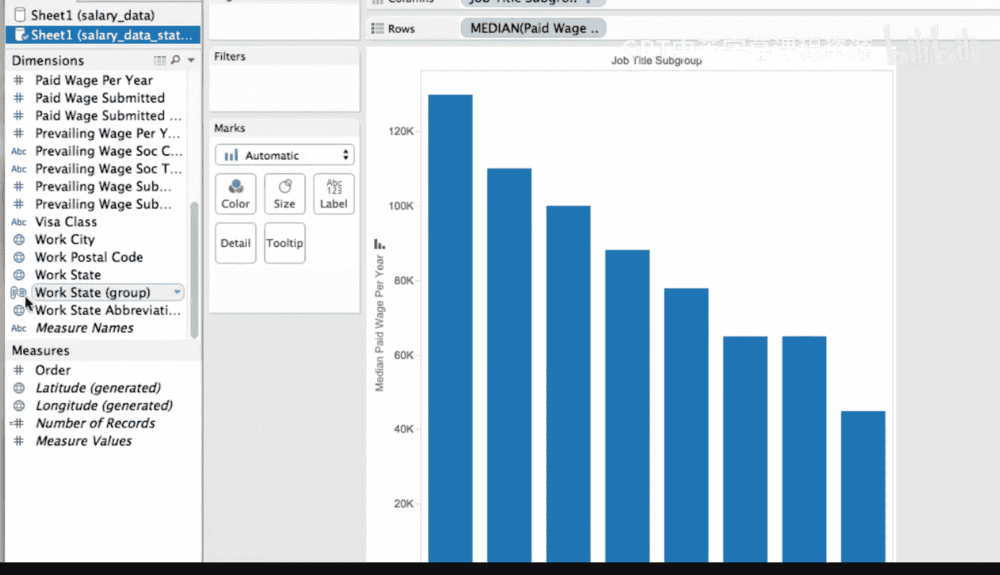
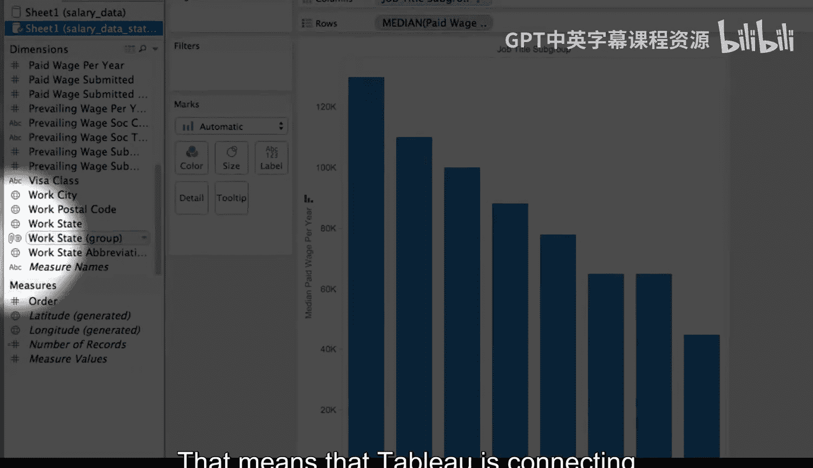
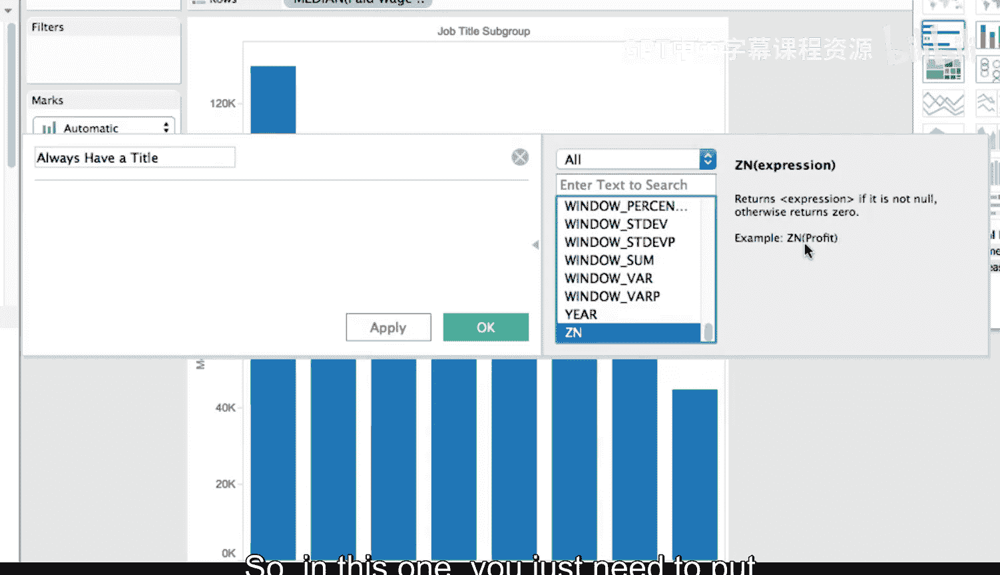
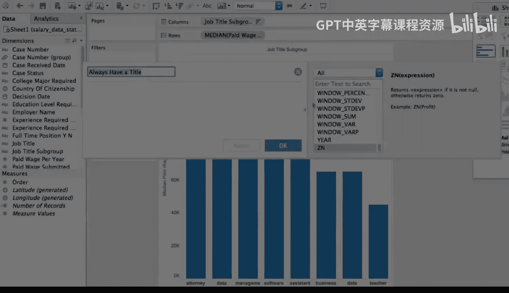
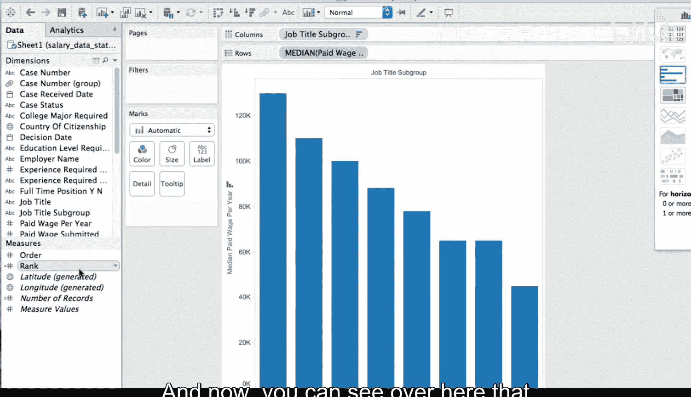
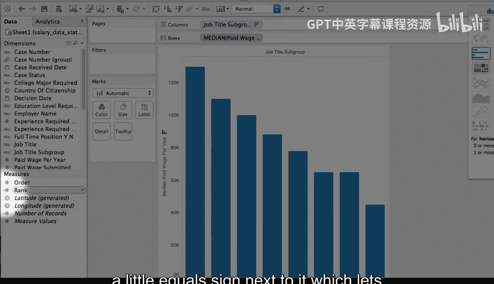
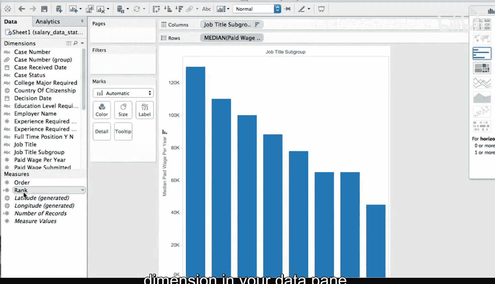

#  104：如何编写计算字段 📊

在本节课中，我们将学习如何在 Tableau 中创建和使用计算字段。计算字段允许你基于现有数据创建新的变量，从而进行更深入的分析。我们将从熟悉计算面板的布局开始，了解其各个组成部分，并学习如何编写、验证和编辑计算。

## 熟悉计算面板

首先，请打开我们之前使用的 Tableau 工作簿。本周我们将使用一个略有不同的数据集，其中已为您清理了州名，这将方便我们后续的一些操作。

在开始查看计算之前，请先打开名为 `salary data states corrected` 的新数据集。请从网站下载该文件并打开它。和上次一样，由于文件较大，加载可能需要一些时间。

打开文件后，和上次一样，您需要更改一些变量的类型。例如，`case receive date` 当前是字符串类型，您需要将其更改为日期类型。`decision date` 也应更改为日期类型。请为数据集中的所有字段进行类似的修正。

修正完所有字段后，如果尚未更新，请点击“立即更新”。

更新完成后，让我们转到工作表。

## 替换数据源

进入工作表后，请转到数据面板。右键单击旧的 `salary data`（不是新的那个），选择“替换数据源”。然后，将 `salary data` 替换为 `salary data states corrected`。

替换数据后，您会看到新数据集旁边有一个勾选标记。在某些情况下，您可能不想删除旧数据集，因为您可能在旧数据集中创建了新变量，而这些变量在新数据集中不存在，您可能希望再次使用它们。例如，如果您向下滚动到 `workday group`，这是我们为尝试修正旧州名而创建的变量，这个变量在新数据集中不存在。如果您想保留它，就需要同时保留两个数据集。Tableau 实际上知道如何将这两个数据集链接起来。当您看到这个小回形针或链接图标时，就表示 Tableau 正在将旧数据集连接到新数据集，并允许您使用这个变量，尽管它只存在于旧数据集中。顺便说一下，它是通过 `case number` 进行链接的。

不过，我们不需要这两个组。为了使操作更简单，我们将删除这个旧数据集。

现在，我们应该准备就绪了。接下来，让我们看看计算面板是什么样子的。

## 计算面板的布局

和往常一样，您可以通过多种方式打开计算面板。第一种方法是右键单击数据面板的空白处，然后选择“创建计算字段”。

这就是计算面板。它有几个不同的部分：
*   **标题**：这是计算字段的标题。您应该始终设置一个标题，并且尽量使其比我现在设置的更具描述性。因为您通常会有很多计算，它们很容易混淆。标题越具描述性，以后使用起来就越方便。
*   **计算区域**：这是您实际编写计算的地方。
*   **函数列表**：右侧区域列出了 Tableau 中所有可用的不同计算函数。如果您点击此处的下拉菜单，您会看到我之前告诉您的不同类别：数字、日期等。如果您不记得这些函数的作用，可以回顾之前的视频。Tableau 的一个巧妙之处在于，它会告诉您每个函数需要做什么。即使函数很多，当您点击它们时，面板的这个区域会确切地告诉您如何使用该计算。

例如，对于 `ABS` 函数，您只需要在括号内放入一个变量名。

## 编写和验证计算

让我们以 `ABS` 函数为例，看看具体操作。您可以通过双击函数名或在此处手动输入来开始编写计算。现在，它提示我们输入一个变量名。我们输入 `education level required`。实际上，您可以直接从工作簿的变量面板将变量拖入计算区域。

这里有几件事需要注意：
1.  Tableau 自动将变量名放在了方括号 `[]` 中。这是因为每当您的变量名包含空格时，Tableau 可能会混淆，除非您告诉它这是一个完整的变量名。使用方括号就是解决方法。如果变量名没有空格，则不必使用方括号，但我建议您养成始终使用它们的习惯，这样可以避免错误。
2.  变量名在此处显示为橙色，而计算函数显示为蓝色。当您有很长的计算时，这有助于您定位。变量名总是橙色，而浅蓝色表示您正在使用聚合计算。

我特意使用这个变量名，是为了向您展示当计算不正确时会发生什么。Tableau 在这方面非常有用，它会在此处以红色消息显示错误。如果您点击它，它会告诉您哪里出错了。您可以看到它提示此计算 `ABS` 应该使用整数，而我们使用的是字符串。`education level required` 是字符串，但它需要一个数字。

为了修正它，您必须使用不同类型的变量，例如 `experience required`。现在您可以看到它显示“计算有效”。

现在，我想回过头向您展示如果我们确实有错误的计算会发生什么。让我们回到 `education level required`。它显示包含错误，但 Tableau 实际上会让您点击“确定”，并继续创建计算变量。您可以看到，一旦创建了计算变量，它会自动将其放入维度或度量面板中，看起来就像任何其他变量一样。不过，在这种情况下，它旁边有一个红色的感叹号，这意味着这是一个错误的计算。如果我尝试将其拖到工作区的任何其他部分，Tableau 不会允许，因为它是错误的。

如果出现这种情况，您始终可以通过右键单击计算字段并选择“编辑”来修改您的计算。然后您会回到计算面板，可以进行任何修改。

## 计算中的格式规则

关于计算中的格式，还有另一件事需要知道：每当您引用一个字符串（即一系列字母）时，该字符串需要用引号括起来。

让我们转到字符串计算，例如 `FIND` 函数。您可以看到此处对 `FIND` 的描述：先放一个左括号，然后放入您感兴趣的完整单词或字符串，接着是逗号，再放入您想在第一个字符串中查找的字母。它会告诉您这个子字符串在更大字符串中的位置。这为您提供了一个索引，用于指示子字符串在更大字符串中的位置。

让我们看看具体操作。假设我们想查看 `Analysis` 这个单词，并想知道字母 `y` 在哪里。这个计算可以让我们做到这一点，您可以看到它显示有效。

另一个有趣但似乎确实如此的现象是，Tableau 可以识别字符串中的单引号或双引号。所以这样写也有效。因此，当引用字符串时，您可以使用单引号或双引号，但必须使用某种引号。

## 使用注释和识别聚合计算

让我们看另一种类型的计算：`ATTR`。这个函数返回给定表达式的值，但前提是该表达式在组的所有行中只有一个值；否则，它会显示一个星号。

我想通过这个函数向您展示的是，尤其是在处理很长的计算时，有时您可能想为自己留下注释。您可以通过添加注释来实现。通过在计算中输入两个斜杠 `//` 来向 Tableau 表明这是注释。您可以看到，当我输入一个斜杠时，字体是深色的，但如果我输入两个，它会自动变为浅色字体，让您知道这是注释。您可以在这里写任何内容，计算仍然有效，因为 Tableau 不会将这部分内容纳入计算中。这可以是一个非常有用的功能。

通过这个特定计算，另一个有用的观察点是，您可以看到 `ATTR` 是加粗显示的。**加粗** 表示任何在 Tableau 本地对某种聚合函数或聚合结果执行的计算。如果它是正常字体，比如 `decision date`，这意味着它将在数据库级别或行级别执行。当您有非常长的计算并试图排除故障时，或者当您有嵌套计算（稍后会看到）时，记住这种格式结构会很有用。这是一个很好的提醒，让您知道您的计算是在聚合函数或聚合结果集上执行，而不是在行级结果上执行。

## 创建一个实际的计算字段

让我们创建一个稍后实际会用到的计算类型：`INDEX`。`INDEX` 函数很有趣，我们实际上不需要在括号内放入任何东西。稍后我们会展示这意味着什么。您可以看到计算有效，点击“确定”。

现在，您可以看到在度量面板中出现了 `rank`，它旁边有一个小等号，这表示它是一个计算参数。现在，您可以像使用数据面板中的任何其他度量或维度一样使用 `rank` 了。

## 总结

本节课中，我们一起学习了 Tableau 计算面板的基本布局和核心操作。我们了解了如何通过替换数据源来更新数据集，并深入探索了计算面板的各个组成部分：标题、计算区域和函数列表。我们实践了如何编写一个简单的计算（如 `ABS`），并学习了 Tableau 如何通过颜色编码（橙色变量名、蓝色聚合函数）和错误提示来辅助我们。关键点包括：为包含空格的变量名使用方括号 `[education level required]`，为字符串常量使用引号 `"Analysis"`，以及如何使用双斜杠 `//` 添加注释。我们还区分了本地聚合计算（加粗字体，如 **ATTR**）和行级计算。最后，我们成功创建了一个计算字段 `INDEX()`。现在您已经对计算面板的布局有了良好的感觉，在下一个视频中，让我们开始制作一些行计算。