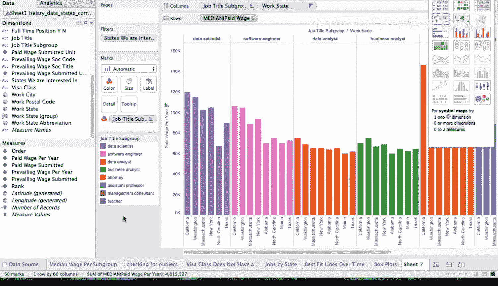

#  105：提升筛选效率的计算方法 📊


在本节课中，我们将学习如何在 Tableau 中使用计算字段来创建行级计算，从而更高效地筛选数据。行级计算会为数据集的每一行生成一个独立的值，类似于在 Excel 中创建一个新列。


上一节我们介绍了计算窗格的基本用法，本节中我们来看看如何通过具体的行计算示例来优化筛选流程。

## 创建逻辑计算字段

我们首先创建一个计算字段，作为上周操作的一种替代方案。上周，我们通过将“州”变量拖到筛选器卡片上，并逐一勾选我们感兴趣的州来筛选数据。一种更快捷的方法是创建一个计算字段，当数据行中的州属于我们感兴趣的组时，该字段返回“真”或类似的逻辑值，否则返回“假”。

以下是创建该计算字段的几种方法。

### 方法一：使用 IF 语句

我们可以使用一系列 IF-THEN 语句来构建逻辑判断。基本格式如下：

```tableau
IF [Work State] = "California" THEN "View"
ELSE "Don't View"
END
```

**注意**：如果字符串本身包含单引号，为了避免 Tableau 解析错误，需要使用双引号将整个字符串括起来。例如，`"Don't View"`。

如果我们对10个感兴趣的州都进行判断，可以添加多个 `ELSEIF` 语句。另一种更简洁的写法是在条件中使用 `OR` 语句。

以下是使用 `OR` 语句的完整示例：

```tableau
IF [Work State] = "California" OR
   [Work State] = "Washington" OR
   ... (其他8个州) ...
THEN "View"
ELSE "Don't View"
END
```

### 方法二：使用 CASE 语句

除了 IF 语句，我们还可以使用 CASE 语句来实现相同的逻辑。CASE 语句的格式略有不同，它不使用等号。

以下是 CASE 语句的示例：

```tableau
CASE [Work State]
    WHEN "California" THEN "View"
    WHEN "Washington" THEN "View"
    ... (其他8个州) ...
END
```

**关键点**：CASE 语句是一个逻辑函数，而非聚合函数。无论使用 IF 还是 CASE，都必须以 `END` 关键字结束。

让我们保存这个计算字段，并将其命名为“States We Are Interested”。保存后，你会在维度窗格中看到这个新字段，旁边有一个等号图标，表明它是一个计算字段。

## 应用计算字段进行筛选

现在，我们可以使用这个新建的计算字段来复现上周制作的条形图。

首先，创建一个新的工作表。由于是新工作表，一些工资变量（如“Paid Wage Submitted”）可能又变回了维度，我们需要将它们重新设置为度量，并将默认聚合方式改为“中位数”。

以下是操作步骤：
1.  将“Paid Wage Per Year”拖到行功能区。
2.  将我们创建的计算字段“States We Are Interested”拖到筛选器卡片上，并只勾选“View”。
3.  将“Work State”拖到列功能区。
4.  将“Job Title Subgroup”拖到颜色标记卡上。

这样，我们就得到了与上周类似的图表，但这次筛选步骤更加高效，只需在计算字段筛选器上点击一次“View”，而无需逐个勾选十个州。

## 总结与展望 🎯



本节课中我们一起学习了如何利用 Tableau 的计算字段创建行级逻辑计算，从而简化数据筛选过程。我们掌握了使用 **IF 语句** 和 **CASE 语句** 两种方法来构建判断逻辑，并将生成的计算字段应用于视图筛选，显著提升了工作效率。

在下一个视频中，我们将继续运用计算功能，来分析和解答更多关于数据相关职位薪资的新问题。