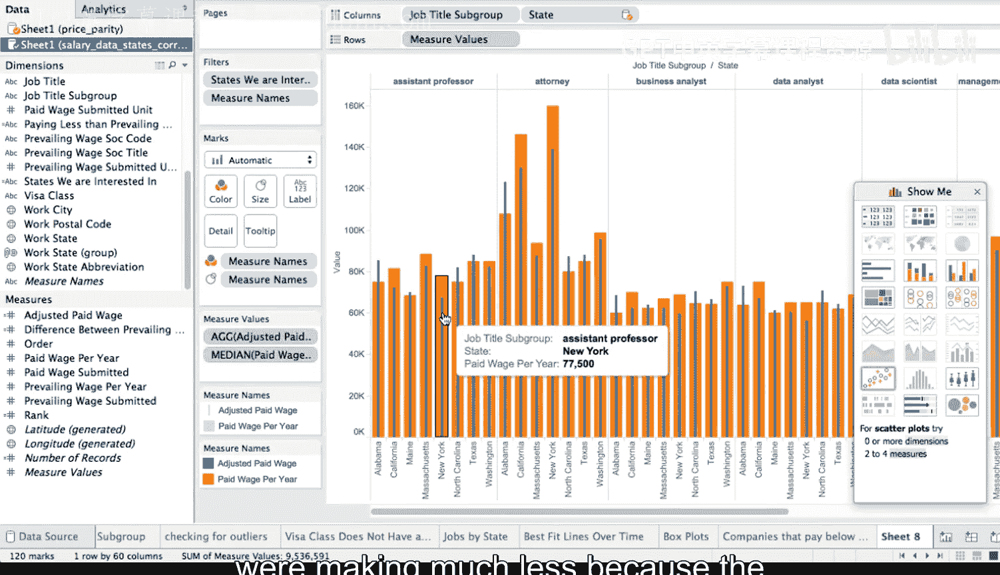

#  108：根据生活成本调整数据相关薪资


## 概述
在本节课程中，我们将学习如何将薪资数据与生活成本平价数据相结合，并计算一个调整后的薪资值。这个计算能帮助我们确定，在考虑了不同地区的生活成本后，哪些州为数据相关岗位提供的实际薪资最高。

## 数据准备与导入
上一节我们介绍了薪资数据的处理，本节中我们来看看如何引入生活成本数据并进行合并。

首先，你需要从课程网站下载生活成本平价数据集。请确保将其保存到你能找到的位置。

以下是操作步骤：
1.  打开 Tableau。
2.  点击左侧的“数据”窗格。
3.  在顶部菜单栏选择“添加新数据源”。
4.  选择“Excel”选项。
5.  导航到你保存生活成本平价数据文件的位置，点击“打开”。

导入完成后，你可以在工作表区域看到新增的“price parity”工作表。原始薪资数据集旁会有一个蓝色的勾选标记，表示它是当前活动数据源。

## 关联两个数据集
为了将薪资数据与生活成本数据结合起来，我们需要在 Tableau 中建立数据关联。

以下是建立关联的步骤：
1.  在顶部菜单栏，点击“数据”，然后选择“编辑关系”。
2.  在弹出的窗口中，Tableau 通常会将第一个加载的数据集设为默认主数据源。但在实际分析中，主次数据源的角色可能会根据你在工作区中首先使用的变量而动态变化。
3.  为了演示，我们将较小的数据集（生活成本数据）设为主数据源，较大的数据集（薪资数据）设为次要数据源。因此，主数据源选择“price parity”，次要数据源选择“salary data sets corrected”。
4.  起初，两个数据源的“州”字段旁可能没有链接标记。这是因为两个数据集中州字段的列名略有不同（例如“Work state”和“state”），Tableau 的自动匹配未能成功。
5.  返回“编辑关系”窗口，将匹配选项从“自动”改为“自定义”。
6.  点击“添加”，然后在弹出的对话框中，将薪资数据中的“Work state”字段与生活成本数据中的“state”字段进行关联。
7.  点击“确定”完成设置。

现在，生活成本工作表上的“state”变量旁会出现一个带横线的链接图标。点击这个图标激活数据混合，此时“price parity”工作表旁会出现一个橙色的勾选标记，表示它现在作为次要数据源与工作区中的主要数据（薪资数据）进行了混合关联。

## 创建调整后薪资计算字段
现在两个数据集已经关联，我们可以创建一个计算字段，用于根据生活成本调整年薪中位数。

以下是创建计算字段的步骤：
1.  右键单击“数据”窗格中的空白处，选择“创建计算字段”。
2.  将新字段命名为“Adjusted Paid Wage”。
3.  在公式编辑区输入以下计算逻辑：
    ```
    ([Paid Wage per Year] / [Price Parity]) * 100
    ```
4.  输入公式后，你可能会看到错误提示。这是因为“Paid Wage per Year”和“Price Parity”的聚合级别可能不匹配。生活成本数据（Price Parity）是以州为单位的，没有更细的粒度。
5.  为了解决这个问题，我们需要确保两个字段的聚合级别一致。将“Price Parity”的聚合方式从“总和(SUM)”改为“属性(ATTR)”。同时，将“Paid Wage per Year”的聚合方式设置为“中位数(MEDIAN)”。
6.  修改后的有效公式应类似于：
    ```
    (MEDIAN([Paid Wage per Year]) / ATTR([Price Parity])) * 100
    ```
7.  点击“确定”保存计算字段。现在，在“salary data corrected”数据源下，你可以看到新创建的“Adjusted Paid Wage”字段。

## 验证与可视化分析
在深入分析前，我们先验证一下计算是否正确。

为了提升数据混合的运算速度，我们可以先使用之前创建的筛选器，只关注我们感兴趣的10个州。

以下是构建验证表格的步骤：
1.  将之前创建的州筛选器应用到当前工作表。
2.  将“Work state”（或来自price parity的“state”）拖放到“列”功能区。
3.  将“Median Paid Wage per Year”、“Price Parity”和“Adjusted Paid Wage”三个字段依次拖放到“标记”卡片的“文本”属性中。
4.  现在，你得到了一个包含原始薪资、生活成本指数和调整后薪资的数据表格。

你可以使用计算器手动验证一行数据。例如，用某个州的年薪中位数除以该州的生活成本指数，再乘以100，结果应与表格中“Adjusted Paid Wage”列的数字一致。这证实了我们的计算是正确的。

## 对比分析调整前后薪资
确认计算无误后，我们可以进行可视化，更直观地对比调整前后的薪资差异。

以下是创建对比视图的步骤：
1.  将“Median Paid Wage per Year”拖放到“行”功能区。
2.  将“Job Title Subgroup”拖放到“列”功能区，放在“State”前面。
3.  将“Adjusted Paid Wage”字段拖放到“行”功能区，紧挨着“Median Paid Wage per Year”。现在你可以看到两列并排的条形图，分别代表原始薪资和调整后薪资。
4.  为了更直接地对比，我们可以使用一个技巧：将“Adjusted Paid Wage”拖放到“Median Paid Wage per Year”的坐标轴上，实现重叠。
5.  将“度量名称”拖放到“标记”卡片的“大小”和“颜色”上（按住Shift或Ctrl键可同时拖放）。
6.  现在，图表中较粗的条形代表调整后薪资，它叠加在表示原始薪资的条形上。



通过这个视图，你可以清晰地看到差异。例如，在阿拉巴马州，调整后的薪资可能高于原始薪资，这意味着考虑到较低的生活成本，该薪资的实际购买力更强。而在加利福尼亚州、马萨诸塞州或纽约州，调整后的薪资则显著低于原始薪资，反映出这些州高昂的生活成本极大地削弱了薪资的实际价值。

## 总结
本节课中，我们一起学习了如何在 Tableau 中混合不同的数据源。我们通过关联薪资数据和生活成本数据，创建了一个计算字段来根据生活成本调整薪资。最后，我们通过可视化对比，直观地看到了生活成本如何影响不同地区数据相关岗位薪资的实际购买力。这为做出更明智的职业或居住地决策提供了关键洞察。在接下来的课程中，我们将利用表计算，进一步分析在全国范围内，对于特定数据岗位，哪些州在考虑生活成本后能提供最高的实际薪资。