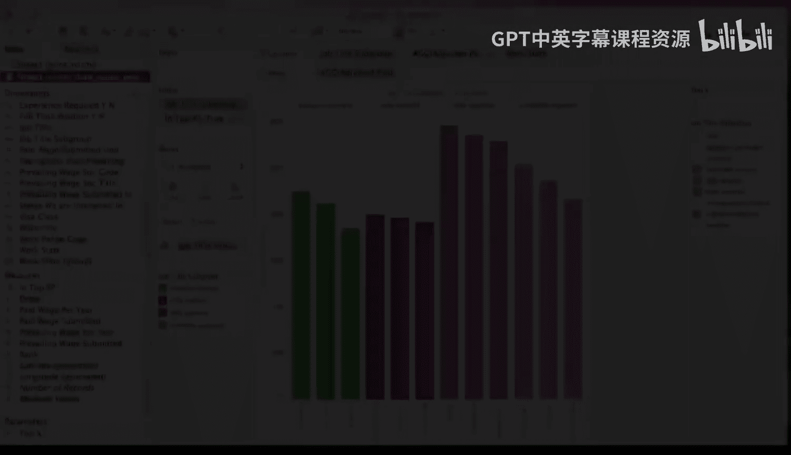
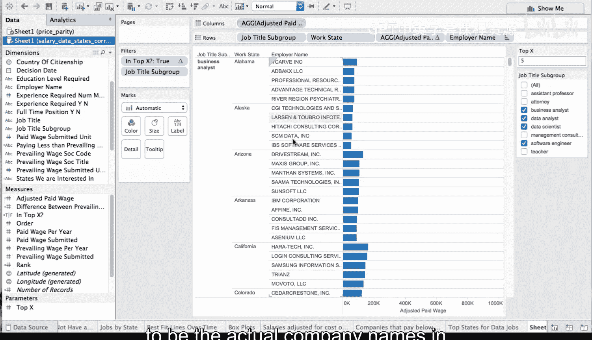

#  111：创建交互式仪表板 📊

在本节课中，我们将学习如何创建 Tableau 仪表板。仪表板是商业智能和商业分析的关键组成部分，它允许我们将多个视图整合到一个界面中，并实现视图间的交互。我们将创建一个用于求职分析的仪表板，帮助你识别在特定数据相关职位中，哪些公司提供了最高的调整后薪资。

---

## 仪表板的核心作用

上一节我们介绍了如何制作单个图表，本节中我们来看看如何将多个图表整合到一个仪表板中。

仪表板通常用于满足公司内部对特定格式信息的需求。在这种情况下，你的任务是精确地按照客户要求的方式提供他们所需的信息。掌握让 Tableau 精确执行操作并按需格式化的技巧，是一项非常重要的技能。

然而，在本课程中，我们更侧重于帮助你作为数据分析师做出决策，并为企业决策做出贡献。因此，我们将为仪表板赋予一个不同的用途。在本课程中，仪表板的作用虽然更有限，但依然重要，主要是因为它是 Tableau 中唯一可以让你在一个地方同时查看多个图表的地方。

仪表板对数据分析有用的另一个原因是，在 Tableau 中，你可以使用一个图表的结果来筛选另一个图表的结果。这有助于你在解读数据时发现其中的细微差别。

如果你在一个数据分析团队中工作，仪表板也会很有用。与工作表相比，仪表板允许你添加更多的注释和文本框。因此，如果你想向团队更新你的工作进展，这是一个将所有内容集中放置、添加备注的好方法，有助于让每个人了解最新情况并达成共识。

---

## 构建求职分析仪表板

在我们的课程中，我们将为一个非常具体的目的使用仪表板。我们开始这项数据分析是为了帮助你确定，如果你想申请数据相关职位，应该申请哪些公司。

为此，我们将制作一个仪表板。仪表板的顶部将放置我们在上一课中制作的图表，该图表显示了在特定职位子类别中，调整后薪资中位数最高的州。仪表板的底部将显示，在该子类别和每个州中，哪些公司提供了最高的薪资中位数。这将帮助你精确地确定想要申请的公司。

为了实现这个目标，我们首先需要制作最后一个尚未完成的图表，用于显示哪些公司提供了最高的调整后薪资。

---

## 创建“高薪公司”图表

现在，让我们开始制作这个图表。

1.  打开你的 Tableau 工作簿，并新建一个空白工作表。
2.  我们将进行与上次非常相似的操作，但需要添加一个名为“雇主名称”的新字段。
3.  将“调整后薪资”拖放到“行”功能区。
4.  将“职位标题子组”拖放到“列”功能区。
5.  为了简化操作，在放置“工作州”之前，先将我们感兴趣的州放入筛选器。
6.  现在，将“工作州”拖放到“列”功能区，放在“职位标题子组”的右侧。
7.  这次，我们将添加“雇主名称”字段。
8.  如果我们尝试排序，会发现它似乎不是在一个州内的特定职位子组内排序，而是以某种方式在整个表格中排序。我们知道如何解决这个问题：使用计算字段。
9.  将“调整后薪资”拖放到“标记”卡片的“详细信息”中。
10. 创建一个表计算：选择“排名”，然后选择“沿表向下运行”。
11. 跳过其他选项，直接进入“高级”设置。
12. 将“雇主名称”移动到“寻址”侧，让“职位标题子组”和“工作州”保持在此处。“自动”设置即可，然后点击“确定”。
13. 再次使用降序排列，点击“确定”。
14. 将这个排名计算转换为离散变量，并将其放置在“工作州”和“雇主名称”之间，因为它专门用于对“雇主名称”进行排序。
15. 处理完成后，你会看到排名现在按顺序显示，并且每个州都重新开始排名，这正是我们想要的。

接下来，我们需要像上次一样，使用参数计算来筛选出排名靠前的公司。

1.  查看我们之前创建的“前 X 名”参数。你可以去编辑它，当前值可能是 3，我们将其改为 5。
2.  回顾我们的“是否在前 X 名内”计算。该计算将给出调整后薪资的排名（我们仍在使用降序），并判断其是否小于或等于我们的参数值。这个计算仍然适用。
3.  将这个计算字段拖放到“标记”卡片的“详细信息”中。
4.  处理完成后，编辑这个计算，确保将其计算方式从“跨表”改为进入“高级”设置，并指定“雇主名称”为排序依据。
5.  在高级设置中，“职位标题子组”和“工作州”保持在此处，将“雇主名称”移动到“寻址”侧，这是我们排序的依据。点击“确定”。
6.  然后，将这个计算字段拖入筛选器，并选择“真”。
7.  现在，我们应该只看到在每个特定职位标题子组中，薪资排名前 5 的雇主。
8.  将“职位标题子组”放入筛选器，以便我们只查看数据相关职位。
9.  确保我们控制了参数和筛选器。将“感兴趣的州”筛选器移除，以便查看所有州的数据。

最后，进行一些格式调整，使图表更美观易读。

1.  再次去掉这个标题。
2.  去掉网格线。
3.  由于有较长的文本需要阅读，让我们改变图表的朝向，以便更容易阅读每个州、每个职位子组中的具体公司名称。

---

## 总结

本节课中，我们一起学习了 Tableau 仪表板的核心概念和创建方法。我们了解到，仪表板可以将多个相关视图整合，并实现交互筛选，这对于数据探索和团队协作非常有用。我们逐步创建了一个用于分析各州、各数据职位中高薪公司的图表，并为其设置了排名和筛选逻辑，为下一节构建完整的交互式仪表板做好了准备。

接下来，请观看下一个视频，学习如何将我们创建的所有视图组合成一个功能完整的仪表板。😊