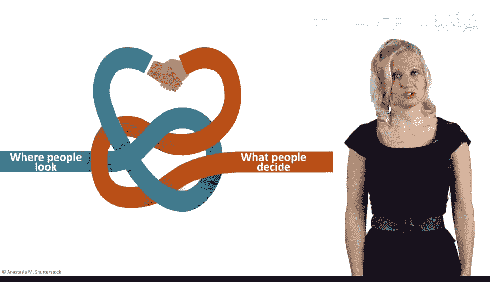
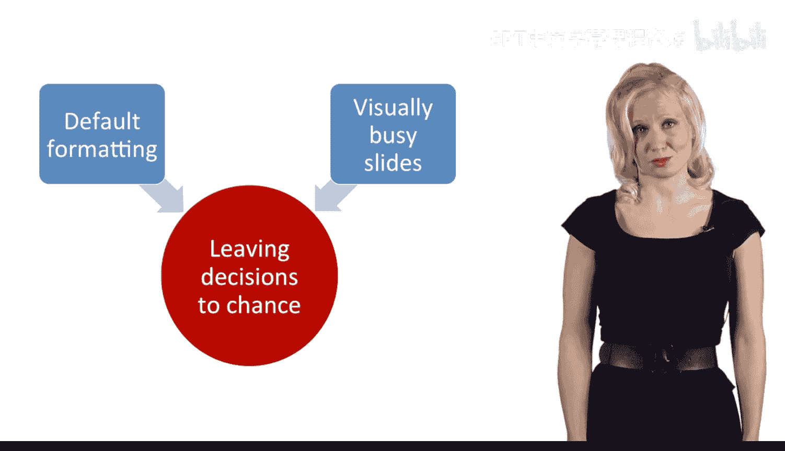

#  114：运用可视化科学影响商业决策

在本节课中，我们将探讨可视化科学如何与决策科学相结合，从而影响商业决策。我们将学习如何通过引导观众的视觉注意力，来增强数据演示的说服力。

---

计算机协会是世界上最大的科学和教育计算学会。该学会在1959年首次开始出版笔记和通讯时，其编辑委员会将以下原因作为创办该出版物的理由之一：如果计算机编程要成为计算机研究和开发的重要组成部分，那么编程必须从一门艺术转变为一门有纪律的科学。

正如20世纪50年代末标志着计算机科学的开端一样，我认为今天我们也处在一个类似的起点，这个领域最终将被称为可视化科学。关于我们如何与可视化互动并从中学习，已经进行了大量研究，我们现在已经达到一个阶段，可以将其中一些知识视为事实。

这就是为什么Tableau可以理直气壮地声称他们已经自动化了可视化的最佳实践。正如我们在过去两周所学到的，Tableau在这些实践方面确实非常出色。

然而，本周我们将讨论一个来自可视化科学与决策科学交叉领域的见解，这个见解尚未完全实现自动化。这个见解就是：人们看哪里与他们决定什么紧密相连。简单来说，你将要做出的决定会影响你看哪里，而你看哪里也会影响你的决定。

现在有越来越多的科学文献表明，在一个复杂的视觉场景中你看哪里，甚至阅读文本时你看哪里，不仅会影响诸如你购买什么这样的实际事情，还会影响更抽象的判断，比如你认为什么是道德上错误的。

虽然每一次商业演示都会不同，你无法保证注视与决策之间的关系在每种情况下都相同，但这对于我们进行商业演示意味着：如果我们想影响人们对我们所展示内容的决策，我们就应该影响他们看哪里。

实现这一目标的最佳方法之一是引导他们的视觉注意力。事实上，注意力和视线注视这两个概念经常互换使用。我们不仅想让观众保持兴趣，实际上还想在物理上引导他们的眼睛，让他们看着我们打算用来影响他们决策的事物。

本周，我们将介绍一些技巧，告诉你如何调整图表以将人们的视线吸引到你希望他们看的地方。我希望你能从接下来的系列视频和练习中，至少带走两个总体性的、可操作的见解。

第一个见解是：如果你只是使用图表的默认格式，或者你的演示文稿充满了视觉上杂乱无章的幻灯片，那么你将放弃引导观众注意力和视线的能力。因此，你基本上会将观众对你所展示内容的决策过程留给偶然性。在你为精彩的分析项目付出所有努力之后，这将是多么巨大的遗憾。

第二个见解是：视觉对比是吸引人们注视数据相关图像的最佳方法之一，因此它也是你影响人们决策的最佳工具之一。

在我们能够制作数据相关图像之前，首先需要弄清楚数据讲述了什么故事，这就是我们本周要开始的内容。在确定了一个引人注目、逻辑严谨的数据故事之后，我们将讨论如何选择最佳的数据可视化来说服人们相信这个故事。

随后，我们将介绍一系列工具和概念，你可以用来优化你的可视化和演示风格。最终，你将成为运用可视化来让人们同意你基于数据的商业建议的大师。

---

本节课中，我们一起学习了可视化科学如何与决策过程交织。我们了解到，引导视觉注意力是影响决策的关键，而放弃这种引导意味着将决策权交给偶然。通过掌握利用视觉对比等工具，我们可以有效地将观众的视线引向关键数据点，从而更有力地支持我们的数据驱动型商业建议。