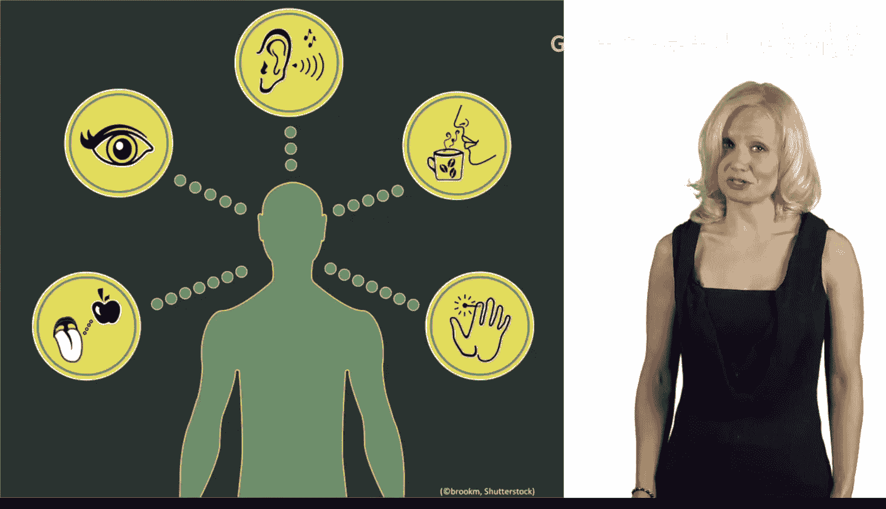
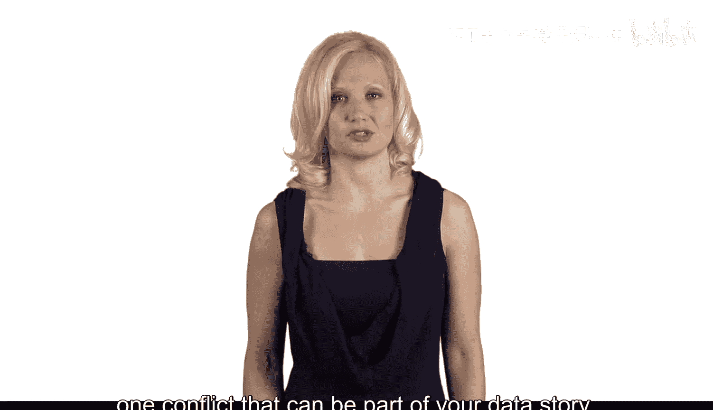

#  116：让数据故事生动呈现

在本节课中，我们将学习如何运用故事元素，让听众对你将要解决的商业问题产生情感共鸣，从而使你的数据分析和建议更具说服力。

## 概述：为何需要故事元素

在商业演示中，数据和分析是核心，但故事是连接数据与听众情感的桥梁。故事元素能帮助你将一个抽象的商业问题，转化为听众能够感知和关心的具体情境。通常，这些元素用于演示的开头和结尾，但也可以在演示过程中穿插使用，以保持听众的投入。

## 你的故事背景与动力

在探讨具体的故事元素之前，让我们先回顾一下你学习本课程的初衷。你学习使用Tableau和数据可视化，是为了解决商业问题。这是一项了不起的技能。在进行长时间的数据分析后，当你准备演示时，请回想那份自豪感。你之所以承担这个数据分析项目，是因为你要向听众展示如何解决一个影响公司、进而影响他们生活的问题。这是一件非常酷的事情。因此，在演示的开场和结尾，请带着这份自豪与热情。

## 如何激发情感

那么，如何具体地激发情感呢？无论是调动自己的情绪还是听众的情绪，最佳方式都是通过感官体验，尤其是视觉、听觉和身体感受。这正是故事的作用——创造体验，哪怕只有几秒钟。

## 核心故事元素

以下是构成故事的关键元素，对我们的目的最有用的是：**角色**、**地点/场景**、**冲突**和**解决方案**。

在商业演示中融入越多的这些元素，你的演示就越像一个故事，也越能激发听众的情感共鸣。

### 角色与场景

在数据分析的语境下思考角色或场景，起初可能显得奇怪。但请记住，你的整个项目背景都基于一个事实：企业中至少有一人（通常是多人）遇到了一个足以影响他们、并愿意付费解决的问题。

因此，在项目开始前，你就已经知道至少一个可以成为你数据故事一部分的角色和一个冲突。通常，与你的故事相关的角色和冲突有很多，包括你自己。

### 角色的运用

故事可以聚焦于个体角色或群体角色。有时，你甚至可以将一个非人的事物（如一家制造工厂或一个损坏的数据集）作为主角。

一个有效吸引听众的方法是，描述与你的问题相关的某个角色的经历或某个地点的情景，使用能让听众在脑海中真实描绘出人物或地点的细节。

另一个特别有力的方法是讲述你自己的亲身经历。

让我给你举个例子，听起来可能是这样的：

> 想象你在一家生产新型无线手机充电器的公司工作。你的任务是建议公司明年应如何分配营销预算。你的数据分析表明，公司应在每种营销渠道内，针对特定的年龄群体进行营销。如果这样做，他们的投资回报率将显著提高。
>
> 那么，你可以这样开始你的演示：
>
> “我想和大家分享一下我上周末在父母家吃晚餐的经历。晚餐很美味，我爸爸做了他拿手的炖肉，连我的孩子们都喜欢。然而，晚餐后，一切都急转直下。我竭尽全力想让家人共度一段美好时光。我问了体育赛事，问了我父母他们小时候的事，我拿出了棋盘游戏。和往常一样，什么都没用。最后，在绝望中，我喊道：‘你们为什么连假装想在一起待会儿都不愿意？’
>
> 我女儿从沙发上抬起头——她当然正全神贯注于她的iPhone——说：‘妈妈，不是我们不想在一起，我们只是在放松。我想看看Facebook上大家都在干什么。’然后，我妈妈从正在阅读的周报上移开视线，说：‘亲爱的，路边的杂货店这周有促销，想看看吗？’
>
> 起初，我因恼怒而目瞪口呆。但随后我突然意识到，他们说得有道理。
>
> 在接下来的20分钟里，我将向你们展示，我们的营销活动如何能从我在家庭晚餐中学到的同一课中受益。正如我开始通过社交媒体与22岁的女儿在她的手机上互动，以及通过周报剪报与76岁的母亲互动后，我对周末晚餐的‘投资回报’大大改善一样，当我们开始通过不同年龄客户最喜欢互动的环境和实物与他们互动时，我们的营销投资回报也将得到改善。”

然后，你可以引出你的明智建议和议程。在这个开场白中，我利用个人经历引入了角色和地点，描述了冲突并提供了解决方案。这个简短但完整的故事给出了方向感和满足感。我希望我的听众感觉到，如果他们在我们的数据故事中沿着类似的方向前进，就像我在个人故事中那样，他们最终会获得类似的满足感。这种“动感”将激励听众听完我要讲述的全部内容。

## 其他情感钩子

如果你不习惯使用个人经历来激发情感，或者没有足够时间讲述一个完整的故事，还有其他方法可以作为情感钩子。

*   **使用图像**：你可以展示一张图片，比如一个青少年和一位祖母坐在沙发上，青少年沉迷于手机，而祖母则开心地剪着优惠券。然后你可以这样开场：“这张图片说明了我们都知道的一件事：不同年龄的人喜欢做的事情非常不同。在接下来的20分钟里，我将展示如何将这一概念融入我们的营销策略，使我们的投资回报率提高12%。”
*   **使用实物、引语或惊人事实**：对于其他类型的商业问题，你可以带一件导致公司工厂出现问题的故障设备；可以大声朗读一封真实的客户服务请求，以例证你的建议试图解决的问题；或者以一个戏剧性的统计数据开场。
*   **发起对话**：另一种吸引听众的方式是发起实际的对话。你可以通过提问来开始演示。例如：“如果你的父母或任何你认识的75岁以上的人，可以选择阅读一封实体邮件或在手机上阅读博客，你认为他们中有多少人会选择在手机上阅读博客？”然后接着问：“那么，你们的孩子或25岁以下的家人中，你认为有多少人会选择手机上网选项？”由于回应第二个问题举手的人会更多，你可以接着说调查统计数据与刚才的小投票结果一致，而你将利用这些信息来改进营销策略。

无论你使用哪种故事元素或策略，试着找到真正能激励你自己的东西，因为如果你被打动了，你的听众也会被打动。请记住，在演示开始时，你只有大约30到60秒的时间来吸引听众。所以，无论你决定用什么来吸引他们，都必须相对快速。

## 更多实用技巧

在结束之前，这里还有几个在演示中使用故事元素、段落或小插曲来吸引听众的技巧。

*   **从中间开始**：与其从故事的最开始讲起，不如从中间开始，让角色已经处于行动之中。这可以创造一种动感和对接下来发展的期待，有时是引出你商业建议的有效方式。
*   **描述角色并赋予质感**：尽可能描述你的角色，给他们增添细节。例如：“乔伊斯是我们来自俄亥俄州阿克伦的忠诚维生素客户。她42岁，会说法语，她的朋友们都说羡慕她永久的精力和乐观的生活态度。”保持描述简短，但使用具体细节，它们能增加可信度并提升信念感。
*   **使用积极信息的故事**：尽可能使用传递积极信息的故事，而非消极信息的故事。如果一个开场故事片段成功地引发了负面情绪，如恐惧或厌恶，这些负面感受可能会持续。心理学实验表明，你的听众可能会将这些残留的负面感受误解为对你逻辑论证的不赞同，而不仅仅是开场故事留下的余味。
*   **高质量使用图片**：使用非常高质量的图片，并尽量使其全屏显示。此外，使用那些人物直视着你、或者能给观众一种身临其境视角的图片。高分辨率、直视他人面部以及戏剧性的几何透视，在激发情感和让你所说的内容感觉真实方面非常有效。

## 总结

本节课中，我们一起学习了如何让数据故事生动呈现。虽然没有一个公式能保证某个故事元素、段落或机制能在每位听众身上引发你想要的确切情绪，但本视频所讲的内容是一些很好的指导原则。

每当你不知如何传达数据故事的重要性时，请认真思考是什么动力支撑你完成了所有分析。想想是什么让你兴奋，是什么让你担忧，困难是什么。想想所有受你所解决问题影响的相关方，由于那个问题他们的生活是怎样的，以及现在他们的生活将如何变得更容易。

一旦你开始感觉到心率变化，或者脑海中开始浮现生动的画面，你就会知道该用什么情感背景来开场和结束你的演示了。