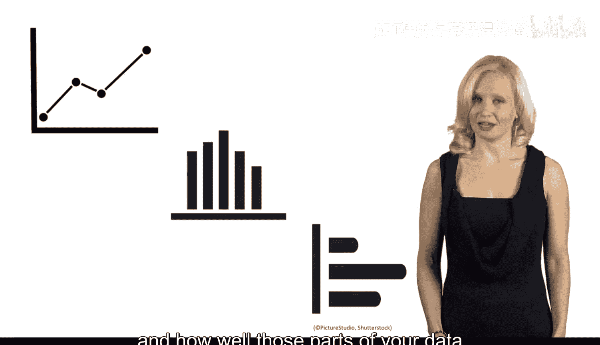

#  123：为故事点选择可视化图表 📊

在本节课中，我们将学习如何为商业演示选择最合适的图表类型，以清晰、有效地传达数据分析的成果。我们将重点讨论柱状图、折线图和饼图的适用场景，并了解应避免使用的图表类型。

在之前的视频中，我们学习了如何为演示构建故事板并对逻辑论证进行压力测试。现在，是时候制作那些至关重要的演示幻灯片了。在数据项目的这个阶段，你必须决定使用何种可视化图表来传达你所有辛勤工作的价值。

我知道你们中有些人见过像这样的精美图表。或者这样的。这些图表确实引人入胜。你可能非常渴望使用它们。我同意这些可视化图表既美观又有趣。然而，它们通常更适合印刷形式，供人仔细研究和探索，而不太适合用于幻灯片演示。因为它们非常复杂，信息量过大，难以快速处理。

你可能会惊讶于我这么说。但在进行商业演示时，柱状图或折线图几乎总是传达分析结果的好方法，甚至可能是最佳方法。即使在你运行非常复杂的统计模型时，这一点也成立，甚至更为重要。

我建议将柱状图和折线图作为你的默认选择，只有在你有更多时间深入研究可视化科学的细节，或者将可视化用于其他目的（如信息图或杂志文章）时，才考虑其他类型。我知道这对你们中的一些人来说可能有些失望。但请记住，在这类商业场景中，数据可视化的首要目的是传达数据中最关键的部分——那些你花费数月甚至数年时间处理的宝贵数据——以及这些数据如何有力地支持你的建议。

让演示保持有趣的部分，应该通过故事元素来激发听众兴趣、通过你讲述的实际内容以及非数据幻灯片的格式来实现。不要在图表类型上过于追求创意。听众需要花费越多精力去理解你的图表，他们能用于关注你展示的实际内容的精力就越少，他们也越可能将注意力集中在图表的格式上，而不是你希望他们关注的内容上。我们知道，当你这样做时，你就失去了影响他们决策过程的杠杆。因此，请坚持使用柱状图和折线图。

在接下来的几个视频中，我们将讨论一些概念，让你了解使用其他类型的图表为何存在风险，以及在数据分析项目尾声、成败攸关之际，这可能不是你愿意承担的风险。在本课程结束前，我们将再次回到这个视频，整合我们所学的一切，看看如何将使用柱状图和折线图作为默认选择付诸实践。

同时，让我们确保大家对为何以及何时应使用柱状图而非折线图有共同的理解。我还将简要讨论饼图，并告诉你一些绝对不应该使用的图表。

以下是主要图表类型及其适用场景的说明：

**柱状图** 应用于比较不同组别或类别的度量值，例如不同职位子类别的薪资。柱状图适用于大多数你想展示聚合数据而非原始数据的情况。我认为，在面向非技术背景普通听众的商业演示中，你几乎总是应该展示聚合数据。

**折线图** 最适合观察数值和类别如何随时间变化，例如我们之前研究数据相关薪资的子类别是否随时间变化时。你也可以使用折线图来展示数值随另一种变量的变化，但请确保该变量具有有序的、连续的、且间距相等的结构，例如按1万美元分组的收入、受教育年限或按1000本递增的图书销量。

折线图的一个危险在于，我们的眼睛会自然地跟随图表中的线条，并将其解读为线上的点之间存在某种直接的顺序关系。因此，当这些点没有明显的顺序关系时，我们需要更长的时间来理解图表所展示的内容，并且实际上很有可能误解图表试图表达的观点。

例如，如果我们用折线图表示这些信息，最自然的解读会是我们应该理解存在某种地理效应，因为城市位于X轴上。但随后我们会困惑为什么国家的各个地区是这样排列的。顺序看起来是任意的，我们的注意力会被引向试图弄清楚这一点，而不是关注一月和二月之间的差异，甚至是国家不同地区之间的差异。

所以现在，想象一下你将图表格式化为这样的柱状图。使用这个图表，你的眼睛会立即尝试比较不同的类别，而不是试图将类别联系在一起。

因此请记住，当X轴上的刻度没有特定的内在顺序时，应将折线图改为柱状图。

**饼图** 是第三种你偶尔可能在商业演示中受益的图表类型。但让我提醒你，可视化科学和数据科学界讨厌饼图。我的意思是，真的非常讨厌。在接下来的几个视频中，你将了解原因。与此同时，我想站出来，与可视化社区中最直言不讳的人士持不同意见。

我认为饼图在以下两种情况下可能有用：第一，你试图传达总计为100%的类别；第二，你打算突出显示不超过四个类别，最好不超过两个类别。人们主要担心的问题是，人眼无法察觉空间区域的微小差异。因此，饼图永远无法很好地传达具体或详细的信息，但我相信它们可以很好地传达一般模式，尤其是关于百分比的信息。稍后会有更多关于此的讨论。

**散点图** 是第四种你可以使用的图表类型，它显示两个变量之间的关系，特别是连续变量。散点图通常用于显示原始数据，尽管也可以像我们在上一个模块中绘制薪资随时间变化的最佳拟合线那样，用它们来显示聚合数据。

我喜欢散点图。它们是我分析数据时最喜欢的方式之一，因为我真的很喜欢同时看到我所有的数据。但我发现散点图对于非技术背景的听众来说过于混乱和令人不知所措。在与技术团队或有统计学背景的人讨论时可以使用它们。但我建议在面向非技术听众的商业演示中省略它们。相反，用像这样的视觉元素来总结散点图的解读，以传达关系，但不要展示其背后的原始数据。

另一种你应该在大多数商业演示中省略的图表是几乎任何类型的**3D图表**。想看看为什么吗？请告诉我此图表中条形A、C和E的值。现在告诉我此图表中条形A、C和E的值。信不信由你，这些图表表示的是相同的数据。3D图表严重扭曲了数据的表示，使其非常难以解读。

这是另一个例子。在此图表中，项目A占总体的百分比是与项目C相同、更大还是更小？现在再试一次。同样，这些图表绘制的是相同的数据，但3D饼图极大地扭曲了表示，以至于我们许多人会误解它。发生这种情况的部分原因是这些图表中的第三维没有任何意义。它只是为了让图表看起来更有视觉趣味。

如果你想让你图表看起来更精致，可以随意使用斜角或阴影效果，但不要添加另一个维度或使用那些预制的3D图表，除非你想误导你的听众。Tableau在大多数情况下甚至不允许你制作3D图表。

总而言之，在商业演示中你应该重点关注的三种主要图表是：用于比较类别的柱状图、用于展示随时间变化的折线图（有时也用于展示随另一个有序类别的变化），以及用于在突出显示四个或更少类别时传达百分比一般信息的饼图。

不要使用散点图，因为它们更适合技术型听众；也永远不要使用3D图表。

本节课中我们一起学习了如何为商业演示选择最合适的图表。我们明确了柱状图、折线图和饼图的核心适用场景，并了解了应避免使用散点图和3D图表的原因。记住，清晰、准确地传达数据洞察是商业演示中可视化的首要目标。