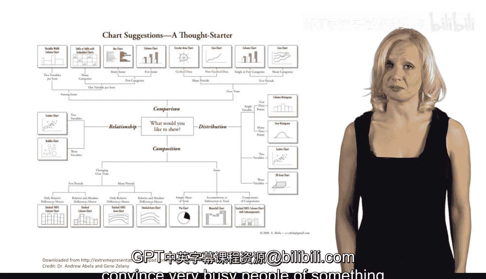

#  124：视觉感知神经科学决定可视化成败 👁️📊

在本节课中，我们将学习视觉感知神经科学如何决定数据可视化的成败。理解人眼如何“看见”和“感知”信息，是创建有效图表、影响受众决策的关键。

上一节我们介绍了不同类型的图表。本节中，我们来看看两个影响受众“所见”的强大现象：视觉感知与视觉注意。本视频将重点讨论视觉感知。

视觉感知指的是人们意识到自己看到了什么。为了说明这一点，请看这些浆果看起来成熟了吗？如果你是色盲，你可能会说不成熟。因为你感知或意识到的图像会是这样的。如果你不知道自己是色盲，你就不会知道自己错过了图片中的重要信息，因此也不会意识到自己可能基于此图做出错误的决策。

虽然我们大多数人不是色盲，但我们的视觉环境中存在一些特定的方面，在没有辅助的情况下，所有人都难以精确感知。如果我们没有意识到自己存在特定类型的“视觉盲区”，我们就不会知道何时可能因为所见之物而做出糟糕的决策。同样，如果我们在演示中使用的可视化图表依赖于大多数人相对“视而不见”的特征，那么这些图表将是无效的。

研究表明，人类在感知不同类型差异的精确度上存在明确的层级关系。以下是基于实际感知研究得出的列表，列出了生活中可能需要进行的视觉比较，并按我们感知每种差异的准确度排序。

此处的“准确度”指，当我们认为两幅图像的属性存在特定程度的差异时，判断正确的程度。

以下是人类视觉感知能力的层级列表，从最精确到最不精确：

1.  **位置**
2.  **长度**
3.  **角度/斜率**
4.  **面积**
5.  **体积**
6.  **颜色饱和度**
7.  **色调**

这个列表告诉我们，我们非常擅长感知位置和长度的相对差异。另一方面，我们对体积或颜色的差异则相当“盲目”。你可以自己尝试一下。

现在你已经了解了人类视觉感知事物的能力层级，我们可以回到为什么折线图和条形图如此有效，而其他类型图表效果不佳的问题上。

折线图和条形图依赖于**位置**和**长度**的比较，这是我们非常擅长且能精确感知的两种差异。而饼图和气泡图则依赖于**面积**和**体积**的比较，这是我们不太擅长精确比较的两样东西。当这些比较以3D形式呈现时，我们的判断能力会更差。

这意味着，我们很难从饼图、气泡图或任何类型的面积图中提取出非常详细的信息。我们只能感知非常大的差异，这些差异可以利用我们后续视频中将讨论的其他视觉技巧来加以利用。但由于这些差异需要非常大，因此它们不应被用来区分超过少数几个组别，理想情况是2个，最多4个，除非可视化的目的只是为了引起对某一个特定组的注意。颜色方面的情况也是如此。

因此，之前我建议坚持使用条形图和折线图，并非出于个人好恶。我们的眼睛和大脑确实不具备感知其他类型图表所依赖的许多差异的能力。因此，依赖这些其他类型的图表来传达你最关键的信息是非常冒险的。

既然你已经听到了我对此话题的强烈观点，我觉得有责任与你分享一个关于何时可以使用条形图和折线图之外图表的著名决策树。该资源的链接包含在课程材料中。但请自行承担使用风险。请记住，该资源建议的许多不同类型的图表可能更适合用于人们有时间仔细研究可视化内容的仪表盘、信息图或网站。对于商业演示来说，当你只有很短的时间去说服非常忙碌的人接受一个可能花费他们大量金钱的事情时，这些图表可能就不那么合适了。

本节课中，我们一起学习了视觉感知神经科学的基本原理。我们了解到，人类感知位置和长度差异的能力最强，而感知面积、体积和颜色差异的能力较弱。这解释了为何条形图和折线图在商业演示中通常更有效、更可靠。理解这些限制，能帮助我们在选择图表类型时做出更明智的决策，从而更有效地传达信息并影响受众。