#  127：通过幻灯片格式化传达数据故事 📊

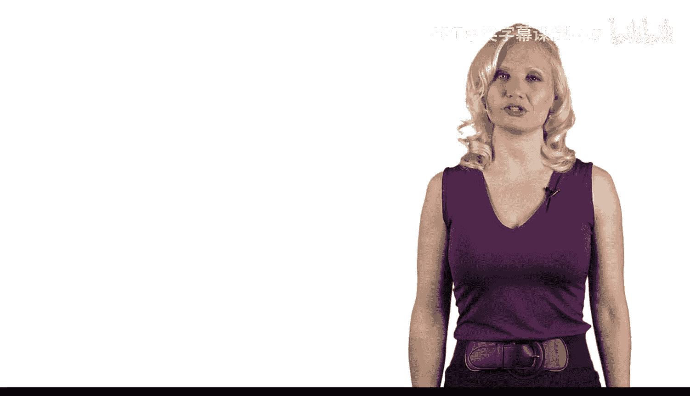

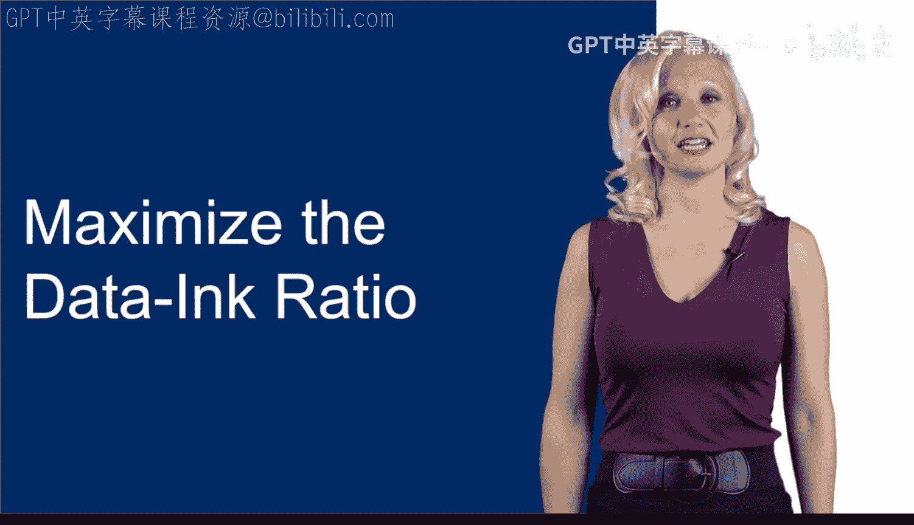

在本节课中，我们将学习如何有效地格式化数据图表并将其置于幻灯片上，以清晰、有力地传达数据故事。核心在于优化视觉呈现，让观众能毫不费力地理解你的核心信息。

---

## 最大化数据墨水比 📈

上一节我们讨论了数据图表的选择，本节中我们来看看如何优化图表本身的呈现。第一个核心概念是**最大化数据墨水比**。

这个术语由统计学家兼政治科学家爱德华·塔夫特提出，他是数据可视化领域的知名先驱。最大化数据墨水比，其基本含义是：**移除图表和幻灯片上所有没有明确、独特用途的元素**。

*   **数据墨水**：指图表中代表实际数据的墨迹（“图表”在此指你的数据可视化内容，如我们课程中视为等同的图表或图形），以及幻灯片上用于支持和增强数据可视化的其他内容。可以理解为，图像中任何被移除就会导致信息丢失的墨迹。
*   **非数据墨水**：指不代表数据本身，而是用于刻度、标签和边框的墨迹。基本上是图表上的其他所有东西。

因此，**使数据墨水比尽可能高，意味着让页面上尽可能多的墨迹代表数据，而非其他内容**。

让我们通过一个商业演示中可能看到的幻灯片例子，来看看如何做到这一点。

以下是提升数据墨水比的一些具体做法：

*   **移除网格线和多余的刻度标记**：在图表中，去掉不必要的网格线和次要刻度线。
*   **简化背景设计**：移除背景中任何不传达特定信息的华丽设计。
*   **精简文本**：如果公司允许，建议移除所有多余的文本，包括徽标、幻灯片页码以及那些用于指示演示进度的符号。
    *   我知道这对一些在商界工作已久的人来说可能听起来像大不敬。但请记住课程开始时提到的主题：**当前惯例不等于最佳实践**。这就是一个完美的例子。
    *   在传统的商业环境中，许多人认为让观众确切知道演示进度很重要。然而，我认为如果观众专注于这个，他们就不会如你所愿地专注于你试图呈现的数据或论点。
    *   话虽如此，期望很重要。如果公司里每个人都期望你有幻灯片页码等，那就加上。只是要知道，代价可能是你可能会在影响观众决策过程的力量上做出一些让步。
    *   记录一下，我认为在这个领域，值得尝试去影响公司的文化，让人们更乐于接受清晰、简洁的幻灯片所带来的改进沟通。
*   **善用空白**：在努力最大化数据墨水比时，不要害怕留白或空白区域。它能让你的数据图表更加突出，并确保观众的注意力集中在你希望他们关注的地方。
    *   观众要看的东西越多，他们的视线就越容易游移。这个概念非常重要，以至于视觉设计界将积极保护图形中的空白区域作为一种实践。我曾听一位设计师说：“没有空间，你就没有设计。你只有视觉噪音。”
    *   所以请放心，当你试图传达具体信息时，空间是好事。😊 人们抱怨空间太多的可能性，远低于抱怨空间太少。

---

## 实现一目了然的理解 👀

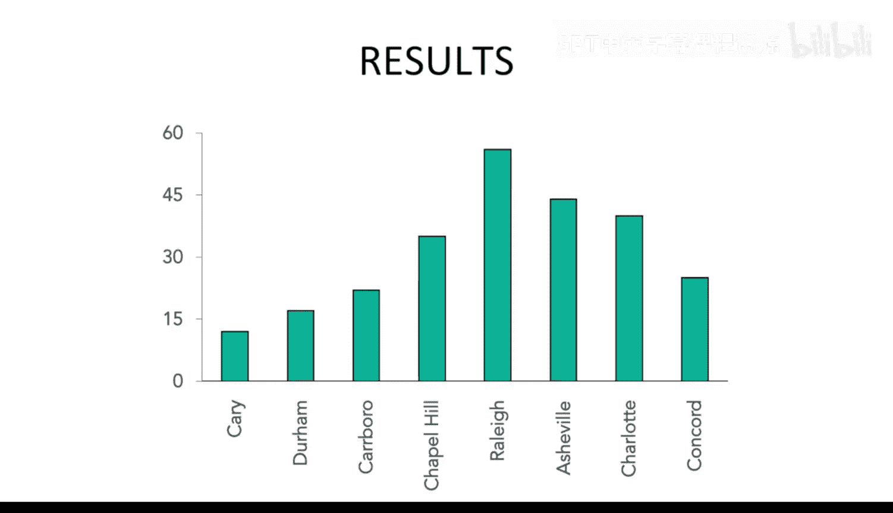

制作幻灯片时要关注的第二个概念，我称之为**实现一目了然的理解**。

你的目标应该是让观众**以最少的眼球移动和最少的阅读量**来理解你幻灯片的要点。让他们轻松理解你想要传达的内容。不要让他们做心算或花费大量精力去理解你的数据。

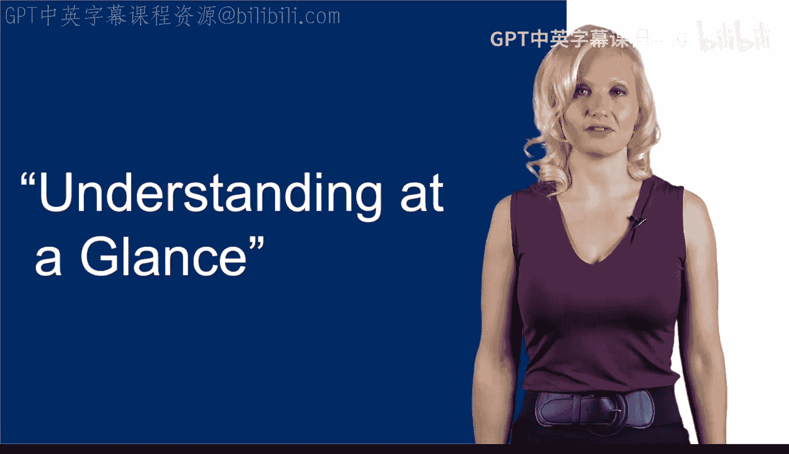

在这方面，最重要的问题之一是：**始终、始终、始终为图表中不明显的坐标轴添加标签**。这一点非常重要。如果你忘记标注坐标轴，没人会知道你的图表是关于什么的。

以下是实现“一目了然”的具体建议：

*   **使用完整词语和单位**：除非缩写极为常见（如用“K”代表“千”，或用“SEC”代表“秒”），否则使用完整词语，并包含单位。
    *   在我们的例子中，“本月销售箱数”是必须包含的标签，但“店铺位置”这个标签可能是可选的，取决于你在其他幻灯片中展示的内容，城市名称可能足以传达你关心的信息，而“店铺位置”的标签可能是多余的。
*   **直接在图表上标注**：尽可能在图表上直接标注，而不是使用图例。这样需要更少的眼球移动和工作量来理解，因为你不需要在数据和图例之间来回对照。
    *   额外的好处是，去掉图例会提高你可视化的数据墨水比。
*   **标签与背景色融合**：在包含这些标签时，类似于我之前关于饼图各块周围线条的建议，尝试使用幻灯片的背景色作为标签的颜色。注意，我在这里对标签和方框周围的线条都使用了背景色。这同样提高了图表的数据墨水比，并减少了可能将注意力从数据本身吸引走的额外颜色对比。
*   **优先使用水平标签**：水平标签比垂直标签更容易阅读。因此，尽可能为坐标轴以及数据标签使用水平方向。这可能意味着你必须翻转条形图的方向，使条形和标签平放。记住，在 Tableau 中有一个按钮可以为你做到这一点。

---

## 确保文本可读性 🔤

关于使幻灯片易于阅读的最后一组注意事项，与**必须保留在屏幕上的文本应使用何种字体**有关。

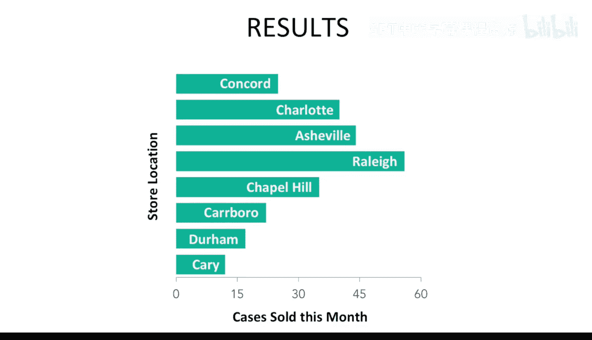

以下是关于字体选择的建议：

*   **衬线字体 vs. 无衬线字体**：
    *   **衬线字体**：指那些在字母边缘有小卷曲装饰的字体。最著名的是 Times New Roman，其他还有 Garamond 等。这些卷曲装饰使字体在近距离阅读时更容易，因为它们有助于引导视线沿着文本行移动，因此我推荐在任何书面材料或讲义中使用衬线字体。
    *   **无衬线字体**：指那些字母边缘没有那些小细节的字体。一些常见的无衬线字体有 Helvetica、Calibri 和 Arial。由于屏幕分辨率在演示中常常是个问题，尤其是当人们坐得离屏幕较远时，通常的做法是在演示文稿或任何你想发布在网上的内容中使用无衬线字体。
*   **确保字体足够大**：无论使用什么字体，都要确保文本能从房间后排看清。
    *   我发现这是 Tableau 自动化做得不太好的方面之一，可能是因为其默认设置更多是针对仪表盘而非演示文稿。
    *   如果文本不可读，它就毫无用处，所以**放大字体**。许多人建议使用的最小尺寸是 **30 磅**。一个更幽默的版本来自硅谷营销高管、知名创业书籍作者盖伊·川崎，他说：“一个好的经验法则是，将最年长投资者的年龄除以 2，然后使用那个字体大小。”
    *   在图表中，你可能不得不使用稍小的字体，但我会建议尽可能减少标签数量，而不是缩小字体。
    *   完成演示文稿后，将幻灯片置于“幻灯片浏览”模式并将其大小缩小到 **66%**。如果你在这个尺寸下无法清晰阅读，那么你的字体可能对后排观众来说太小了。作为一个通用经验法则，**如果你担心字体太小，那它肯定太小了**。
    *   顺便说一下，如果使用 30 磅字体意味着你的文本无法再放在一页上，那么一开始可能就不该在一张幻灯片上放那么多文本。
    *   遵循这个建议通常意味着你最终会去掉项目符号点。相反，每个项目符号点（如果你确实需要它的话）最终会出现在它自己的幻灯片上，并配有它自己的可视化，这无论如何都是我的建议。

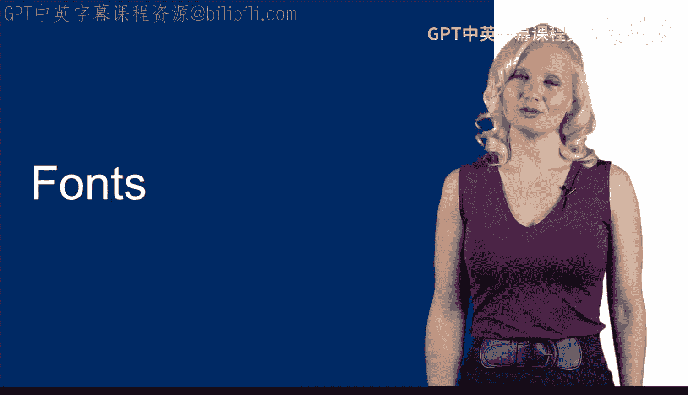

---

## 避免视觉心算与统一比例 📏

让我们再谈谈如何确保你的观众不需要做“视觉心算”。

正如我们在之前的视频中讨论过的，这意味着**不要使用让观众从由大小、角度或颜色编码的项目中推断具体数字或进行精确比较的图表**。

另一个重要点，与图表类型本身无关，是**确保所有坐标轴具有相似的比例**。

*   **统一坐标轴尺度**：尝试在整个演示文稿中对坐标轴使用相同的限制范围。
*   **处理双Y轴图表**：如果你被要求制作一个带有两个Y轴的图表（如此处所示），而这两个测量值具有完全不同的单位类型，无法轻易放在同一尺度上，那么要么将两个变量转换为一个共同的尺度（如百分比），以便它们可以简单地绘制在单个图表上；要么将测量值分成两个易于比较的独立图表。

---

## 巧用辅助线与有效标题 🎯

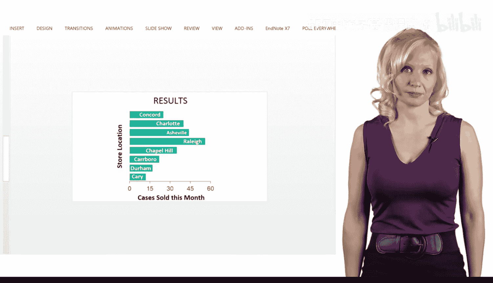

你可能以前没遇到过的是：**虽然你应该尽可能从图表中移除线条（尤其是黑线），但有时使用白色网格线可以使条形图上的条形高度或折线图上的点值更容易看清**。

我在这里展示了一些例子。这为你的观众提供了视觉参考点，使得确定单个数据点的值变得容易，尤其是当数值非常大时。

这是格式化幻灯片时要考虑的最后一件事：**如果你打算使用幻灯片标题（我认为这是可选的），让每个标题都给出该幻灯片的“核心要点”**。

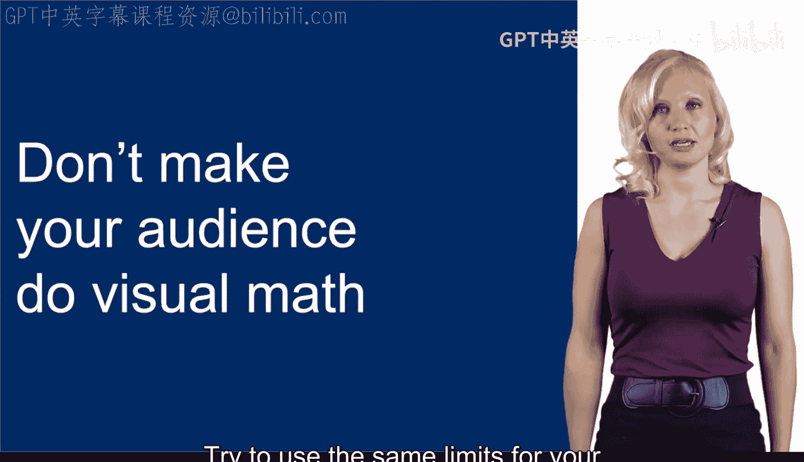

*   **标题应传达核心信息**：幻灯片标题不应存在，除非它们能增加额外信息。用“支持论点”或“讨论”这类词语作为幻灯片标题，会与你希望观众关注的内容（即你的论点）产生竞争。
*   **避免无关信息**：这类标题确实提供了一些信息，但它是关于一个与你正在讲述的故事不同的故事的信息。它是关于“我还要在这个房间里待多久”这个故事的信息，而不是“这就是为什么你应该遵循我的建议”的故事。
*   **最佳实践**：所以，如果你要使用幻灯片标题（这在可视化社区是一个有争议的点），请使用能非常简洁地陈述幻灯片核心要点的标题。

---

## 总结 📝

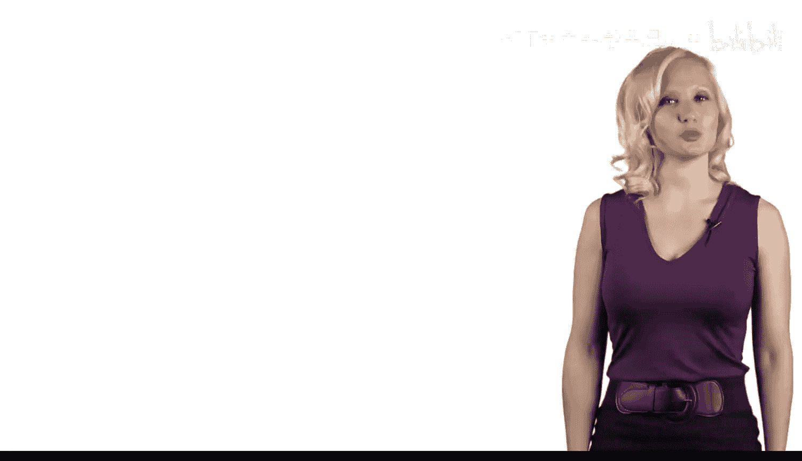

本节课中，我们一起学习了如何通过优化幻灯片格式来有效传达数据故事。核心要点包括：

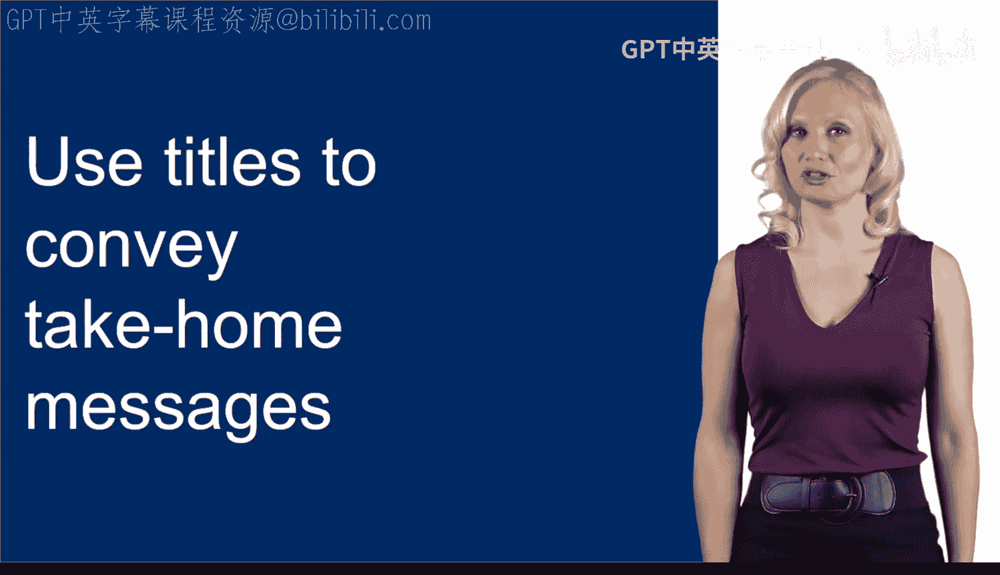

1.  **最大化数据墨水比**：移除所有非必要元素，让数据本身成为焦点，并善用空白。
2.  **实现一目了然**：清晰标注、直接标记、使用水平文本，降低观众的理解成本。
3.  **确保文本可读性**：根据场合选择合适的字体（演示用无衬线，印刷用衬线），并务必使用足够大的字号。
4.  **简化认知负担**：避免让观众做视觉心算，统一图表坐标轴比例，谨慎处理多轴图表。
5.  **善用视觉辅助**：在需要时使用浅色网格线作为参考。
6.  **标题即要点**：如果使用标题，应使其直接概括幻灯片的最终结论。

让我们最后看一下我们开始时使用的商业幻灯片，以及我们应用这些原则后得到的幻灯片。你认为哪一个更有效地传达了这些数据的核心信息？

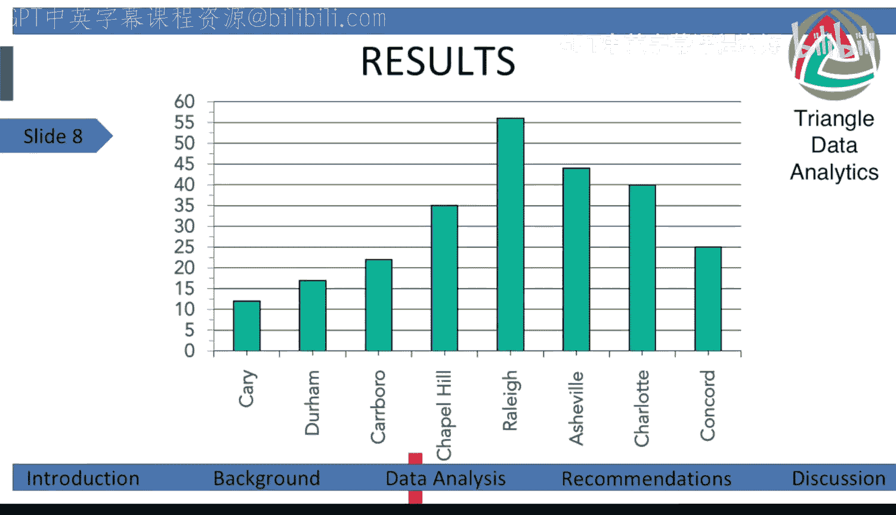

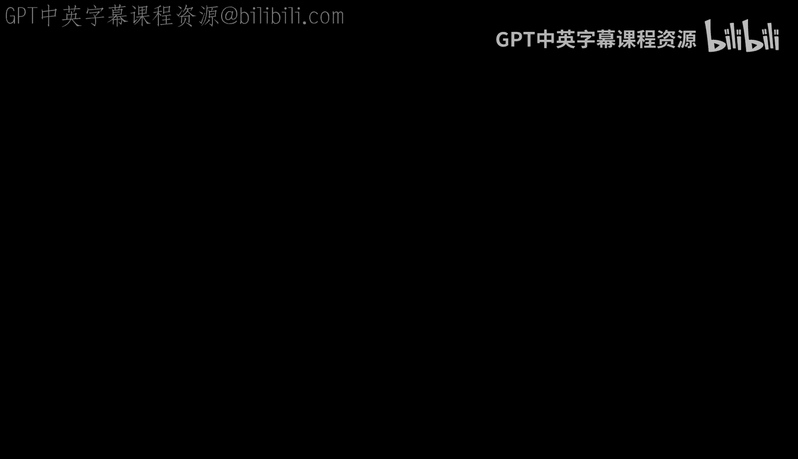

通过应用这些原则，你可以将杂乱、难以理解的幻灯片，转变为清晰、有力、能引导观众直达结论的有效沟通工具。