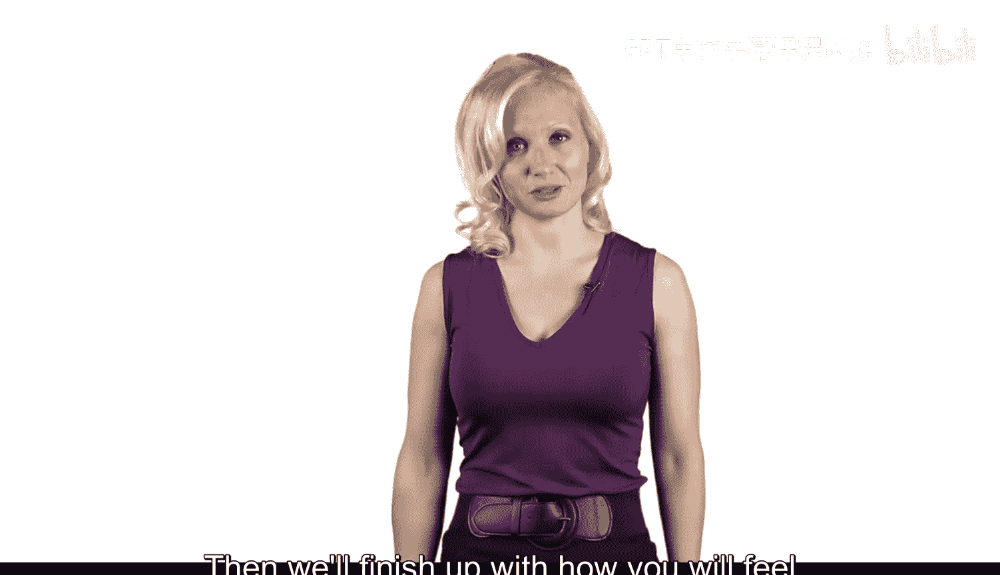
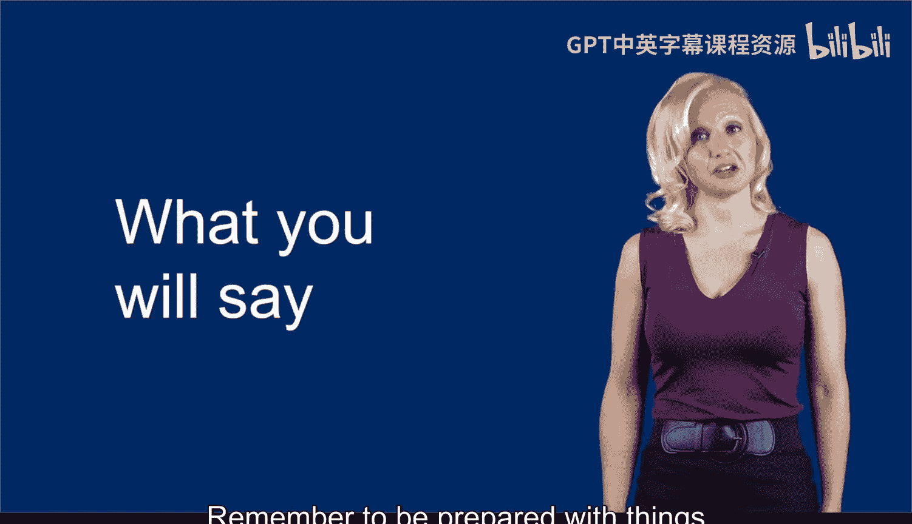
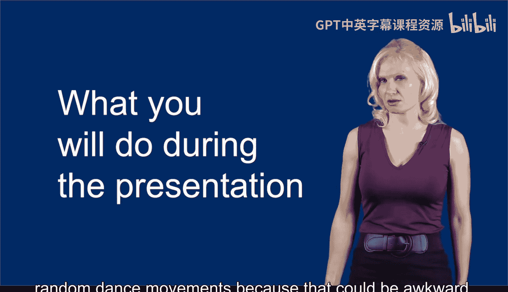
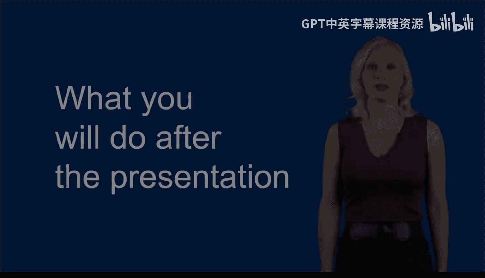
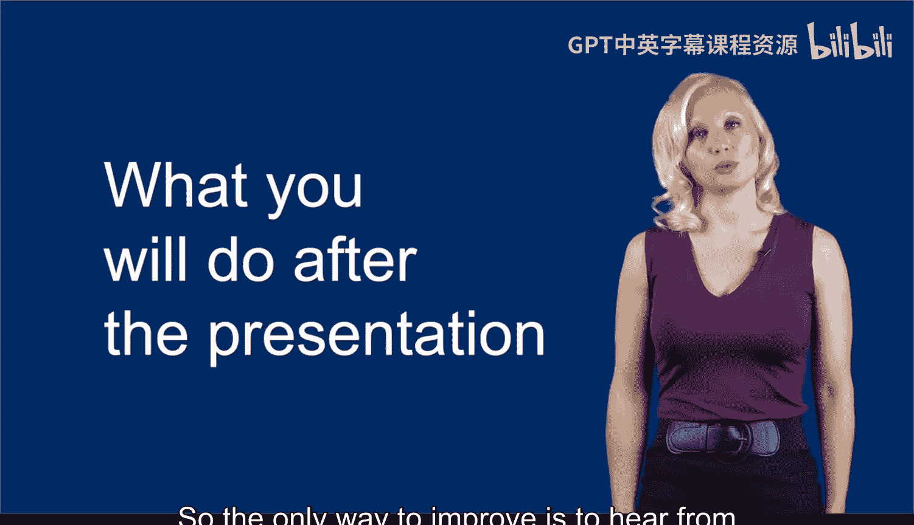
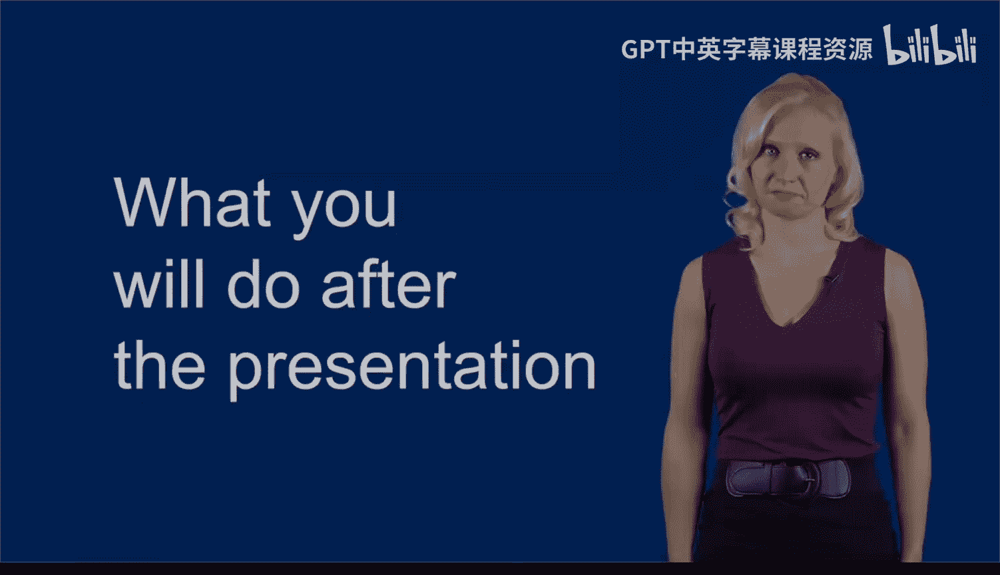
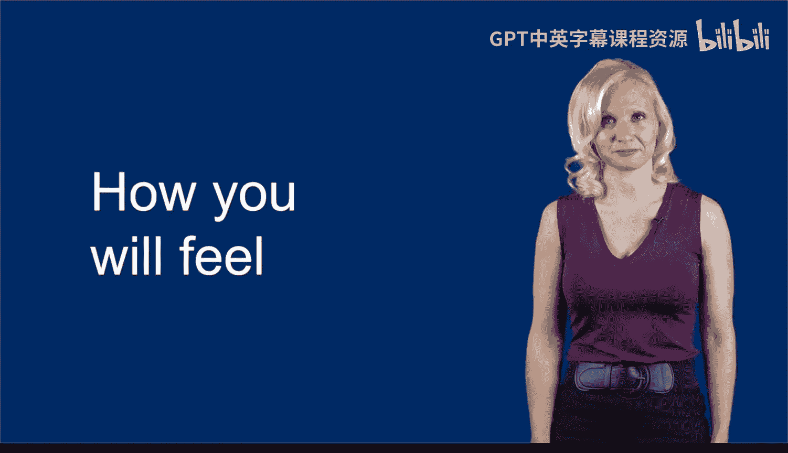

#  129：呈现您的数据故事 📊

在本节课中，我们将学习如何有效地呈现您的数据分析成果，并成功地向听众讲述您的数据故事。我们将涵盖演讲内容、表达方式、演讲前后的准备与行动，以及如何管理演讲时的情绪。

---

经过数月甚至数年的辛勤工作，这一天终于到来。您终于有机会向人们展示您的发现。关键在于，您现在必须站在众人面前，说服他们采纳您的建议。这确实令人紧张，但也令人兴奋，因为我知道您会表现出色。

在本节中，我们将介绍一些要点，让您同样自信地相信自己会表现出色。我们将聚焦于您要说的内容、表达方式、演讲过程中的行为，以及演讲前后的准备工作。最后，我们将讨论演讲时的感受。

## 演讲内容：说什么 🗣️

与听众互动是吸引他们的最佳方式。如果您要向公司高层做汇报，可能无法避免互动，因为他们可能在您演讲开始两分钟后就提出问题。但如果他们不主动提问，您需要计划在演讲中设置至少两到三个邀请听众参与的环节。

以下是几种互动方式的例子：
*   您可以请听众猜测一个与您演讲相关的数字，例如：“您认为我们每月销售多少本书？”
*   您可以请听众在认同某个观点时举手，例如：“有多少人认为我们是威斯康星州前五的电脑零件生产商？”

请务必准备好能促使听众参与的内容。

---

另一种您会经常用到的内容是过渡语句。当演讲的流程被打断时，听众会失去注意力，开始神游天外。如何抓住听众的注意力？答案是使用口头过渡。

口头过渡是您用来连接前后幻灯片内容的语句。它们本质上充当了您故事中的粘合剂。我已附上一个提供优秀口头过渡建议的网站链接，请将其加入书签，并在准备演讲时疯狂练习您的幻灯片口头过渡。

---

在演讲中，您不应该说任何听起来像行话的内容。即将做出百万美元决策的人，如果听不懂您在说什么，是不会耐心的。因此，不要假设听众具备任何特定的先验知识，只使用普通听众都能理解的语言。

我们已经讨论了要说的内容。现在，让我们谈谈如何表达。

## 表达方式：怎么说 🎤

您的声音是一个工具，它可以让听众全神贯注，但如果使用不当，也可能让他们昏昏欲睡。显然，您希望是前者。为此，请有意识地通过声音传达您对所完成工作的热情和活力。

同时，确保变换您的声音。有时，您可能需要放慢语速以强调重点。其他时候，您可能需要加快语速，以表达对即将提出的极具影响力的建议的兴奋之情。

此外，确保变换您的音调。有时使用较高的音调，这通常更显亲和；其他时候使用较低的音调，这能提醒听众您正在讲述需要他们高度关注的重要内容。

既然您知道了说什么和怎么说，接下来让我们谈谈演讲前要做什么。

## 演讲前：准备与练习 📝

我敢打赌您知道我要说什么：练习、练习、再练习，然后继续练习。

一种特别有效的练习技巧是：反复练习演讲中的一小部分，直到完全熟练，然后转向练习另一小部分，如此反复，直到覆盖整个演讲。这种聚焦式练习法的好处在于，它将任务分解为易于管理的小块，您不会因为需要一次性记住所有内容而感到不知所措。

既然我们知道您会采纳我的建议并在演讲前进行练习，接下来让我们谈谈如何在演讲中运用这些练习成果。

## 演讲中：肢体语言与姿态 🧍

您要做的一件事是确保有意识地注意自己的体态。我已随本视频附上一个很好的资源，其中详细介绍了可能影响听众反应的体态重要方面。因此，我将让您在那里阅读有关体态的细节。我在此总结一下：尽量保持身体开放，双臂不要交叉在身前，直接面向听众，当然，还要微笑。

正如您可能听说过的那样，确保与房间里的不同人进行眼神交流，不要忽略任何人，也不要低头或照读幻灯片。尽您所能，让动作显得自然，不要感觉太拘束，除非您有突然开始随机舞蹈动作的倾向，因为这可能会很尴尬。我不知道谁会这样做，尤其是在Coursera上公开的视频里，您知道吗？

---

好的，假设您完成了一场精彩的演讲。您就结束了吗？还没有。

## 演讲后：寻求反馈 🔄

演讲结束后您该做什么？答案是向您的同事和同行寻求反馈。因为做演讲很难，客观衡量自己的表现则更难。最终，演讲的成功取决于听众的反应。因此，改进的唯一途径就是听取听众的想法。

我们将在本课程的最终评估中练习给予反馈和接受反馈这两项关键技能。

---

最后，让我们谈谈您会有什么感受。

## 情绪管理：如何感受 😌

对我们大多数人来说，答案会是：非常、非常紧张。公开演讲对许多人来说都令人神经紧张，以至于心理学家在实验中用它来主动给人施加压力。据报道，温斯顿·丘吉尔和沃伦·巴菲特都曾患有严重的演讲焦虑，但他们都是证明演讲或表现焦虑可以被克服的绝佳例子。所以，练习、练习、再练习。自信是焦虑的最佳解药。

---

在本节课中，我们一起学习了如何成功呈现数据故事。我们探讨了设计互动内容、使用口头过渡、避免行话的重要性；学习了如何运用声音的变化和肢体语言来增强表达效果；强调了演讲前充分练习、演讲后积极寻求反馈的关键步骤；最后，我们也正视了演讲时的紧张情绪，并认识到充分的准备和练习是建立自信、克服焦虑的最佳途径。