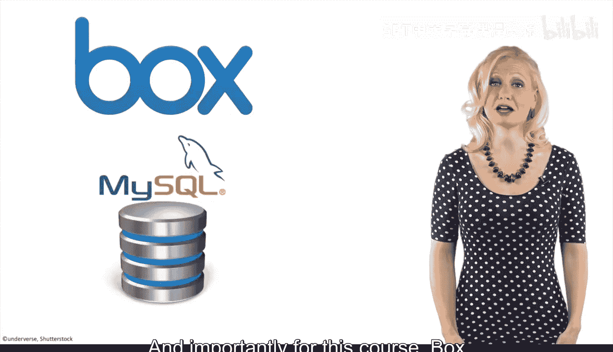
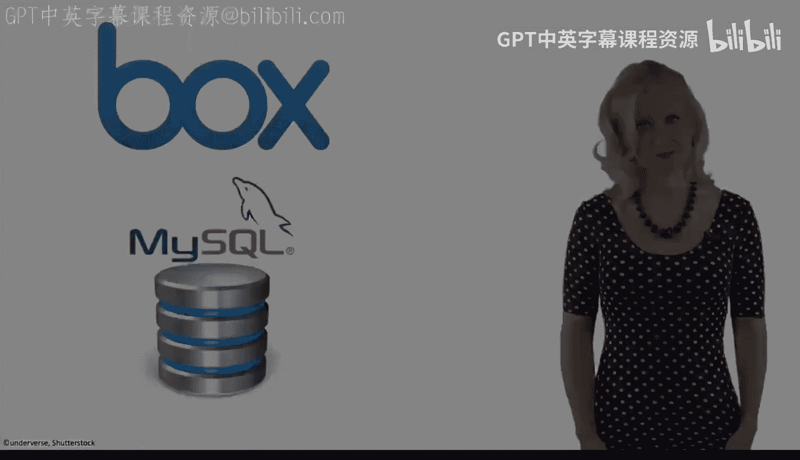
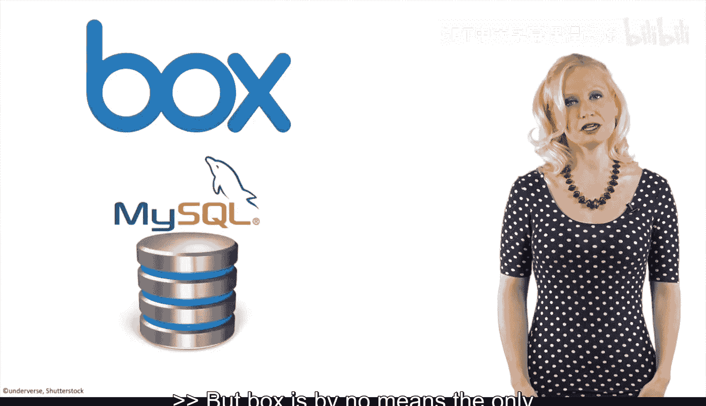
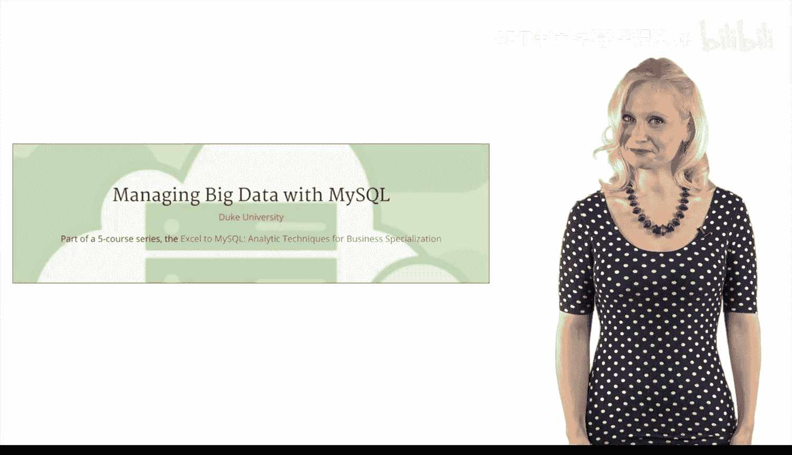

#  132：SQL与MySQL概述

在本节课中，我们将要学习SQL语言的基本概念、其发音争议、在商业分析中的重要性，以及为什么选择MySQL作为本课程的重点学习平台。我们还将了解课程的整体学习目标。

## SQL的发音与重要性

上一节我们介绍了课程主题，本节中我们来看看SQL语言本身。SQL是一种数据库语言，但其名称的发音存在广泛争议。

最常见的发音是“S-Q-L”或“Sequel”。该语言的联合创始人Don Chamberlain表示，由于语言最初被命名为“Sequel”，即使在缩写为SQL后，许多人仍沿用此发音。两种发音都被广泛使用和认可。一些主流数据库系统，如Oracle，在其文档中明确说明该语言发音为“S-Q-L”。而另一些系统，如MySQL，则明确表示其名称发音为“My-S-Q-L”。因此，你可以选择自己喜欢的发音方式。

那么，为什么我们需要关注SQL呢？公司需要管理大量数据，而唯一实用的方法是将数据存储在某种数据库中。在技术驱动的公司中，从数据库检索数据的唯一方法是编写自己的SQL查询。SQL查询是用于提取数据的结构化计算机代码。在其他更传统的大型公司中，虽然可能有专人负责提取数据，但你需要提交正式请求，这可能需要数天或数周时间。因此，公司非常渴望招聘不仅会分析数据，而且懂得如何首先获取数据的分析师。

一项针对400多名技术公司招聘人员的研究表明，在招聘商业智能和业务分析师时，他们认为最重要的技能排名如下：

以下是招聘人员认为重要的技能排名：
1.  沟通技巧
2.  **SQL与查询技能**
3.  基础分析技能

由此可见，从数据库中提取数据的能力对于获得商业分析师职位甚至比分析技能更为重要。

## 关系型数据库与MySQL

SQL是用于从特定类型的数据库（称为**关系型数据库**）中检索数据的语言。关系型数据库是存储高度组织化和结构化业务数据的黄金标准。全球几乎每家公司都至少拥有一个关系型数据库。

当前数据库市场的年销售额超过400亿美元，预计未来几年将超过500亿美元，其中绝大部分资金都用于关系型数据库技术。因此，本专项课程选择重点讲解如何使用关系型数据库管理大型企业数据。

本课程标题的第二部分提到了**MySQL**，它是一个特定的关系型数据库品牌或平台。市场上存在许多关系型数据库平台，包括Oracle、Microsoft SQL Server、DB2、Microsoft Access和PostgreSQL等。我们选择聚焦于MySQL。

以Box公司为例，这是一家为企业提供在线文件共享和协作服务的公司。Box的整个界面都基于关系型数据库概念构建。每次你在Box账户的文件夹中存储新文档，就像在表中添加新行。每次为文档添加新的协作者，就像在表之间添加新的关系。因此，Box本质上是一个访问所有底层数据库操作的友好界面。Box使用MySQL作为其主要数据库，原因如下：

以下是Box选择MySQL的主要原因：
*   **可靠且成熟**
*   **开源且社区生态完善**
*   **拥有大量工具和行业会议支持**
*   **能够满足其存储数百万用户和数十亿条内容数据的关系型需求**

但Box并非唯一使用MySQL的知名公司。以下是一些重度依赖MySQL数据库的其他公司：

以下公司也广泛使用MySQL：
*   Facebook
*   YouTube (Google旗下)
*   Yelp
*   Dropbox
*   GitHub
*   LinkedIn
*   Etsy
*   Twitter
*   Booking.com
*   Pinterest
*   Yahoo

鉴于MySQL是开源的、可免费使用、易于理解并被许多你可能心仪的公司所使用，我们认为它是一个能为你提供重要实践经验的数据平台。

## 课程目标与学习内容

每个数据库系统使用的SQL语言版本略有不同，但它们的相似度很高。编写SQL查询就像开车，不同车型的按钮位置可能不同，但只要你学会开一辆车，你就掌握了驾驶所有同类车型的基本方法。关系型数据库也是如此，一旦你学会使用SQL与一种数据库交互，你就掌握了与所有关系型数据库交互的基本方法。

为了让你感受不同SQL语言的差异，本课程除了提供MySQL数据库访问，还提供了另一种关系型数据库：**Teradata**。Teradata是**数据仓库**领域的领导者。数据仓库是历史数据和当前公司数据的副本，其结构专门为查询和分析报告而设计。使用数据仓库的知名公司包括沃尔玛、山姆会员店、Verizon、美国银行和苹果等。

通过本课程的学习，你将能够掌握以下技能：

在本课程结束时，你将能够：
*   描述关系型数据库的结构。
*   解释和创建描述特定数据库内容的实体关系图与关系模式。
*   编写查询以检索和排序符合特定条件的数据，并能从包含超过100万行数据的MySQL和Teradata数据库中检索此类数据。
*   执行限制查询对同事影响的实践操作。
*   使用聚合函数汇总数据行，并根据指定变量进行分段聚合。
*   跨数据库组合和操作来自多个表的数据。
*   重新记录数据并执行依赖于动态数据特征的计算。
*   将数据分析问题转化为SQL查询。

不久之后，你将拥有一套备受追捧的技能，这对数据分析招聘者极具吸引力。你也将拥有一套强大的工具，帮助你为企业提供真实、有形的价值。

本节课中我们一起学习了SQL在商业分析中的核心地位、关系型数据库与MySQL平台的优势，以及本课程将帮助你达成的具体学习目标。掌握这些技能将为你打开数据分析领域的大门。