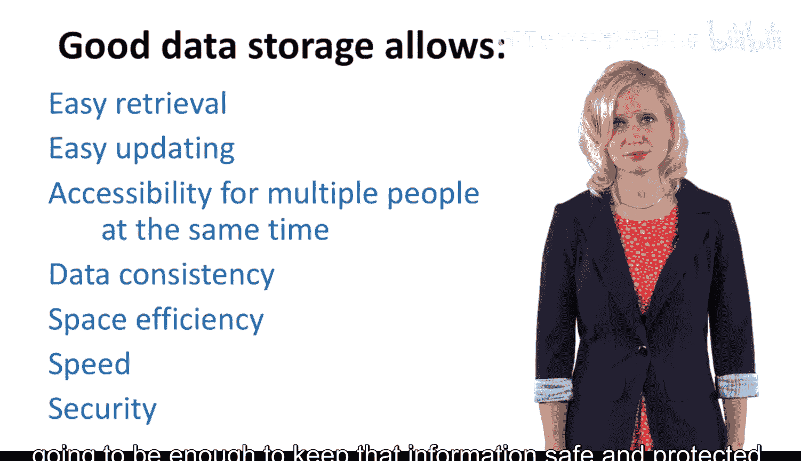

#  133：海量数据与多用户并发访问带来的挑战

在本节课中，我们将要探讨为什么随着业务增长，使用电子表格管理数据会变得低效且不可靠，并理解数据库系统旨在解决的核心问题。

## 为什么需要数据库？

为什么企业不能保持简单，将所有数据存储在电子表格中？这似乎会让每个人的工作都变得更轻松。让我们来审视这个前提：将公司数据保存在电子表格中是否真的能让所有人更轻松。

想象一下，你正在为丹尼尔·埃加工作，他创办了“埃加烘焙咖啡”，这是你在本专项课程第一门课《数据驱动公司的商业指标》中描述的业务。在营业的第一周，丹尼尔亲自处理订单，而你则尽职地将所有重要信息记录在一个电子表格中，一切看起来都很好。

现在，时间快进几年。埃加烘焙咖啡取得了非凡的成功，丹尼尔已成为北卡罗来纳州的咖啡之王。每天都有海量订单涌入，现在有许多人需要在你第一周制作的电子表格中输入这些订单，并且当客户致电询问时，许多人需要跟踪和修改订单。

实际上，我刚才的描述过于平静了。真相是，我刚才的描述对埃加烘焙咖啡订单部门可能发生的情况给出了误导性的乐观看法。

## 电子表格带来的具体挑战

以下是埃加烘焙咖啡在使用电子表格管理数据时遇到的一系列具体问题。

### 1. 数据规模与性能问题

真正的情况是，多人试图在电子表格中输入订单，但这并不总能实现，因为现在埃加烘焙咖啡的订单已超过100万份。因此，公司初创时制作的单一电子表格已被拆分成六个独立的电子表格，以防止每次尝试输入订单时Excel崩溃。

将电子表格拆分为6个有助于防止Excel崩溃。但现在，每当客户致电询问订单或发票问题时，员工都需要花费几分钟才能找到包含该订单的正确电子表格，尤其是因为每个电子表格仍然非常庞大，Excel需要一段时间才能打开每个文件。

### 2. 并发访问与协作冲突

更令人烦恼的是，多人试图同时使用电子表格。因此，当客户致电询问时，你必须等待其他人完成对某个电子表格的操作，然后才能自己打开它。结果，大家开始想出各种复杂的办法，让电子表格在自己的电脑上保持打开状态，以确保当客户来电时，自己是加载了该文件的人。

幸运的是，埃加烘焙咖啡的每个人都意识到，在员工需要时将其从订单电子表格中踢出是一种糟糕的商业实践。因此，公司同意将电子表格转移到一项在线服务上，允许多人同时编辑同一个电子表格。

### 3. 数据不一致与错误

但是，新的问题出现了。首先，电子表格仍然相当大，因此打开和搜索仍然需要时间。其次，有时多人最终会同时与一个电子表格交互，导致他们互相覆盖对方的输入。第三，数据开始出现大量不一致之处，如果你不同时打开多个电子表格，这些不一致很难被发现，而且只有少数人的电脑性能足够强大，能够同时打开多个如此大小的电子表格。

以下是主电子表格中的一些摘录，作为这些不一致的例子：
*   客户 Archways 的联系人是 Trudy 还是 Mark？
*   如果是 Trudy，电子表格中的哪个电子邮件地址是她的真实邮箱？Trudy 的第二个电子邮件地址不同，是因为有人错误地输入了第二个，还是因为 Trudy 实际上更改了她的电子邮件？
*   你可能会担心 Trudy 的第二个电子邮件是错误的原因之一是，最近发生了很多错误。每次回头客下订单时，埃加咖啡的员工都必须再次输入该回头客的所有信息，尽管这些信息已经在电子表格中输入了多次。由于员工尽力让客户满意，他们最终会非常快速地输入信息，而副作用就是更容易出错。

### 4. 数据更新与维护困难

其他变得烦人的问题是，当电子表格中某个地方出现错误时，通常意味着员工必须更改电子表格中的多个字段来纠正错误。因此，当发现 Lina 实际上不是完成这笔销售的埃加烘焙咖啡员工时，有人必须更新包含 Lina 姓名的这一列，但那个人还必须更新包含 Lina 联系信息和销售编号的这些列。如果这是自动的，本可以节省大量时间。

这些列中曾经有公式可以实现自动更新。但现在有太多不同的电子表格和电子表格中的错误，以至于公式经常输出错误的结果。因此，没有人信任它们。

### 5. 数据删除与保留的矛盾

问题还不止于此。有时，保留行中的某些信息但删除其他信息会很有用。例如，Lulus 决定取消订单，因此你删除订单信息以确保汇总销售额的公式正确。但你仍然希望将 Lulu 的联系信息保留在公司记录中，以便将来尝试说服他们重新下订单。问题是，如果你有一行包含大量空数据，查看电子表格以核对审计记录的员工可能会认为该行是一个重大错误，要么感到担忧，要么将其完全删除。

### 6. 系统变更与数据整合挑战

说到审计，公司最终在某个时候更换了发票系统，一些订单是在旧发票系统上生成的，而另一些则是在新系统上生成的。负责核对公司记录的员工需要区分两个系统上生成的销售，但这很难做到，因为分析使用了另一个单独的分析电子表格，并且当新订单不断添加时，很难保持该分析电子表格的更新。

### 7. 扩展性与未来需求

此外，埃加烘焙咖啡希望开始收集更多关于客户的信息以改进营销工作。然而，为实现这些营销分析而需要在每个电子表格中添加的列数将使电子表格的大小增加两倍以上。这会使电子表格比现在更慢。

## 数据库解决方案的必要性

正如你所看到的，一开始将埃加烘焙咖啡的记录输入电子表格很容易且很有意义，但随着公司的发展，电子表格变得越来越低效和不准确。在这一点上，将公司数据保存在电子表格中确实会阻碍公司发展。如果埃加烘焙咖啡未来达到每年数百万销售额的程度，电子表格系统将成为公司维持客户服务、跟踪财务状况和做出商业决策的巨大瓶颈。

为了使埃加烘焙咖啡保持竞争力，他们需要一个数据存储解决方案，使他们的信息易于检索、易于更新，并且可以同时被多人访问和修改。此外，特别是因为将有如此多的人访问数据，需要有一种方法来确保所有存储记录中的数据保持一致，并且数据不会被无意中删除或丢失。

存储方法还需要空间高效，这样数据就不会被重复并占用额外空间。当然，存储也需要快速。数据需要能够快速输入、搜索和检索。

最后，我们尚未讨论的另一件事是，当你存储财务信息时，公司数据也需要非常安全。仅给电子表格添加密码不足以保护这些信息的安全。

## 总结

本节课中我们一起学习了，当大量人员使用大量数据时出现的这一长串问题，正是数据库旨在解决的问题。下一节视频将探讨关系型数据库如何具体实现这一目标。