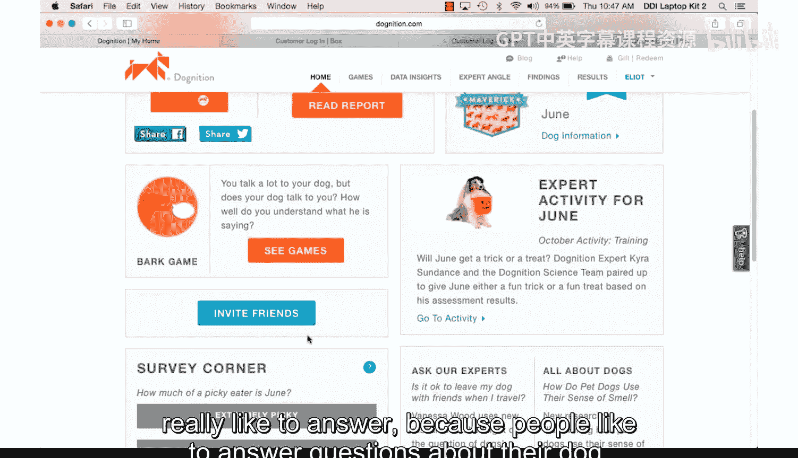
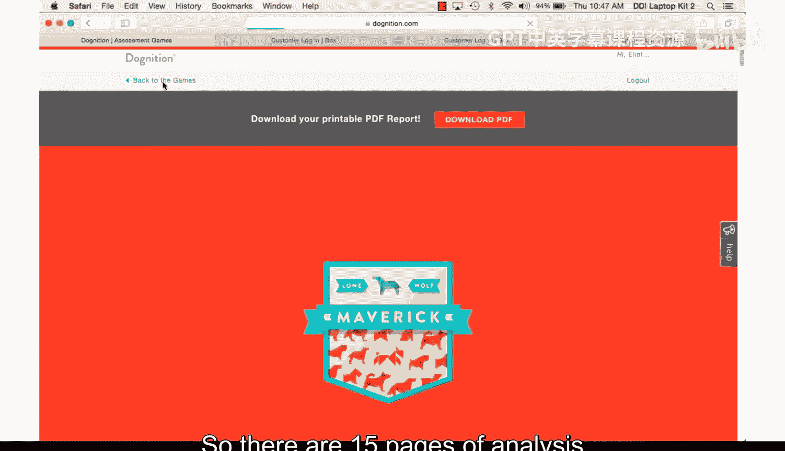
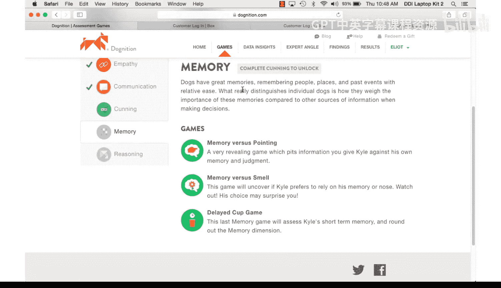
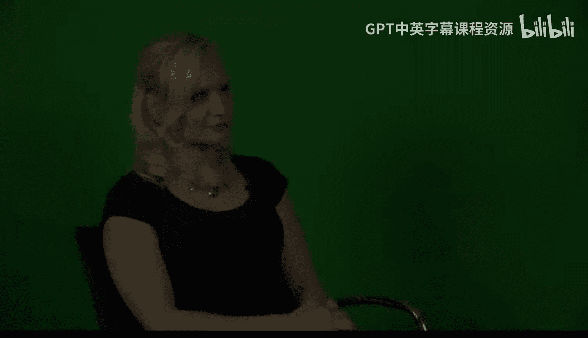
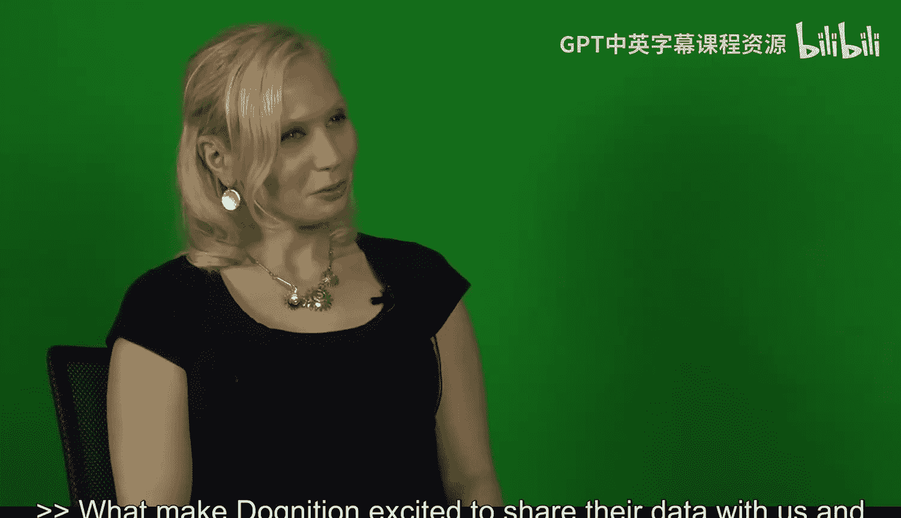

#  143：认识Dognition数据集 🐕

在本节课中，我们将学习一个真实的商业数据集——来自Dognition公司的数据。我们将了解这家公司的业务、其产品如何运作，以及他们希望通过数据分析解决的核心商业问题。

---

我们在这门课程中非常幸运，能够使用来自真实商业环境的真实数据集。这家公司名为Dognition。今天，我们邀请到了Dognition的制作人Elliot Cohen，他将为我们介绍他捐赠给我们的数据集。

Dognition是一个面向全球狗主人和爱狗人士的平台，旨在帮助他们更深入地了解自己的狗。该公司将世界各地犬类认知实验室中的科学游戏进行拆解，并利用家庭中常见的物品进行重构，让任何人都能在家中进行测试。然后，他们汇总所有数据。目前已有超过3万名用户参与Dognition游戏，公司从群体层面分析这些数据。他们最近发表了首篇论文，证明其数据质量与实验室数据相当。

对于参与Dognition游戏的狗主人来说，他们能了解到许多关于自己狗的、原本可能不知道的信息。许多人一开始会想“我知道我的狗是聪明还是笨”，但即使是设计这些游戏的博士，也通过测试对自己的狗Tasmania有了新认识。例如，他本以为Tasmania有很强的主动记忆能力，能轻松回忆事物。但结果发现，它并不太依赖自己的记忆，反而非常依赖主人的指令。所以当主人说“坐下”后它走开，并不是因为它忘记了指令，而是它确实记不住。这就是一个例子，说明通过了解狗所依赖的技能，你能获得新的认知。

Dognition游戏本身分为犬类智力的五个维度。这些维度是：**共情**、**沟通**、**狡猾**、**记忆**和**推理**。在这五个维度下，共有20个游戏，实际上是10个正式游戏和10个热身游戏。这些游戏贡献出各维度的分数，从而确定你的狗在某个维度（如记忆）中具体依赖哪些技能，而不是简单地判断它是否使用记忆。根据这些结果，你的狗会被归入九个档案之一。这些档案是不同特质的组合。

一个非常有趣的发现是，狗的品种对其最终属于哪个档案的决定性作用不大。一切取决于狗个体解决问题的方式。

那么登录网站后实际看到的是什么呢？登录Dognition，只需点击登录按钮，等待加载，然后输入用户名和密码即可。登录后看到的首页，是一个已完成所有测试的狗的界面。首页会显示你已完成的所有维度、下个月的推荐游戏、你的活动列表，以及调查角。调查角包含约150个额外问题，用户很喜欢回答，因为人们乐于回答关于自己狗的问题。报告也在这里，共有15页的分析内容。然后用户可以返回游戏界面。

这是一个已完成测试的狗的界面，显示了所有已完成的维度和结果。如果我们看一个未完成测试的狗，比如顶部的Kyle。我们从首页来到这里，看到“接下来”的提示是“玩游戏”。这里显示下一个要玩的游戏，侧边栏列出了需要完成的游戏。Kyle接下来要进行的是“狡猾”维度的游戏。顶部有“开始游戏”按钮，点击即可进入游戏。上方还会显示尚未解锁的游戏，因为用户需要按顺序完成，系统会提醒你需要先完成前一个维度的游戏才能继续。

Dognition提供三种订阅模式来玩其游戏。我们有**核心Dognition评估**，包含10个游戏和10个测试（或热身），用于生成你的狗的Dognition档案（即九种类型之一）。除此之外，还有**Dognition年度订阅**和**月度订阅**。这些是在完成核心评估后，可以与你狗进行的额外有趣活动。主要包括两件事：在一年内解锁12个额外游戏，以及由专家或训练师创建的12个额外活动。这些游戏和活动从你订阅之日起，每月解锁一个。

如果理解正确，每位客户在第一个月都有机会完成20项测试，并且每次都是按照你们设定的相同顺序逐一进行，对吗？Dognition游戏被设计为按特定顺序进行，从共情开始，然后是沟通、狡猾、记忆和推理。这样设计有两个原因。第一，共情游戏实际上是最简单的游戏。除了你和你的狗，以及眼神接触游戏需要零食外，不需要任何其他东西。你不需要训练狗来适应这些游戏，只是和狗一起相处。这很有帮助，因为你不必担心狗是否过度兴奋，这会是一个平静的体验，能让你的狗进入玩游戏的状态。之后，游戏会逐渐变得更加复杂，所以我们认为循序渐进更好。

你们是否尝试过以不同顺序提供测试？在Dognition推出大约六个月后，我们仔细研究了产品在完成率方面的表现，发现我们对用户的进展程度并不满意。初期有非常大的流失率，没有足够多的人坚持到最后。为了解决这个问题，我们的假设是用户可能不太喜欢共情维度，因为它虽然简单易上手，但不够刺激。我们之所以知道这一点，是因为我们设计并实施了一项额外的“乐趣/惊喜”调查。利用从调查中获得的信息，我们提出了一个替代假设：不从共情维度开始，而是从记忆维度开始，因为记忆维度在调查中被评为更有趣，并且结果常常出人意料。但事后我们意识到这样做的缺点：虽然总体完成率和进展没有改变，但它改变了人们能走多远。更多的人完成了第一个维度，但这并不意味着他们能走得更远。记忆维度的缺点是，它的操作说明在技术性上要求很高。如果狗没有采用能获得零食的策略，那它就一点零食也得不到。这会让主人和狗都感到非常沮丧。这就是我们早期测试的一些见解。

那么，现在的问题是：Dognition有什么商业问题，你认为我们或许能帮助解决？Dognition作为一个产品和公司，最基本可以分为两个部分。一部分是我们称之为“宣传册”的部分，即未登录时看到的网站外部版本，包括主页、“如何运作”以及上千个提供更多信息的页面。另一部分是实际的产品本身，即登录后与游戏、训练师、专家或其中任何功能互动的部分。这为我们提供了两个截然不同的可以重点发展的领域。

在Dognition，我们面临一个有趣的问题：我们非常关心客户购买后的行为。一旦你付了钱，这很好，但我们实际上希望你能更多地使用Dognition这个产品。这涉及到，我们真的希望你**完成**测试。如果你没有完成，我们只能获得你的一小部分数据。而Dognition的总体目标是发表论文，更多地了解狗。用户的贡献有助于我们持续运营。但归根结底，如果我们没有你的数据，我们就一无所有。

因此，我们主要寻求的方向之一是，想办法提高完成率，或者更准确地说，是让用户在Dognition体验和游戏进程中走得更远。我们可以进行很多局部分析，比如只分析完成了第一部分游戏的人，或者只分析特定问卷的回答。但我们真正寻求的是能够进行大规模的对比分析，比如跨所有游戏比较不同品种的狗。因此，任何能为我们提供一些见解，以推动用户和他们的狗完成更多测试的分析，从我们的角度来看都将非常有帮助。

那么，在我们着手解决这个商业问题时，你对课程有什么建议吗？在数据分析方面，我确实有一个建议。我们发现最重要的一点是，你必须在进行每次测试前带着一个问题进去。你需要有一个假设，并且需要确切知道你将如何测试它。因为如果你只是漫无目的地查看数据，要么会发现一些无关紧要的东西（这毫无用处），要么什么也发现不了（同样毫无用处）。所以，在开始分析之前，找到一个可测试的假设，这是我认为唯一真正重要的事情。

那么，你愿意向我们展示一个你们测试的例子吗？当然。我给大家展示“记忆 vs. 指向”游戏。我认为这是一个很好的例子，说明Dognition如何试图了解你的狗使用的策略，这里没有对错之分。这个游戏进行得比较深入，位于记忆维度的末尾部分。具体操作是：我放下几个杯子，在其中一个杯子下藏一块食物，然后站起来，指向我没有藏食物的那个杯子。这将直接表明狗是从我的动作中学习信息，还是记得食物实际所在的位置。让我们看看会发生什么。我们放下两个杯子，狗在对面。Cizu，展示零食。把它放在一个杯子下。然后获取零食。它首先走向的那一边就是它认为有零食的地方，所以它知道零食在那里，尽管我指向了另一边。

是什么让Dognition愿意与我们分享数据并参与这门课程？Dognition非常重视教育。我们想分享关于狗的信息。如果我们有足够的数据和经验，可以分享一些关于如何做出数据驱动决策的信息，那么我们非常乐意提供帮助。

从我们的角度来看，分享数据时非常重要的一点是，我们要照顾好自己和用户。因此，我们分享的所有数据都是匿名的，没有任何对单个用户的引用，没有地址、电子邮件或姓名等任何可以识别个人身份的信息，这些都已从数据中清除，无法追溯到任何人。

现在你已经了解了我们需要共同解决的商业问题，请前往课程网站，查找关于Elliot和Dognition慷慨捐赠的数据集中具体字段的更多详细信息。同时，我建议你去看看Dognition的网站。这是一家非常酷的公司。我想你会对解决他们的商业问题感到兴奋。

---

本节课中，我们一起学习了Dognition公司的背景、其产品（基于五个智力维度的犬类评估游戏）、三种订阅模式，以及他们核心的商业问题：如何提高用户在完成一系列游戏测试过程中的参与度和完成率，以收集更完整的数据用于科学研究。我们还了解到，在分析此类数据时，带着明确的假设和问题出发至关重要。