#  145：Jupyter Notebook 使用指南 📓

## 概述
在本节课程中，我们将学习如何使用 Jupyter Notebook 这一前端界面。Jupyter 是我们本课程中用来与存储在 MySQL 数据库中的 Dogognition 数据集进行交互的工具。我们将了解其独特功能、基本操作方法以及如何利用它来高效学习和练习 SQL 查询。

## Jupyter 简介与课程安排
在上一节视频中，我们介绍了如何编写 SQL 查询。接下来的两个视频，我们将重点介绍 Jupyter。

Jupyter 是本课程中用于与 MySQL 数据库交互的前端界面。在职业生涯中，你可能会遇到多种不同的前端界面。在众多选择中，Jupyter 非常独特，它是为**协作**而明确设计的，这也使其非常适合**教育**。

Jupyter 允许我以文本形式解释每一个查询，帮助你理解每个查询背后的逻辑。你可以按照自己的节奏阅读这些文本，在同一个地方尝试查询的不同部分，并同时查看示例。因此，你会发现这是熟悉 SQL 语法的有效方式。

当然，在公司环境中，你不会有我在旁边指导，也无法将我的示例放在手边。因此，我建议你利用这些 Jupyter MySQL 练习来熟练掌握语法。当你准备好独立操作时，再转向 Teradata 练习。

本课程使用的 Teradata 界面与你在公司中使用的非常相似，事实上，在某些公司你可能会使用完全相同的界面。但这要求你能够独立操作，需要从头开始编写查询，并且没有现成的示例。所以，我再次建议你从 MySQL 和 Jupyter 界面开始，当你准备好独立尝试时，再转向 Teradata。

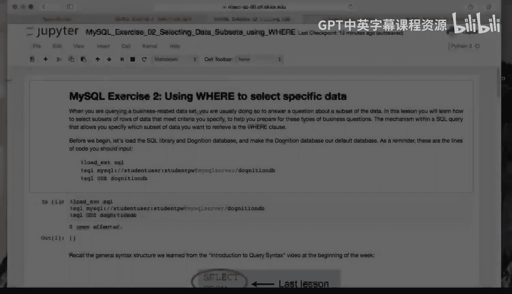

我将在后续视频中展示如何使用 Teradata 界面。但在接下来的两个视频中，我们将专注于 Jupyter。特别是本视频，我们将重点学习如何在 Jupyter 中使用 Notebook。

## 启动与界面概览
首先，你需要点击课程网站上的链接，直接进入一个 Notebook。

当你点击其中一个链接时，会进入一个页面。进入该页面后，请点击“Open Tool”。

点击后，会打开一个类似这样的界面。本课程的每一课都包含在一个我们称之为“Notebook”的文件中。你可以立即看到 Notebook 中包含大量文本。如果我向下滚动，还会看到许多供你编写代码的区域。

使用这些 Notebook 或完成这些课程的方法是：阅读文本，然后按照说明和问题，在可以编写代码的区域中写入内容。

需要说明的是，Jupyter 中每一个这样的区域都称为一个 **Cell**。我告诉你这一点，是因为稍后我将展示一些菜单选项的功能，其中一个菜单选项就叫“Cell”，这个菜单选项就是针对这些编写代码的区域的。

## 代码单元格的使用
为了让你了解实际使用代码单元格时的样子，你需要编写查询并输入。输入后，它看起来会是这样。在左侧，你会看到单词“In”和一些方括号。这是你运行查询之前的样子。当你准备好运行查询时，需要点击上方的这个按钮（箭头图标），悬停时会显示“Run Cell”。

当我按下这个按钮时，你会看到这些括号之间出现一个星号。只要查询正在运行，这个星号就会存在。如果你运行一个需要数据库长时间处理的长查询，这个星号会一直存在，直到输出准备就绪。

这个特定查询会很快完成。当我运行它时，你会很快看到星号，然后紧接着在下方看到输出。让我们看看是什么样子：你看到了星号，然后是输出。

当你运行一个有很多输出的查询时，我想向你展示几件不同的事情。这个特定查询输出了超过 16，000 行。然而，我们已经在这些 Jupyter 界面中实施了一些安全措施，以减少系统崩溃的可能性。

我之前提到过，我们专门设计了本课程，将你们每人大约分成 150 人一组。我们希望你们练习为同事着想。因此，当你编写需要很长时间或大量资源的查询时，也会影响本课程中的同事。当你运行长查询或占用大量资源时，会影响你所在 150 人组中的其他人。

有可能导致你所在 150 人组的系统崩溃，但我们提供了一些安全措施，至少降低了这种可能性。我们在这里做的一件事是，即使输出超过 16000 行，如果你一直滚动到这个输出的底部，你会看到它显示“truncated to display limit of 1000”。我们明确设置了这一点，以便你每次在输出中只获得 1000 行。

我还想再展示一点。如果你的输出中有很多不同的列，你还会在这里看到一个滚动条，可以让你左右滚动。我知道当我第一次使用 Jupyter 时，花了点时间才找到那个滚动条，所以请确保你以后记住这一点。

除此之外，这就是输出的样子。你可以看到上面显示“In”，下面显示“Out”。所以输出总是在这里。

我们在这些练习中运行的许多查询会输出包含大量行的表格。因为有这么多行，Jupyter 和系统需要大量资源来保存这些表格。因此，如果你不需要输出，或者你不会从中学习，或者你不会将其与你正在做的其他事情进行比较，那么删除该输出是个好主意，这样 Jupyter 就不必将其保持在线状态。

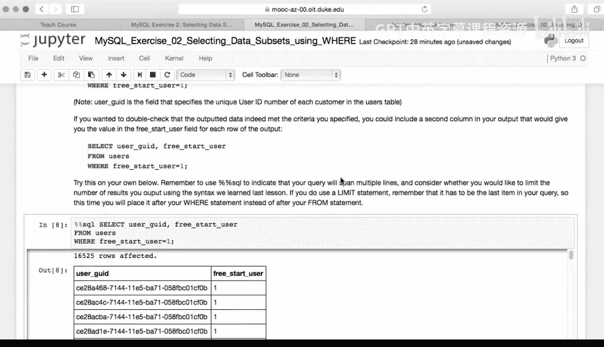

要删除输出，请点击你的输出，然后点击我之前指出的“Cell”菜单，转到“Current Outputs”，然后点击“Clear”。现在你可以看到，这个代码单元格的输出已经不存在了。

但我还想在“Cell”菜单中向你展示一个可能对你有用的功能。让我们再次运行查询。现在点击输出，然后首先让我指出，我们可以像我之前展示的那样滚动浏览输出。但现在，请转到“Cell”菜单，转到“Current Outputs”，然后点击“Toggle Scrolling”。

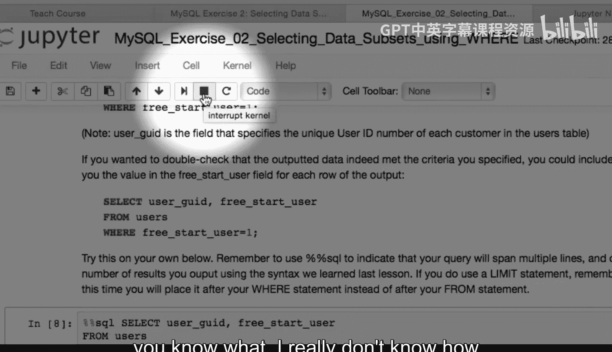

现在你可以看到，输出不再有滚动条，而是显示了整个列表。如果你更喜欢这种查看输出的方式，欢迎你这样做。但我们默认设置为滚动，因为它占用空间更少。

## 中断查询与内核操作
接下来我想展示的是，如果你启动了一个需要很长时间运行的查询，然后决定不再运行它了，该怎么办。

为此，你可以点击这个按钮。悬停时，它会显示“Interrupt Kernel”。这个按钮基本上就是一个停止按钮。所以，如果你正在运行一个查询，它似乎永远在运行，而你决定你并不真的需要知道答案，并且担心可能会使小组其他人的系统崩溃，那么请点击正在运行的查询，然后按停止。你看到它显示“Interrupt Kernel”了。

另一种方法是，你可以转到这个“Kernel”下拉菜单，然后点击“Interrupt”。

当你停止一个查询时，有时需要一点时间才能停止，所以你需要有点耐心。然后它会输出一个错误信息或告诉你内核被中断，之后你可以重新开始，要么清除输出，要么添加一个新的单元格。

## 单元格操作：添加、编辑与移动
说到新单元格。你已经看到了使用这些 Notebook 所需知道的大部分内容，但它们实际上比我刚才展示的功能要多得多。

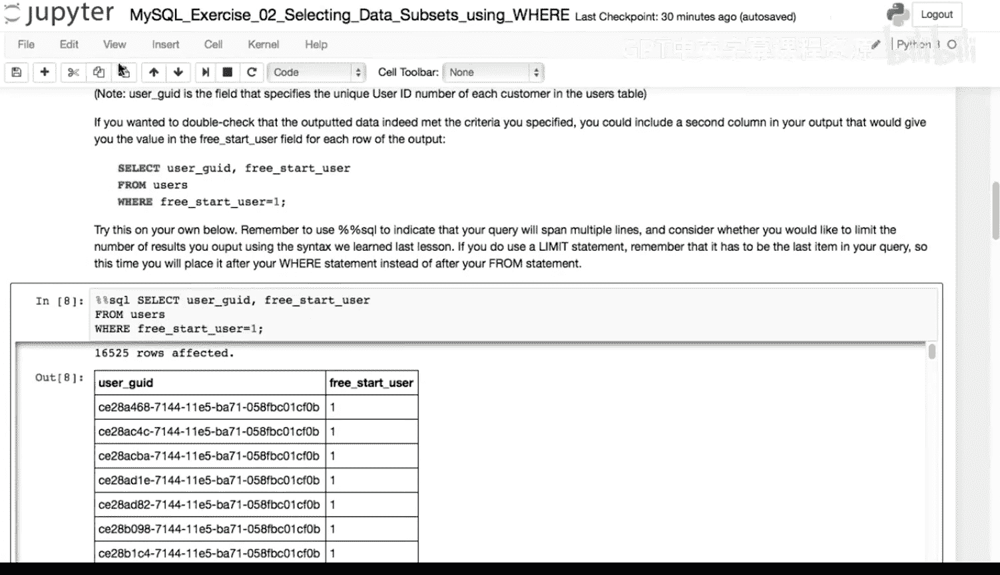

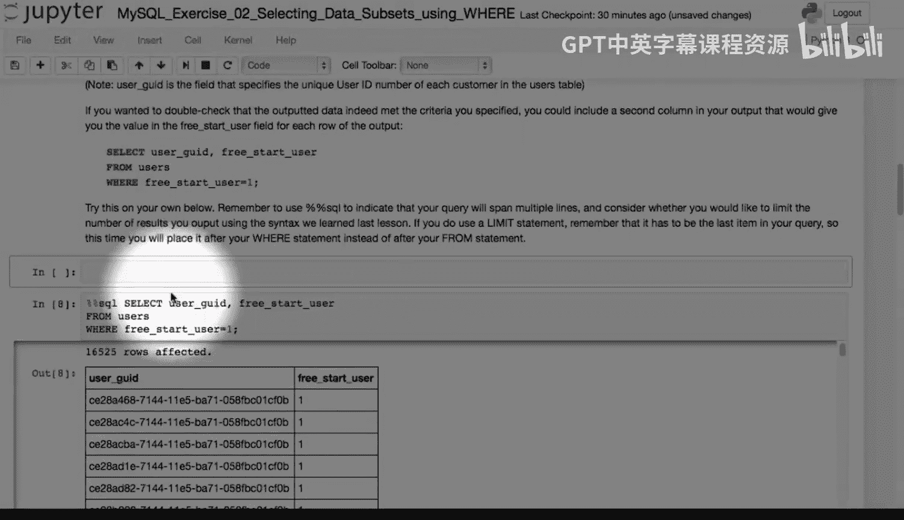

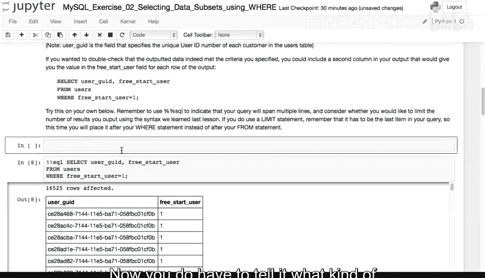

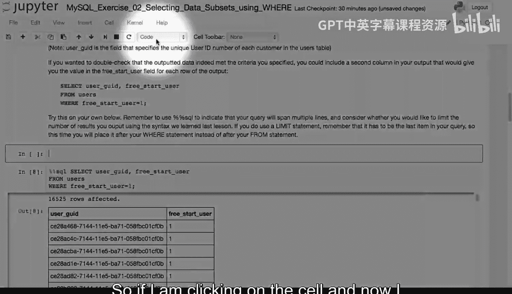

我们无法配置这些 Notebook 来阻止你编辑它们。这有一个好处，就是可以向你展示如何用它来记笔记和彼此分享内容。但这也意味着你有可能编辑这些 Notebook，即使这样做可能对你没有好处。

让我先展示好的部分。想象一下，你想为这个查询做一些笔记。每一个包含代码的区域都称为一个单元格，但这些包含文本的区域也是单元格。如果我点击这个文本，你可以看到这里有一个框包围着文本。所以这实际上也是一个单元格，任何包含文本的单元格都是用所谓的 **Markdown 语言** 编写的。这是一种非常简单的语言，在许多不同的程序中都有使用，尤其是在网络上用于格式化文本。

所以你可以做的是，实际上可以**包含你自己的单元格**。你可以自己插入一个包含笔记的单元格。如果你转到“Insert”菜单，你可以选择“Insert Cell Above”或“Below”。我们选择“Insert Cell Above”，你会看到它为你放入了这个单元格。

现在你需要告诉它你想在该单元格中输入什么类型的内容。如果我点击这个单元格，然后看到上面显示“Code”，这意味着这个单元格（就像我点击的这个一样，你看到它仍然显示“Code”）被配置为能够实际编写和执行查询。

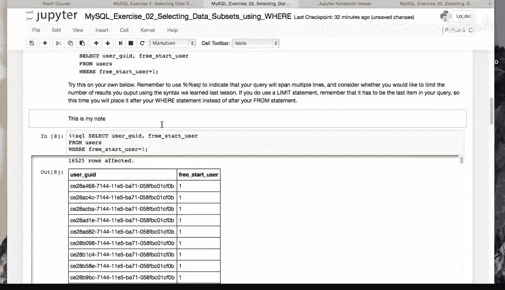

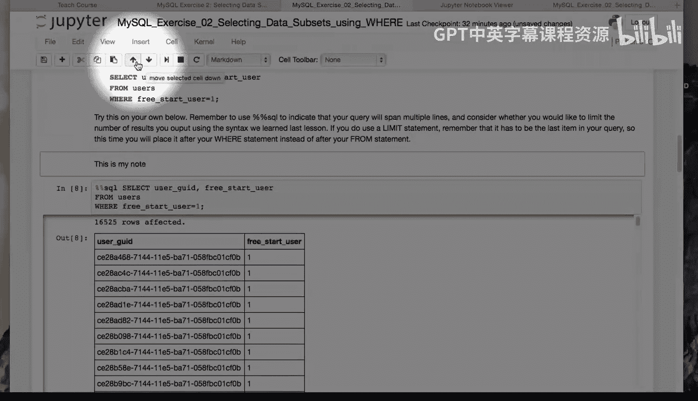

另一方面，当我点击这个单元格时，你看到它显示“Markdown”。所以如果我想把我自己的笔记放入这个单元格，我需要转到这个菜单，然后按“Markdown”，现在我就可以输入任何我想要的文本了，并且我可以为以后保存它。

你不需要运行它，但如果你希望它像这里显示的那样格式化，那么你实际上需要运行这个单元格。所以我点击单元格，然后再次按“Run”，现在你可以看到它的格式和这里一样了。

有很多技巧可以用来格式化你的 Markdown 单元格。稍后我会告诉你在哪里可以找到更多相关信息，因为这不是本课程的主要部分，我不想详述细节，但我会展示一些资源，如果你决定使用 Markdown，可以在那里找到所有你需要知道的信息。

一旦你创建了单元格，你可以移动它们。你可以使用这些按钮将单元格上移或下移。

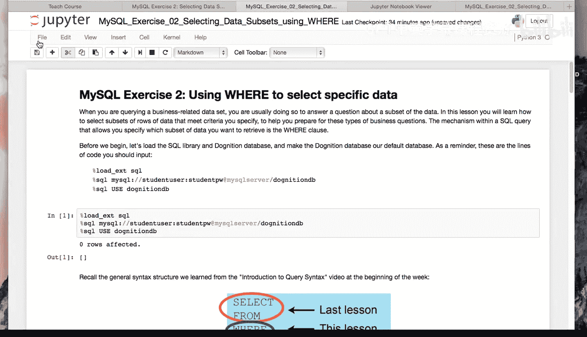

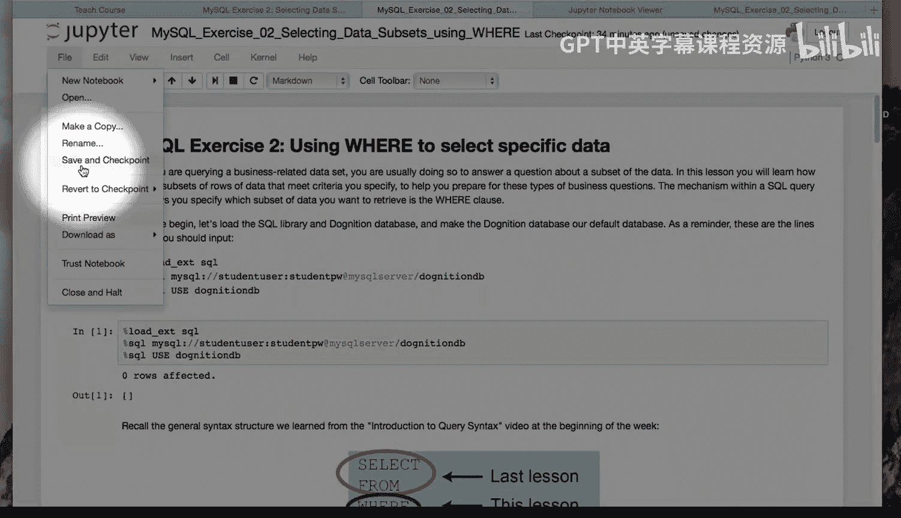

或者你可以使用这个下拉菜单，选择“Cut a cell”。然后你可以转到 Notebook 中的其他地方，在那里粘贴它。你可以选择“Paste Cell Above”、“Below”或“Paste in Place”等选项。请随意尝试这些选项。这将为你提供一种很好的方式，可以保存笔记供以后使用。

当然，这样做的缺点是，即使你不想记笔记，也很容易意外地弄乱我为你制作的这些文本单元格。所以，如果你点击并双击了其中一个文本单元格，这就是你开始编辑其中一个 Markdown 单元格的方式。你会看到它突然变成这样，看起来有点奇怪，这是用 Markdown 语言编写的文本。

如果这种情况发生在你身上，别担心，不要惊慌，你只需要再次按下“Run”按钮，它就会恢复正常。让我再演示一次。如果意外地，你点击了其中一个文本单元格并双击，这给了你编辑文本单元格的机会。如果你不想这样做，再次按下“Run”按钮，它就会看起来像你第一次收到 Notebook 时一样。

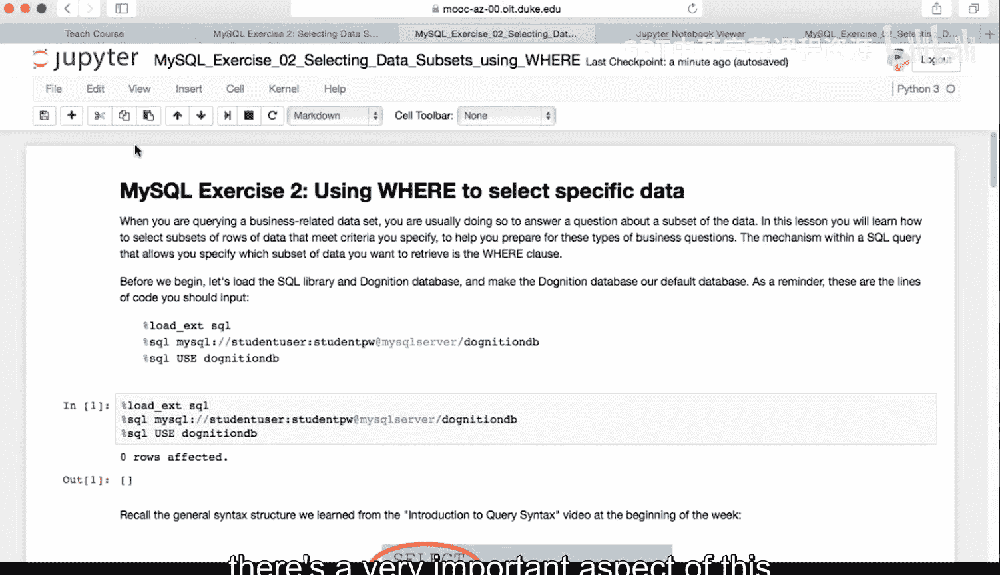

## 保存、检查点与帮助资源
当你与 Notebook 交互时，Jupyter 会自动保存更改。但你也可以自己保存。如果你转到“File”，然后选择“Save and Checkpoint”，这将保存你制作的工作簿，并创建一个所谓的 **Checkpoint**。

检查点是特定时间点的一个快照，Jupyter 会保存 Notebook 在该时间点的确切样子。这允许你，如果你开始尝试然后搞乱了，或者不喜欢你所做的，你可以转到“File”菜单，选择“Revert to Checkpoint”，它会给你一个你已创建的不同检查点列表，你可以选择其中任何一个，回到你之前的状态。它会给你这个选项，你可以选择恢复或不恢复。正如它告诉你的，如果恢复，则无法撤销。所以，如果你要回到某个检查点，请确保你知道你想这样做。我们按“Cancel”。

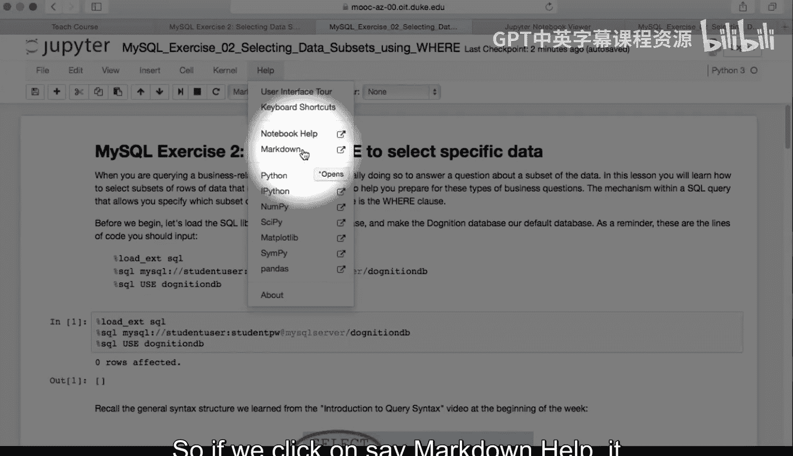

在我向你展示下一组关于 Jupyter 的内容之前，有一个非常重要的方面你应该知道，那就是**帮助**。

Jupyter 有很棒的帮助资源。你应该特别关注两个不同的东西，但也可以随意查看任何其他内容。实际上，有三件事你应该知道。首先，有一个界面导览，我认为你会发现它非常有用，所以我建议你看一下。但你也可以查看“Notebook Help”或“Markdown Documentation”，这两者都非常有用。

如果我们点击“Markdown Help”，它会带你到这个网页，为你提供所有关于如何使用 Markdown 的说明。所以，如果你想开始尝试如何编辑单元格，就应该来这里。

另一个非常有用的东西是“Notebook Help”。这为你提供了各种部分，告诉你所有关于如何运行代码的基础知识。真的，如果你有任何问题，这是你应该去的地方，是找到任何答案的最佳场所。

## 导出与分享
在我们转到主菜单之前，我想展示的最后一件事是如何保存你的 Notebook，或者打印或导出它们，以便你可以用另一种方式查看，或者与彼此分享。

要做到这一点，请转到“File”菜单并点击。有几个不同的选项供你选择。你可以将你的 Notebook 下载为 **iPython Notebook** 文件，我稍后会向你展示如何将这些文件上传到你的主目录。这为课程中的你们提供了一种彼此互动的方式，可以互相分享查询和所学内容，这样你就可以像这里一样编写自己的文本，向彼此展示正在进行的查询，然后互相帮助。

另一件你可以做的事是将你的 Notebook 保存为 **PDF**。一种方法是转到菜单的下载部分，点击“PDF via LaTeX”。但这实际上不是我最喜欢的方式，因为有时 LaTeX 格式非常分散，可能会占用很多页。所以我更喜欢的方式是转到“Print Preview”，这会给你一个类似这样的视图，它会更加紧凑，在你的打印输出中页数更少。一旦你得到这个，你可以转到“File”然后“Print”。下一个屏幕在每个人的电脑上看起来都会不同，因为每个人的配置都不同，你可能使用 Mac 或 PC，所以这会看起来有点不同。但应该总是有一些选项可以打印为 PDF，这样你就可以保存一个文件供以后使用，以便查看你的查询或笔记，或者让你打印出来，以便在学习时查看。

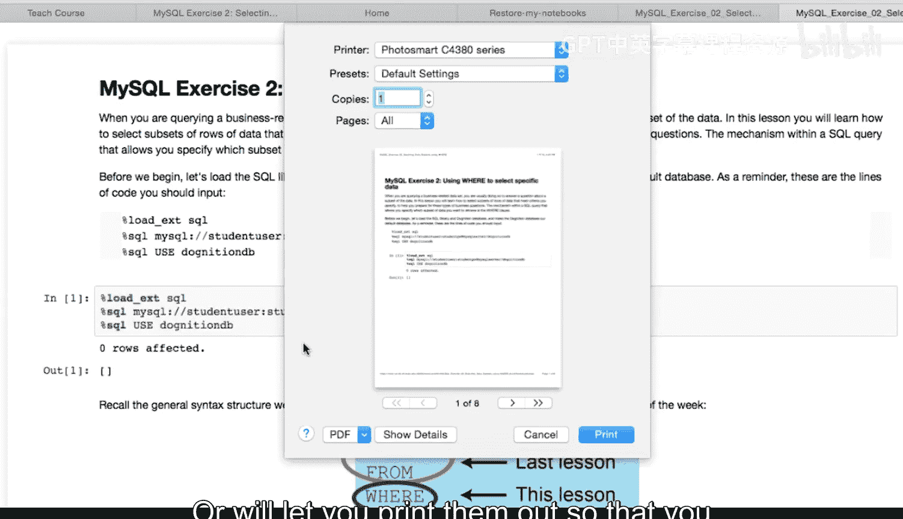

## 总结
做得好！你现在已经知道如何使用 Jupyter Notebook 了。在下一个视频中，我将向你展示如何使用 Jupyter 账户的主页来创建新的 Notebook、重命名 Notebook 以及彼此分享 Notebook。我们下个视频见。