#  146：个人 Jupyter 账户操作教程 📓

在本节课程中，我们将学习如何使用 Jupyter 账户的主页界面来创建新笔记本、重命名、重新组织笔记本，以及如何与他人共享笔记本。

## 访问主目录

上一节我们介绍了 Jupyter 笔记本的编辑界面。本节中，我们来看看如何管理所有笔记本文件。

要从当前笔记本界面返回存放所有笔记本的主目录，请点击左上角的 **Jupyter 图标**。点击后，页面将跳转到主目录，您会看到本课程提供的所有 12 个笔记本文件都已列出。此外，这里还有一个名为“Restore my notebook”的笔记本，稍后会进行说明。

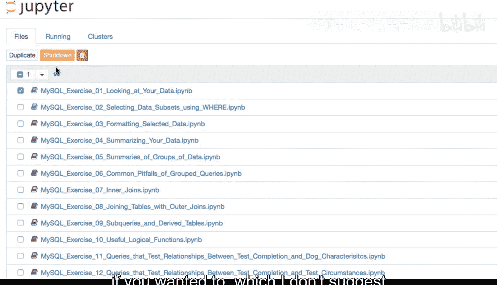

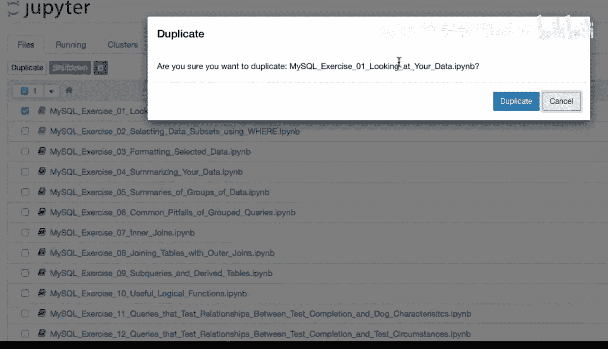

## 管理笔记本文件

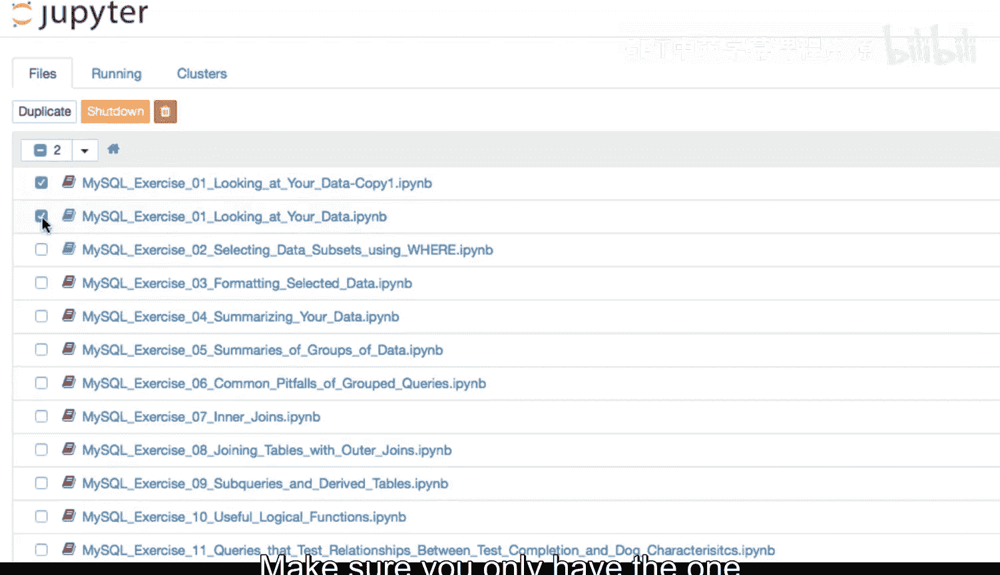

在主目录界面，您可以对笔记本进行多项操作。以下是可用的主要功能：

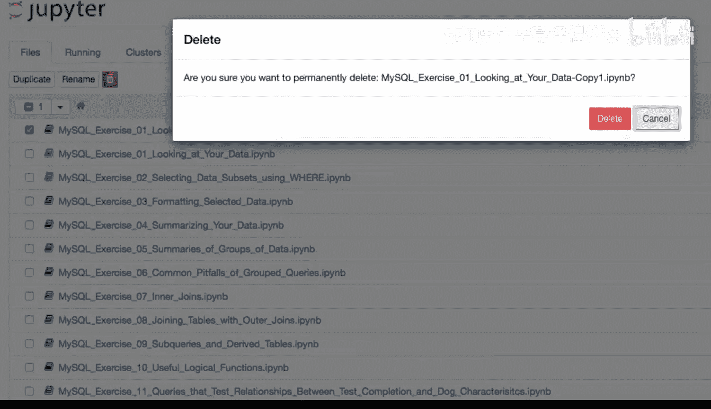

*   **选择与操作**：点击笔记本名称左侧的复选框，会出现几个选项。
*   **复制笔记本**：选择“Duplicate”可以创建该笔记本的副本。
*   **关闭笔记本**：选择“Shutdown”可以关闭正在运行的笔记本以节省系统资源。您的工作会自动保存，不会丢失。
*   **删除笔记本**：选择“Delete”可以永久删除选中的笔记本（请谨慎操作）。

## 查看与关闭运行中的笔记本

您会注意到，某些笔记本旁边有绿色圆点并标注了“running”，这表示它们当前正处于打开状态。

点击顶部的 **“Running” 选项卡**，可以查看所有当前打开的笔记本列表。为了节省您自己、同组约150名同学以及杜克大学的系统资源，建议在不使用笔记本时将其关闭。关闭操作会保存您的所有工作，包括输出结果和编写的查询代码。

关闭笔记本最简单的方法就是进入“Running”选项卡，然后点击“Shut down”。您也可以在“Files”选项卡中通过勾选笔记本并选择“Shutdown”来完成此操作。

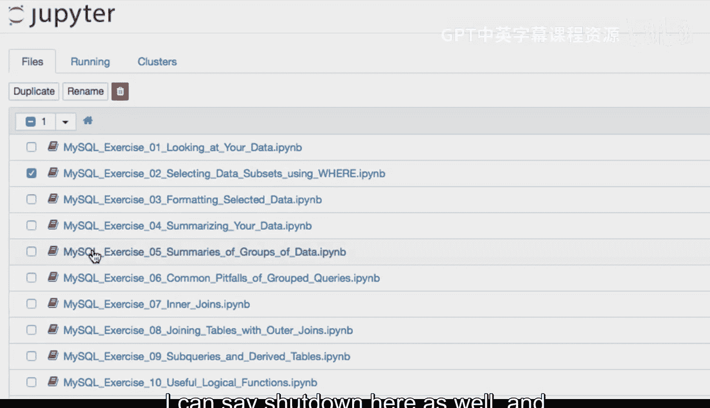

## 创建新笔记本

除了使用课程提供的笔记本，您也可以创建自己的笔记本来记录笔记或尝试新内容。

在主目录界面右侧，找到 **“New” 按钮**。点击后，您可以选择创建文本文件，或者创建一个新的笔记本。若要创建新的可执行代码笔记本，请选择 **“Python 3”** 选项。

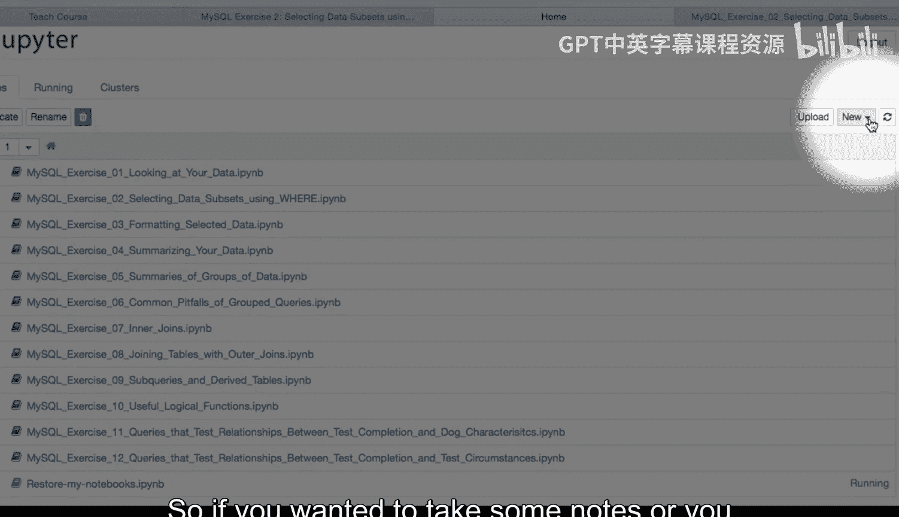

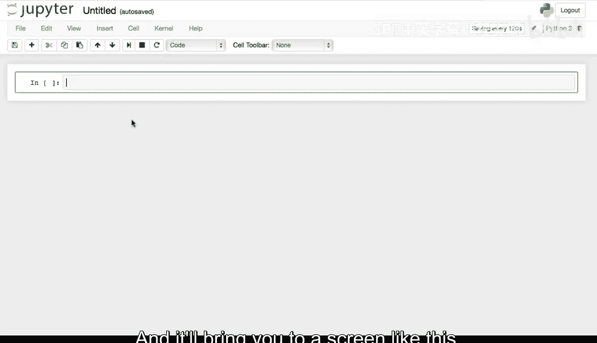

创建后，您可以在新笔记本的顶部更改标题，并根据需要添加新的单元格，将其类型设置为 Markdown 或代码。

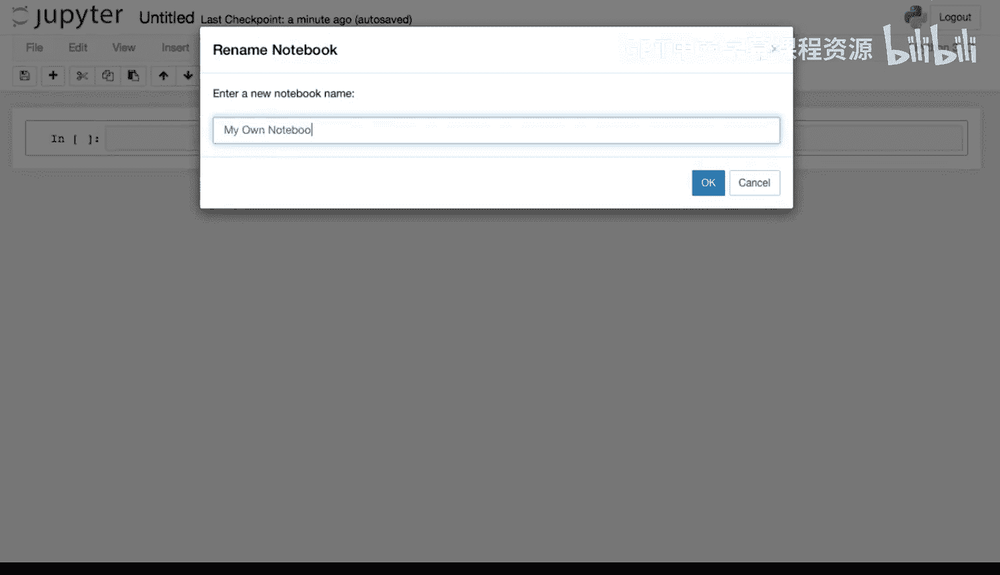

## 共享笔记本文件

“Upload” 按钮为您提供了与同学共享 Jupyter 笔记本的途径。

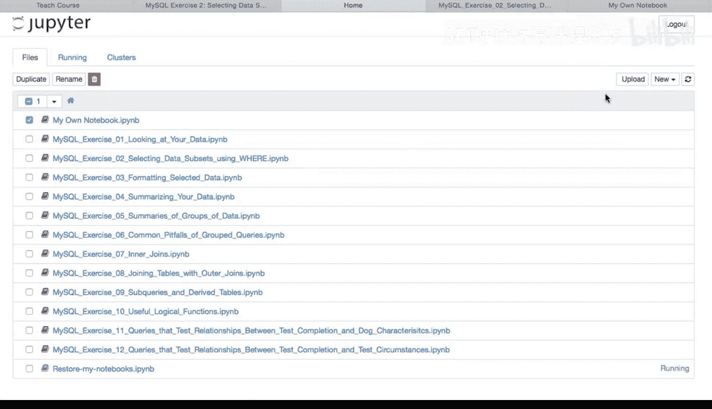

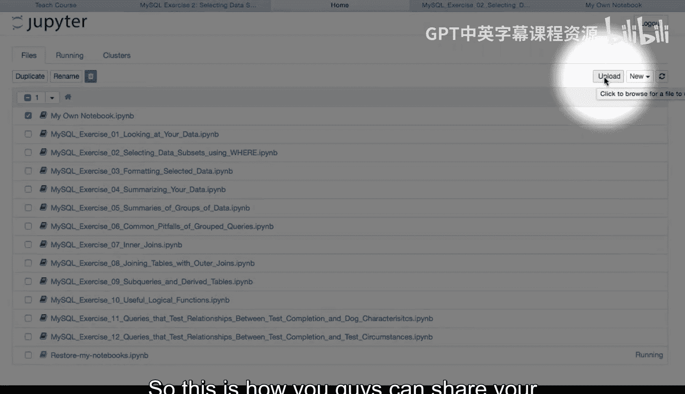

点击 **“Upload”** 按钮，系统会打开文件导航窗口。您可以导航到保存笔记本文件的位置，选择文件后点击“Choose”，该笔记本就会被上传并显示在您的主目录中。这为协作学习提供了便利。

## 恢复笔记本

我们提供了 **“Restore my notebook”** 这个笔记本，以防您在操作中遇到问题。

如果您对笔记本进行了过多修改，导致查询无法停止运行或系统似乎崩溃，可以使用此功能将所有笔记本恢复到初始状态。**请注意**，此操作会恢复所有课程笔记本，而不仅仅是其中一个。

打开“Restore my notebook”笔记本，里面会有详细说明。您需要运行其中的特定代码单元格来执行恢复。**重要提示**：在执行恢复前，如果您想保留之前在任何笔记本上所做的工作，**必须重命名那些笔记本**，否则它们将被初始版本覆盖。

## 高级功能：文件夹管理

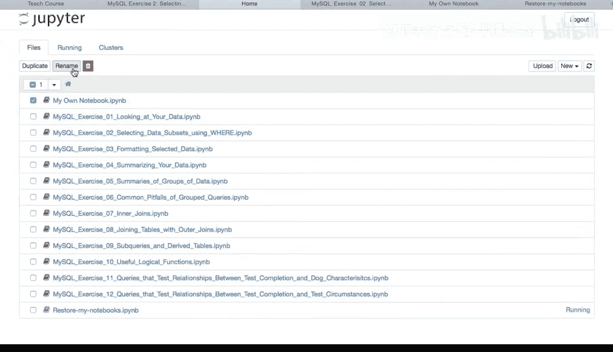

如果您开始创建大量自己的笔记本，可能会需要用到文件夹来整理。虽然此功能对于不熟悉编程的用户可能有些繁琐，但了解其用法仍有帮助。

在主目录点击 **“New”**，然后选择 **“Folder”**，即可创建一个新文件夹。创建后，您可以点击文件夹左侧的复选框，然后选择“Rename”来为其重命名。

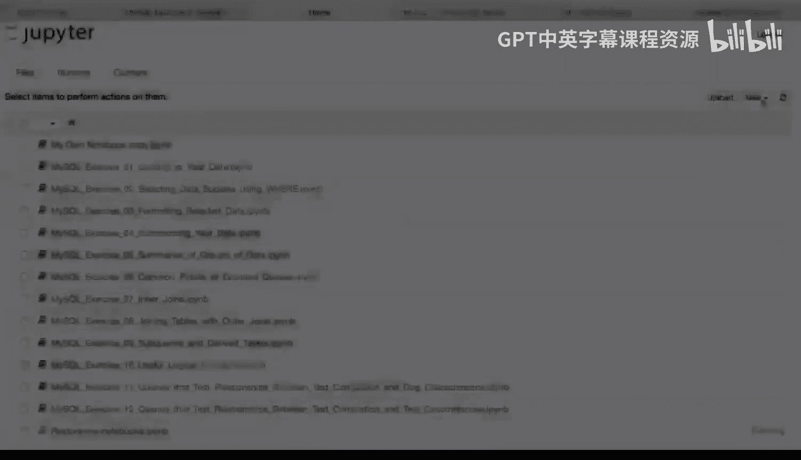

若要将一个笔记本移入文件夹，操作稍显复杂。您需要**重命名该笔记本**，并在新名称前加上**文件夹名称和反斜杠**。例如，要将笔记本“my_notebook.ipynb”移入名为“practice”的文件夹，新名称应设置为 `practice/my_notebook.ipynb`。

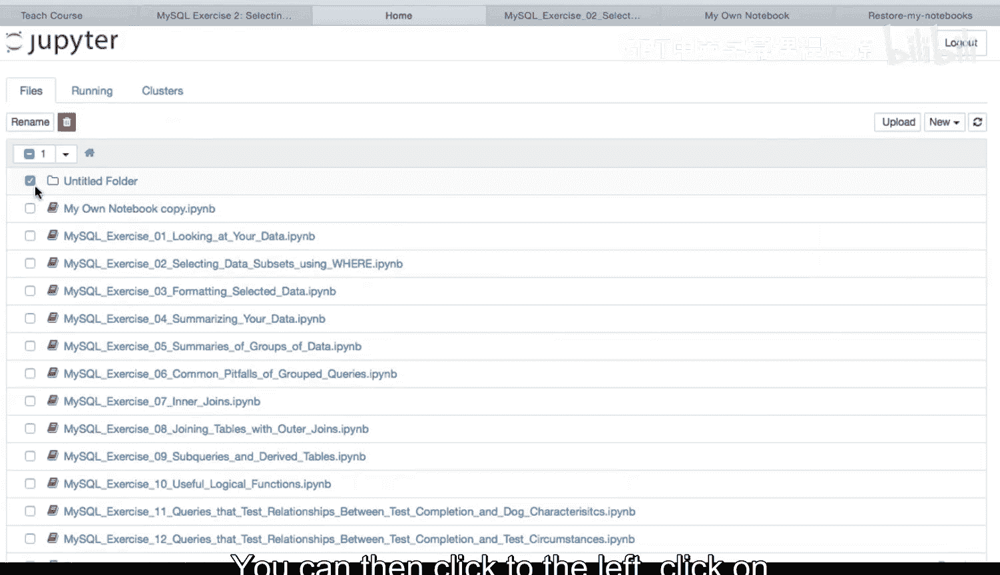

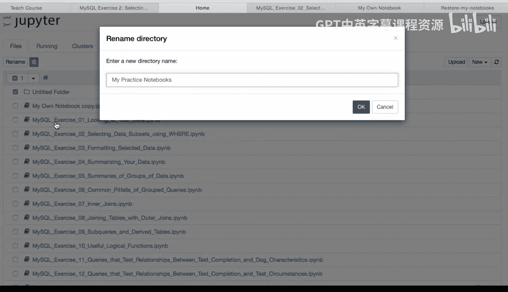

操作完成后，该笔记本会从主目录消失。点击进入相应的文件夹，即可看到它。要返回主目录，点击页面左上角的 **小房子图标** 即可。

## 关于重命名的重要提醒

最后需要了解的是，如果您决定重命名课程提供的原始笔记本文件，将会产生一个影响：

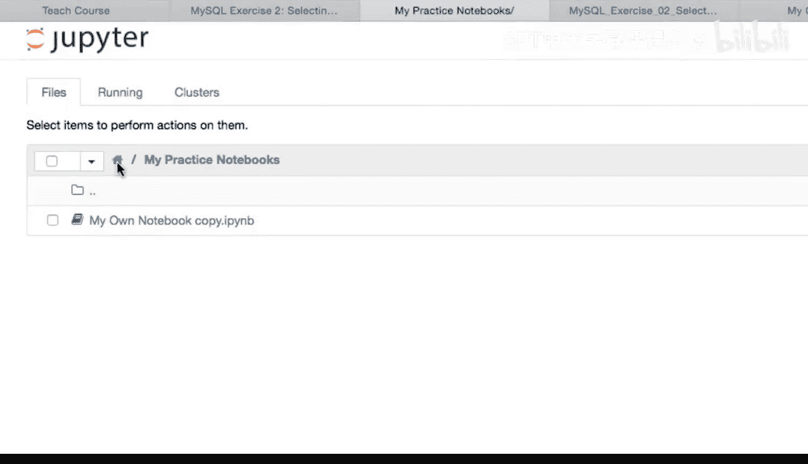

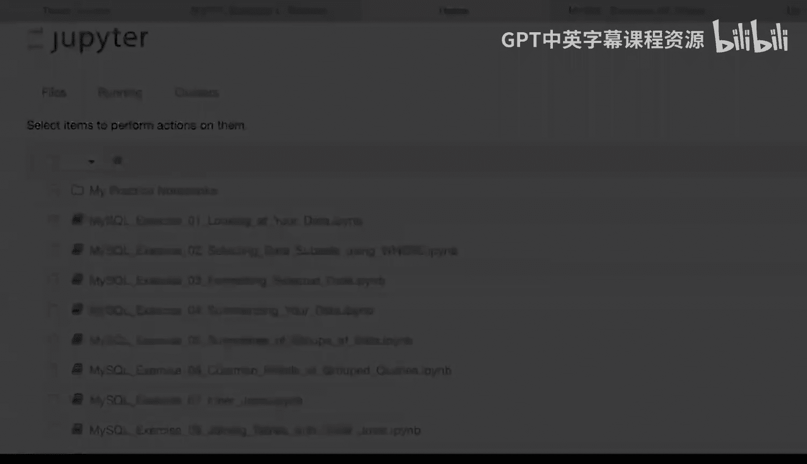

Coursera 课程网站上的链接分为两种：一种是直接跳转到特定课程或笔记本的链接；另一种是跳转到您 Jupyter 主页的链接。

如果您更改了某个课程笔记本的名称，那么**直接跳转到该特定课程的链接将不再有效**。不过，您仍然可以使用跳转到主页的链接，然后从主目录手动找到并打开重命名后的笔记本。如果您因某些原因需要重命名课程笔记本，请务必记住这一点。

## 总结

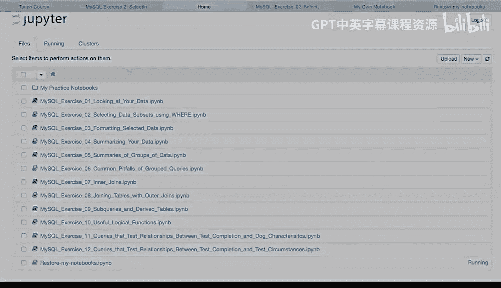

本节课中，我们一起学习了 Jupyter 账户主页的核心操作：包括访问和管理主目录、创建与共享笔记本、使用恢复功能以及进行文件夹管理。您现在已掌握了在本课程中使用 Jupyter 所需了解的全部基础知识。

下一步，请前往课程材料，点击链接开始学习“my_SQL_Ex1：查看数据”。当您准备好学习如何使用 Teradata 时，我们下一节视频再见。祝学习顺利，探索愉快！😊