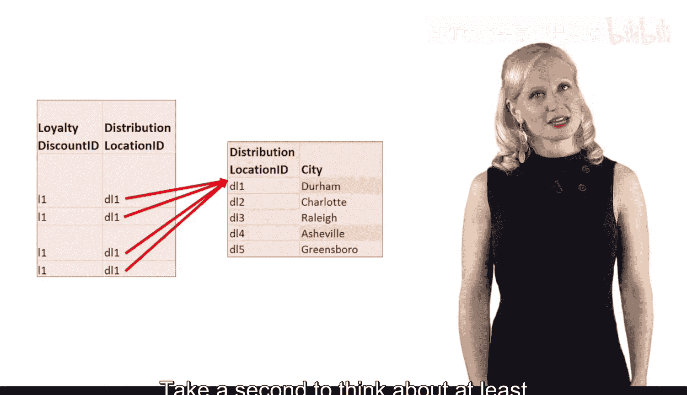
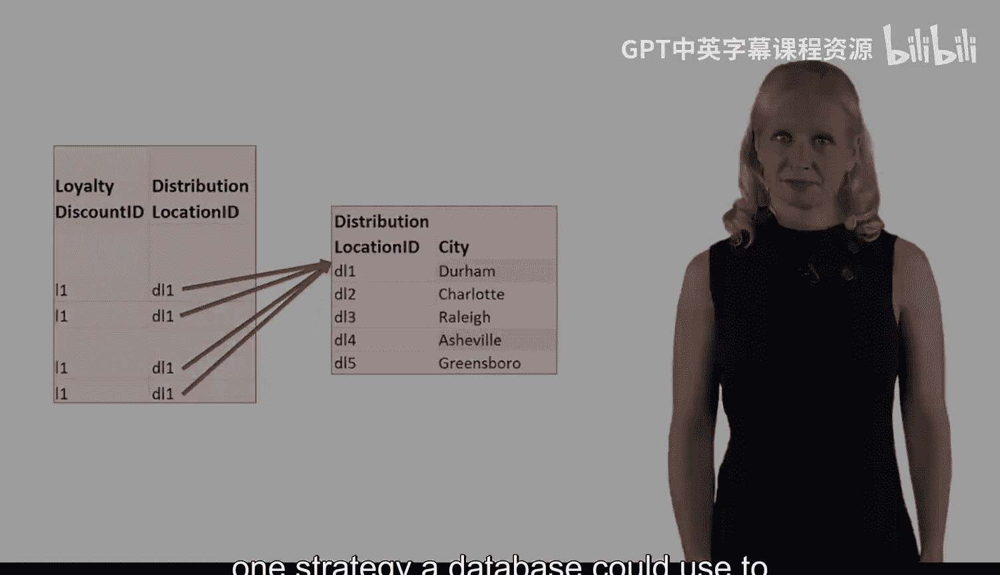
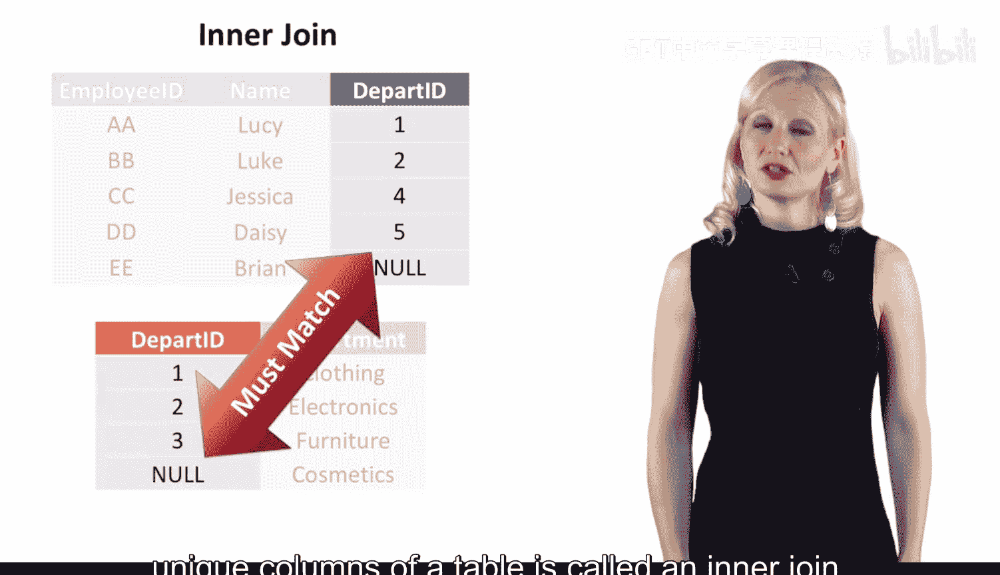
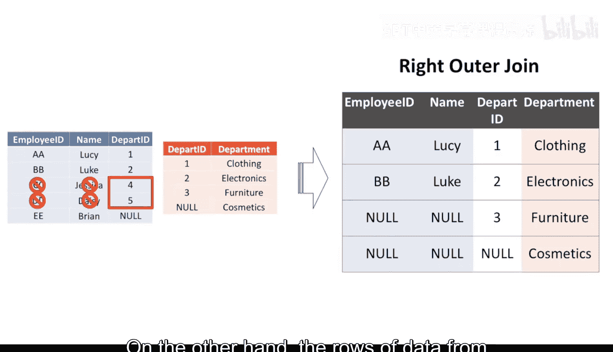

#  150：连接查询基础概念 🧩


在本节课中，我们将学习关系型数据库中一个核心且强大的功能：**连接（Joins）**。我们将探讨连接查询的基本概念、不同类型及其工作原理，为后续处理更复杂的数据关系打下坚实基础。

## 概述

关系型数据库通过将大型数据集分解为具有统一主题的较小数据表来工作。这种策略有效的前提是，当我们需要时，能够将这些表重新组合起来。**连接（Joins）** 正是实现这一目标的 SQL 命令类别。理解连接的关键在于掌握关系数据库的构建方式以及集合论中的笛卡尔积概念。

## 连接要解决的问题

为了理解连接的作用，让我们先看看它旨在解决什么问题。

回顾我们为“Egggarers 烘焙咖啡大赛”数据库创建的表。我们聚焦于其中两个表：`orders`（订单表）和 `distribution_center`（配送中心表）。为了从 `orders` 表中获取任何关于商品配送中心的信息，我们必须通过匹配 `distribution_location_id`（配送位置ID），将 `orders` 表的每一行数据链接到 `distribution_center` 表的相应行。

之前我们讨论了链接表作为组织数据库的一般概念，现在我们需要思考数据库实际建立这种链接的细节。

## 连接的基本策略：从低效到高效





一种可能首先想到的策略是，数据库可以逐行遍历 `orders` 表的 `distribution_center_id` 列，并询问：“这是哪个配送中心ID？是 DL1 吗？好的，那么它就与 `distribution_center` 表中 DL1 行的所有数据匹配。”

你可以在 Excel 中使用 **`VLOOKUP`** 函数实现此策略，如果数据集不大，它会工作得很好。

```excel
=VLOOKUP(lookup_value, table_array, col_index_num, [range_lookup])
```

但是，如果你必须将 `VLOOKUP` 函数复制到分布在多个 Excel 工作表中的 1 亿行呢？即使你是 Excel 专家，仅将公式粘贴到所有合适的单元格也需要不少时间。

虽然计算机在此类操作上比人类快得多，但对于数据库而言，类似的概念仍然成立：让数据库查找信息的操作，相比其他类型的数学运算，总是相对较慢。数据库需要查找信息的次数越多，或者需要搜索的信息池越广，数据库查询的速度就越慢。因此，逐行策略效率低下。

## 集合论与笛卡尔积的引入

那么，有没有其他策略呢？这时，**集合论** 来解围了。集合论中组合两个集合的理论方法是通过 **乘法**，产生所谓的 **笛卡尔积（Cartesian Product）** 或 **叉积（Cross Product）**。对于集合，乘法并不意味着数值相乘。笛卡尔积是一个包含两个表中所有可能项目对的集合。

如果这是我们的订单表（集合 A），那是我们的配送中心表（集合 B），那么这就是两个集合的笛卡尔积（A × B）。

数据库组合表的方式是：首先，根据你在查询中指定的条件，过滤你用来链接表的列。然后，它生成这些过滤后列的笛卡尔积。最后，附加你在查询中要求的任何其他列。

因此，在查询中连接表以获取所需数据的方法是：指定 **“我只想要在唯一ID列中具有相同ID的行的笛卡尔积”**。

你需要了解笛卡尔积，因为有时当你连接具有重复行或存在多对多关系的列的表时，会得到意外的输出。只有记住 **“连接以笛卡尔积为基础”** 这一基本概念，这些输出才有意义。

## 四种基本连接类型

我们将逐步理解这些复杂情况，但让我们先从理想情况开始思考连接：没有重复行，并且一个表中的每一行只与另一个表中的一行相连。

假设你有以下两个通过部门ID `D` 链接的表。你至少有四种不同的方式可以组合这些表。

### 内连接（INNER JOIN）

第一种情况是，如果你想找出所有在当前部门工作的员工。在这种情况下，你需要一个所有员工行的列表，这些员工行在部门表的唯一列中具有匹配的部门ID。

这种连接类型，**只有当一行在其链接列中的值同时出现在两个表的唯一列中时，该行才会被包含在结果中**，称为 **内连接（Inner Join）**。

以下是这两个表内连接的结果：



由于部门表中没有部门ID 4或5，并且员工表中没有部门ID 3，因此员工“Jessica”、“Daisy”和“家具”部门将被排除在结果之外。


同时注意，员工“Brian”和“化妆品”部门也从结果中删除，因为 **`NULL`** 值永远不能用于在连接中链接行。`NULL` 值不会链接到其他任何值，它们直接被排除。

### 左外连接（LEFT OUTER JOIN）

如果你想要所有员工及其部门的列表，**无论该员工的部门是否在当前部门表中**，该怎么办？在这种情况下，你可以使用 **外连接（Outer Join）**。当你编写外连接时，在查询中输入表的顺序很重要。连接的名称定义了哪个表的所有值将被包含。

假设我们在查询中先输入 `employee` 表，后输入 `department` 表。在这种情况下，这两个表的 **左外连接（Left Outer Join）** 结果将是：**左侧表（员工表）的所有值都被包含**。右侧表的值只有在其链接列中的值与左侧表的链接列匹配时才会被包含。

以下是对我们的表进行左连接的结果：

你可以看到，我们所有的员工都包含在输出中，但包含的部门仅限于那些在部门ID列中有匹配值的部门。

注意，每当员工表中有一行的部门ID在部门表中没有匹配项时，部门信息就列为 `NULL`。这次，员工表中具有 `NULL` 值的行被包含在输出表中，因为没有要求它必须与另一列中的值匹配。

### 右外连接（RIGHT OUTER JOIN）

你也可以检索所有当前部门及其匹配员工的列表，**无论员工表中是否有员工指向部门表中的某个部门**。

如果我们再次在查询中先包含 `employee` 表，后包含 `department` 表，我们可以使用 **右外连接（Right Outer Join）** 来获取此列表。在右连接中，**右侧表的所有结果都被包含**。左侧表的值只有在其链接列中的值与右侧表的链接列匹配时才会被包含。

因此，结果将如下所示：

这次，所有部门行都包含在输出中。然而，“家具”行在员工表中有 `NULL` 值，因为员工表的部门ID列中没有任何地方列出部门ID 3。

部门表中部门ID为 `NULL` 的数据行被包含在输出中。另一方面，员工表中那些部门ID未出现在部门表中的数据行被排除。

此时你可能会想：等等，如果我运行一个左连接但反转查询中表的输入顺序，难道不能得到相同的结果吗？答案是：**是的，完全可以**。




左外连接和右外连接是相当冗余的，它们只是为你编写查询提供了灵活性。以此顺序编写表的左外连接，与以相反顺序编写表的右外连接，会得到相同的结果。

### 全外连接（FULL OUTER JOIN）

还有一种我们尚未讨论的连接类型：**全外连接（Full Outer Join）**。

全外连接会给出**列在任一表中的所有员工和部门**，无论它们是否与另一表中的值匹配。

如果你只是想提取所有符合某个条件的数据，以便在分析中检查每一份原始数据，你可能会使用这种连接。我们两个表之间的全外连接结果将如下所示：

你可以看到所有行都被包含，并且每当有一行在部门ID列中没有匹配值时，就会输入 `NULL` 值。

需要知道的一个重要点是：**并非所有数据库管理系统都支持全外连接**。特别是，**MySQL 不支持全外连接**，而 **Teradata** 支持。并非所有数据库管理系统都支持全外连接这一事实，也让你感受到它们的使用频率有多低。

## 总结

本节课我们一起学习了 SQL 连接查询的基础概念。我们了解到，连接是关系型数据库组合分散数据表的核心工具，其理论基础是集合论的笛卡尔积。

我们详细探讨了四种基本连接类型：
*   **内连接（INNER JOIN）**：仅返回两个表中匹配的行。
*   **左外连接（LEFT OUTER JOIN）**：返回左表所有行，以及右表中匹配的行。
*   **右外连接（RIGHT OUTER JOIN）**：返回右表所有行，以及左表中匹配的行（功能上与调整表顺序的左连接等效）。
*   **全外连接（FULL OUTER JOIN）**：返回两个表中所有行，无论是否匹配（并非所有数据库都支持）。


到目前为止，我们只查看了在链接列中每个值仅有一个匹配项的表上应用连接的结果。当你对外连接应用于**关系基数大于一**的表，或者表中存在**重复行**时，结果会变得稍微复杂一些。在接下来的视频中，我们将一起探讨其原因。