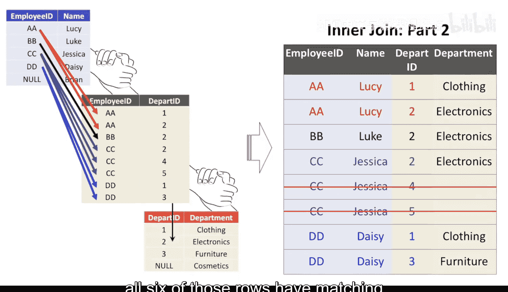
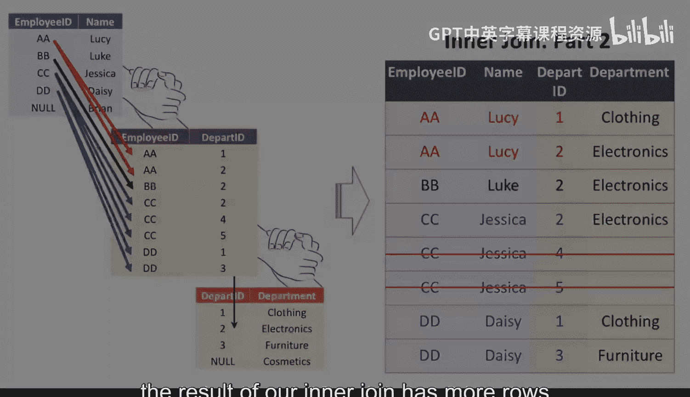
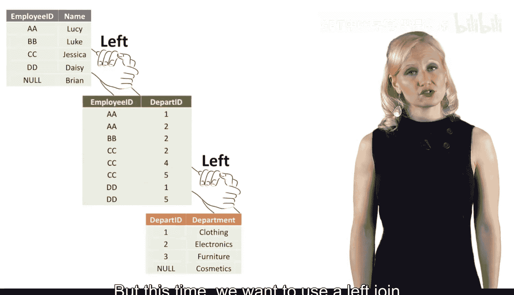
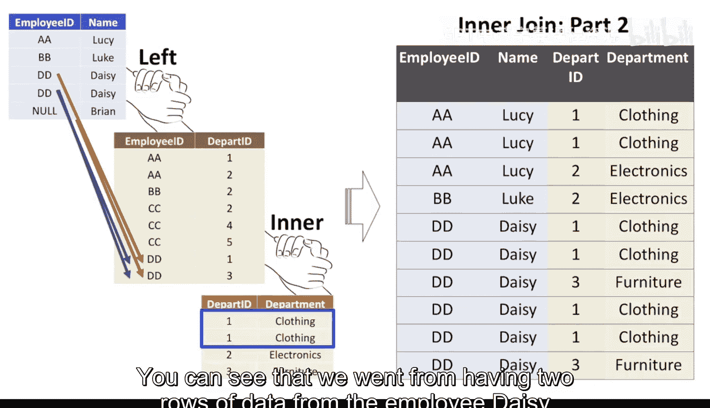
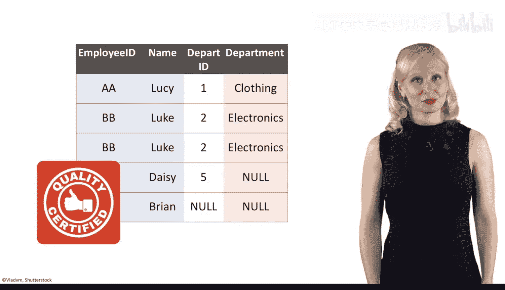

#  151：多对多关系与重复数据的连接处理

在本节课中，我们将深入探讨数据库连接操作中的两个重要概念：多对多关系的连接处理，以及当表中存在重复数据时连接操作可能带来的复杂情况。理解这些概念对于准确分析数据至关重要。

## 连接类型回顾

上一节我们介绍了连接的基本类型，这些概念总结在下图中。

*   **内连接** 保留两个表中所有共有的行，不包括空值。
*   **左连接** 保留左表中的所有行（包括空值），并且只包含右表中匹配的信息。
*   **右连接** 保留右表中的所有行（包括空值），并且只包含左表中匹配的信息。
*   **全外连接** 包含两个表中的所有行，并在可能的情况下进行匹配（MySQL 不支持全外连接）。

这些概念都是准确的，这张图也是教科书或网络上常见的优秀参考。但是，如果你忘记了笛卡尔积的概念，这张图可能会产生一些误导。当你开始处理最大基数约束大于一的关系时，你就会明白原因。

## 多对多关系对连接结果的影响

例如，上图给人的印象是所有内连接的结果表都会比输入表小。然而，如果你的一个表中的值可以关联到另一个表中的多个值，情况往往并非如此。

为了理解这是如何发生的，让我们逐步分析一个例子。

让我们再次连接员工表和部门表，但这次，每个员工可以属于多个部门，每个部门也可以拥有多名员工。

回顾课程第一周的内容，为了将具有多对多关系的实体放入关系型数据库，你总是需要一个链接表，该表包含指向你最终想要链接的表的外键。

因此，在这种情况下，我们需要连接三个表才能最终合并员工和部门信息。

当你连接多个表时，需要一次连接两个表，然后将每次连接的结果与后续的表进行连接。因此，要将员工表中的信息与部门表中的信息连接起来，首先必须将员工表与分配表连接起来。

当我们执行这个连接时，只要员工ID匹配，数据库就会生成两个表之间所有可能的行组合，即笛卡尔积。

在这种情况下，有时会有多个分配行具有相同的员工ID，因此连接操作将输出每个具有相同员工ID号的员工行和分配行的组合。结果，内连接将输出八行，即使员工表只有五行，并且有一个未被包含的空值。

当我们连接第一次连接的结果与部门表时，最初的八行中有六行将被保留，因为这六行在部门表中都有匹配的部门ID。所以最终，我们的内连接结果比我们正在连接的任何单个表都拥有更多的行。

请记住，每次你查看这张略有误导性但仍非常有用的参考图时，这种情况都可能发生。

## 混合使用不同连接类型的注意事项

这张图难以体现的连接操作的另一个方面，是当你使用不同类型的连接来连接多个表时会发生什么，这通常意味着你可能会意外地混合使用不同类型的连接。

为了说明这一点，让我们再次链接员工表和部门表。但这次，我们希望使用左连接，因为我们想要一个所有员工的完整列表，无论他们是否被分配到某个部门。

你可以看到，这次我们第一次连接的结果有九行，因为包含了员工表第5行中的空值。到目前为止一切顺利。如果我们然后使用另一个左连接将第一次连接的结果与部门表连接起来，我们将在输出中保留所有九行，其中三行在部门列中将没有值。

但是，如果我们在第二个连接语句中忘记了 `LEFT` 这个词，从而意外地计算了第一次连接结果与部门表之间的内连接呢？

现在，我们的九行中将有四行被移除，因为它们没有出现在部门表中的部门ID。如果你有一个非常大的数据集，并且是对连接结果进行聚合而不是单独查看连接输出的每一行，查询当然可以运行，但你的结果将不是你想象的那样，而且可能很难注意到你犯了错误。

有时，在组合表时，你确实有意想要改变连接类型，所以我不希望你认为必须始终使用相同的连接类型。相反，我只是希望你记住，运行连接的顺序很重要，因此你需要确保在查询的正确位置，对正确的表对应用正确类型的连接。

## 处理含有重复行的表连接

关于连接，还有一件事需要记住，那就是当你连接含有重复行的表时会发生什么。

连接操作会将重复行保留在输出表中，因为连接概念本身没有移除它们的机制。因此，这两个表的左连接结果将如下所示：员工表中的重复行会被传递到连接结果中。

但由于笛卡尔积的存在，当你连接两个不仅包含重复行，而且具有多对多关系的表时，情况会变得有些棘手。本质上，你的重复行会被成倍增加。

让我们回到员工表、分配表和部门表的连接。现在，员工表中有一对重复行，部门表中也有一对重复行。

当我们首先对员工表和分配表进行内连接时，每个重复行都会被链接表中所有具有相同员工ID的行相乘，因此输出将为你提供链接表中每个具有员工ID `D` 的行的副本。

但这甚至变得更复杂。当我们将第一次连接的结果与部门表进行内连接时，每个部门ID为 `1` 的行都会被复制，所以最终结果将如下所示。你可以看到，我们从拥有员工Daisy的两行数据，变成了拥有员工Daisy的六行数据，尽管其中只有两行代表真实的记录。

这就是连接重复行时可能发生的情况。你可以想象，如果你连接大量重复行，这种倍增效应会变得多么失控。事实上，我们将在我们的Dotion数据集中看到一个这样的例子。

## 处理重复数据的建议

现在你已经看到了处理混乱数据集时可能发生的各种情况，你或许能理解数据库人员为什么希望对数据库设计和实际数据库使用不同的术语。

基于集合论的数据库设计假设没有重复行。但在现实生活中，存在重复行，并且处理它们可能非常具有挑战性。因此，使用区分理论与现实生活的术语是有用的。

关于如何处理这些重复行，以下是一些良好的实践建议。

首先，在进行分析之前，尽可能清理数据并消除尽可能多的重复行是一个好主意。但有时这不切实际或不可能。

因此，你应该养成一个习惯：在将一个查询中链接多个连接之前，先查看你将要连接的每一对表所输出的少量测试行。逐步确保你将要运行的每个独立连接，在你开始聚合连接结果或进行任何其他复杂操作之前，都能给出你期望的结果。这也有助于确保你不会在特定步骤中输入错误的连接类型。

在分析开始时花时间仔细检查查询的每个部分，可以避免你日后因误解那些你并不知道是错误的结论而陷入大量麻烦。因此，我强烈推荐这个习惯。它将确保你掌控你的连接操作，而不是让它们控制你。

## 总结

本节课中我们一起学习了多对多关系如何通过链接表和笛卡尔积影响连接结果的行数，理解了混合使用不同连接类型时需要特别注意顺序和类型，并探讨了表中存在重复数据时，连接操作可能导致数据被意外倍增的复杂情况。最后，我们强调了在分析前清理数据、逐步测试每个连接结果的重要性。掌握了这些知识，你就可以开始连接一些表了。享受这个过程，并且别忘了笛卡尔积。

