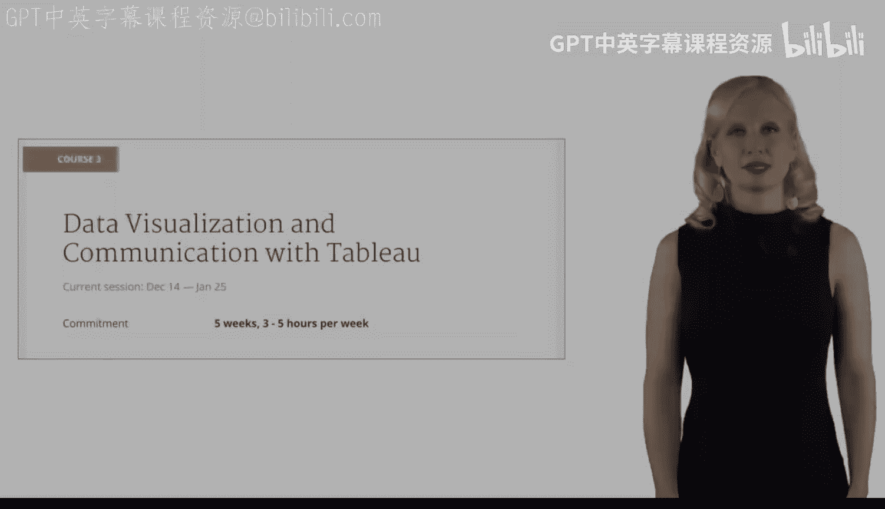

#  155：从制定分析计划开始 📋

在本节课中，我们将要学习为何在开始数据分析项目前，制定一个结构化的分析计划至关重要。我们将探讨缺乏计划的潜在风险，并介绍一种有效的计划方法。

恭喜你完成了所有的 SQL 课程学习。你应该为自己感到自豪。你现在已经学会了检索数据所需的一切知识，这些数据将帮助你开始研究如何提高 Dian 公司的测试完成率，这正是 Dian 公司希望我们帮助解决的商业问题。

你已经准备好开始我们的分析了。但还不行。我很高兴你渴望投入分析，相信我，我也非常兴奋能分析这个数据集。但你需要思考以下问题。

作为一名商业分析师，你的工作不仅仅是做一些令人兴奋的事情。你的工作是明确企业究竟应该采取什么行动来解决问题。换句话说，是创造价值。更重要的是，要以尽可能快速高效的方式完成，并且最好能让你的项目投资者或利益相关者了解你的进展。

我将根据多年的数据分析经验给你一条建议，我在本专项课程中的“使用 Tableau 进行数据可视化与沟通”课程中也多次谈到这一点。

不要在没有结构化分析计划的情况下进入数据分析项目。甚至在开始查看数据之前就应该有计划。数据量越大，计划就应该越结构化。

记得我在之前的视频中提到过，数据分析项目需要提供对商业流程的洞察，这些流程是企业有能力且有意愿改进以创造新价值的。

数据分析师需要始终思考以下问题：哪些问题能提供可操作的洞察？我的问题的答案是否重要？我的问题的答案是否正确？

我们在学习如何编写聚合查询时讨论了最后一个问题。现在是时候讨论前两个问题了。

## 缺乏分析计划的风险 ⚠️

你可能听说过“分析瘫痪”这个术语，这是真实存在的。它发生在你被分析数据集的所有可能方式压垮，最终什么也没做的时候。

然而，更危险的是我称之为“分析大杂烩”的情况。这是当你开始分析任何看起来有趣或好玩的东西时。当你这样做时，最终会得到各种各样有趣但互不关联的结果，你不知道如何理解它们，即使你已经实施了数月复杂而精美的图表和分析。

当你使用这种分析策略向利益相关者展示你的发现时，你或许能从尝试过的不同分析中拼凑出某种孤注一掷的数据故事，但这个故事通常与需要解决的原始商业问题关系不大。

分析瘫痪和分析大杂烩的危险从一开始就存在，即当你想要开始摆弄数据以感受数据能告诉你什么的时候。虽然摆弄数据是有用的，实际上也是必要的，但你也可能以与目标无关的方式使你的策略产生偏见。

因此，在开始运行分析之前，制定一个关于你将实施哪些具体分析来解决你需要解决的商业问题的计划非常重要。这个计划应该受到以下两个指导性问题的启发。

## 制定结构化分析计划 🗺️

我们没有时间在本课程中详细讨论如何制定分析计划，但我在本专项课程早期的“使用 Tableau 进行数据可视化与沟通”课程中描述了我最喜欢的方法之一。我称那种方法为结构化金字塔分析计划。

既然我们现在无法一起制定一个，我已在课程材料中为你提供了一个大纲。本质上，你将看到的是一个针对项目的具体的、可衡量的、可实现的、相关的、有时限的目标，也称为金字塔顶端的 SMART 目标。

你将用于评估该目标的变量将写在目标下方。在这些变量下方，你会看到不断拓宽的类别和子类别层次，这些是为了实现你的 SMART 目标而需要分析的重要问题。

在正常情况下，这些类别应来自与你的利益相关者和分析团队在“需求征询”过程中的对话，以确保这些类别与你的解决方案——即你的公司愿意且能够实施的解决方案——相关。

结构化金字塔分析计划框架的一个特点是，你应该写下解决关于某个因素类别或子类别问题所需的确切变量或列名。既然你将是实际编写 SQL 查询来检索分析数据的人，这一步的效用现在应该清晰得多。你对自己需要分析的变量越具体，你就越能判断在给定数据库中的表的情况下，是否真的有可能分析这些变量。

明确你需要什么变量以及如何组合它们，也将使你更容易、更高效地推进并为每一类问题编写适当的 SQL 查询。

我们在“使用 Tableau 进行数据可视化与沟通”中学到的另一点是，数据分析在数据分析项目生命周期中只扮演一到两个部分的角色，而 SQL 查询扮演的角色甚至更为受限。

SQL 查询完全处于项目生命周期的这个部分，即我们检索数据和进行计算的时候。当然，SQL 查询对于项目的成功绝对至关重要，这就是为什么懂得使用 SQL 查询的数据分析师如此抢手。但重要的是要记住，查询只是你工作的一部分。

你需要确保你实施的查询能以正确的方式解决正确的问题，引导你形成一个关于哪些商业变革可以实现你的 SMART 目标的强有力的假设。

考虑到这一点，在接下来的几节课中，我将尽力（同时考虑到我们的主要目标是学习 SQL）让我们练习的这些 SQL 查询能够解决真实的分析问题，从而帮助我们获得一些可以呈现给 Dian 公司的洞察。我将处理的分析问题将基于课程材料中包含的结构化金字塔分析计划。

## 实践建议与总结 🎯

当你开始在自己的业务中进行 SQL 查询时，我强烈建议你为自己制定一个类似的分析计划。如果你需要学习如何做到这一点，请参考本专项课程中“使用 Tableau 进行数据可视化与沟通”第一周发布的材料。

本节课中我们一起学习了制定分析计划的重要性。我们了解到，在接触数据之前，一个清晰、结构化的计划是避免“分析瘫痪”和“分析大杂烩”的关键。它确保我们的分析工作始终围绕创造商业价值、解决具体问题展开，并能高效地与利益相关者沟通。记住，SQL 查询是强大的工具，但它们是服务于更宏观分析策略的一部分。现在我们已经了解了分析计划，让我们去帮助 Dian 公司解决他们的商业问题吧。