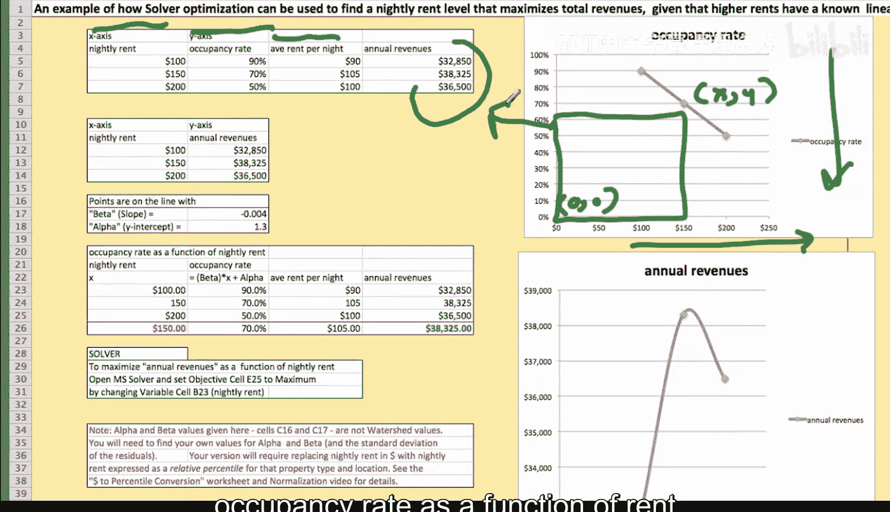

#  167：使用求解器实现收益最大化

## 概述

在本节课程中，我们将学习如何使用 Excel 的“求解器”工具，在已知租金与入住率存在负相关关系的情况下，找到能够最大化年收入的最优租金价格。我们将通过一个酒店定价模型来演示这一过程。

---

## 模型基础：租金、入住率与收入

在表格的左上角区域，我们设定了不同的租金价格和对应的入住率。

租金乘以入住率，可以得到**平均每晚租金收入**。其公式为：
**平均每晚租金收入 = 租金 × 入住率**

将平均每晚租金收入乘以一年的天数（365天），即可得到**年收入**。其公式为：
**年收入 = 租金 × 入住率 × 365**

这个计算逻辑相对直接，易于理解。

---

## 理解租金与入住率的关系

我们在此使用了一个预测模型。该模型表明，当租金价格上涨时，入住率会随之下降。这意味着两者之间的关系系数（Beta）小于零，是一个负值。

在图表上，这条关系线会向右下方倾斜。这与我们过去所学的经济学原理一致：对于同一种产品或服务，定价越高，市场需求通常会减少。因此，随着租金价格的提高，入住率往往会降低。

---

## 优化目标：寻找最大收入点

我们的目标是找到使“租金 × 入住率”这个乘积达到最大值的点。

从几何意义上理解，这相当于在由原点（0,0）和关系线上的点（X, Y）所构成的矩形中，寻找面积最大的那个矩形。这个矩形的面积（租金 × 入住率）乘以365，就对应着年收入。

为了找到这个最优点，我们将使用 Excel 的“求解器”工具。

---

## 使用求解器进行优化

此电子表格中的所有参数都可以修改。你可以调整关系线的斜率（Beta值），也可以更改其在Y轴上的截距（Alpha值）。

这样设计的目的是让你能够通过操作表格，熟悉如何使用“求解器”来寻找使总收入最大化的最佳租金。

当你掌握了入住率随租金变化的函数关系，或者你拥有一个自己确信的、关于入住率如何随租金变化的预测模型时，这个方法尤其有用。

以下是使用求解器的一般步骤：
1.  在Excel中加载“求解器”加载项。
2.  设定目标单元格（即年收入计算公式所在的单元格）。
3.  选择“最大值”作为目标。
4.  设定可变单元格（即租金价格所在的单元格）。
5.  添加约束条件（例如，租金必须为正数，入住率在0到1之间等）。
6.  点击“求解”，让工具自动计算最优解。

---

## 总结

本节课我们一起学习了如何利用“求解器”工具解决商业中的最优化问题。我们首先建立了租金、入住率与年收入之间的数学模型，理解了它们之间的负相关关系。接着，我们明确了优化目标是找到使“租金 × 入住率”乘积最大化的点，这对应着最大的年收入。最后，我们介绍了使用“求解器”执行此优化计算的基本思路和可调参数，为在实际业务场景中应用此技术奠定了基础。