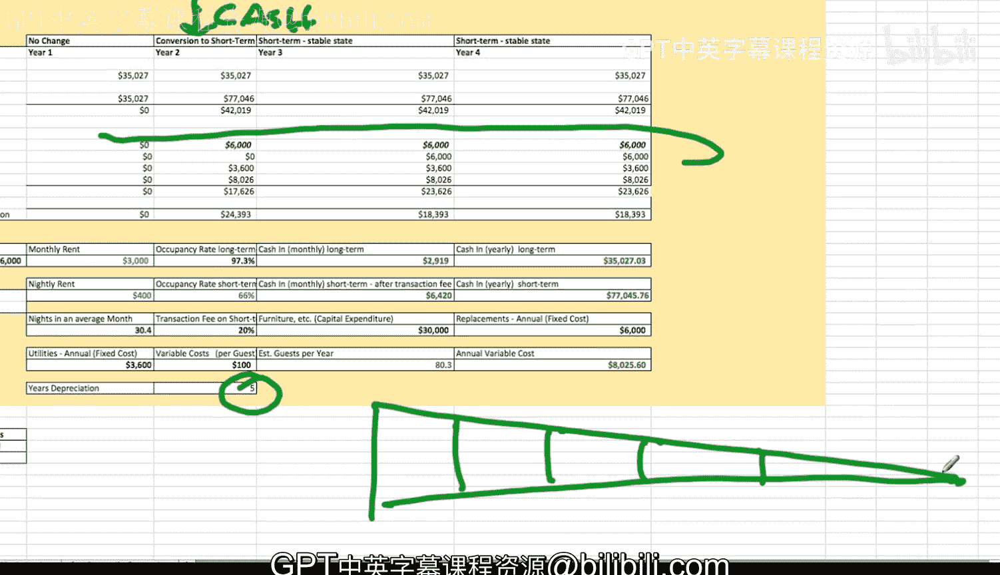

#  170：使用年度现金流与利润计算表 💰

在本节课中，我们将学习如何构建一个年度现金流与利润计算表，这是评估商业决策（如Watershed公司的长期租赁方案）财务影响的关键工具。我们将重点理解现金流与利润之间的核心区别，并学习如何将财务假设整合到一份清晰的报表中。

## 构建现金流报表 📊

上一节我们讨论了财务评估的基本框架，本节中我们来看看如何具体构建报表。我建议你建立一个类似下图的现金流报表。

以下是构建报表的步骤：
*   第一列数字应反映长期租赁方案下的财务状况。
*   第二列代表转换发生的年份，即第二年。
*   第三列代表第一个稳定状态年份，此时不再有高昂的前期转换成本，即第三年。
*   你可以继续列出第四年及以后的年份，但后续年份的财务结构应与第三年完全相同。

## 聚焦评估指标 🎯

现在，我们得到了一份针对转换年份和稳定状态年份的现金流报表。正如之前讨论的，我们将以稳定状态年份的**盈利能力**作为评估Watershed公司商业价值增长的核心指标。这一点在估值相关的视频中已经提及。

你在此处拥有的是从访谈中提取或获得的所有财务假设。以下是完成此问题分析所需的所有假设的完整列表。

## 理解现金流与利润的关键差异 🔍

我想提请你们注意现金流报表与利润报表之间的一个关键区别，即代表**折旧**的那一行。

在我们的简化Watershed模型中，正是折旧这一项导致了现金流与利润报表的差异。我们在此假设了五年的使用期。

## 折旧的计算原理 📉

在现金流报表中，转换年份（第二年）我们有一笔大额的现金支出。但在利润表中，我们将这笔现金支出分摊到一定的折旧年限中。

你可以这样理解直线折旧法：我们将初始价值（此处为30,000）分为五等份，每年减少6,000，直至为零。

其背后的理论是：如果我们将运营业务所需的30,000美元全部计入第一年，会显得我们第一年的经营状况很差，而后续年份却可能表现优异。实际上，如果你通过制造产品或提供服务而损耗资本设备，你应该将该项目的成本分摊到使用它的整个期间。

---

本节课中，我们一起学习了如何设置用于商业分析的年度现金流与利润计算表。我们掌握了构建报表的步骤，明确了以稳定状态盈利能力为核心评估指标，并深入理解了**折旧**如何造成现金流与利润的关键差异。通过将财务假设系统化地组织到报表中，我们为后续的财务分析与商业决策奠定了坚实基础。