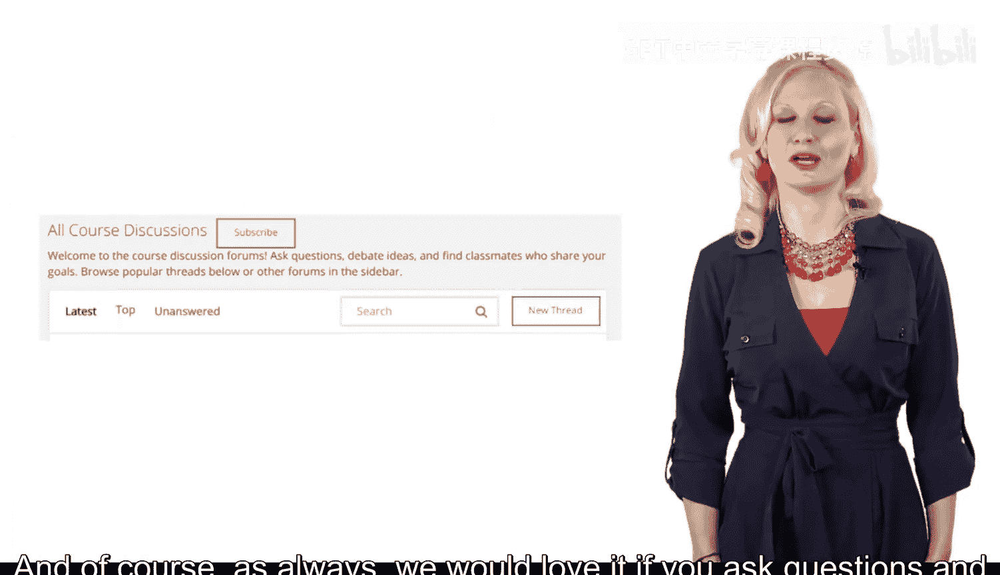

#  171：使用Tableau进行敏感性分析 🎯

在本节课中，我们将学习如何使用Tableau进行敏感性分析，以测试财务模型的可靠性。我们将探讨如何通过可视化手段，动态地观察模型假设变化对结果的影响，从而增强决策的信心。

---

课程进行至此，你已经完成了分析将流域房产转为短期租赁潜在盈利能力的模型。这项工作非常出色。你应当为此感到自豪。达到这一步需要经过许多细致的思考步骤。因此，你绝对应该庆祝这个里程碑。

庆祝之后，请准备好再次投入学习。因为在接下来的几周里，我们将使用Tableau和数据可视化来最大化你模型的影响力。

在之前的“使用Tableau进行数据可视化与沟通”课程中，我们深入探讨了数据可视化如何成为一种高效的方法。首先，它能帮助你确定哪些因素对纳入计算模型或分析至关重要。其次，它能帮助你更有说服力地传达模型或分析结果的重要性。

数据可视化还有一个用途，我在之前的课程中提到过，但直到这个顶点项目才有机会充分强调：数据可视化也可以用来测试计算模型的可靠性。

还记得在“使用Tableau进行数据可视化与沟通”课程中，我谈到如何对你的故事进行压力测试，并警惕逻辑谬误吗？我们讨论了当你发现数据中某个效应对你的业务很重要时，最好确保能在不同的数据集中复现该效应，或者至少观察该效应在你数据的不同子集中是否持续存在。

这些思路的变体同样可以应用于预测模型。你想知道的是，假设条件对你的模型结果，以及由此得出的关于你或公司应如何行事的结论，影响有多大。换句话说，如果在模型中增加或减少一个变量会怎样？如果改变财务假设的实际值（例如某物的成本或使用寿命）会怎样？

如果改变这些变量或假设最终不会改变你对数据分析结果的解读，那么你的模型就是稳健的，你应该有信心根据模型结果决定行动方案。反之，如果模型中变量或假设的微小变化就会改变你的分析结论，那么在根据数据分析提出建议或预测时，你就应该谨慎。你可能需要做更多研究，以确保输入模型的变量和值能更准确地反映现实。

在商业世界中，以这种方式测试模型的可靠性被称为**敏感性分析**。财务分析师尤其想知道，如果你的财务假设被证明是错误的，关于如何推进的最佳决策是否会改变。他们还想知道，与其他变量相比，某个变量对模型结果的影响有多大。

传统上，人们使用Excel中的表格进行敏感性分析。然而，本周我们将学习如何使用Tableau以可视化、甚至更动态的方式来测试模型的假设。

你将创建一个仪表板，根据一系列系统性的不同假设集，报告你过去几周在Excel中设计的财务模型的动态结果。你的策略是，为模型中做出的每个财务假设在Tableau中创建一个**参数**。你将使用引用这些参数的计算来制作可视化图表。

虽然初期设置可能需要一些时间，但完成后，你将能够通过简单地更改仪表板上的相应参数，立即测试某个假设对模型的影响。此外，你将能够同时看到改变多个假设的效果。在Excel中进行同样的分析将花费很长时间，并且你需要为每个要测试的假设设置不同的表格。正如你将看到的，在Tableau中操作要愉快得多。通过使用仪表板，你可以在同一位置同时查看数据的多个方面。

---

在Tableau中创建仪表板以测试假设变化对财务模型的影响，主要有两个不同的原因。

第一个原因是让你作为分析师，能够弄清楚你对模型的信任程度，以及基于模型提出建议时应有的信心水平。为此目的制作仪表板时，你应该根据你认为最有用、最快捷的图表来选择，并且图表格式是否完美并不重要。

第二个原因则是为了让你的受众中的决策者能够使用仪表板，亲眼看到改变模型中的假设如何影响其结果。在这种情况下，仪表板需要合理地进行格式化。你需要选择受众习惯使用的图表或可视化形式，并且需要解释每个图表显示的内容。

本周，我们希望你将重点放在第一个目的上。你本周的目标应该是将模型导入Tableau，并以此确定你的假设如何影响模型和结论。专注于确保计算正确，但不必过分担心图表或仪表板的具体外观。我们已安排下周让你专注于格式化仪表板，使其对流域公司高管更具吸引力，并添加任何有帮助的新图表（这些图表对你的敏感性分析并非必需）。在你完成基础工作并了解敏感性分析结果后，下周再处理图表的设计和格式会容易得多，因为那时你会知道希望受众最关注仪表板的哪些部分。

---

为了制作你的仪表板，你将需要用到在“使用Tableau进行数据可视化与沟通”课程中学到的几乎所有知识。

请确保复习如何制作条形图、表格、箱线图、地图、仪表板和Tableau故事。同时，确保你记得如何使用标记卡、筛选器架，以及如何创建参数和计算。如果在任何时候你需要关于如何做这些事情的提醒，请回顾“使用Tableau进行数据可视化与沟通”的课程材料或在线查找资料，因为我们不会在这里复习大部分内容。相反，本课程包含的新材料将重点向你展示几个新的Tableau技巧，这些技巧对你的流域项目以及现实生活中的公平分析项目应该很有用。

---

在开始之前，请记住这是一次学习体验。在没有明确指示的情况下从头开始制作仪表板是具有挑战性的。所以，如果你有时遇到困难，请不要担心，准备好花些时间将模型导入Tableau。

你需要多久就用多久，当不知道如何做某事时不要放弃。相反，尝试享受尝试不同选项和培养解决问题技能的过程。独立处理所有细节将有助于你获得在实际工作情境中使用这些技能所需的信心，一旦你弄清楚了如何完成所有想做的事情，你会感觉非常棒。我向你保证，你的时间和努力是值得的。

当然，一如既往，我们非常欢迎你使用讨论论坛提问并互相帮助。你们都在共同学习，并且拥有很棒的想法，如果你们能彼此分享，那将是非常美好的事情。

---

那么，让我们开始吧。