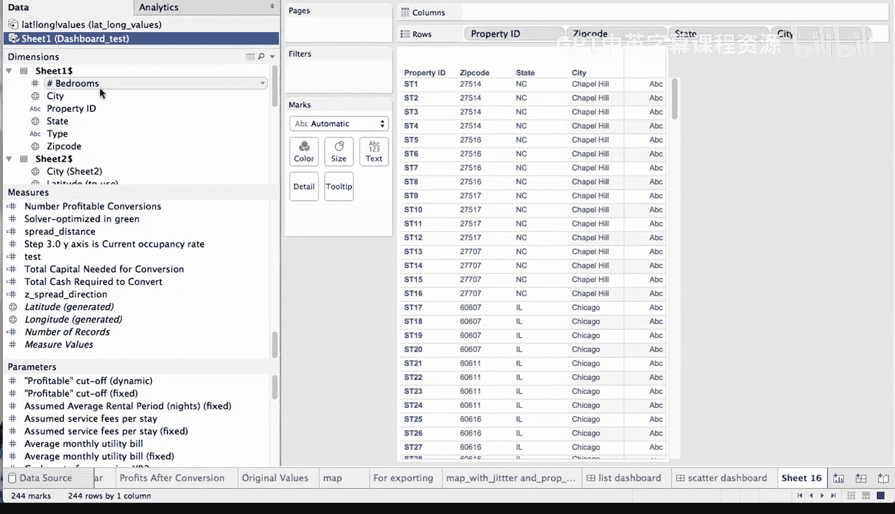
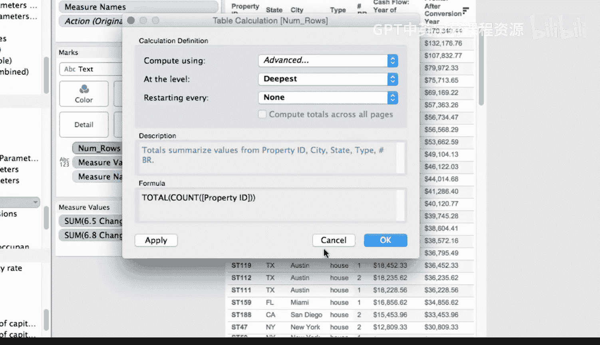

#  176：在 Tableau 中创建表格 📊


在本节课中，我们将学习如何在 Tableau 中创建和格式化表格。虽然 Tableau 的核心是数据可视化，但商业世界常常需要表格来展示数据。我们将介绍两种创建表格的方法，并学习如何调整表格的格式，使其更符合你的需求。


上一节我们介绍了条形图和直方图的制作，本节中我们来看看如何创建表格。你应该对 Tableau 的基础操作有所了解，但请注意，Tableau 并非专为制作表格而设计，因此其界面可能不够直观。不过，只要掌握正确的方法，创建表格将变得非常简单。



## 快速创建表格的方法


最快捷的创建表格方法是直接双击所需的维度和度量。

以下是具体步骤：
1.  双击你想要包含在表格中的第一个维度，例如 `Property ID`。
2.  继续双击其他维度，如 `Zip Code`、`State`、`City`。
3.  双击你想要包含的度量，例如 `Cash Flow`、`Year of Conversion`。

完成上述步骤后，一个基本的表格就会自动生成。

## 格式化表格选项

创建表格后，你可以对其进行多种格式化调整。

以下是可用的格式化选项：
*   **隐藏/显示标题**：右键点击列标题，选择“显示标题”来隐藏或显示它。
*   **修改标题别名**：右键点击标题，选择“编辑别名”，可以将其重命名为更易理解的名称，如将 `Cash Flow` 改为“现金流”。
*   **调整数字格式**：右键点击度量值，选择“格式”，在“数字”选项中可设置为货币、调整小数位数或单位（如千位）。
*   **修改外观**：在“格式”窗格中，可以更改字体、移除行/列之间的边框线，或取消行的交替背景色（行条带化）。

## 备用创建方法（使用“度量名称”和“度量值”）

如果快速双击法不适用，你可以使用 Tableau 自动生成的 `Measure Names`（度量名称）和 `Measure Values`（度量值）来创建表格。这种方法稍复杂，但提供了更多控制。

以下是操作步骤：
1.  将 `Measure Names` 拖到“筛选器”架上，取消选择“全部”，然后仅勾选你希望在表格中显示的特定度量。
2.  将你需要的所有维度（如 `Property ID`、`State`）拖到行功能区。
3.  将 `Measure Names` 拖到列功能区。
4.  将 `Measure Values` 拖到“标记”卡的“文本”属性上（点击“标记”卡上的“文本”下拉菜单选择）。

## 创建动态标题

为了让你的仪表板更具交互性，可以为表格标题添加动态计数，例如显示当前列表中“盈利物业”的数量。

这需要创建一个表计算，并将其插入标题中。



核心是使用以下公式创建一个名为（例如）`Num Rows` 的计算字段：
```
TOTAL(COUNT([Property ID]))
```
**关键点**：`TOTAL` 函数确保计算的是整个分区（当前视图）的总行数，而不是每行的计数。创建后，需在计算字段的“默认表计算”中正确设置计算依据（例如，按特定维度汇总）。

创建好计算字段后，即可将其插入标题：
1.  双击图表标题进入编辑状态。
2.  点击“插入”按钮，从列表中选择你创建的计算字段（如 `Num Rows`）。
3.  插入后，该字段名会被特殊符号包围，表示它是一个动态值，会随着视图数据变化而自动更新。

本节课中我们一起学习了在 Tableau 中创建表格的两种主要方法：快速的直接双击法以及更可控的“度量名称/度量值”法。我们还探讨了如何对表格进行格式化，以及如何通过创建表计算来实现动态标题，从而增强仪表板的交互性和信息量。掌握这些技巧后，你就能高效地制作出满足商业报告需求的表格。