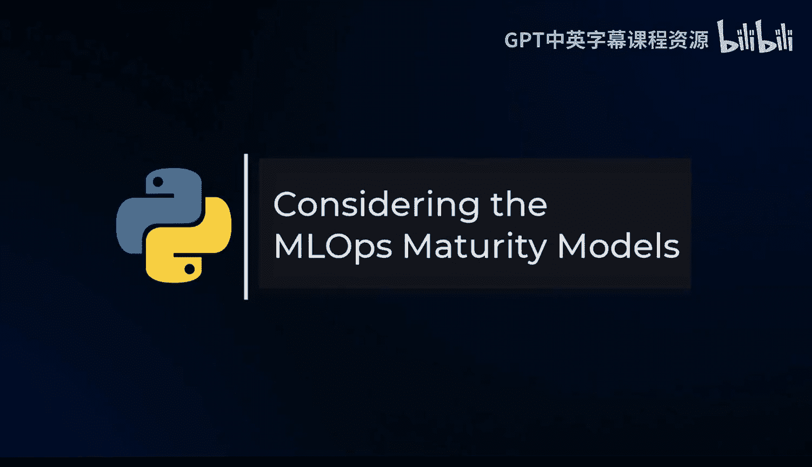
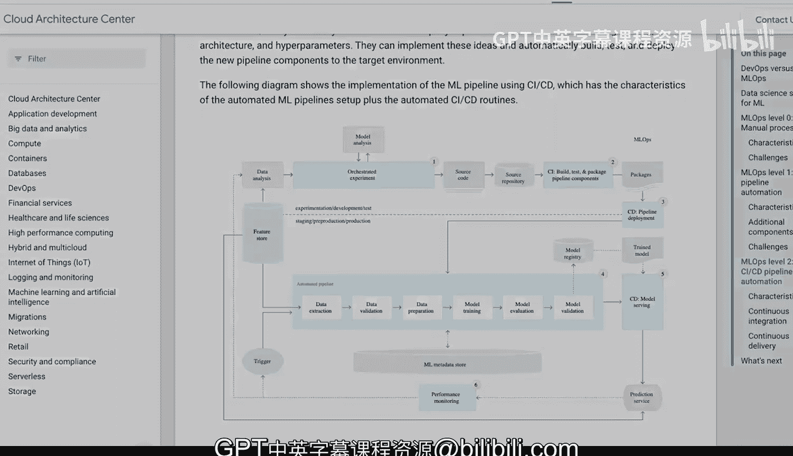

#  003：MLOps成熟度模型考量 🧭

在本节课中，我们将要学习MLOps成熟度模型的概念。我们将了解AWS、Microsoft和Google这三大云服务商如何定义和划分MLOps的不同成熟阶段，并理解自动化在其中的核心作用。

## 概述

所有主要的MLOps领域供应商都提出了MLOps成熟度模型的概念。其核心含义是，从最初级、手动且容易出错、难以将模型投入生产的阶段，到高度自动化、具备下一代特性的成熟系统，中间存在多个不同的演进阶段。接下来，我们将深入探讨这些不同供应商的MLOps成熟度模型是如何进行比较的。

## AWS的MLOps成熟度模型

首先，我们来看AWS平台。让我们了解一下他们对MLOps成熟度的看法。

在将模型投入生产或实现运营化方面，你拥有的能力越多，投入生产的模型就越多，迭代速度就越快，组织的成熟度也就越高。

以下是AWS定义的几个关键阶段：

*   **实验能力**：初期必须具备实验能力。如果无法进行实验，将任何东西投入生产都会非常困难。
*   **可重复性**：下一步是实现可重复性。你是否能够标准化你的代码和资源？是否确保有一个可以实际部署解决方案的平台？这是进入下一级别的关键。
*   **可靠性**：在可靠性方面，你需要进行测试。你能否测试生产环境的能力？是否监控数据漂移和新版本？例如，你能否拥有多个隔离的账户，如生产账户、预发布账户和开发账户？
*   **可扩展性**：在最后的成熟阶段，你拥有可扩展性。你能够将许多不同的机器学习解决方案模板化并投入生产，而不仅仅是一个。你拥有一个可以反复重复使用的可扩展系统。

## Microsoft的MLOps成熟度模型

现在，让我们继续看Microsoft。Microsoft同样拥有成熟度模型的概念。

他们将第一阶段视为“无MLOps”，其特点是部署困难、团队割裂、系统是黑盒且无法知晓其是否有效。

以下是Microsoft定义的成熟阶段：

*   **阶段1：无MLOps**：如上所述，这是最基础的阶段。
*   **阶段2：具备部分DevOps**：一些组织处于较好的位置，他们至少拥有DevOps，但由于缺乏机器学习的关键能力（如特征存储和数据漂移检测），发布过程仍然痛苦。
*   **阶段3：自动化训练**：整个流程能够自动化完成。例如，在检测到数据漂移时可以自动重新训练模型。
*   **阶段4：自动化模型部署**：发布变得简单。可以轻松地拥有训练环境、测试环境和生产环境。
*   **阶段5：全自动化CI/CD**：一切完全自动化，没有停机时间，可以持续创建新模型。

AWS和Microsoft模型中的关键点都在于**自动化**因素。

## Google的MLOps成熟度模型

现在，让我们来看看Google的观点。

Google认为，MLOps Level 0是一个手动过程。许多团队拥有数据科学家和ML研究员，但你可以看到机器学习和运维之间是分离的，所有事情完全手动。

以下是Google定义的成熟阶段：

*   **Level 0：手动流程**：机器学习与运维分离，所有步骤均为手动。
*   **Level 1：管道自动化**：此阶段的目标是持续训练模型。因为实现了部分自动化（例如，检测到数据漂移、拥有特征存储），你能够在适当时机自动训练模型。
*   **Level 2：CI/CD管道自动化**：最后的阶段是，你不仅拥有自动化的模型训练，你的持续集成和持续交付系统还能够完整地部署系统，正确地进行打包，从而实现100%的端到端自动化。

## 总结

本节课中，我们一起学习了三大云服务商（AWS、Microsoft和Google）的MLOps成熟度模型。尽管各家的具体阶段划分和命名有所不同，但其核心理念高度一致：即通过**自动化**和**深度集成**，实现系统的持续部署，并最终培养一种**生产优先**的思维模式。从手动、孤立的起点，到实现端到端的自动化CI/CD管道，是MLOps成熟度演进的核心路径。