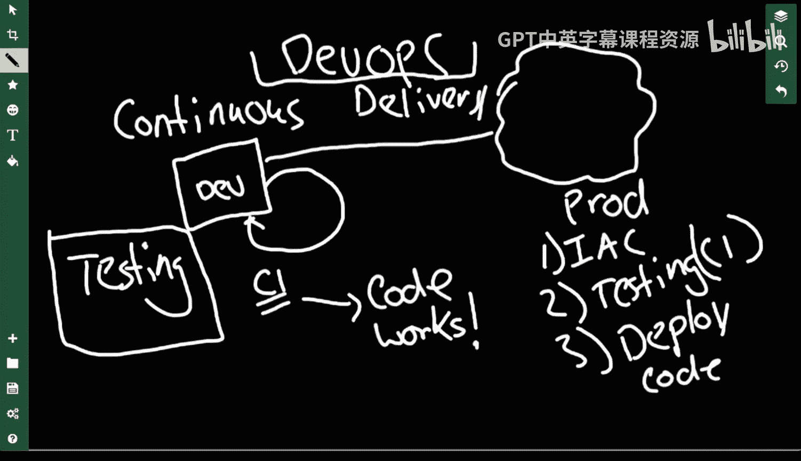
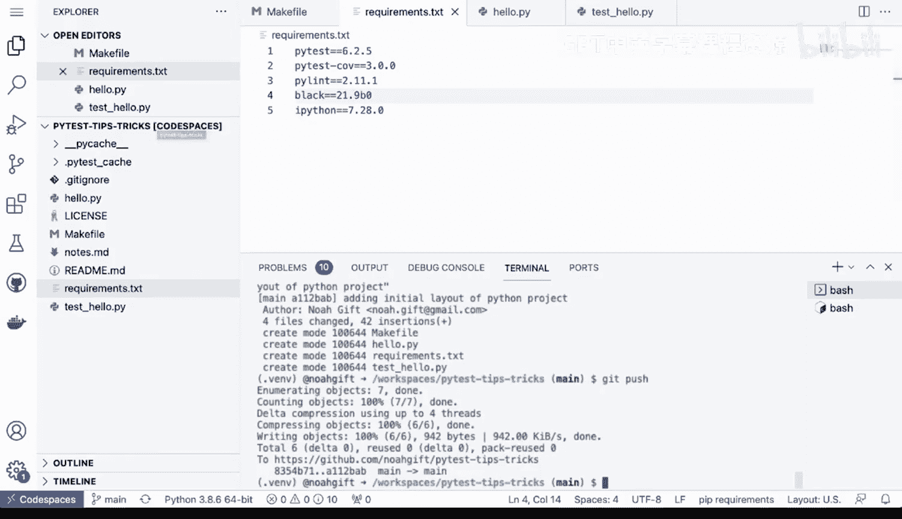
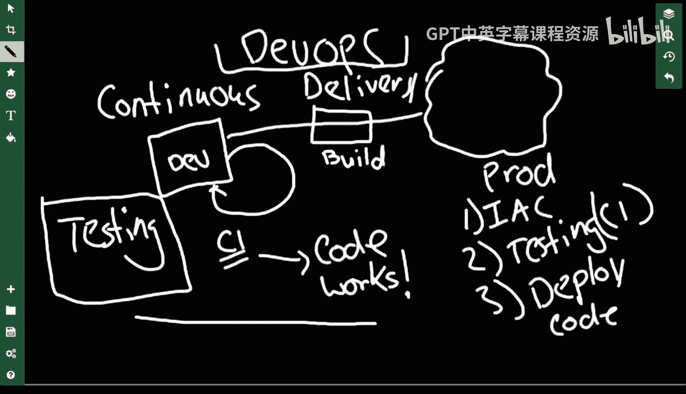
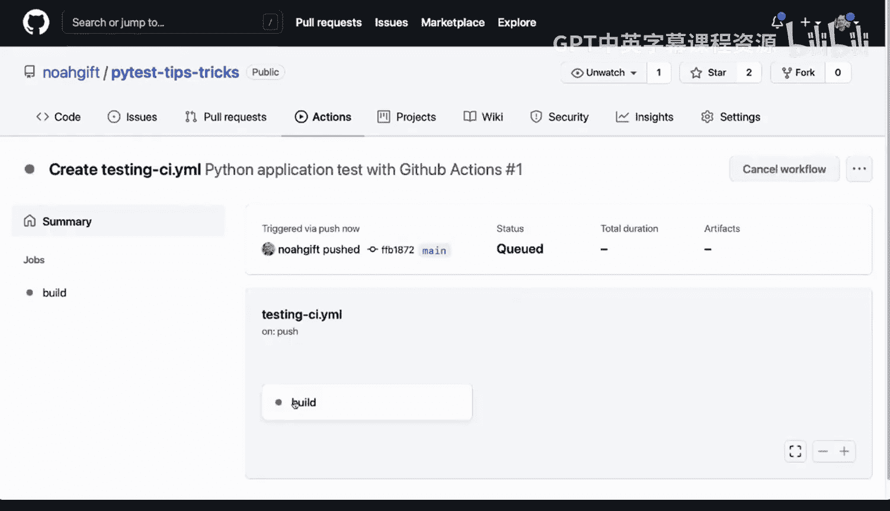
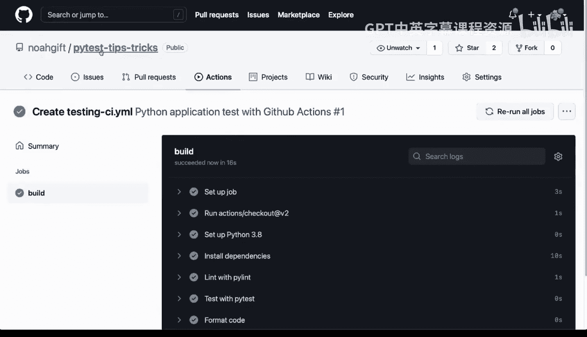
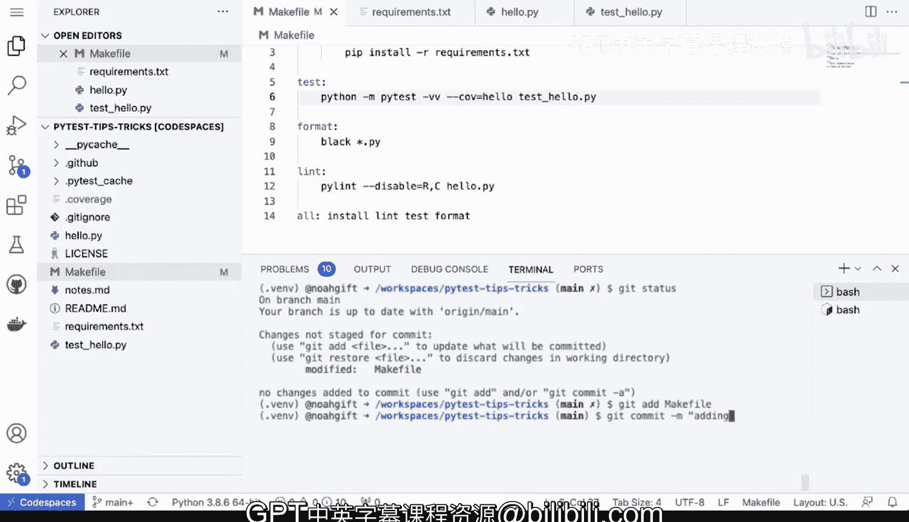

#  004：什么是持续集成 🚀

在本节课中，我们将要学习DevOps的核心概念之一——持续集成。我们将从搭建一个本地开发环境开始，逐步创建一个包含测试、代码检查和格式化的Python项目脚手架，并最终将其与GitHub Actions构建系统集成，实现自动化的持续集成流程。

## 开发环境搭建 💻

上一节我们介绍了持续集成的核心思想，本节中我们来看看如何搭建一个可靠且可复现的开发环境。

DevOps的一个核心概念是能够自动测试你的代码。这是一个反馈循环，即持续集成。持续集成的本质是能够知道你的代码是否正常工作。一旦你的代码在开发环境中正常工作，关键就在于能否将其复制到云端或生产环境。

为了实现这一点，你需要具备几个条件。首先，你需要能够在生产环境中进行复制。这意味着你可能需要使用基础设施即代码来定义基于云的环境，使其与你的开发环境相似。其次，你需要某种形式的测试，这就是之前提到的持续集成组件。最后，在部署方面，你需要将所有部分整合起来，并将代码部署到该环境中。这就是所谓的持续交付。

一旦建立了持续交付，你就能够将这些更改复制到任意数量的环境中。这就是DevOps的力量，也是测试的力量。测试是持续交付的强制性组成部分，因为你不会希望将错误的代码复制到生产环境并导致服务中断。这就是我们关心测试的本质：首先让代码在本地工作，然后能够将其复制到基于云的环境中。

我认为首先要做的是让本地开发环境先运行起来。确保我们能够真正让任何东西工作。

我将切换话题，讨论几种不同的开发环境。大多数人可能从GitHub或GitLab开始。GitHub可能是最受欢迎的，我认为这是一个开始思考项目结构的好地方。我喜欢使用基于云的开发环境，因为这样可以轻松获得所有合适的工具。我认为现在大多数开发者最好在基于云的开发环境中进行开发。

其中之一是GitHub Codespaces。这是GitHub的一个功能，与其他基于云的开发环境（如AWS Cloud9）非常相似。我将在这里创建一个新的代码空间。

它的优点是，如果你出于某种原因真的想在本地工作，你甚至可以在本地的VS Code桌面版中使用它。但我喜欢这些环境，因为它让云本身承担所有繁重的工作。我不必担心我的环境。现在，它对我来说是完全安全的。它已经配置好，加载了扩展，基本上为我测试代码做好了准备。

在这样一个新环境中，我要做的第一件事是创建一个Python虚拟环境。原因是Python是一种解释型语言，Python需要能够将所有包放在一个目录中以确保可靠性。它附带了一个叫做`venv`的工具。

如果我们输入`python -m venv --help`，它会显示在这个环境中可以做的所有不同事情，包括创建虚拟环境。这个虚拟环境工具有很多功能，但我们将保持简单，只创建一个新的。

一个好的惯例是这样做：`python -m venv ~/.venv`。这样做的原因是它不会被意外地推送到你的GitHub仓库中。如果把它放在主目录的一个隐藏目录里，这是一个很好的地方，可以避免干扰。

创建完成后，要激活它，我只需要输入`source ~/.venv/bin/activate`。现在，如果我输入`which python`，可以看到我引用的是这个Python。所以，对于任何Python项目，第一步在我看来就是获取一个基于云的开发环境。如果你在AWS上，使用Cloud9；如果你在GitHub上，可以使用GitHub Codespaces；GCP有Cloud Shell；Azure有Cloud Shell环境。它们都非常相似。

现在我已经设置好了。一个缺点是，如果我在这里打开一个新的终端，虚拟环境就消失了，这有点烦人。我们如何解决这个问题？幸运的是，我们可以很容易地解决，因为我可以编辑我的`.bashrc`文件，这是这个环境的配置文件。我认为对于这些基于云的开发环境来说，如果你要将其用于一个项目，并且项目与环境是一对一的关系，为什么不让它每次打开新shell时都自动激活呢？

我将输入`vim ~/.bashrc`，然后按`Shift+G`跳到文件底部，在这里添加一个小注释，说明我想激活我的虚拟环境。然后我只需放入那个命令。现在如果我们打开一个新的终端，虚拟环境就自动激活了。我认为这是一个很巧妙的小技巧，可以为你节省很多麻烦。

现在我们有了环境，状态良好，可以打开新的shell，这很好。我要做的第一件事是创建一个项目的脚手架。

## 创建项目脚手架 🏗️

上一节我们成功搭建了开发环境，本节中我们来创建一个标准化的项目脚手架。

对我来说，一个测试项目脚手架的最低要求首先是`Makefile`。我喜欢使用`Makefile`，因为它可以为我保存很多复杂的命令。这将是我在项目中可以反复引用的东西，甚至可以像食谱一样不断积累。

接下来我要创建的是一个`requirements.txt`文件。这将是一个我可以引用我想要安装的包的地方。这真的是我最初需要的两个文件。然后我们也许可以创建一个测试文件和一个应用文件。让我们称第一个文件为`hello.py`，第二个文件为`test_hello.py`。这是一个非常标准的过程，我参与的大多数项目都使用类似的结构。

现在，首先要做的是，这些文件都是空的，`touch`命令的作用就是创建空文件，它是幂等的，意味着如果我反复运行`touch`命令，如果文件已经创建，它不会做任何不同的事情。这是一个很简洁的命令，可以为你创建空文件。

我将打开这个`Makefile`，需要在里面放入一些不同的组件。为了做到这一点，我可以去看看我之前设置的另一个项目，参考一下。我有一个叫做`pytest`的项目。注意，我过去已经创建了一个`Makefile`。让我们看看这个，看看是否能得到一些启发。

很好，我有一个安装部分，一个测试部分，一个格式化部分，一个代码检查部分，然后还有一个同时运行所有这些的东西。我们可能可以直接复制这个。让我们用它作为我们的脚手架。我回到代码空间，直接粘贴进去。这就是创建一次脚手架的好处，你几乎可以一遍又一遍地使用它。

现在让我们看看这个`Makefile`是如何工作的。首先，我们会看到，如果我输入`make`，然后输入`install`，它会自动补全。如果我输入`make`加空格加`Tab`，它实际上会显示所有不同的选项。这就是`make`另一个非常酷的部分，它几乎能自动给我一个帮助菜单。这就是为什么我认为`Makefile`对于Python开发者来说真的非常酷。如果你不使用`Makefile`，开始将它们集成到项目中是值得的，可以节省你很多时间。

现在我们可以看看`requirements.txt`文件，我们需要安装一些能帮助我们的包。首先，我认为我们要安装的一个包显然是测试库`pytest`。

首先，我们放入`pytest`。让我们看看它是如何工作的。记住，这真的很简单。我总是先检查确保Python打包工具`pip`没有新版本。然后我输入`pip install -r requirements.txt`。让我们运行这个：`make install`。完美。

现在我已经设置好了，我已经加载了`pytest`。我如何测试`pytest`是否加载了呢？我可以直接输入`pytest --help`。你可以看到它确实在运行。我已经加载了`pytest`，它是一个非常复杂的工具，可以做很多事情。很多测试工具都非常复杂，我现在可以查看所有我可以用`pytest`做的事情。

对于我刚开始一个项目时，很可能还会开始使用其他一些东西。比如我喜欢用`pylint`进行代码检查，还有`flake8`作为替代。还有`black`工具，它是一个格式化工具。然后我还放入了`pytest-cov`，这是一个覆盖工具，显示我们代码的覆盖报告，比如有多少代码被实际测试了。这可能是一个很好的开始，我认为这可能是一个很好的组合。

我可以再次利用`Makefile`的力量，简单地再次输入`make install`。`make install`。

这里有趣的是，安装是持续集成的一个重要组成部分，这可能并不直观，但确实如此。当我们稍后为GitHub Actions设置构建系统时，我们要做的一件事就是实际测试包的安装，因为这是现实世界的情况。你想确保你的代码实际上是可以安装的。

现在我们几乎一切都设置好了，我们有能力运行东西。也许我们可以安装另一个我喜欢用来调试或尝试东西的工具，那就是`ipython`。

我认为这会是另一个。让我们来做这个，我会告诉你为什么我喜欢安装`ipython`。当我调试代码或尝试东西时，能够从交互式提示符导入我的模块或任何东西，然后尝试它，这实际上非常简洁。例如，如果我要测试我的代码，我可能会先尝试我写的模块。

让我们输入`more hello.py`，然后做一些非常简单的事情，比如说`hi`。现在我这里有了一段代码。那么我如何在`ipython`中使用这个呢？我只需输入`ipython`，然后输入`from hello import`。看，它会为我自动补全，这真的很棒。然后我甚至可以在写第一个测试之前尝试我的代码。我可以看看这个做了什么，如果我调用它，它会做什么。它返回`hi`。我甚至可以尝试我可能在`pytest`中写的测试。

`pytest`使用`assert`，所以我可以在这里输入`assert`。`hi`等于`more_hello`。这本质上就像是在原型化我的单元测试。哦，太好了，这很简单，很酷。所以`ipython`是一个很好的工具，我认为它被严重低估了。

很好。我们这里有一个测试文件，这很好。让我们继续在`pytest`中写我们的第一个测试。幸运的是，用`pytest`写测试非常简单，这就是为什么这么多人喜欢它。这个工具很复杂，但在`pytest`中写测试却简单得离谱。

我们记得我们这里有一个`test_hello.py`。我们需要做的就是基本上做和我在`ipython`终端里一样的事情。事实上，我可以直接看下面的`ipython`终端，本质上那就是我需要的所有代码。我要输入`from hello import more_hello`。

现在我只写一个`assert`。测试就是这样工作的。我要写`def test_more_hello`，我喜欢用模块函数的名字来命名测试。然后我就做同样的事情，我基本上可以剪切粘贴下面我做的事情，然后粘贴进去。

我们可以在这里写`assert hi == more_hello()`。现在让我们做一个测试。再次看看我们的`Makefile`。注意我是如何测试的：我说`python -m pytest`，并给它几个选项，比如让它更详细，这些标志的作用就是这样，然后我就这样运行这个文件。所以如果我们运行这个，我可以说`make test`。我喜欢在这里做`make test`的原因，你可以看到它通过了，是因为它更简单，输入代码更少，一遍又一遍地输入命令很烦人。

你会发现，除非你在`pytest`中做一些非常棘手的事情，否则只需将其放入`Makefile`的测试块中，就能节省你很多时间。

现在让我们看看如果测试失败会发生什么。那是成功的，但让我们做一个失败的测试，说`test_more_hello_2`。显然它只返回`hi`，如果我们说别的呢，比如`bye`？我们可以在这里输入`more_hello`，它会自动补全。如果我再运行`make test`，我们会得到一个失败。非常直观地用`pytest`写测试。看，它给了我们一个报告，说系统有50%通过了，我们有一个失败，我们可以在这里看到，它说看，你说函数应该返回`bye`，但实际上它返回了`hi`，我们有问题。

好吧，现在也许我接下来要做的是回到我的代码，说哦，是的，我还没写这个函数。让我们写一个函数，说`more_goodbye`。然后，我们说`return "bye"`。然后如果我们回到测试文件，我可以直接导入那个文件。我们可以这样做。`more_goodbye`。然后我可以改变这个。改成`test_more_goodbye`。像那样改变。完美。现在如果我再次运行`make test`，我们得到了两个通过的测试。所以从某种意义上说，它非常直观，因为它给了你这个输出，说，哎呀，我们这里有问题，让我们修复它。

很好，我们掌握了`pytest`的基础。我个人认为让格式化和代码检查工作起来也很好。我会称之为最佳实践清单。让我们再次检查代码检查是否工作。如果我们用`pylint`进行代码检查，注意我在这里做的是说`pylint`，我禁用了另外两种类型的警告，我相信这是配置中推荐的。所以我只想看到警告和错误。就我而言，这些是我最关心的事情。所以我要继续检查这个文件。我要再次输入`make lint`，因为我想让我输入的内容简洁。`make lint`很好。

现在什么能让我们测试这个，看看如果代码不好会发生什么？一个简单的方法是，如果我说`var = 1`，我创建了一个变量，然后在里面，我说`var = var`，做一些无意义的事情。看，如果我做`make test`，测试仍然通过。所以它在语法上仍然是有效的，它仍然有效，只是没有真正做任何事情，这是一种糟糕的编码技巧。你不想把一个变量重新赋值给自己。所以如果我做`make lint`，现在它会说，嘿，看这个，你不能这样做，你应该小心你正在把变量赋值给它自己，这是一个警告。代码仍然有效，这不是一个错误。它也会捕获错误。让我们在这里放一个注释，说“这是产生警告的无意义代码”。

所以我相信这对于像Python这样的语言，甚至编译语言来说，捕获警告也是非常关键的。为什么不听编译器的呢？我认为这是一个好主意。

但现在让我们制造真正糟糕的语法。如果我在这里，我也可以说，`f =`，然后留空。像这样，这是坏掉的代码，这段代码不会执行。另一件很酷的事情是，如果我们做`make lint`，它实际上会显示无效语法。所以它在这里失败了，说，看，你的代码甚至无法运行。我甚至无法得到警告，因为它甚至无法运行，它直接告诉我们了。它说第12行。这就是`pytest`真正强大的地方之一。抱歉，是`pylint`。它和`pytest`配合得很好，它们是互补的，或者`flake8`也是。所以它捕获了额外一层的东西，这些只是有帮助的。你想知道这些事情，尤其是当你在一个团队项目中工作时。

好的，很好，这个工作了。让我们继续，再次运行`make test`，确保它工作。很好，我们要运行`make lint`，确保它工作。太棒了。然后真正获得初始反馈循环的另一个组成部分就是去格式化，除非你想再次检查这是如何工作的。在这个里面，我喜欢格式化工具的地方是，它还能解决你团队中的问题。当你在公司里和一些人一起工作时，一个人想这样做，另一个人想那样做，这可能会很烦人。如果你使用像这样的格式化工具，就像看，格式化工具这么说，所以让我们保持简单，继续使用这个。如果我输入`make format`，它只是清理代码，让它变得更好一点。所以我认为这样做也是一个好主意。如果你愿意，你实际上可以把所有这些放在一起，你可以按照你喜欢的顺序链接它们。所以我认为这是一个相当好的顺序，我推荐这个顺序，基本上就是在你将代码签入到GitHub之前，为什么不直接做`make all`呢？安装你的代码，确保你拥有所有最新版本，你也可以固定需求，我们实际上会这样做，然后测试你的代码并格式化你的代码。

让我们继续做这个，输入`pip freeze`。如果我们输入`pip freeze`，也许把它管道到`less`，它会显示当前安装的所有版本。我们可以继续做这个，我们可以把它们换掉。我不喜欢直接剪切粘贴这个，因为这样可能会把我不需要的东西放进去。所以我认为在这里对我的选择更小心一点更好。我可以说`pytest`和`pytest-cov`。很好，让我们把它们放进去。像这样，这会告诉这个仓库，你正在使用我安装的这个版本的包。这对于测试来说又很好，因为我可以测试我的代码的一个非常特定的版本。然后我们可以回到这里，也可以放入这个版本。

太棒了。我们也有我们的包安装了，这很好。现在我可以做`make all`。让我们继续做`make all`，再次检查一切是否正常。它会安装我的软件，检查我的软件，测试我的软件，格式化。我认为这是一个开始你的项目的好方法，在我看来，强烈推荐。

## 集成持续集成流程 🔄

上一节我们完成了本地项目的脚手架和测试，本节中我们将把代码推送到远程仓库，并集成GitHub Actions以实现自动化持续集成。

让我们进入下一步，推送这个代码。我要输入`git status`，然后输入`git add .`。然后我要输入`git commit -m "adding initial layout"`。完美。现在我要推送这个代码。很好。

现在我已经在这里建立了这个初始结构，我们现在可以开始看下一个层次，那就是，如果我想使用一个不同的环境，而不仅仅是这个环境，例如，假设你的公司使用AWS或GCP或Azure，你该怎么做？有几件事我推荐，一是如果我们回到这个图，记住想法是你在本地测试，你的代码工作得很好，但你也希望有能力部署到其他环境。所以这就是构建系统发挥作用的地方，构建系统基本上将是守门员，允许你在使用之前再次检查一切是否正常。

因为我们还没有设置构建系统，在我们解决这个问题之前，先不要进入云环境。

我要做的是转到GitHub。我要回到我们的仓库，然后设置这个。让我们继续，称这个为`pytest`。`pytest`技巧和提示。

现在我要进入这个叫做“Actions”的部分，这将是GitHub Actions构建系统。构建系统只是运行你的代码，并允许你对其进行测试和部署，这真的是它的本质。GitHub Actions是较新的一个，集成得非常好，我个人是它的忠实粉丝，我认为它很棒。关于GitHub Actions，有几点要指出。

这些工作流允许你做诸如使用Anaconda之类的事情，这里有一个如何使用`Makefile`的例子，我刚刚展示给你，还有如何发布Python包。所以如果你想成为一个开源软件开发人员，你可以这样做。你也可以使用其他流行的服务部署你的代码，比如Azure ACR、ECS、GKE。所有这些都是使用它的好例子。此外，还有一些更抽象的例子，比如让我们做一个标签器，或者让我们给某人分配任务。有很多很酷的东西。我认为一个好的起点是自己设置工作流，它基本上给你一个非常粗略的结构，你可以用来尝试东西。

既然我以前做过这个，我要做的是，实际上打开一个新标签页，再次复制一个我以前的版本。我有一个GitHub Actions的例子。我有一个之前做过的，看看布局，是`.github/workflows`，然后有一个YAML文件。你可以在这里看到一个非常非常简单的使用GitHub Actions的Python应用测试。我们要说在推送时，我们将运行这些步骤。我们甚至可以说是什么操作系统，在这种情况下是Ubuntu最新版。我们甚至可以指定Python的版本。然后我可以告诉它做我刚刚在本地做的事情。这真的就是全部，只是做同样的事情，但在云端的某个地方运行，并确保在我进入下一步之前一切都经过验证。让我们继续尝试这个，这看起来正是我想要的。

让我们复制这个。然后我将把它放入这个文件。事实上，我们甚至可以称这个为`testing`，或者`CI`，测试持续集成。然后我们可以直接点击开始。这很酷，一旦你点击这里的开始，它就会开始运行我们的任务。我可以看到它在运行。所以它将执行所有步骤，它将首先安装，然后检查，然后测试，然后格式化我们的代码。

很好，这看起来很不错。到目前为止，一切顺利。好的，看起来我们状态良好。我们让一切都在运行，它甚至在这里显示了每个步骤，这对我们所有的代码都很好。然后点击这个小菜单，说“创建状态徽章”，然后复制这个，这不是一个坏主意。

然后我们可以回到我们的项目。就是这个项目。

然后转到`README.md`文件。也许把它放在顶部。我们可以有我们的测试徽章。所以我们状态很好。我认为我们唯一没做的，我们可以很容易地做到。就是我没有，我要输入`git pull`，这样我就能得到我刚才做的所有东西。

但我们也没有做测试覆盖标志。为了做到这一点，我们只需要稍微调整一下。我们只需要做，我相信我们可以查一下，实际上，这就是我通常解决问题的方式，我直接说，`pytest-cov`。它在哪里，如何在命令中使用它？你只需要说。就是这样，这就是我需要做的。所以我要做类似的事情，回到这个仓库，我们只是添加一个小标志。我们只是说，在这种情况下我想覆盖什么？我只有一个叫做`hello.py`的文件，一个非常简单的项目。让我们继续做这个。再次运行`make test`。

让我们看看是否能得到一个覆盖报告，`make test`。现在我们有了一个覆盖报告，我们有100%的测试覆盖率，这并不奇怪，这是一段非常简单的代码。输入`git status`，`git add Makefile`。好的，让我们提交这个，添加覆盖报告。

## 总结 📝

在本节课中，我们一起学习了持续集成的核心概念与实践流程。我们从理解持续集成和持续交付的基本定义开始，认识到自动化测试和可重复部署的重要性。接着，我们动手搭建了一个基于云的开发环境（GitHub Codespaces），并创建了一个标准化的Python项目脚手架，其中包含了：
*   **`Makefile`**：用于封装复杂的安装、测试、代码检查和格式化命令。
*   **虚拟环境**：确保项目依赖的隔离性和可复现性。
*   **测试框架（pytest）**：编写和运行单元测试。
*   **代码检查工具（pylint）**：确保代码质量。
*   **代码格式化工具（black）**：统一代码风格。

最后，我们将本地验证成功的项目与GitHub Actions集成，实现了自动化的工作流。该工作流会在代码推送时自动在云端运行安装、代码检查、测试和格式化步骤，并通过状态徽章直观展示构建结果。这构成了一个完整的、可扩展的持续集成基础，为后续向生产环境的持续交付打下了坚实的基础。