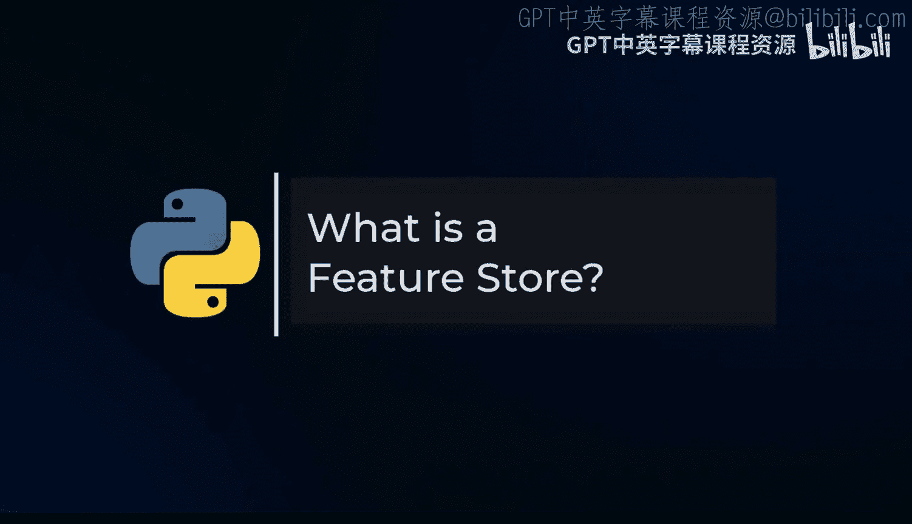
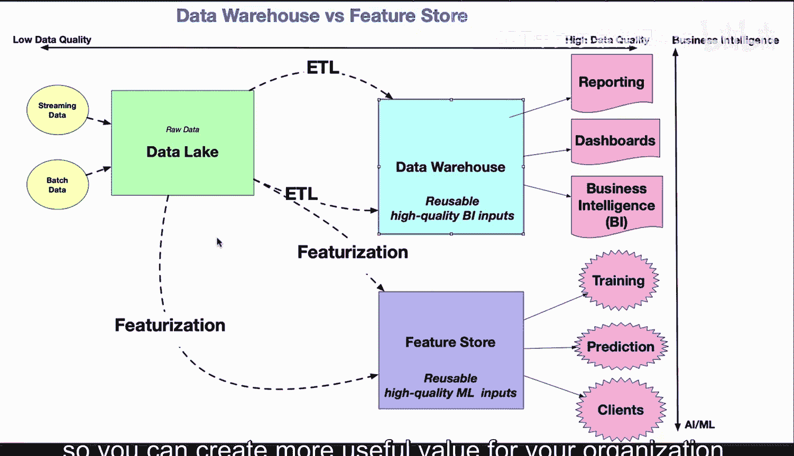

#  006：什么是特征存储 🗂️

在本节课中，我们将要学习特征存储的核心概念。我们将探讨特征存储与数据仓库的区别，并理解它在机器学习工作流中的关键作用。

## 概述

特征存储是机器学习基础设施中的一个关键组件，它负责存储和管理用于模型训练和预测的高质量特征数据。理解它与数据湖、数据仓库的关系，对于构建高效的机器学习系统至关重要。

## 数据湖、数据仓库与特征存储

上一节我们介绍了机器学习运维的宏观概念，本节中我们来看看特征存储的具体定位。数据湖、数据仓库和特征存储具有不同的特点。

我们可以从数据质量的角度来看这张图。数据湖可能是流式数据、批处理数据、非结构化数据和结构化数据的混合体。因此，你需要做大量工作来清理这些数据。

在这个具体问题中，你可以做什么？你可以从数据湖中提取原始数据，进行特征工程，并将高质量、可缓存、可复用的特征组合起来，放入特征存储中。这些特征随后将用于训练模型、为预测客户端提供服务，并且整个过程会经过审计，还可能开发出自动相关性分析等功能。所有这些都构成了特征存储的组成部分。

所以，特征存储本质上是对数据湖中内容的精炼，目的是让机器学习系统能够高质量地访问那些用于训练模型的特征。

另一种不同的资源是数据仓库。它的理念更侧重于报告、仪表盘和商业智能分析。

无论是特征存储还是数据仓库，你都可以看到它们处理的是高质量数据。一个关键区别在于，商业智能分析主要基于数据仓库，而人工智能/机器学习则主要基于特征存储。

特征存储和数据仓库之间不一定有严格或绝对的界限，它们可能存在一些重叠。但核心思想是，你将那些未清理、非结构化的低质量数据，通过ETL管道和特征工程管道等自动化工具，转化为这些高质量的资源，从而为你的组织创造更多价值。

## 核心概念总结

以下是特征存储的几个核心要点：

*   **数据来源**：特征存储的数据通常来源于需要大量清理工作的**数据湖**。
*   **核心功能**：它通过**特征工程**流程，生产出**高质量、可缓存、可复用**的特征。
*   **服务对象**：这些特征服务于**模型训练**和**在线预测**。
*   **附加价值**：特征存储支持**审计**，并有助于发现特征的**自动相关性**。
*   **与数据仓库对比**：数据仓库更侧重于**商业智能和报告**，而特征存储专为**AI/ML工作流**设计。
*   **共同目标**：两者都是将低质量原始数据转化为高质量、结构化数据的关键环节，旨在提升数据价值。

## 总结

本节课中我们一起学习了特征存储。我们明确了特征存储作为数据湖中原始数据的“精炼厂”角色，它产出专供机器学习使用的高质量特征。同时，我们将其与服务于商业智能的数据仓库进行了对比，理解了它们在数据流水线中各自不可替代的价值。掌握特征存储的概念，是构建可维护、高效机器学习系统的基石。