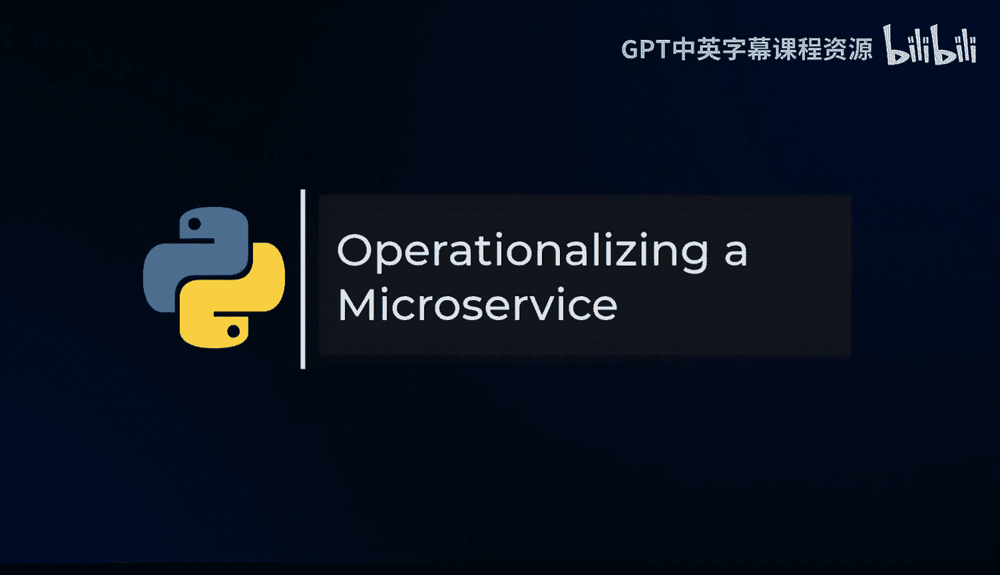
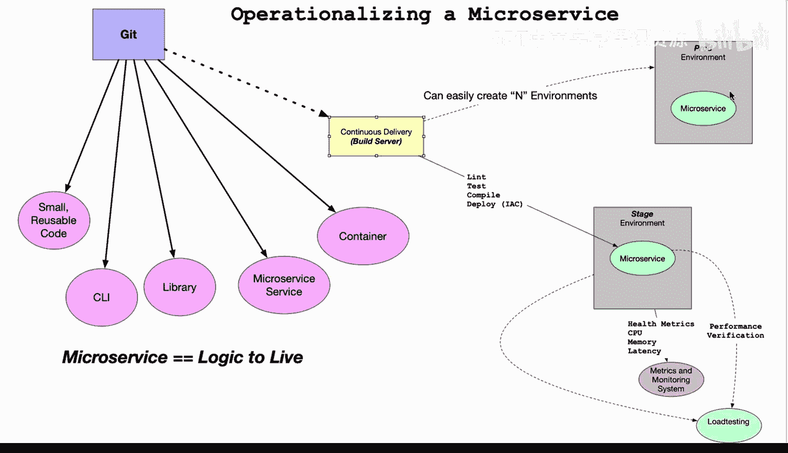

#  008：微服务运维化

在本节课中，我们将学习如何将一个微服务投入生产环境，即“运维化”。我们将探讨微服务的核心概念、其优势，以及如何通过持续交付流程和基础设施即代码来自动化部署与管理。

## 微服务的核心概念

上一节我们介绍了机器学习运维的宏观流程，本节中我们来看看一个具体的实现单元：微服务。微服务本质上是一段可独立部署和运行的业务逻辑代码。

其核心优势在于其**小**和**可复用**的特性。你可以将这段逻辑转化为多种形式，例如：
*   一个命令行工具。
*   一个可供其他程序调用的库。
*   一个独立的微服务。
*   一个Docker容器。

因此，微服务就像一个被“运维化”的函数，它被封装并赋予了新的形态。

## 持续交付与自动化部署

当我们通过Git管理微服务代码后，其优势便开始显现。代码提交后，会触发持续交付系统中的构建服务器（Build Server）执行一系列自动化步骤。

以下是构建服务器典型的处理流程：
1.  **代码检查**：进行代码质量分析。
2.  **测试**：运行单元测试、集成测试等。
3.  **编译**：将源代码编译成可执行文件或包。
4.  **容器化**：将应用打包成Docker镜像。
5.  **推送至仓库**：将镜像推送到容器镜像仓库（如Docker Hub）。
6.  **部署**：通过**基础设施即代码**工具（如Terraform、Ansible）将服务部署到目标环境。

## 灵活的多环境管理

通过结合**基础设施即代码**和**容器化**技术，我们可以轻松创建和管理任意数量的环境。例如：
*   开发环境
*   测试环境
*   预发布环境
*   生产环境
*   负载测试环境

系统可以根据服务被部署到的不同环境，自动执行相应的操作。例如，在预发布环境中，我们通常需要进行性能验证。

## 预发布环境的监控与验证

在预发布环境中，微服务会暴露健康指标，例如：
*   **CPU** 使用率
*   **内存** 使用量
*   请求**延迟**

这些指标会被监控系统（如Prometheus或AWS CloudWatch）收集。性能验证的目的，就是确认服务在实际运行中的表现符合预期。这确保了变更在进入生产环境前是稳定可靠的。

一旦预发布环境的验证获得批准，只需将代码合并到生产分支并推送，即可自动、安全地部署到生产环境。

## 总结

本节课中我们一起学习了微服务的运维化。微服务最简明的解释就是**一段被投入生产运行的逻辑**。我们看到了如何利用Git、持续交付、容器化和基础设施即代码，将这段逻辑自动化地构建、测试、监控并部署到多种环境中，从而实现高效、可靠的软件交付。