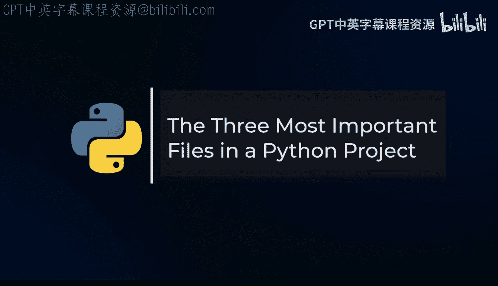
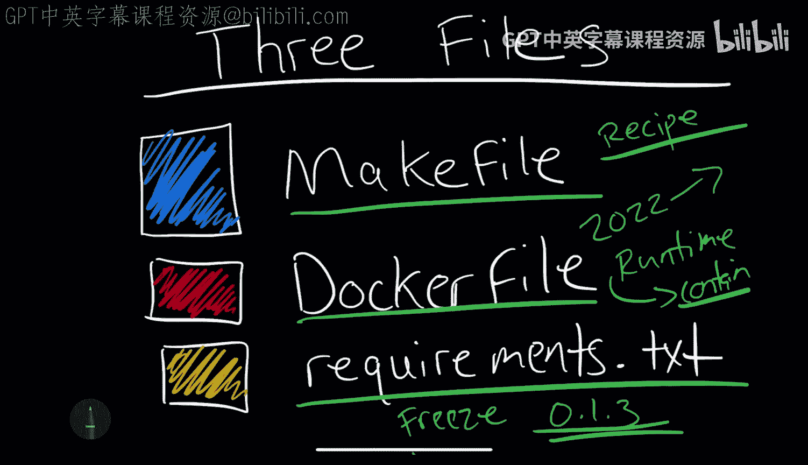
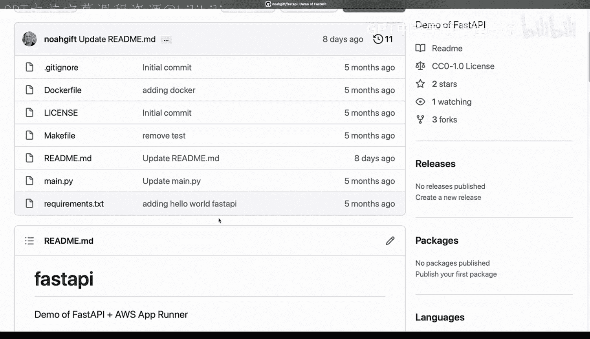

#  015：Python项目中最重要的三个文件 📁



在本节课中，我们将学习Python项目中至关重要的三个文件：`Makefile`、`Dockerfile`和`requirements.txt`。理解并正确使用这些文件，是构建可维护、可重复和可部署的现代Python项目的基础。

---

## 概述

一个组织良好的Python项目离不开核心的配置文件。它们分别负责自动化任务、定义运行环境和锁定依赖版本，共同构成了项目工程化的基石。

---

## Makefile：项目自动化脚本 📜

首先，我们来看`Makefile`。这个文件至关重要，因为它允许你自动化诸如安装、测试、部署等步骤。你可以把它想象成一套烹饪食谱。在家做饭时，你不需要每次都去查看每一种食材；同样，使用`Makefile`可以让你无需反复查找和输入复杂的命令，从而简化开发流程。

`Makefile`通过定义一系列“目标”（targets）和对应的命令来工作。以下是一个简单的示例：

```makefile
install:
    pip install -r requirements.txt

test:
    pytest

format:
    black .
```

在上面的例子中，运行`make install`会自动执行安装依赖的命令，`make test`会运行测试，`make format`会格式化代码。这自动化了所有复杂的步骤，开发者无需记忆具体的命令。

---


## Dockerfile：定义运行时环境 🐳

上一节我们介绍了用于自动化的`Makefile`，本节中我们来看看`Dockerfile`。`Dockerfile`之所以关键，是因为它定义了应用程序的运行时环境。在2022年及以后，项目几乎不可能不使用`Dockerfile`。它已成为必备项，这种运行时打包技术对于容器化部署至关重要。

确保你的项目中包含`Dockerfile`，这样你就可以将应用容器化并部署。一个典型的`Dockerfile`会从基础镜像开始，设置工作目录，复制代码，安装依赖，并指定启动命令。

以下是一个基于Python的`Dockerfile`示例：

```dockerfile
# 使用官方Python 3.8镜像作为基础
FROM public.ecr.aws/lambda/python:3.8



# 设置工作目录
WORKDIR /var/task

# 复制依赖文件并安装
COPY requirements.txt .
RUN pip install -r requirements.txt

# 复制应用程序代码
COPY app.py .

# 设置容器启动时执行的命令
CMD ["app.handler"]
```

这个文件允许你精确地控制应用运行所需的环境，确保开发、测试和生产环境的一致性。

---

## requirements.txt：管理Python依赖 🔒

接下来，我们讨论`requirements.txt`文件。这个文件用于记录项目的Python包依赖。它的重要性在于允许你“锁定”版本号。

这意味着，即使其他人在四年后克隆你的项目，他们也不需要去猜测你当时使用的是哪个版本的包。这极大地实现了流程的自动化。你可以使用`pip freeze`命令来生成当前环境的依赖列表。

以下是`requirements.txt`文件内容的示例：

```
fastapi==0.68.0
uvicorn==0.15.0
pydantic==1.8.0
```

在快速开发阶段，你可能不需要严格锁定每个版本。但一旦准备将项目投入生产，就应该固定这些依赖的版本，以确保稳定性。

---

## 实战项目解析

让我们结合一个名为“NOAAgi fast API”的项目来具体看看这三个文件是如何协同工作的。这个项目包含了我们提到的三个最重要的文件。

*   **Makefile**：该项目的`Makefile`包含了`make install`（安装依赖）、`make test`（运行测试）和`make format`（格式化代码）等命令。它自动化了所有复杂步骤。
*   **requirements.txt**：该文件列出了项目所需的包。在生产部署前，会固定这些包的版本号。
*   **Dockerfile**：这个`Dockerfile`基于AWS Lambda的Python 3.8镜像，通过一系列命令设置运行时环境，最终将应用容器化。开发者只需运行`docker build .`和`docker run`即可构建和运行容器，并可以将其推送到源代码仓库或Amazon的容器仓库。

为项目设置持续集成（CI）也变得非常简单，因为这些文件提供了标准化的构建和测试入口。

---

## 总结



本节课中，我们一起学习了构成Python项目基石的三个核心文件：
1.  **`Makefile`**：用于自动化常见开发任务，如安装、测试和格式化。
2.  **`Dockerfile`**：用于定义和打包应用程序的运行时环境，实现容器化部署。
3.  **`requirements.txt`**：用于精确管理并锁定项目所依赖的Python包版本。


掌握并熟练运用这三个文件，能够显著提升项目的可维护性、可重复性以及部署的便捷性，是迈向专业机器学习运维和软件开发的重要一步。