#  018：贪心算法与旅行商问题


在本节课中，我们将要学习两种经典的算法思想：贪心算法和旅行商问题。我们将通过构建自动找零系统和旅行路线规划工具这两个具体项目，来理解这些算法的核心概念和实际应用。课程将全程使用Python，并借助GitHub Copilot等AI辅助工具来加速开发。


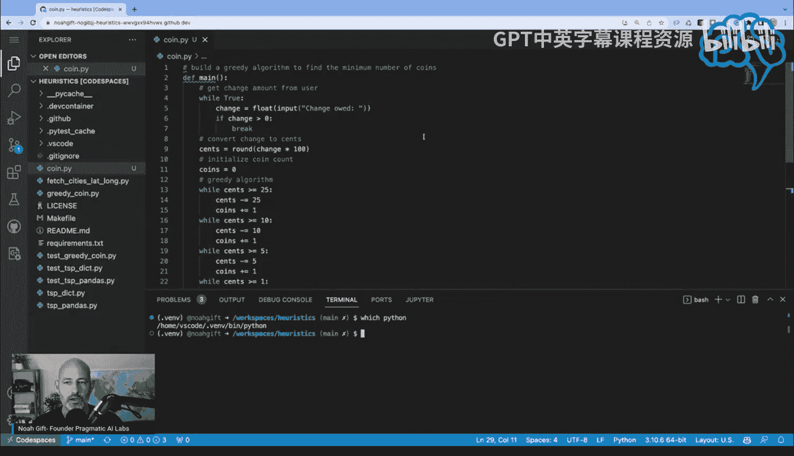

---

## 贪心算法：构建自动找零系统


上一节我们介绍了本课程的目标，本节中我们来看看第一个核心概念：贪心算法。贪心算法的核心思想是，在每一步选择中都采取当前状态下**最好**或**最优**的选择，从而希望导致结果是全局最好或最优的。

一个经典的例子是自动售货机的找零系统。我们的目标是：给定一个找零金额，系统应返回**硬币数量最少**的组合。在美国，常用的硬币面额有：25美分、10美分、5美分和1美分。

贪心算法的策略很直接：**总是优先使用最大面额的硬币**，直到剩余金额小于该面额，然后转向次大的面额，依此类推。

以下是实现该算法的核心代码：

```python
def greedy_coin(change):
    coins = [0.25, 0.10, 0.05, 0.01]  # 硬币面额
    coin_dict = {coin: 0 for coin in coins}  # 初始化硬币计数字典

    for coin in coins:
        while change >= coin:
            change -= coin
            coin_dict[coin] += 1

    # 输出结果
    for coin, count in coin_dict.items():
        if count > 0:
            print(f"{count} 个 {int(coin*100)} 美分硬币")
    return coin_dict
```

为了使这个算法更实用，我们使用 `click` 库将其包装成一个命令行工具。这样，我们既可以在终端直接使用，也可以将其作为模块导入到其他Python项目中。

```bash
# 在命令行中使用
$ ./greedy_coin 0.99
你的找零 0.99 美元需要：
3 个 25 美分硬币
2 个 10 美分硬币
4 个 1 美分硬币
```

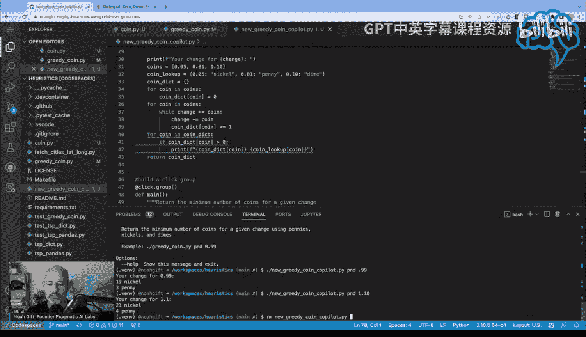

通过这个例子，我们看到了贪心算法如何通过一系列局部最优选择，快速得到一个可行的解决方案。然而，贪心算法并不总能得到全局最优解，但在像找零这样的特定问题上，它非常有效。

---

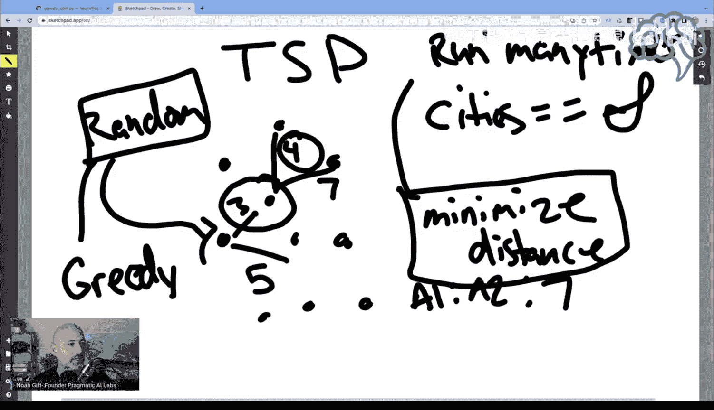

## 旅行商问题：寻找最短旅行路线

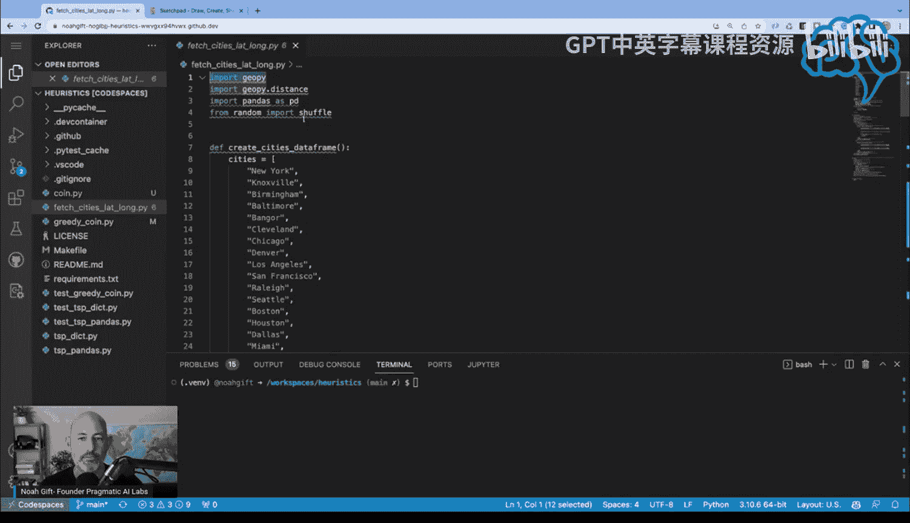

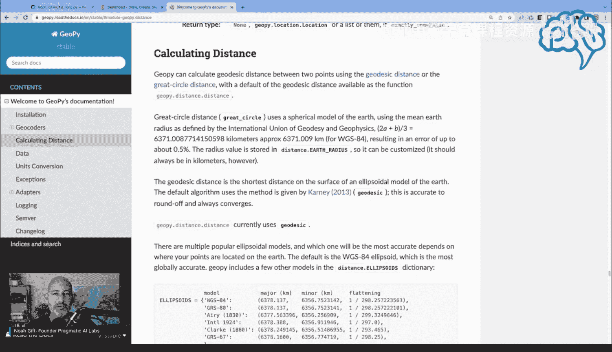

上一节我们介绍了贪心算法解决确定性问题，本节中我们来看看一个更复杂的优化问题：旅行商问题。这是一个NP难问题，目标是为一位“旅行推销员”找到一条访问一系列城市并返回起点的**最短可能路线**。

由于城市数量增加时，可能的路线组合会爆炸式增长，我们无法穷举所有解。因此，我们需要借助**启发式算法**来寻找一个“足够好”的近似解。

我们将采用一种结合了**随机化**和**贪心**策略的算法：
1.  **随机选择一个起始城市**。
2.  从当前城市出发，**贪心地选择距离最近且未访问过的城市**作为下一站。
3.  重复步骤2，直到所有城市都被访问。
4.  计算总旅行距离。
5.  将上述过程运行多次（例如1000次），最后选择**总距离最短的那条路线**作为我们的解决方案。

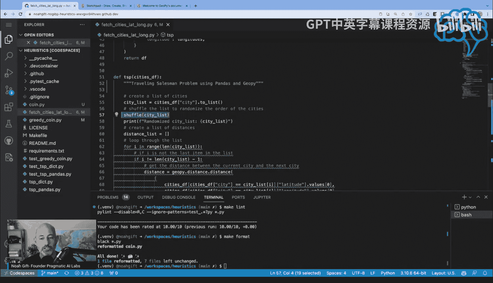

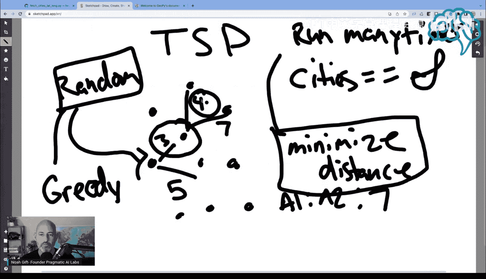

为了模拟真实场景，我们使用真实美国城市的经纬度数据。这里会用到 `geopy` 库来计算城市间的地理距离。

以下是算法核心部分的简化代码：

```python
import random
from geopy.distance import geodesic

def calculate_distance(city1, city2):
    """计算两个城市间的距离（英里）"""
    return geodesic(city1.coords, city2.coords).miles

def tsp_random_greedy(cities_list, num_simulations=100):
    best_distance = float('inf')
    best_route = []

    for _ in range(num_simulations):
        # 1. 随机打乱城市顺序作为新的起点
        random.shuffle(cities_list)
        route = [cities_list[0]]
        unvisited = set(cities_list[1:])
        total_distance = 0

        # 2. 贪心选择下一个最近城市
        while unvisited:
            current_city = route[-1]
            # 找到未访问城市中距离当前城市最近的
            next_city = min(unvisited, key=lambda city: calculate_distance(current_city, city))
            route.append(next_city)
            unvisited.remove(next_city)
            total_distance += calculate_distance(current_city, next_city)

        # 3. 返回起点
        total_distance += calculate_distance(route[-1], route[0])

        # 4. 更新最佳结果
        if total_distance < best_distance:
            best_distance = total_distance
            best_route = route

    return best_distance, best_route
```

同样，我们也将这个解决方案构建成一个强大的命令行工具。用户可以指定任意城市列表和模拟运行次数。

```bash
# 使用内置的美国城市列表运行100次模拟
$ ./tsp_solver simulate --count 100

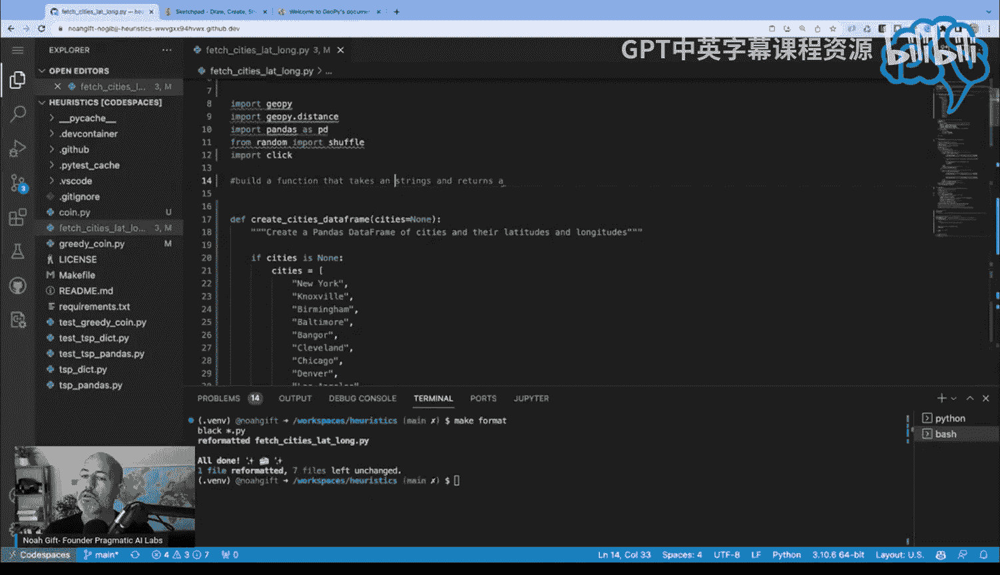


# 使用自定义城市列表运行50次模拟
$ ./tsp_solver custom Boston "New York" Chicago "Los Angeles" --count 50
```

通过多次随机模拟，我们能够以较高的概率找到一个非常接近最优解的旅行路线。这种方法在无法求得精确解的实际问题中非常有用。

---

## 开发技巧：AI辅助与工程化实践

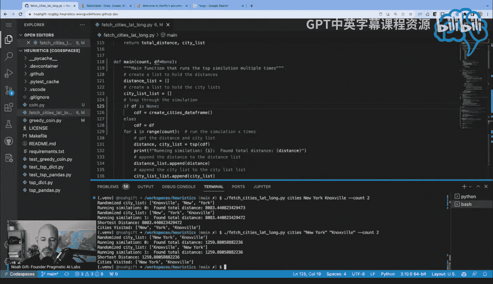


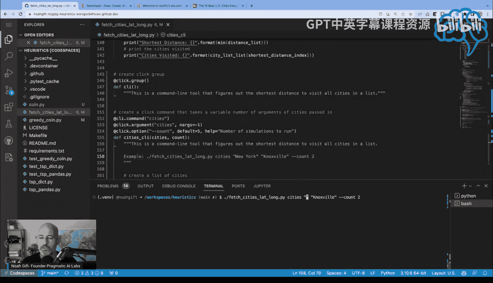

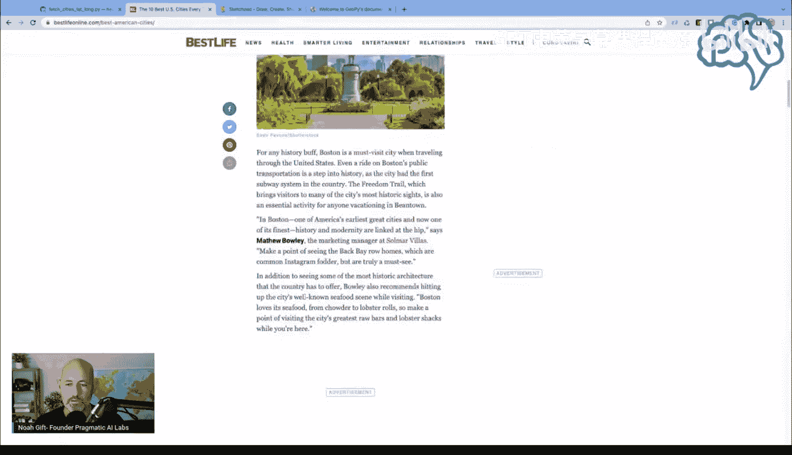

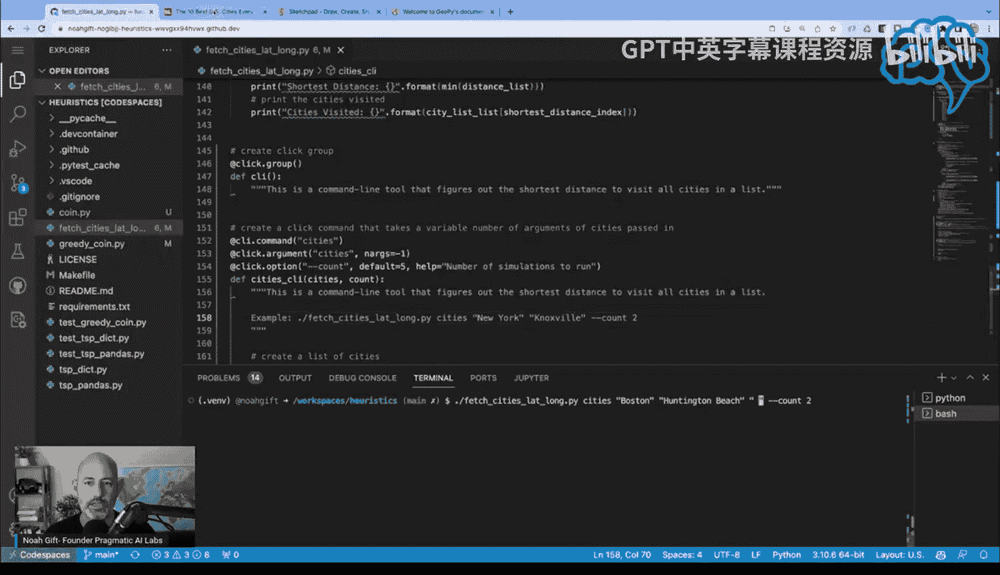


在构建上述项目的过程中，我们实践了一些重要的现代开发技巧：

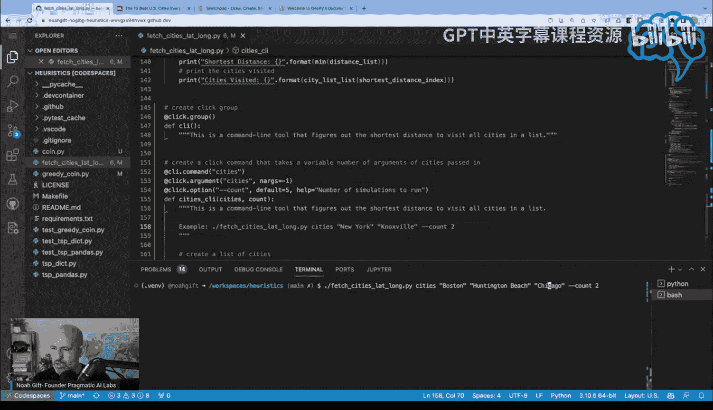


1.  **使用GitHub Copilot辅助编程**：我们演示了如何用自然语言提示Copilot生成函数、命令行工具甚至测试代码，极大提升了开发效率。
2.  **创建可复用的开发环境**：通过 `Dockerfile` 和 `devcontainer.json` 配置Codespaces，确保任何协作者都能获得完全一致的开发环境。
3.  **编写可组合的代码**：将核心算法逻辑与命令行接口分离，使得同一个函数既能被终端调用，也能轻松集成到Web服务或其他系统中。
4.  **实施代码质量检查**：使用 `black` 自动格式化代码，使用 `pylint` 进行静态检查，并使用 `pytest` 编写自动化测试，确保代码的健壮性。

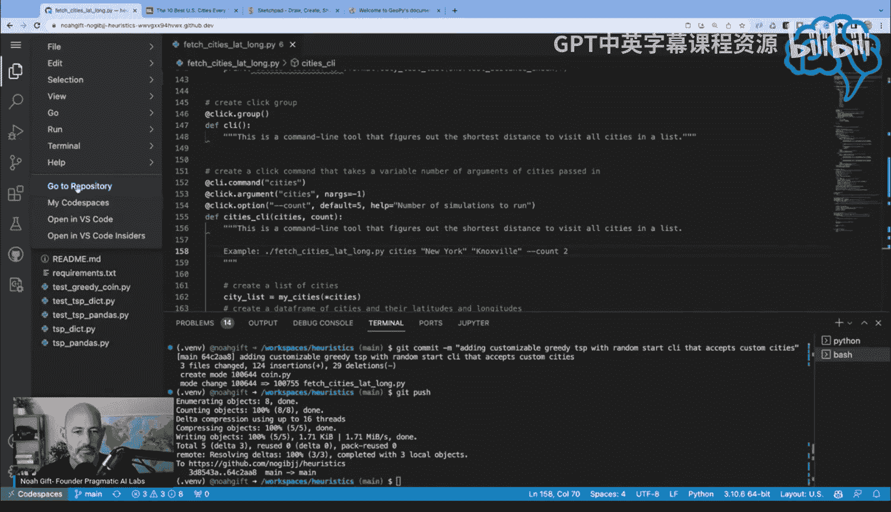

---

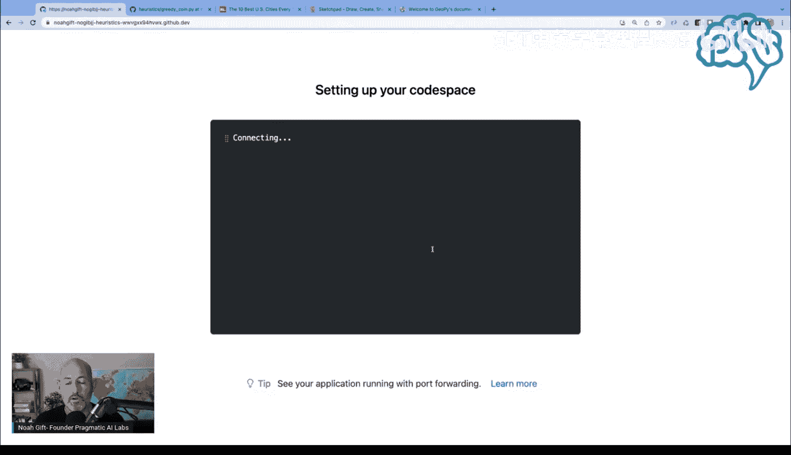

## 总结

本节课中我们一起学习了：
*   **贪心算法**的核心思想及其在自动找零问题上的应用。我们了解到贪心算法通过局部最优选择来构建解，简单高效，但适用范围有限。
*   **旅行商问题**的复杂性以及如何用**随机化贪心算法**这种启发式方法寻找近似最优解。我们构建了一个可以处理真实地理数据的实用路线规划工具。
*   如何利用**AI辅助工具（如GitHub Copilot）** 和**工程化实践（如容器化、代码格式化、测试）** 来高质量、高效率地完成算法项目的开发。

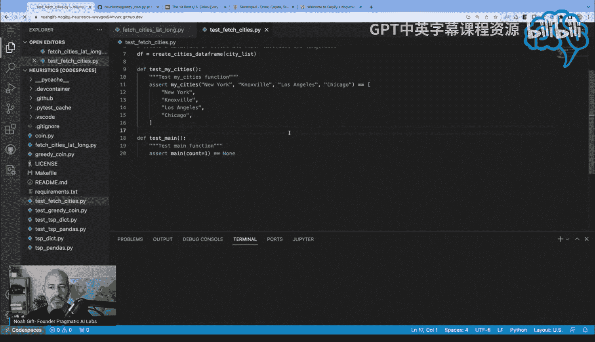

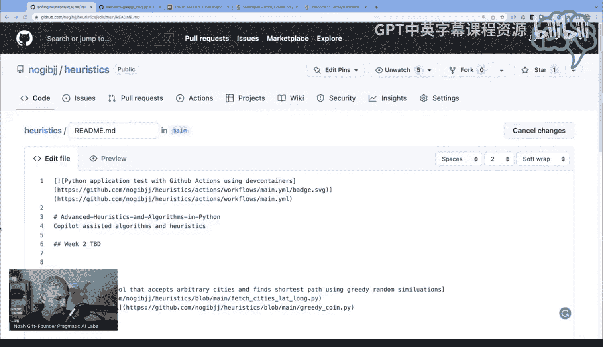


通过这两个从简单到复杂的项目，我们不仅理解了算法思想，更掌握了将其转化为实际可用工具的技能。在接下来的课程中，我们将探索更多有趣的启发式和元启发式算法。