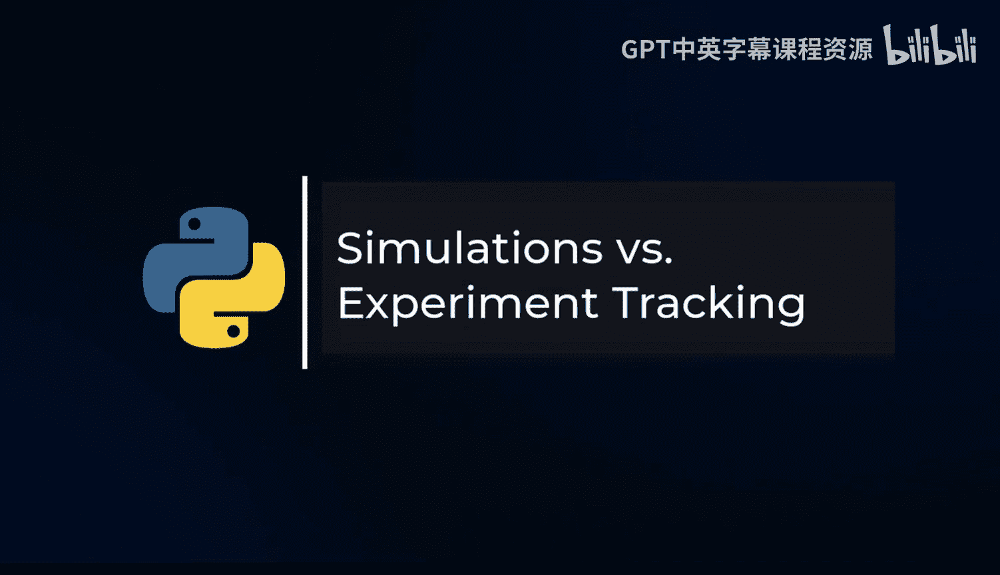
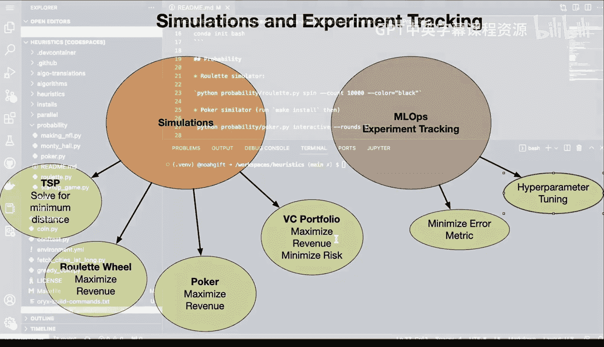
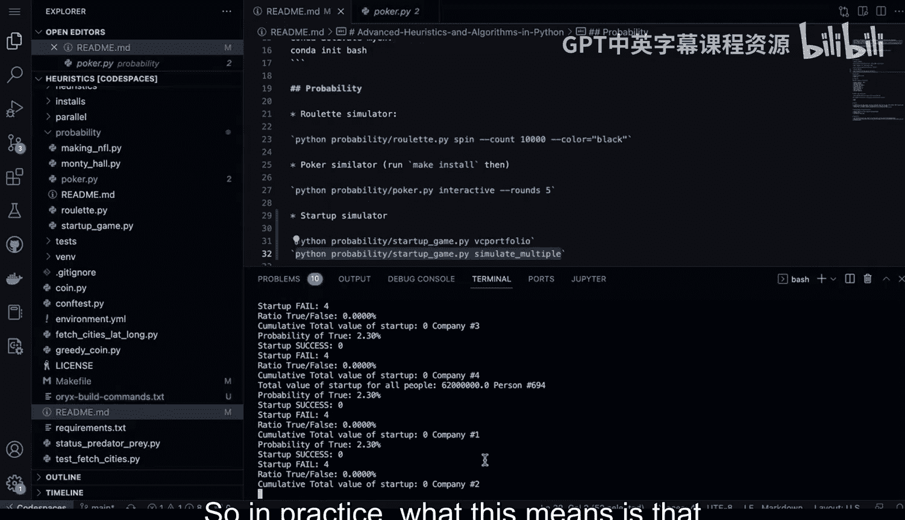
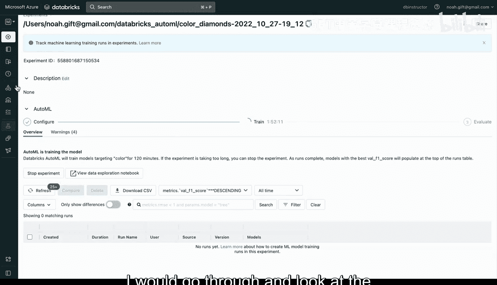
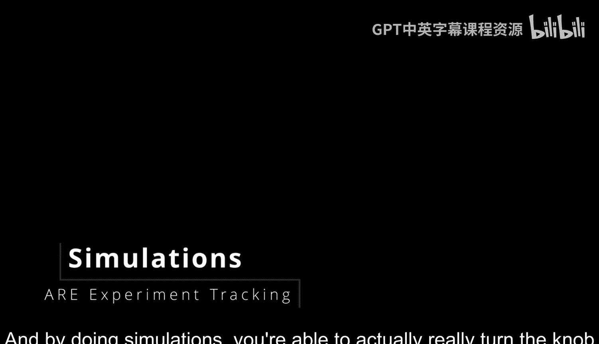
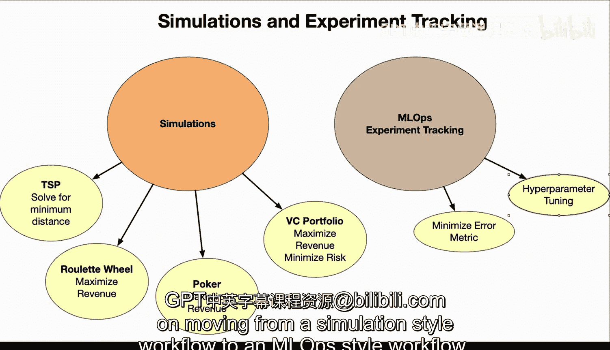

#  019：仿真与实验追踪对比 🔄

在本节课中，我们将探讨机器学习运维中一个核心概念：实验追踪。我们会发现，它与我们熟悉的“仿真”概念有许多相似之处。通过对比仿真与实验追踪，我们可以更好地理解如何将仿真中的思想应用到机器学习模型的开发与优化流程中。

## 仿真与实验追踪的相似性

上一节我们介绍了机器学习运维的宏观概念，本节中我们来看看实验追踪与仿真的具体联系。

仿真与机器学习实验追踪存在许多相似之处。如果我们观察一个仿真问题，例如旅行商问题，其核心思想是多次运行（例如，一个贪婪随机起点算法）以求解最短路径。其目标是找到访问所有城市所需的最短旅行距离。公式可以表示为：

**`minimize(total_distance)`**

同样，对于轮盘赌游戏，如果你想最大化收益，可以创建大量仿真来观察是否存在从轮盘赌中获得高收益的方法。众所周知，这没有最优解，但你可以通过仿真自行验证。扑克游戏也是如此，你可以构建自己的扑克仿真来最大化收益。或者，如果你在考虑加入一家初创公司，可以观察风险投资组合如何通过最小化风险来最大化收益。这就是他们投资100家公司，并将所有风险转移给初创公司员工的原因。

现在，观察机器学习运维中的实验追踪，这是一个非常相似的过程。你需要审视大量实验，目标是在一系列不同实验中最小化误差，或针对某个指标进行优化。你可能需要进行大量的超参数调优，并找出最佳的调优任务。因此，经典的仿真与MLOps实验追踪有许多共同点。

## 仿真实例分析

以下是几个具体的仿真示例，帮助我们理解其运作模式。

### 轮盘赌仿真

第一个示例是轮盘赌仿真。这是一个有趣的例子。如果我想仿真轮盘赌运行10000次，每次我都押注黑色，会发生什么？这实际上是模拟大数定律的一种方式，你可以看到事实上你并没有很高的获胜几率。

如果我们运行这段代码，可以看到我每次下注1美元，选择黑色，并运行成千上万次仿真。我可以可视化发生的一切，结果是我们看到收益为负。它显示了黑色、红色和绿色出现的次数。如果我再次运行仿真，由于大数定律，我同样会得到负收益。长期来看，在简单的轮盘赌中我会输钱。

现在，快速查看一下轮盘赌仿真的代码。其基本要点是：我使用pandas和click库，首先构建一个轮盘。然后，我定义了旋转轮盘、仿真轮盘、生成报告的函数。我计算整个仿真过程中的收益，处理红、黑、绿等结果，打印信息，最后将其构建成一个命令行工具。这就是微型仿真的基本原理。

### 扑克仿真

如果我想运行另一种仿真，我们也可以进行扑克仿真。运行扑克仿真时，它会询问下注金额。例如，下注1美元并玩5轮。每次它都会显示手牌、我是否获胜。最后，它会说基于我的下注，期望收益是4美元，但我实际赢了100美元。这是模拟你以特定方式玩一手牌的不同结果的绝佳方法。

同样，快速查看代码，它会遵循与之前相同的模式：构建我要仿真的“世界”（本例中是扑克牌堆），编写一些辅助代码来处理发牌等操作，选择特定的手牌以便我知道在与哪些牌对赌，构建其他功能，然后进行显示和评估，最后执行仿真。

### 风险投资仿真

我还有一个有趣的仿真示例：模拟成为一名风险投资家的体验。运行这个仿真时，可以看到我获得了20%或80%的投资回报率。它显示累计投资额（例如500万）和最终支出（例如28.85亿），并展示了对这100家公司投资后各自所占的股权百分比。在这个特定仿真中，结果很好。

那么，如果我模拟大量不同的初创公司员工（风险被转移给了他们，且他们无法利用众多公司进行风险分散）会怎样？你可以看到，在这种场景下，初创公司成功的概率一遍又一遍地只有2%。

## 从仿真到MLOps实验追踪

这引出了一个重要的观点：通过进行仿真，你能够真正弄清楚你想要构建什么，并针对某个目标进行最小化或最大化。

在实践中，这意味着如果我转到Databricks平台，查看一个正在进行的实验追踪任务，我可以看到不同实验之间的差异。我会仔细查看我想要达成的指标，这些指标会显示在实验追踪面板中。

总而言之，实验追踪的概念与你实际进行机器学习运维时的许多操作非常相似。通过进行仿真，你能够真正地将工作流程从仿真风格转向MLOps风格。