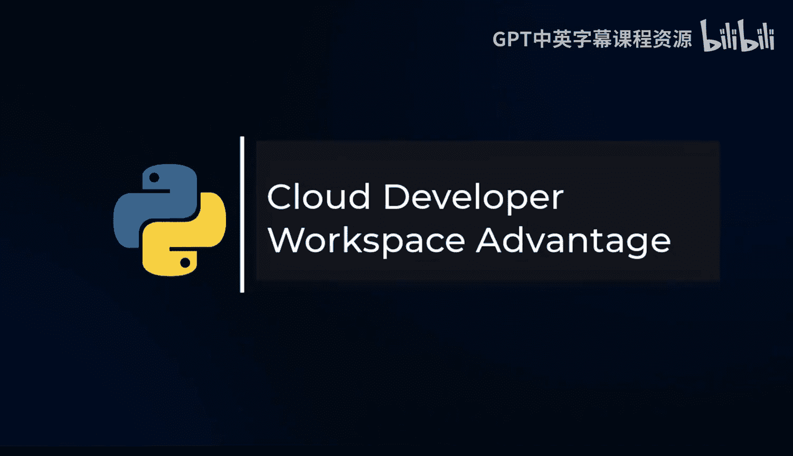
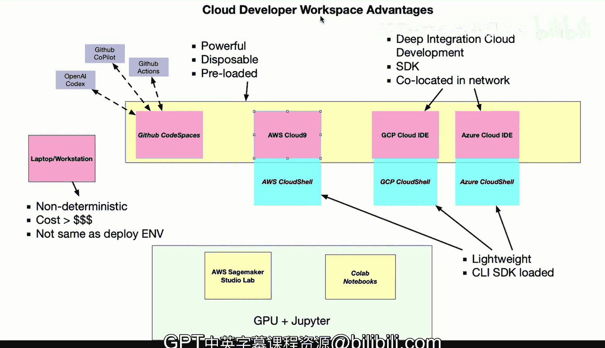

#  021：云开发者工作空间优势 🚀

在本节课中，我们将探讨一个在现代软件开发、数据工程和机器学习领域日益重要的趋势：**云开发者工作空间**。我们将了解其核心优势，并与传统的本地开发环境进行对比，帮助你理解为何向云端迁移是未来的发展方向。

## 传统本地环境的局限性 💻

上一节我们介绍了机器学习运维的多种工具，本节中我们来看看开发环境本身。首先，让我们审视一下传统的笔记本电脑或工作站开发环境。

这种环境存在几个关键问题：
*   **环境非确定性**：没有标准化的、可复现的环境。可能安装了你不想要的软件包，导致依赖冲突。
*   **资源成本高昂**：获取高性能GPU和大容量固态硬盘的成本很高。
*   **与部署环境脱节**：如果你的应用最终部署在云端，那么本地开发环境与生产环境存在差异，可能导致“在我机器上能运行”的问题。

> 虽然可以通过容器技术（如Docker）在一定程度上解决环境一致性问题，但这增加了配置和管理的复杂性。

## 云开发者工作空间的兴起 ☁️

现在，让我们将目光转向云端。云服务商提供了多种基于浏览器的集成开发环境，它们正在改变开发者的工作方式。

以下是主流的云开发环境分类及其特点：

**1. 集成开发环境**
这类环境提供了完整的代码编辑、调试和项目管理功能，更适用于软件工程和MLOps工作流。
*   **GitHub Codespaces**：深度集成GitHub Actions（CI/CD系统）和GitHub Copilot（AI编程助手），是与GitHub生态结合最紧密的环境之一。
*   **AWS Cloud9**：提供基于角色的权限管理，无需在代码中硬编码API密钥，并与AWS Lambda、S3等服务深度集成，便于构建无服务器应用。
*   **GCP Cloud IDE 与 Azure Cloud IDE**：谷歌云和微软Azure也提供了各自功能类似的云端编辑器。

**2. 云端Shell终端**
这是更轻量级的命令行环境，适合执行快速任务或管理操作。
*   **AWS CloudShell / GCP Cloud Shell / Azure Cloud Shell**：各云厂商均提供了内嵌在控制台中的Shell环境，预装了SDK和工具，并可在Bash、Zsh或PowerShell之间切换。

**3. 笔记本友好型环境**
这类环境专为数据科学和交互式编程设计，核心是Jupyter Notebook。
*   **Google Colab Notebooks**：提供免费的GPU资源运行Jupyter兼容的笔记本，并有Pro版本提供更强大的功能。
*   **AWS SageMaker Studio Lab**：由AWS平台提供的免费服务，允许用户使用GPU运行Jupyter笔记本。

## 核心优势与未来展望 ⚡

综合来看，云开发者工作空间代表了明确的演进方向。它们提供的是**强大的、可随时创建与销毁的、预配置好的环境**。

其核心优势可以用一个简单的概念概括：**同地协作**。你的开发环境与你的数据及计算资源位于同一云端区域。

考虑这个场景：当你在咖啡馆需要处理TB级的数据时，如果数据在云端，而你的开发环境也在同一云端，你就可以直接高效地进行计算，无需在本地和云端之间来回传输数据。

因此，未来的趋势是充分利用**云开发者工作空间优势**。它通过提供一致的环境、集成的工具链、按需可扩展的资源以及与云服务的无缝连接，极大地提升了开发、数据科学和机器学习工程的效率与协作能力。

本节课中我们一起学习了云开发者工作空间相较于传统本地环境的巨大优势，了解了不同类型的云端开发环境及其适用场景。拥抱云端开发环境，是迈向更高效、更协作的现代技术工作流程的关键一步。