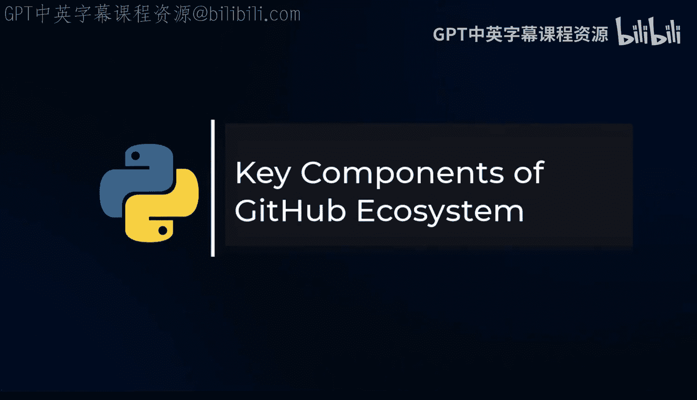

#  022：GitHub生态系统关键组件 🛠️

在本节课中，我们将学习如何利用GitHub生态系统来构建和部署机器学习项目。我们将重点介绍四个核心组件：Codespaces、GPU访问、Copilot AI编程助手以及GitHub Actions。这些工具共同构成了一个强大、可复现且高效的现代开发环境。

---

## 构建可复现的开发环境 🔄

上一节我们介绍了GitHub生态系统的整体价值，本节中我们来看看如何实现开发环境的可复现性。这对于团队协作和课堂教学至关重要。

通过Codespaces环境，你可以获得极高的可复现性。这意味着团队中的其他成员或课堂上的其他学生，都能访问与你完全相同的开发环境。

以下是Codespaces实现可复现性的三个关键方面：

*   **云端开发环境**：它是一个基于云的工作空间，内置了容器镜像。这个镜像可以是Ubuntu镜像、微软创建的镜像，或任何与Docker兼容的镜像。
*   **自定义配置**：你可以通过 `.devcontainer` 配置文件，自定义这个环境以满足你的特定需求。
*   **计算与存储**：你可以配置Codespaces使用GPU、多核机器或高内存机器。这非常宝贵，因为你可以在与生产环境相似的环境中进行测试和构建。

---

## 利用GPU加速机器学习任务 ⚡

现在，我们已经有了一个可复现的环境，接下来看看如何利用GPU的强大算力来加速我们的工作。

访问GPU允许你执行多种高级机器学习任务。例如，你可以深入使用Hugging Face——预训练模型的领先提供商之一。你可以下载其预训练模型，并在你的设备上直接进行微调，而无需购买昂贵的独立GPU。

以下是利用GPU可以进行的几项核心工作：

*   **使用预训练模型**：Hugging Face与PyTorch配合非常紧密。你可以访问PyTorch，也可以使用TensorFlow。
*   **构建深度学习模型**：你可以从头开始构建自己的深度学习模型。
*   **底层GPU编程**：你甚至可以深入到更底层的NVIDIA CUDA SDK，构建直接应用于GPU的函数。

---

## 借助AI编程助手提升效率 🤖

在拥有了强大的计算环境后，我们还需要高效的开发工具。Copilot AI编程助手正是为此而生。

Copilot AI编程助手是一种获取代码建议、直接向项目中添加细节的方式。通过Copilot整合项目中的所有信息，你可以请求Pylint进行代码检查、使用Pytest进行测试，或用IPython执行代码，从而形成一个持续改进的良性循环。这可以带来数倍的开发速度提升。

---

## 实现持续集成与持续交付 🚀

最后，当我们完成了代码开发，就需要一个可靠的部署流程。GitHub Actions的持续集成和持续交付功能完美地解决了这个问题。

它允许你在Codespace环境中，执行 `make install`、`make test`、`make deploy` 等步骤（定义在你的Makefile中）。然后，通过GitHub Actions将这些步骤集成到CI/CD流程中。例如，它可以触发将镜像推送到Amazon的容器注册表，进而触发平台即服务（如App Runner）来部署你的应用。

这样，你就拥有了在**完全相同的环境**中开发和最终部署所需的所有工具，为实现持续集成和持续交付的最佳实践提供了平滑的过渡。

---

## 总结 📝

本节课中，我们一起学习了GitHub生态系统中四个关键组件如何协同工作，为机器学习运维提供强大支持：

1.  **Codespaces** 提供了**可复现的云端开发环境**。
2.  **GPU访问** 赋能了**高性能的模型训练与推理**。
3.  **Copilot AI助手** 显著**提升了代码开发与调试的效率**。
4.  **GitHub Actions** 实现了从代码到部署的**自动化CI/CD流水线**。

掌握这些工具，你将能更高效、更协作地构建和部署机器学习应用。