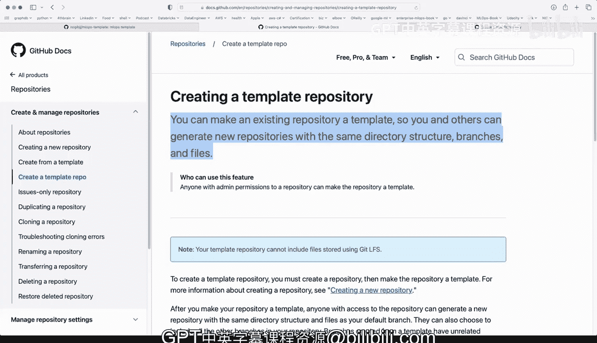

#  023：使用GitHub模板创建项目脚手架


在本节课中，我们将学习如何利用GitHub的模板功能，快速创建一个标准化的机器学习项目仓库。我们将基于一个现有模板创建新仓库，并将其自定义为适合团队或课程使用的模板。

---

## 概述

GitHub模板仓库功能允许用户基于一个预定义的项目结构快速创建新仓库。这能确保团队或课程中的所有项目都遵循一致的目录结构、配置文件和开发环境设置，从而提高协作效率和项目启动速度。

上一节我们介绍了开发容器和代码空间的基本概念，本节中我们来看看如何利用GitHub模板来标准化项目初始化流程。

## 创建基于模板的新仓库

首先，我们需要找到一个合适的模板作为起点。这里以微软的“Codespaces Tea Template Pi”公共模板为例。

以下是创建基于模板的新仓库的步骤：

1.  在模板仓库页面，点击 **“Use this template”** 按钮。
2.  选择目标账户或组织。
3.  为新仓库命名，例如 `mlops-template`。
4.  选择仓库可见性（公开或私有）。
5.  选择是否包含模板的所有分支（通常只包含 `main` 分支即可）。

通过以上步骤，模板中的所有文件将被复制到新创建的仓库中。

## 自定义模板内容

创建模板仓库后，我们通常需要根据特定需求对其进行自定义。一个常见的做法是添加 `Makefile` 来简化常用命令。

例如，我们可以直接在GitHub界面上创建一个新的 `Makefile`：

```makefile
install:
    pip install -r requirements.txt

test:
    pytest

format:
    black .
    isort .
```

此外，我们也可以修改 `.devcontainer` 目录下的配置文件，以定制开发容器的环境，例如预装特定的工具或库。

## 将仓库发布为模板

为了使自定义的仓库结构能够被他人复用，我们需要将其设置为模板仓库。

以下是具体操作：

1.  进入新仓库的 **“Settings”** 页面。
2.  向下滚动找到 **“Template repository”** 选项。
3.  勾选复选框，将其设置为模板仓库。

设置完成后，该仓库的页面将显示“Template”标签。团队成员或学生现在可以通过点击 **“Use this template”** 按钮，基于此标准化结构快速创建自己的项目仓库。

## 总结

本节课中我们一起学习了GitHub模板仓库的完整使用流程。我们首先基于一个公共模板创建了新仓库，然后通过添加 `Makefile` 等方式对其进行了自定义，最后将该仓库发布为团队可复用的模板。利用此功能，可以确保项目结构的一致性，显著提升团队协作和项目初始化的效率。



> 更多详细信息，可以参考GitHub官方文档“Creating a template repository”。