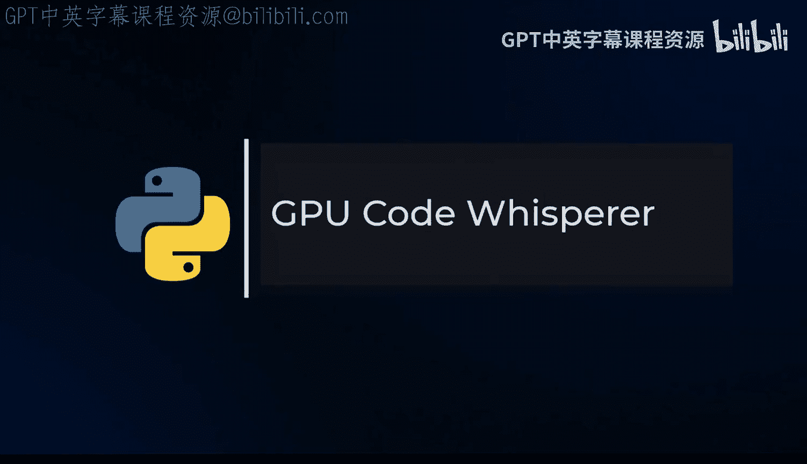

#  025：GPU与Code Whisperer工具 🚀

在本节课中，我们将学习如何在基于GPU的Codespace环境中，利用NVIDIA监控工具和Whisper等工具进行高效的GPU计算与资源管理。

---

上一节我们介绍了机器学习运维中的部署与监控概念。本节中，我们来看看如何在具体的开发环境中利用GPU资源。

这里有一个NVIDIA监控工具，它允许我查看此处NVIDIA GPU的完整利用率。

你可以在此看到CUDA驱动版本是11.7，GPU使用率为43%。在另一个终端中，我正在运行Whisper，它能够利用Codespace上的GPU。同时，得益于Codespace提供的存储空间，我也能够转录非常大的文件。

因此，对于使用基于GPU实例的数据科学和机器学习学生来说，这确实是一个进行GPU相关工作的绝佳环境。

我们还可以切换到这里，查看每个进程的详情。我们可以看到，事实上我不仅能够充分利用GPU。

我还能够使用这台六核机器，并利用这些重型GPU机器上可用的一些大内存资源。

你可以看到有110 GB可用内存。这意味着我实际上可以再启动几个转录任务，使用OpenAI的Whisper。

监控我的资源，然后之后当我想做其他工作时，例如文本摘要或在转录数据上运行其他Hugging Face预训练模型。

一切都可以顺利进行。

---

本节课中我们一起学习了如何在Codespace环境中使用NVIDIA工具监控GPU资源，并利用Whisper等工具执行高效的转录任务。我们了解到，这种环境为数据科学和机器学习工作提供了强大的计算能力和灵活性，便于后续进行更复杂的模型处理。