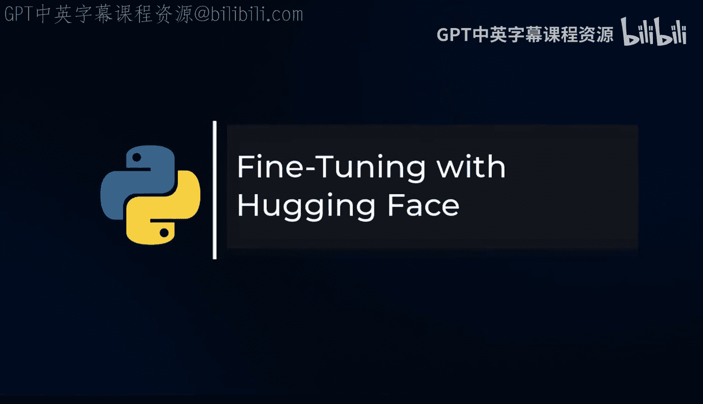
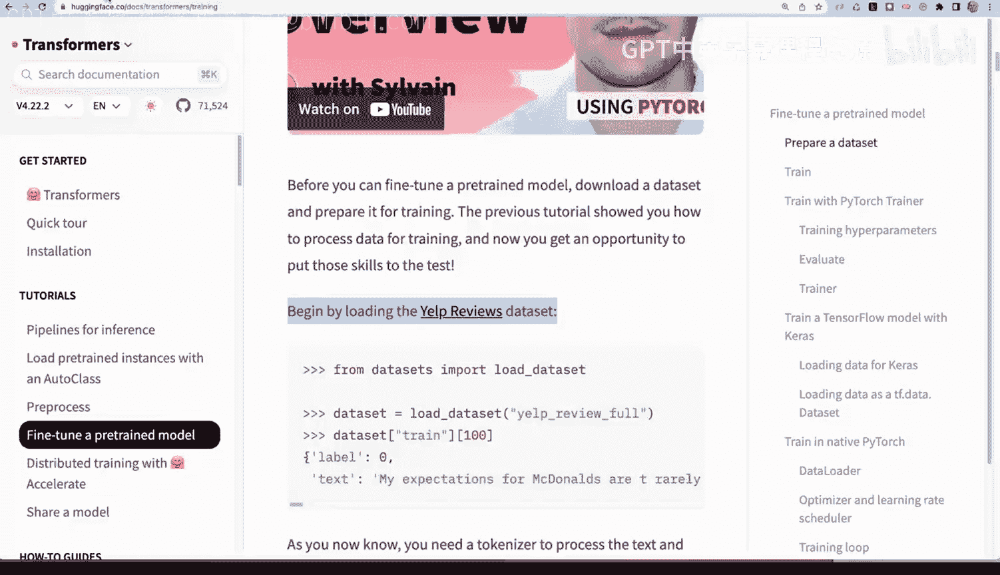
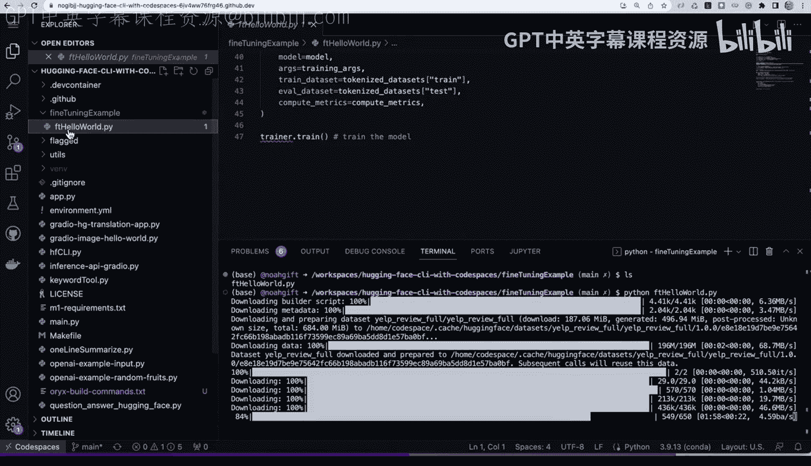
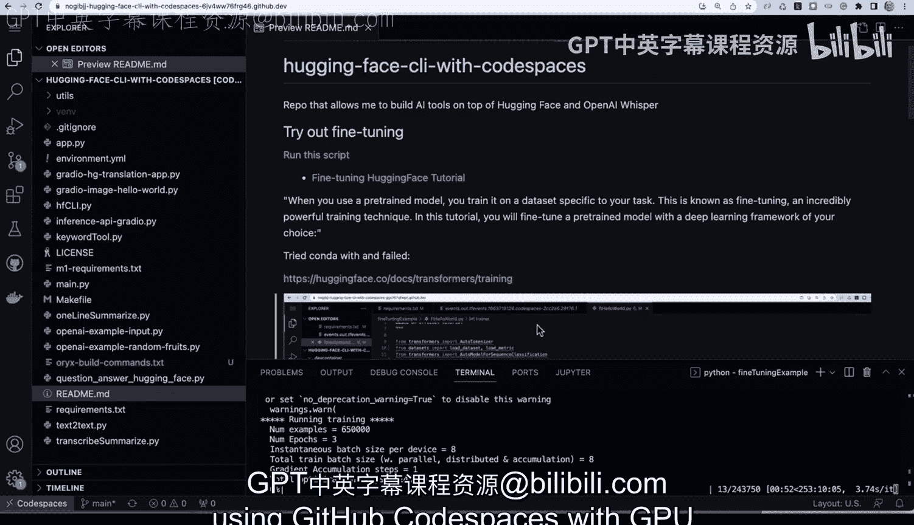

#  026：Hugging Face微调实践



在本节课中，我们将学习如何使用流行的模型托管服务Hugging Face，并实践对预训练模型进行微调的核心流程。

## 概述

Hugging Face是一个提供模型、数据集和协作空间的平台。它拥有超过75,000个且数量持续增长的预训练模型，覆盖了文本摘要、分类、问答等多种任务。用户可以直接在线体验这些模型，也可以下载它们，在自己的环境中针对特定需求进行微调。本节我们将重点介绍微调的实践过程。

## Hugging Face核心功能

Hugging Face主要提供三大核心功能：**模型**、**数据集**和**空间**。

*   **模型**：这里托管了大量预训练模型。用户可以根据任务类型（如摘要、分类）浏览和选择模型，并在线进行测试。
*   **数据集**：平台提供了丰富的数据集，可用于模型训练和评估。
*   **空间**：允许用户创建和分享基于模型的演示应用。

例如，如果我们进入“摘要”任务区，选择Google的Pegasus模型，就可以直接输入文本并查看其摘要效果。这项服务被广泛用于实验和生产环境。

## 微调预训练模型实践

上一节我们介绍了Hugging Face的平台功能，本节中我们来看看如何具体微调一个预训练模型。核心概念是：下载一个预训练模型，然后使用你自己的数据对其进行调整，以适应特定任务。





Hugging Face提供了详细的教程来指导这一过程。通常，你可以从平台下载一个数据集，然后在启用了GPU的GitHub Codespace环境中进行模型微调。

以下是一个微调示例代码的关键步骤：

```python
# 导入必要的库
from transformers import AutoTokenizer, AutoModelForSequenceClassification
from datasets import load_dataset, load_metric
```

1.  **加载数据集**：使用 `load_dataset` 函数加载Hugging Face上或本地的数据集。
2.  **预处理与分词**：定义一个函数，使用 `AutoTokenizer` 对数据集进行分词处理。
3.  **加载预训练模型**：使用 `AutoModelForSequenceClassification` 加载一个基础预训练模型。
4.  **定义评估指标**：例如，构建一个计算准确率的函数。
5.  **执行训练**：配置训练参数后，调用 `trainer.train()` 方法开始微调过程。

执行训练时，计算环境至关重要。在启用GPU的情况下，训练速度会显著快于仅使用CPU。你可以使用 `nvidia-smi` 命令来监控GPU的使用情况，例如在一次微调任务中，GPU利用率可能达到94%。

## 总结



本节课中我们一起学习了Hugging Face平台的核心功能，并实践了对预训练模型进行微调的完整流程。我们了解到，通过下载模型和数据集，并在配备GPU的计算环境中运行训练代码，可以相对直接地完成模型定制，从而将其适配到特定的业务场景中。