#  030：查询Databricks管道


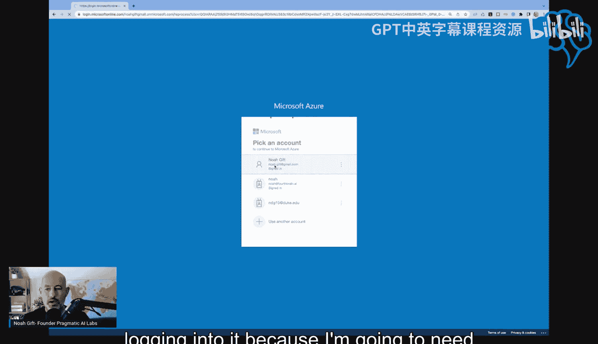

在本节课中，我们将学习如何从外部环境（如GitHub Codespaces）连接并查询Azure Databricks。我们将配置必要的认证信息，使用Databricks CLI和Python SDK来管理集群、文件系统并执行SQL查询。

---

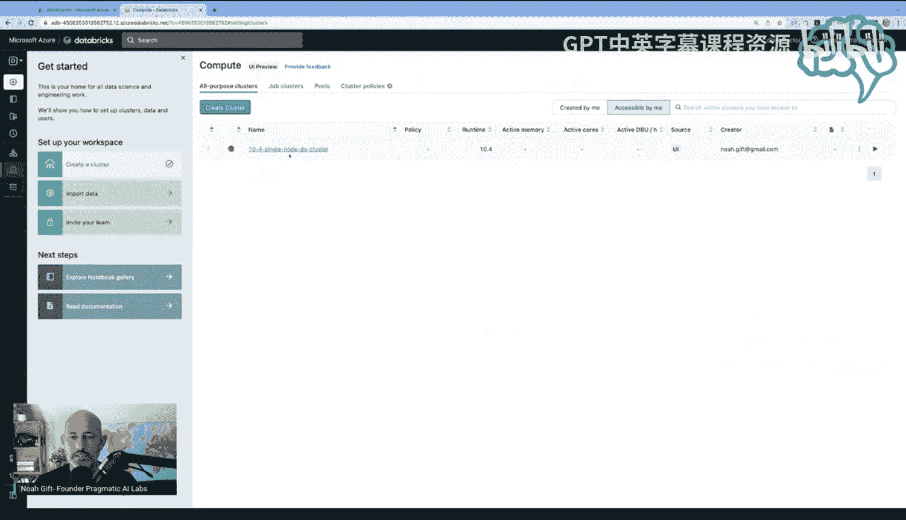

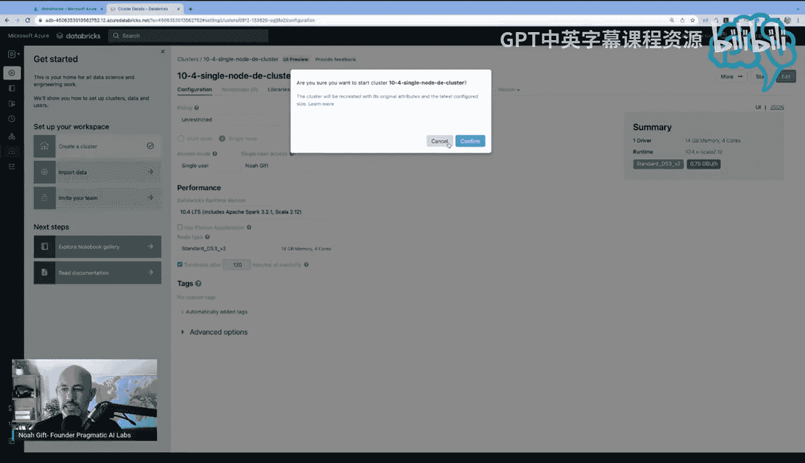

## 概述与准备工作

上一节我们介绍了Databricks的基本概念。本节中，我们来看看如何从本地开发环境远程连接和操作Databricks。

首先，需要在Azure Databricks中启动一个计算集群，并获取连接所需的关键信息。

**步骤：**
1.  登录Azure门户并启动你的Databricks工作区。
2.  导航到“计算”页面，启动一个集群（例如单节点集群）。
3.  集群启动后，在“高级选项”中获取 **服务器主机名** 和 **HTTP路径**。
4.  在用户设置中生成一个 **访问令牌（Token）**。

这些信息是建立远程连接的基础。

---

## 配置GitHub Codespaces环境

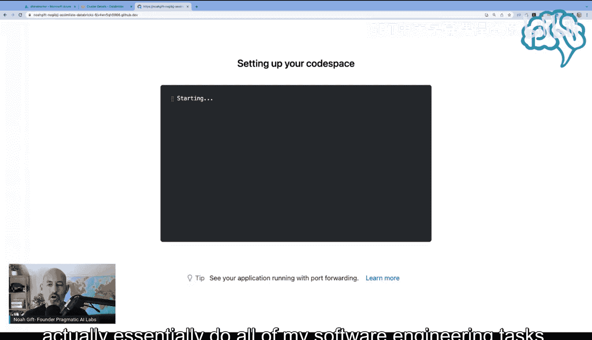

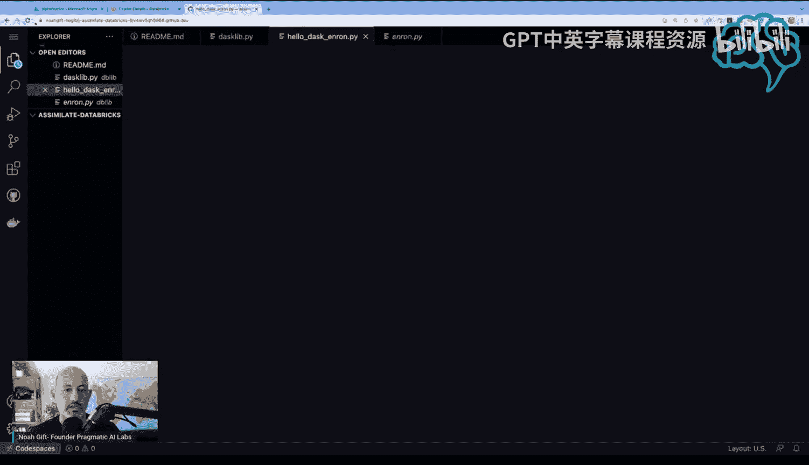

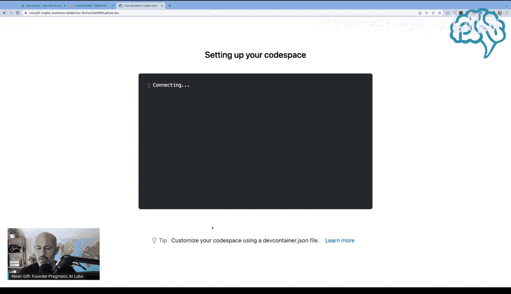

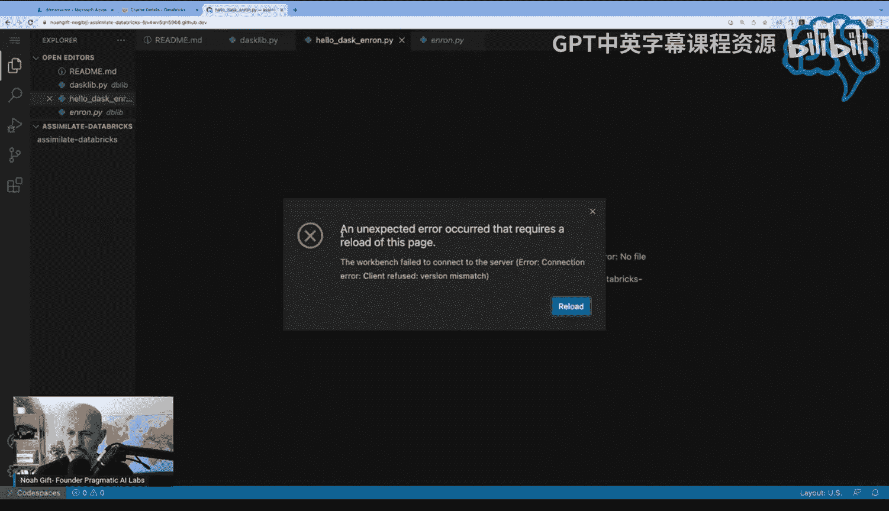

为了在Codespaces中连接Databricks，我们需要将连接信息设置为仓库机密（Secrets）。这样可以在代码中安全地使用这些凭证。

以下是需要设置的机密变量列表：
*   `DATABRICKS_HOST`: 你的Databricks工作区主机名。
*   `DATABRICKS_HTTP_PATH`: 集群的HTTP路径。
*   `DATABRICKS_SERVER_HOSTNAME`: 服务器主机名。
*   `DATABRICKS_TOKEN`: 你的个人访问令牌。

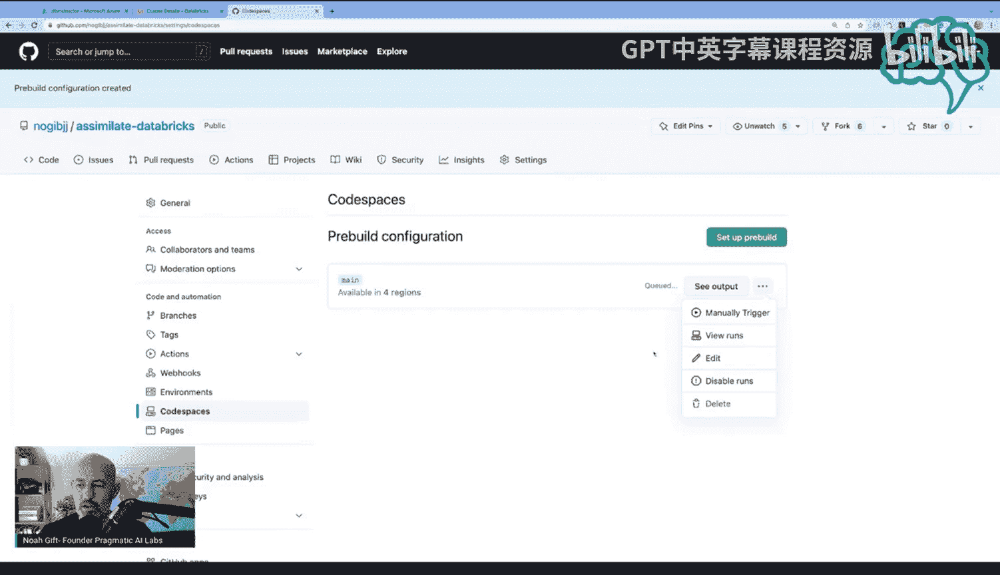

配置完成后，启动Codespaces环境，它将自动加载这些机密。

---


## 验证连接：使用Databricks CLI

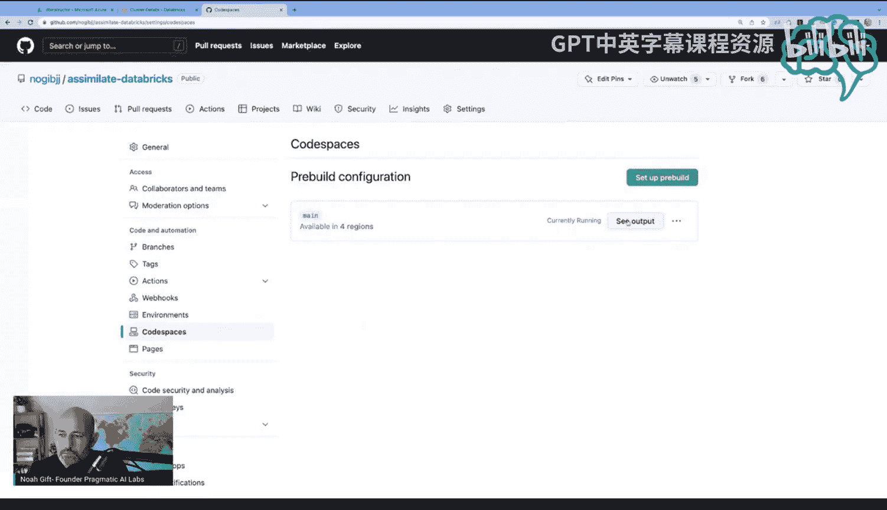

环境启动后，首先使用Databricks命令行工具验证连接是否成功。

打开终端，运行以下命令列出所有集群：
```bash
databricks clusters list
```
如果连接正常，终端将显示当前工作区中所有集群的状态信息。

接下来，可以尝试与Databricks文件系统交互：
```bash
databricks fs ls
```
此命令会列出根目录下的文件，确认你已具备访问数据存储的权限。

---

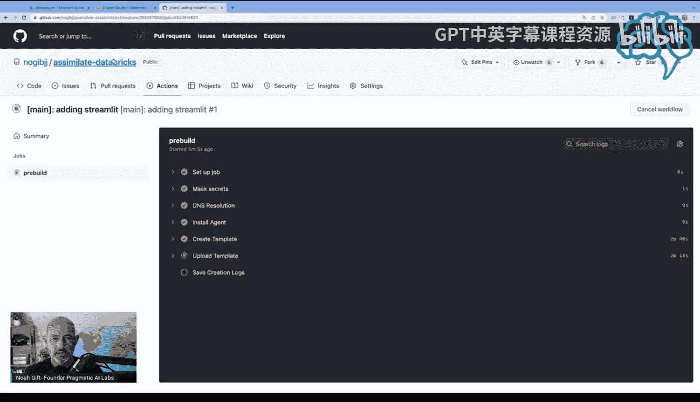

## 使用Python SDK进行管理操作

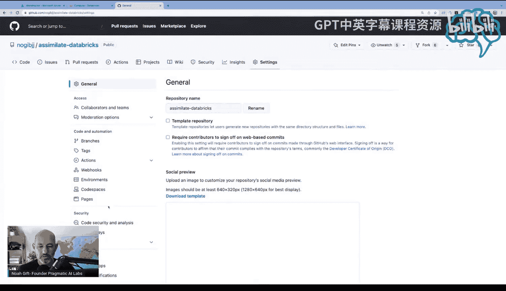

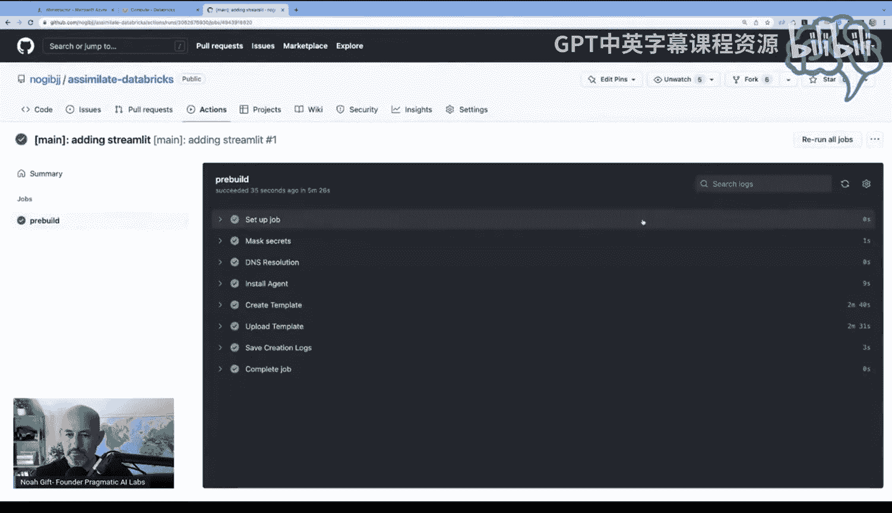

除了CLI，我们还可以使用Python SDK（`databricks-sdk`）以编程方式管理Databricks。这更适合集成到自动化脚本或应用程序中。

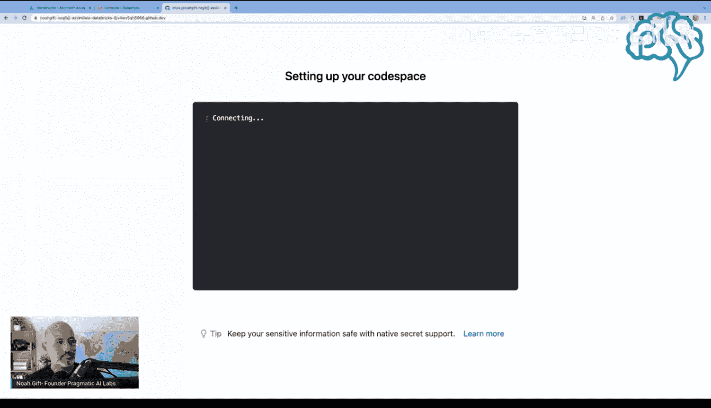

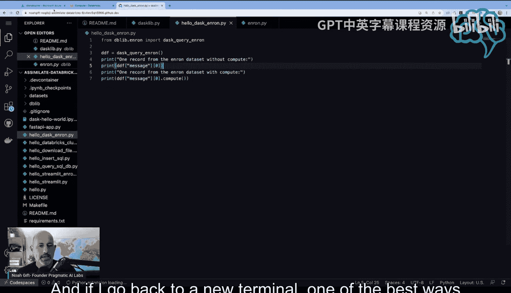

首先，确保已安装必要的Python包。在`requirements.txt`文件中应包含：
```txt
databricks-sdk
```

以下是一个Python函数示例，用于列出所有集群：
```python
from databricks.sdk import WorkspaceClient
import os

def list_clusters():
    # 从环境变量读取认证信息
    host = os.getenv('DATABRICKS_HOST')
    token = os.getenv('DATABRICKS_TOKEN')
    
    # 创建客户端
    w = WorkspaceClient(host=host, token=token)
    
    # 列出集群并返回
    clusters_list = w.clusters.list()
    return clusters_list

if __name__ == "__main__":
    clusters = list_clusters()
    for c in clusters:
        print(f"Cluster: {c.cluster_name}, State: {c.state}")
```

你可以将此逻辑封装成库，并构建自定义的命令行工具。

---

## 执行SQL查询

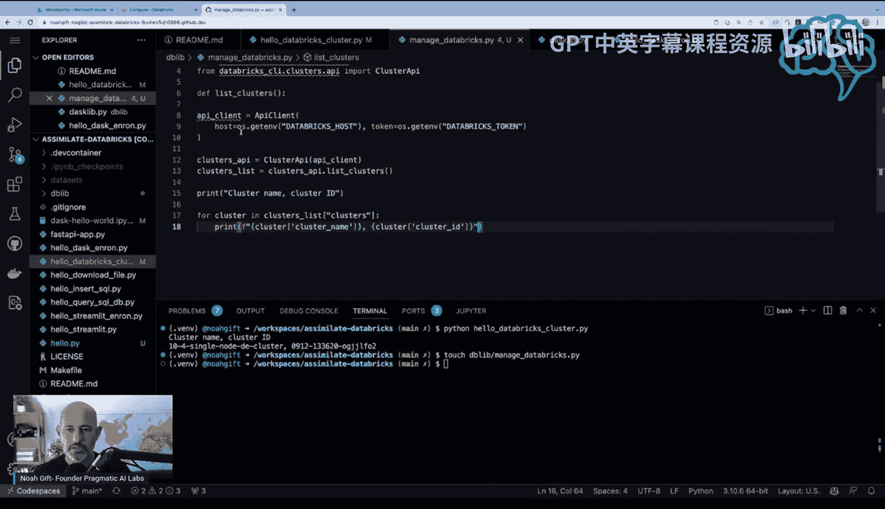


对于数据查询任务，我们需要使用`databricks-sql-connector`库来直接执行SQL语句。

首先，安装连接器：
```bash
pip install databricks-sql-connector
```

以下代码展示了如何连接到Databricks并执行查询：
```python
from databricks import sql
import os

def query_databricks(sql_query):
    connection = sql.connect(
        server_hostname=os.getenv('DATABRICKS_SERVER_HOSTNAME'),
        http_path=os.getenv('DATABRICKS_HTTP_PATH'),
        access_token=os.getenv('DATABRICKS_TOKEN')
    )
    
    cursor = connection.cursor()
    cursor.execute(sql_query)
    result = cursor.fetchall()
    
    cursor.close()
    connection.close()
    return result

# 示例：查询一个表
results = query_databricks("SELECT * FROM default.diamonds LIMIT 10")
for row in results:
    print(row)
```

你可以基于此函数构建灵活的命令行工具，接受动态SQL语句作为输入参数。

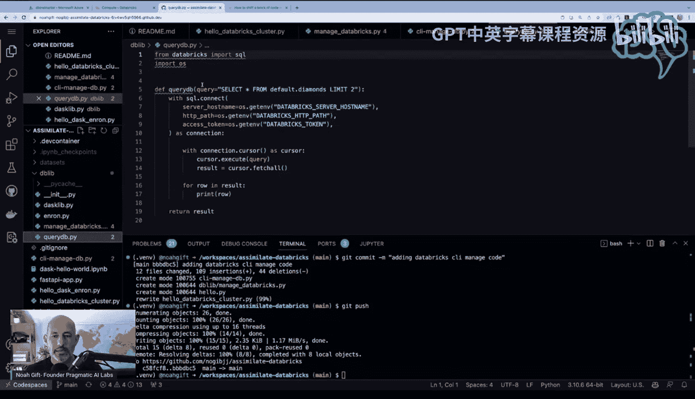

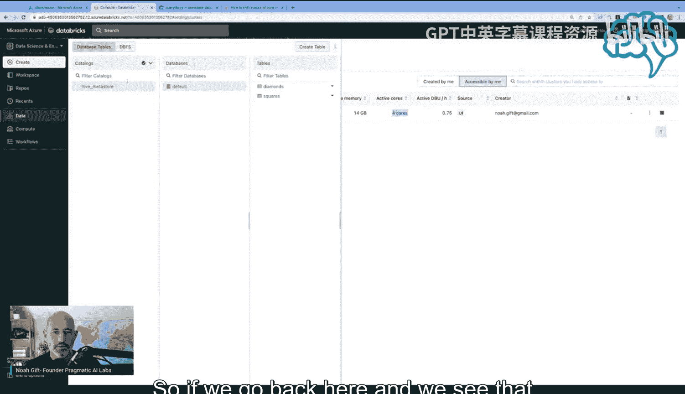

---

## 总结

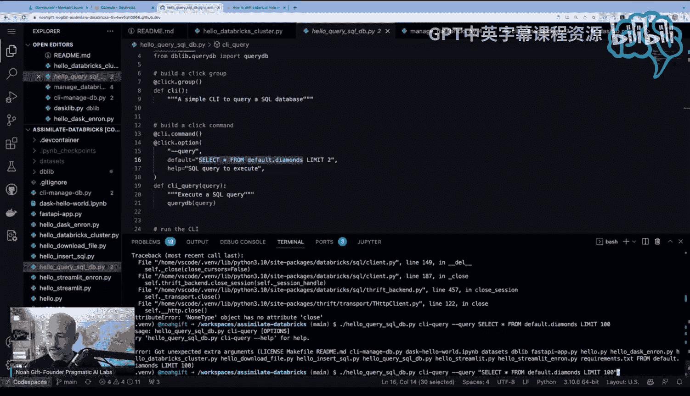

本节课中我们一起学习了如何搭建从GitHub Codespaces到Azure Databricks的远程连接。我们涵盖了从配置认证机密、使用CLI进行基础验证，到利用Python SDK进行集群管理和执行SQL查询的完整流程。

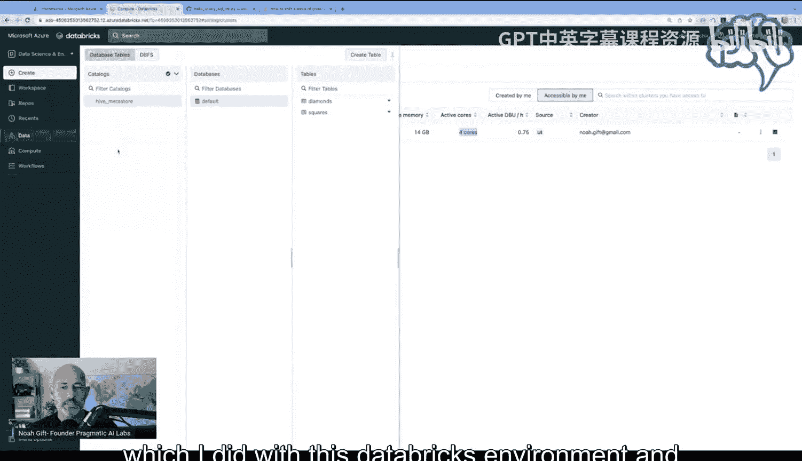

掌握这些技能后，你可以将Databricks视为一个强大的远程数据与计算引擎，在熟悉的本地或云端开发环境中进行数据工程和机器学习任务开发。