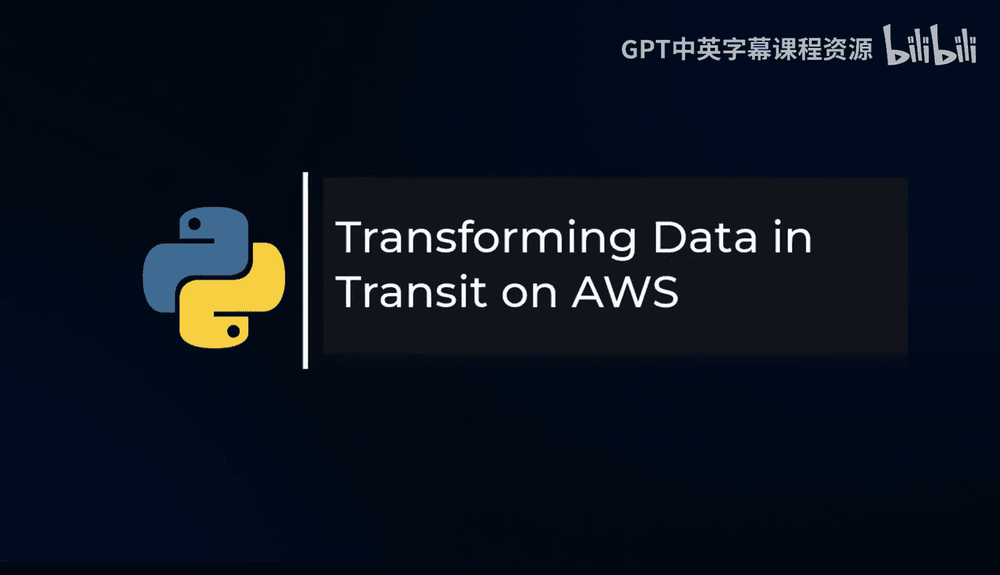
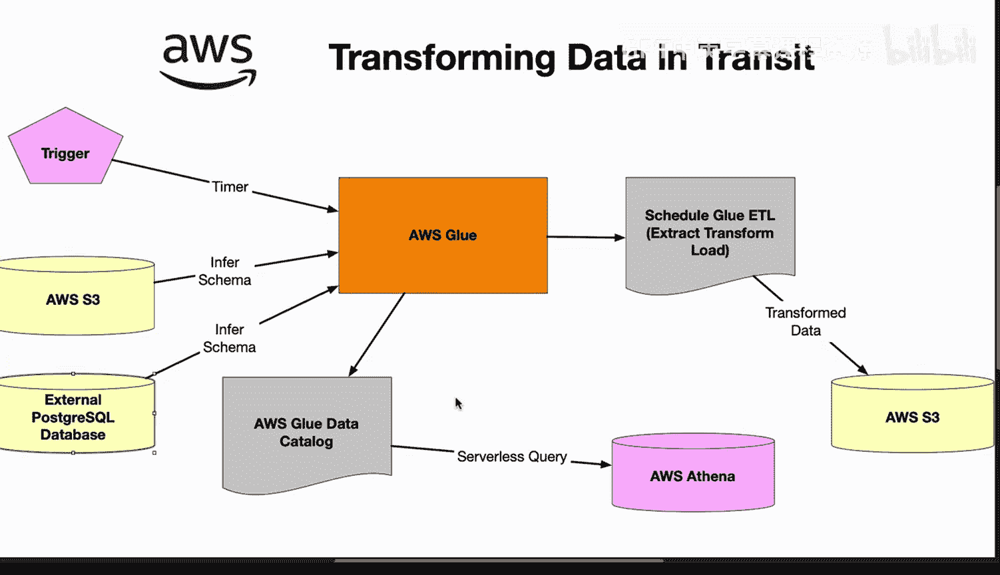

机器学习运维：33：AWS传输中数据转换 🔄

在本节课中，我们将学习如何在AWS平台上进行传输中的数据转换。AWS Glue提供了一个绝佳的示例，我们将通过一个具体的架构图来理解其工作原理。

---

上一节我们介绍了数据转换的概念，本节中我们来看看AWS Glue如何实现一个无服务器的ETL（提取、转换、加载）流程。

首先，整个流程由一个定时器触发一个Glue作业。AWS Glue是一个无服务器的ETL系统。这意味着你可以将其指向多个数据源。

以下是Glue处理数据的基本步骤：
1.  **提取**：从指定的数据源（如S3中的大型CSV文件或外部PostgreSQL数据库）读取数据。
2.  **转换**：根据定义的业务逻辑对数据进行清洗、整合与转换。
3.  **加载**：将处理后的数据输出到另一个目标位置，例如一个新的S3存储桶。

这样，你就创建了一个可重用的ETL操作。由于外部数据源（如供应商更新的数据库）可能持续变化，这个定期触发的作业会不断生成数据的新版本，并将其放入新的存储桶中。

---

此外，Glue还有一个非常实用的功能：它可以为处理后的数据创建数据目录和元数据记录。

这意味着，之后你的数据科学家无需将S3中的所有数据都下载出来，就可以直接使用Athena查询这个目录。他们可以运行无服务器查询，进行数据可视化和初步分析，其组合公式可以表示为：

**数据分析 = Athena查询 + Glue数据目录**

这种由Glue在你的生态系统内部提供的无服务器能力带来了很多好处。我们刚才探讨的这种特定架构是一个非常常见且适用的模式，对于许多组织来说，它既易于理解也便于维护。

---

本节课中我们一起学习了AWS Glue在传输中进行数据转换的核心机制。我们了解了其如何通过定时触发、无服务器ETL作业来处理多源数据，并利用数据目录功能使处理后的数据易于查询与分析。这种架构模式结合了Glue与Athena，为组织提供了一种高效、可维护的数据处理解决方案。