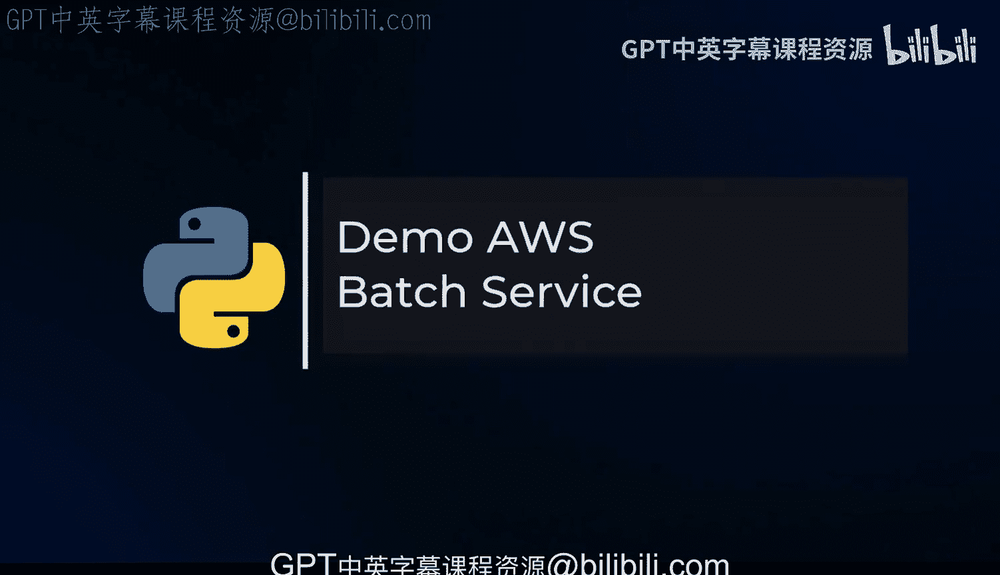
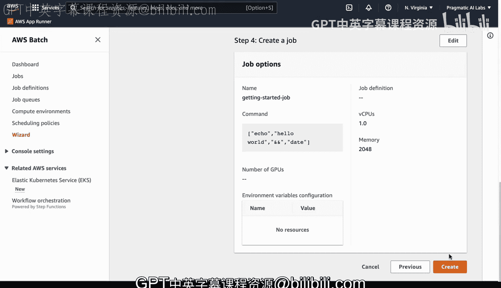

#  034：AWS Batch 入门教程 🚀

在本节课中，我们将学习如何使用 AWS Batch 服务在云端运行计算任务。AWS Batch 是一个用于解决基本云端运行问题的优秀技术。我们将通过一个简单的“Hello World”示例，逐步了解其核心组件和配置流程。

## 概述

AWS Batch 服务允许您轻松地在 AWS 云上运行批处理作业，而无需管理底层基础设施。其架构清晰，包含计算环境、作业队列、作业定义和作业本身。接下来，我们将通过实际操作演示如何配置并运行您的第一个 AWS Batch 作业。

## 核心组件与配置流程

上一节我们介绍了 AWS Batch 的基本概念，本节中我们来看看其具体的配置步骤。整个过程通过一个向导完成，步骤简洁明了。

以下是配置 AWS Batch 作业的主要步骤：

1.  **创建计算环境**：这是运行作业的基础设施。您可以选择在 Fargate 上运行（无需管理服务器），或使用虚拟机（按需或 Spot 实例）。对于 Fargate，您还可以选择 Fargate Spot 以获得高达 70% 的折扣，这对于运行大量作业非常划算。在虚拟机模式下，您可以调整所需的虚拟 CPU 数量，并指定作业运行的 VPC 网络。

2.  **创建作业队列**：作业队列用于存放等待处理的任务。您可以创建多个队列来管理不同优先级或类型的作业。

3.  **创建作业定义**：作业定义是作业的蓝图，它指定了运行作业所需的容器镜像、命令、CPU 和内存资源等。您可以在此处使用自定义镜像，例如包含特定库（如 Hugging Face 库）的镜像。作业启动时执行的命令也在这里定义。

4.  **创建并提交作业**：最后，基于已定义的作业定义，向指定的作业队列提交一个具体的作业实例并运行它。

## 详细配置说明

现在，让我们深入了解每个配置环节的细节。

### 计算环境配置

在配置计算环境时，您需要做出几个关键选择。首先是选择运行平台：**Fargate** 或 **EC2**（虚拟机）。

*   **Fargate**：这是一个无服务器选项，AWS 会为您管理所有后端服务器。这大大简化了运维工作。
*   **Fargate Spot**：在 Fargate 基础上，使用闲置容量，成本更低，适合可中断的任务。
*   **EC2**：提供对底层虚拟机的更多控制，可以选择按需实例或更便宜的 Spot 实例。在此模式下，您可以精确指定虚拟 CPU 的数量和作业运行的 VPC 网络。

### 作业定义配置

作业定义是核心配置部分，它告诉 AWS Batch 如何运行您的任务。

*   **容器镜像**：您需要指定一个 Docker 镜像。可以使用公共镜像，但更常见的做法是构建并推送自己的自定义镜像，其中包含任务所需的所有依赖项（例如，特定的 Python 库）。
*   **执行命令**：这是容器启动后运行的命令。例如，一个简单的 `echo “Hello World” && date` 命令。您也可以通过编写代码来动态插入命令。
*   **资源分配**：您需要为容器预留一定数量的虚拟 CPU 和内存。
*   **高级配置**：您还可以进行更高级的配置，例如挂载存储卷、配置日志记录选项等，这些功能使得 AWS Batch 能够处理复杂的容器化任务。

## 运行示例作业

遵循上述步骤完成配置后，向导会汇总所有信息。确认无误后，即可提交并运行作业。系统会处理作业的调度、执行，并在完成后提供结果信息。

## 总结

本节课中我们一起学习了 AWS Batch 服务。我们了解了其用于在云端运行批处理作业的简洁架构，包括计算环境、作业队列、作业定义和作业。通过一个分步演示，我们掌握了如何配置这些组件，特别是如何选择计算环境类型（Fargate 或 EC2）以及如何定义作业的容器镜像和启动命令。AWS Batch 提供了一种直接且有用的方式，让初学者也能轻松开始在云端运行计算任务。