#  037：使用Python Fire构建NLP项目

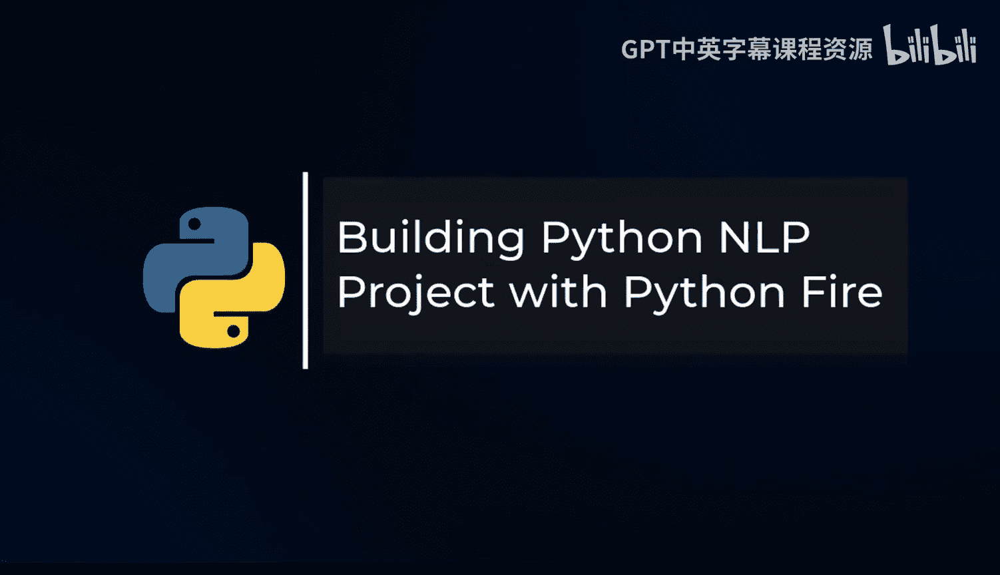

在本节课中，我们将学习如何通过构建函数化的逻辑，并使用Python Fire库将其快速转化为命令行工具，从而创建一个完整的自然语言处理项目。我们将涵盖从逻辑设计、库构建、工具封装到自动化测试和持续集成的全过程。

## 从函数化逻辑开始

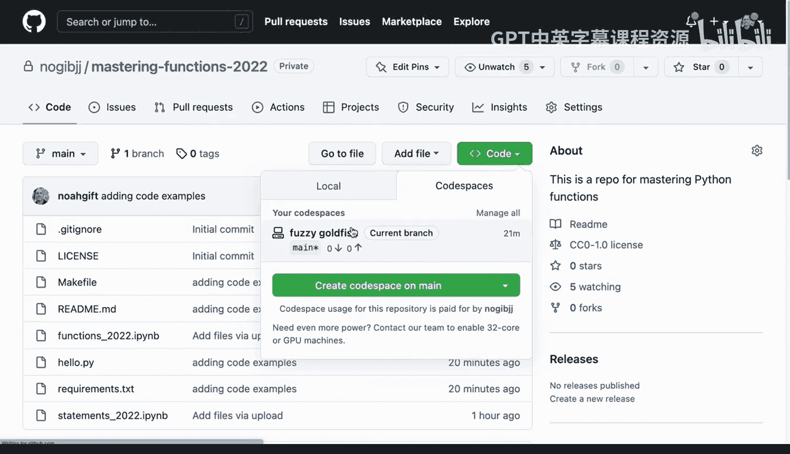


上一节我们介绍了项目构建的基本思想。本节中，我们来看看如何将核心逻辑封装在函数中。

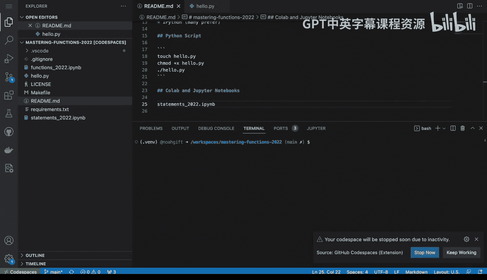

将逻辑封装在函数中的核心思想是：我们需要将处理逻辑放在函数内部。这样，一段包含特定逻辑的代码可以被映射到多种不同的应用场景中。

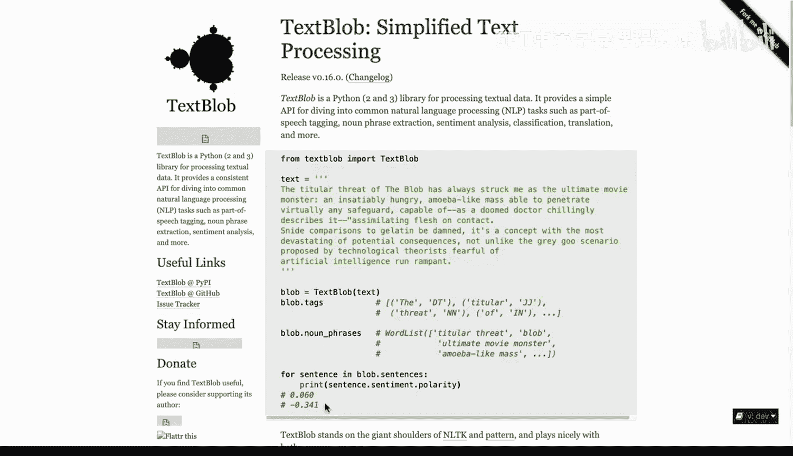

我认为一个很好的例子是进行自然语言处理。因此，这里的逻辑将是NLP处理。一旦我们拥有了这个逻辑，我们可以将其映射到多种形式。

以下是几种主要的映射方式：
*   映射到命令行工具。这可能是最简单的方式之一。
*   映射到iPython交互式环境。
*   映射到Web框架。
*   如果需要，还可以将该逻辑映射到AWS或GCP等云平台的云函数中。

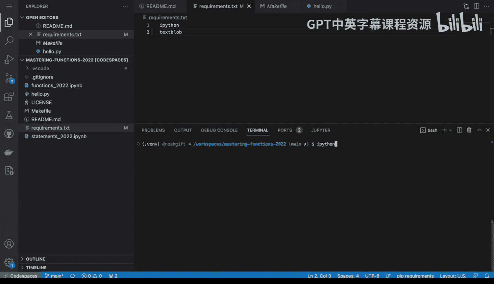

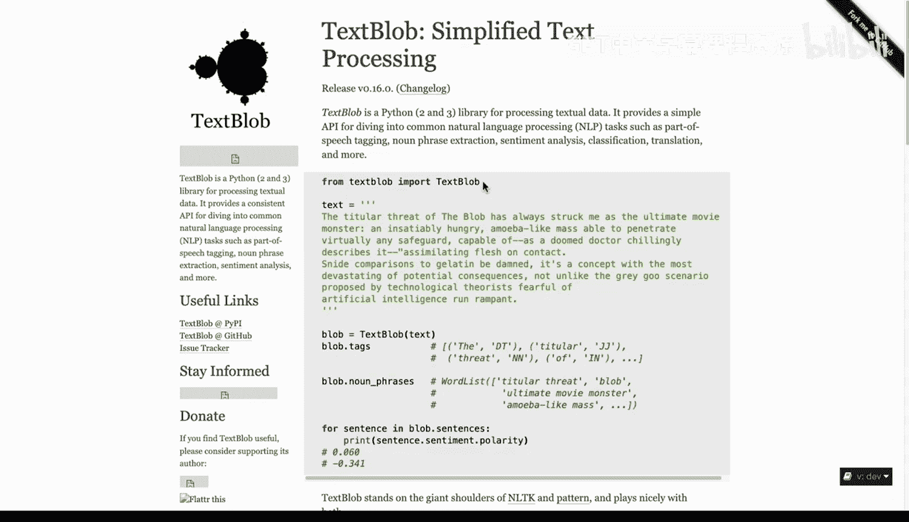

这就是我们接下来要搭建的项目基本框架。

## 搭建项目结构

接下来，我将回到Github Codespaces，开始构建一个项目结构。

首先，我需要导入一个名为TextBlob的库。这是一个用于简化文本处理的库，非常适合用来构建演示项目。

以下是一个使用TextBlob的示例。让我们导入这个库。

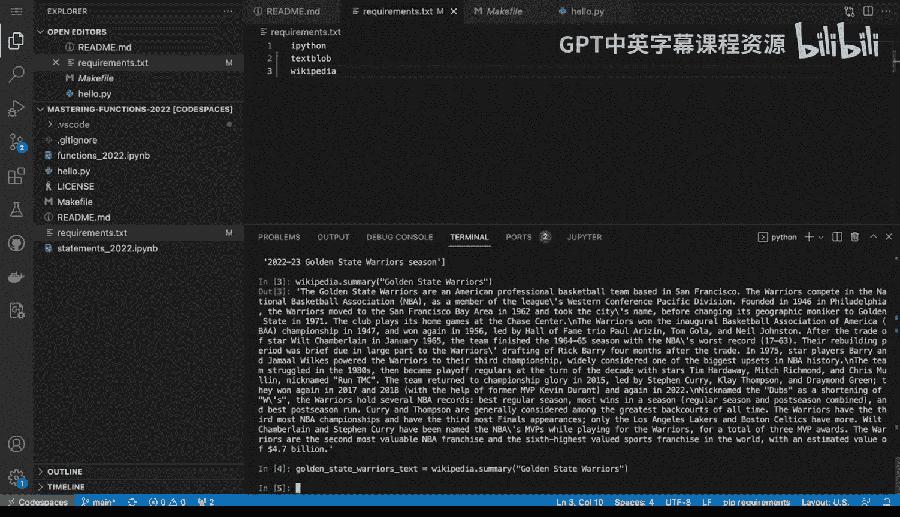

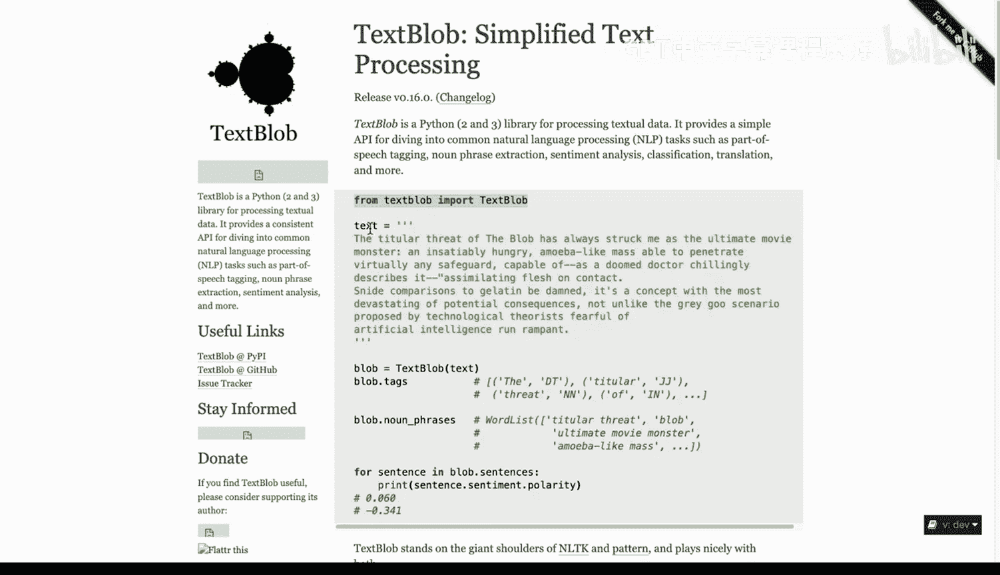

我将把`textblob`添加到`requirements.txt`文件中。由于我已经通过Makefile设置了项目结构，安装变得非常简单。我只需要运行`make install`命令。

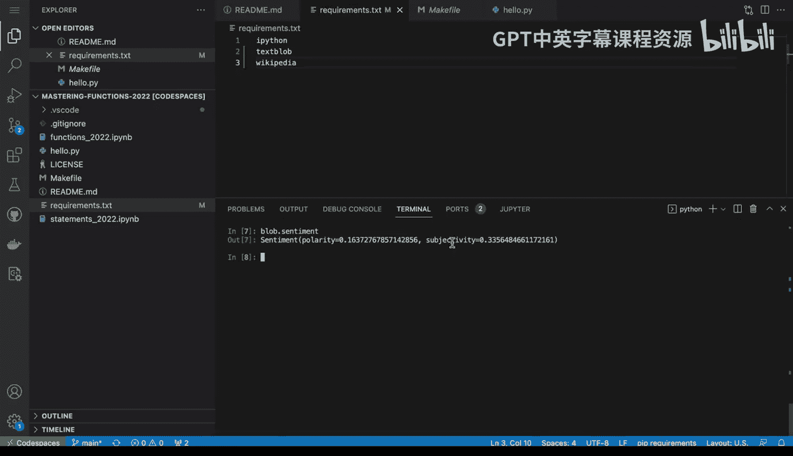

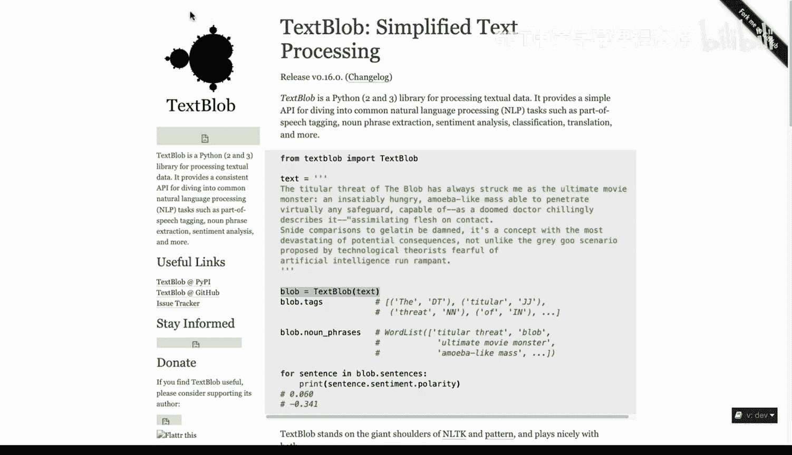

现在安装完成了。测试它也很容易，因为我还有iPython环境。如果我想尝试一个想法，可以参考文档，然后直接在iPython中测试。

例如，我可以这样做：
```python
from textblob import TextBlob
```

现在我需要创建一些文本。让我们用一种高效且富有创意的方式来解决这个问题：使用一个名为`wikipedia`的库来自动抓取文本。这样我们就不需要手动输入任何内容。

我先运行`make install`来安装`wikipedia`库。然后，我们获取一些文本并了解如何构建文本。

在iPython中：
```python
import wikipedia
```

我们可以使用`wikipedia.summary`函数。让我们搜索“Golden State Warriors”。

```python
golden_state_warriors_text = wikipedia.summary("Golden State Warriors")
```

这样我们就获得了一些可以免费使用的文本。现在，我们可以用TextBlob来处理它。

回到文档，我们创建一个TextBlob对象：
```python
blob = TextBlob(golden_state_warriors_text)
```

现在，`blob`对象有许多可用的方法，包括情感分析：
```python
blob.sentiment
```

我们还可以获取词性标签：
```python
blob.tags
```

哦，它提示我们需要下载语料库。这没问题，我们可以把它也加入到Makefile中，使其更容易执行。在iPython中，我们可以使用感叹号来运行任何shell命令。

现在再次运行`blob.tags`，看，它成功了。它能够自动为我们抓取一堆标签，这真的很棒。

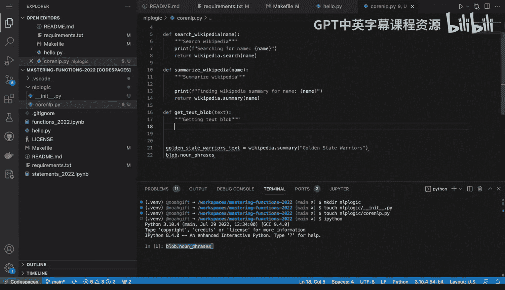

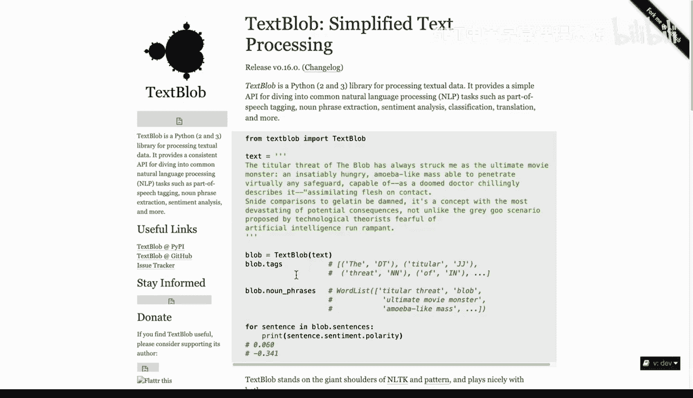

还能做什么呢？可以提取名词短语：
```python
blob.noun_phrases
```

它能够从文本中提取出许多不同的短语。这是一个很酷的小库。

## 构建可复用的逻辑库

我已经有了一些可以工作的东西，现在让我们构建处理所有这些事情的逻辑。为此，我首先创建一个库。如果你开始构建一些可复用的东西，构建一个库总是一个好主意。

首先创建一个名为`nlp_logic`的目录，然后在里面创建一个空文件`__init__.py`，这告诉Python这是一个包。

现在我们可以开始在里面构建代码了。创建一个文件叫`core_nlp.py`。

我可以开始构建内容了。我们可以回到iPython，并“窃取”一些我们已经尝试过的想法。例如，我们导入了`TextBlob`和`wikipedia`，使用了`noun_phrases`等方法。

我们可以构建几个函数。

第一步，创建一个函数来获取维基百科摘要文本。我们可以构建三个函数。

第一个函数，我们称之为`search_wikipedia`，它接收一个名称参数，并返回`wikipedia.search(name)`的结果。我们可以在里面添加一点调试逻辑。

第二个函数，`summarize_wikipedia`，也接收名称参数。它的逻辑是打印“Finding summary for {name}”，然后返回`wikipedia.summary(name)`。

第三个函数，`get_text_blob`，接收文本参数，返回一个TextBlob对象。这样我们可以用它做很多事情。

最后，我们可以构建一个整合一切的主函数`get_phrases`。它接收名称参数，封装了所有操作。它的逻辑是：首先获取摘要文本，然后创建TextBlob对象，最后返回名词短语列表。

这样我们就得到了一些不错的逻辑，允许我们做各种有趣的事情。

## 在iPython中交互式测试

iPython的酷之处在于，它允许我们在深入构建实际应用之前，先玩转所有这些代码。这就是函数化编程的力量。

我要做的是从我们的库中导入模块：
```python
from nlp_logic import core_nlp
```

理论上，我现在只需要将“Golden State Warriors”传入`get_phrases`函数，它就会一次性包装所有操作。

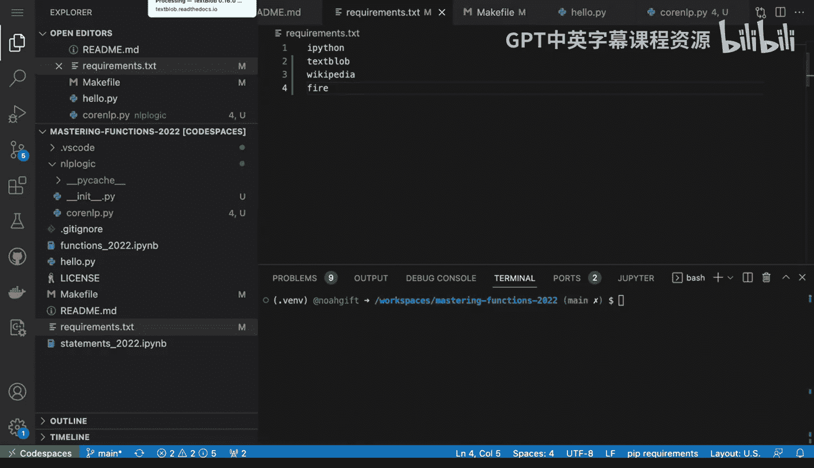

但这里我遇到了一个拼写错误和一个小bug。通过iPython，我可以一步一步地调试，重现函数内部的逻辑，直到找到问题所在。

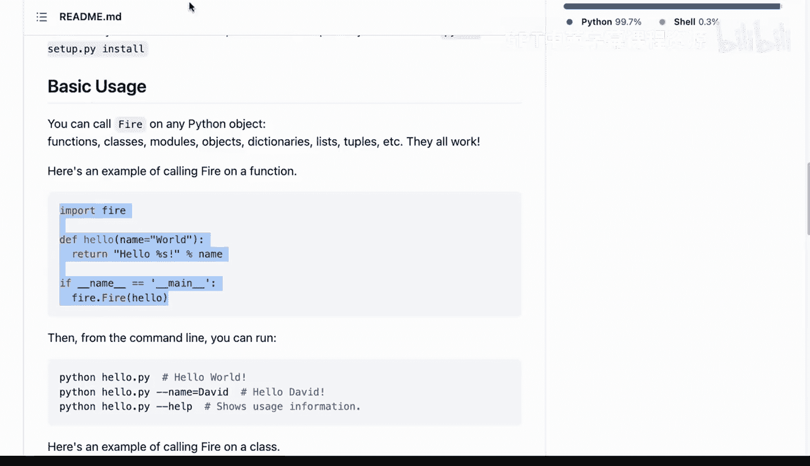

最终，我成功运行了：
```python
from nlp_logic.core_nlp import get_phrases
phrases = get_phrases("Golden State Warriors")
```

在我看来，这种首先使用iPython完全在函数中构建逻辑的编码方式非常强大，因为一些棘手的细节和bug在玩转iPython的过程中就已经被解决了，而且我现在对我写的代码非常熟悉。

## 使用Python Fire构建命令行工具

现在我可以构建一个工具了。首先要构建的是一个命令行工具。同样，我需要使用一个库。事实上，构建命令行工具最简单的方法可能就是使用Python Fire。

Python Fire是一个来自Google的库，用于创建命令行工具，其简单程度令人惊讶。

你需要做的就是`import fire`，然后构建命令行工具。基本上，你只需要几行代码。

我创建一个新文件`wiki_phrases.py`。我想导入之前构建的逻辑，也就是`core_nlp`库中的`get_phrases`函数，它为我们完成了所有工作。

接下来，关于Python Fire令人惊叹的一点是：我甚至不需要在里面放太多代码。我基本上只需要导入逻辑和fire，然后调用`fire.Fire(get_phrases)`。这可能是世界上最简单的命令行工具了。

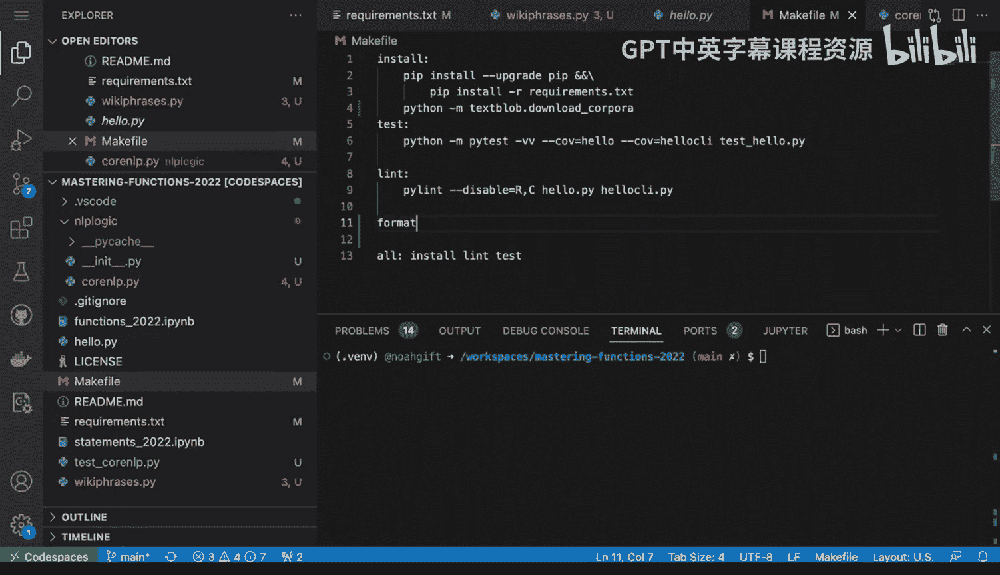

我还需要添加shebang行并将其设为可执行的Python工具。

现在运行它。哦，我需要先安装fire，运行`make install`。

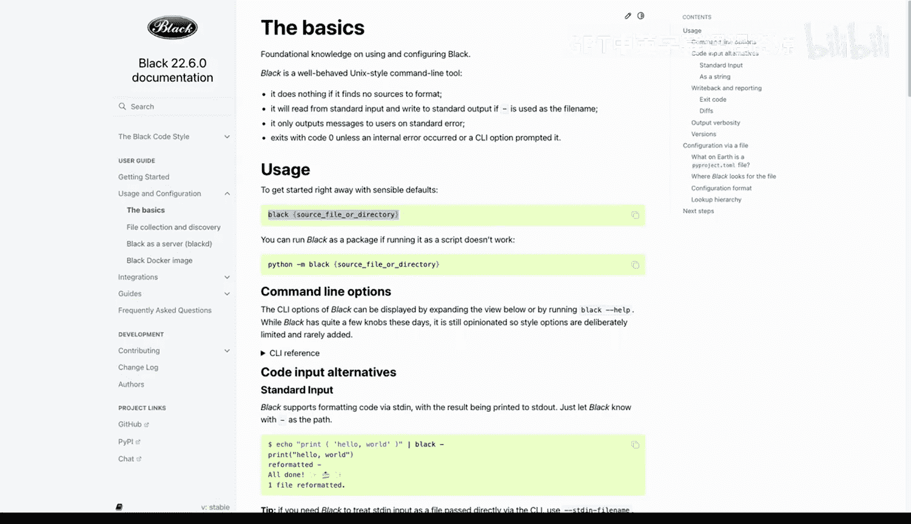

现在，如果我运行`python wiki_phrases.py --help`，看，它给了我所有帮助信息。我几乎什么都没做，因为它从文档字符串中获取了信息。实际上我只添加了几行代码。

现在，我们可以这样使用它：
```python wiki_phrases.py --name="Golden State Warriors"```

它会去维基百科获取摘要，然后找出短语。如果你首先在函数中构建逻辑，然后使用像Python Fire这样的工具将该函数转化为命令行工具，其强大程度令人震惊。

## 完善项目：代码质量与自动化测试

为了让项目更专业，我们应该构建一个DevOps结构，包括代码检查、测试等。

首先，我构建一个测试文件`test_core_nlp.py`。为了进行测试，我需要添加一些其他库：`pytest`、`pytest-cov`（用于测试覆盖率）、`pylint`（用于语法检查）和`python-black`（用于代码格式化）。这些都是我喜欢使用的库。

我要确保Makefile中包含所有这些步骤。让我们添加一个`format`步骤，使用`black`格式化所有Python文件。

运行`make install`获取所有库，然后运行`make format`。很好，它清理了我们的代码。

同样，我们运行`make lint`来检查代码。太好了，10分满分。

接下来我们需要构建一个测试结构。我们关心的是测试`wiki_phrases`和`nlp_logic`库。我们告诉pytest查看测试文件`test_core_nlp.py`。

现在运行测试，它会显示没有测试或0%的覆盖率。所以我需要添加一些测试。

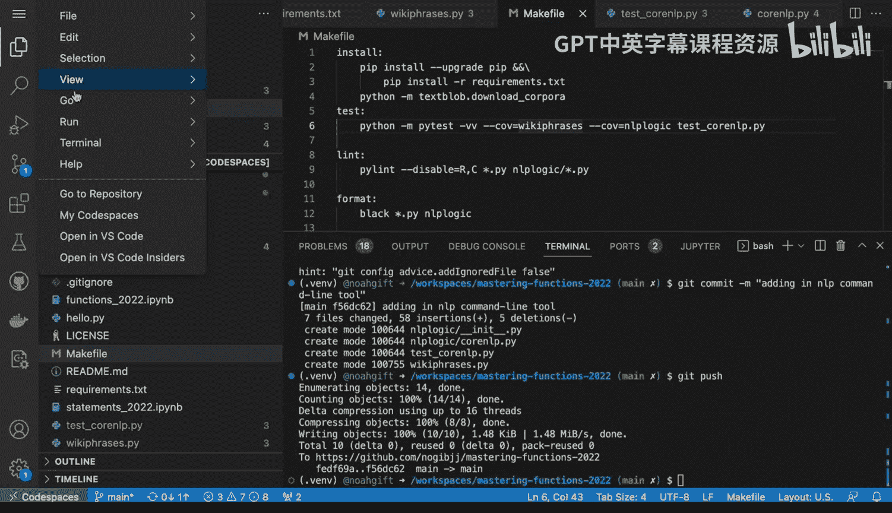

打开测试文件。我会导入`core_nlp`模块中的所有相关函数。然后，至少先创建一个测试。我们可以做一个简单的功能测试。例如，断言从`get_phrases("Golden State Warriors")`返回的结果中包含“Golden State”。这是一个可以接受的功能测试。

现在我们有了测试。运行`make test`。我们遇到了一个导入错误，因为我可能导入方式不对。修复它，然后再次运行测试。

现在，仅从这一个功能测试，我们就获得了88%的测试覆盖率。

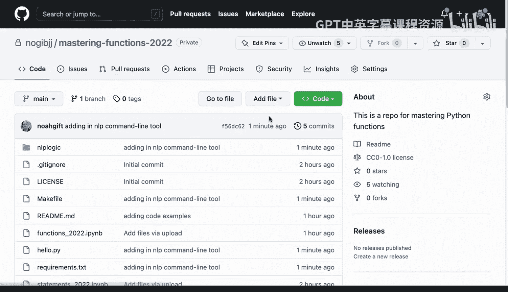

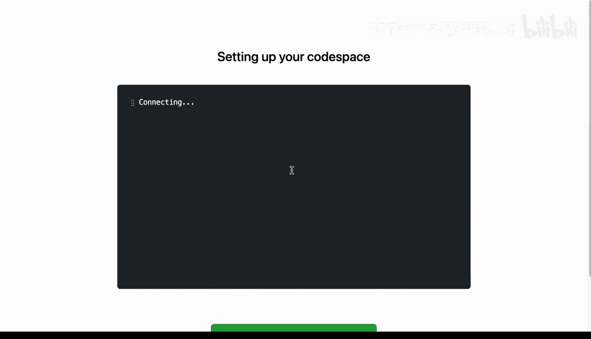

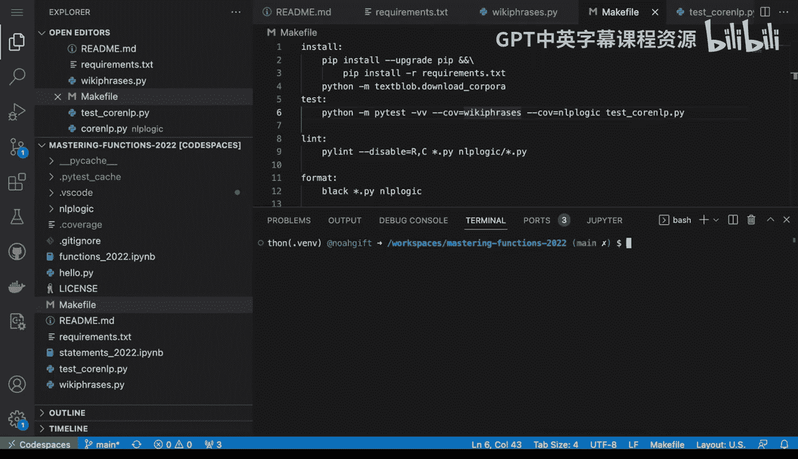

## 配置持续集成

现在让我们提交代码。然后使用Github Actions来设置持续集成，这非常容易做到。

我们可以设置一个工作流。我通常有一些之前构建的Github Actions作为模板。这个Yaml文件将自动测试我们的项目。

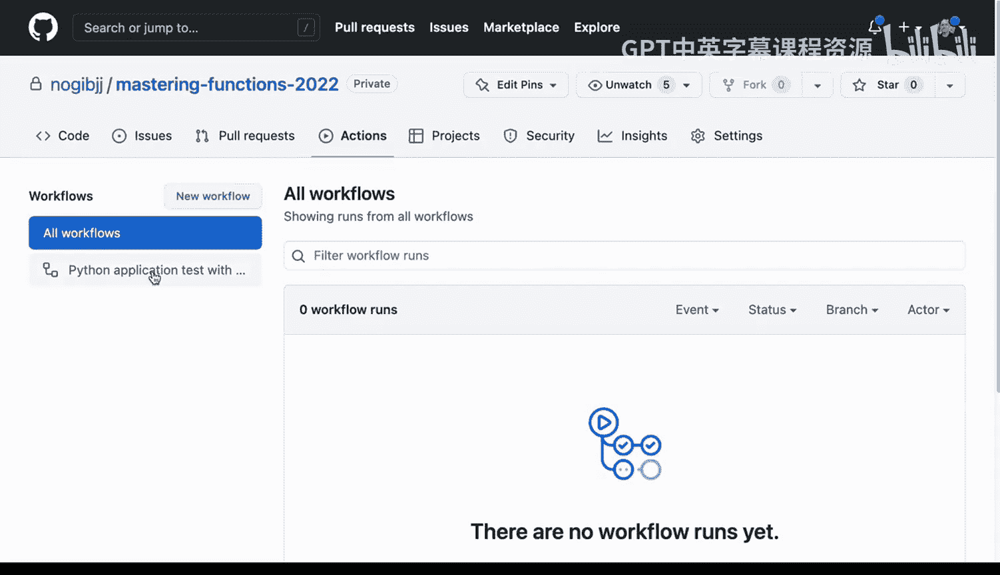

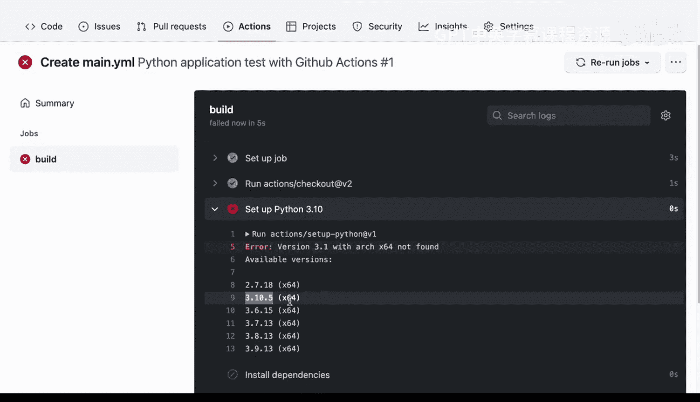

我们需要确保构建系统测试的Python版本与我们项目中使用的版本一致。检查一下，我们使用的是Python 3.10.x，所以在工作流文件中指定3.10。

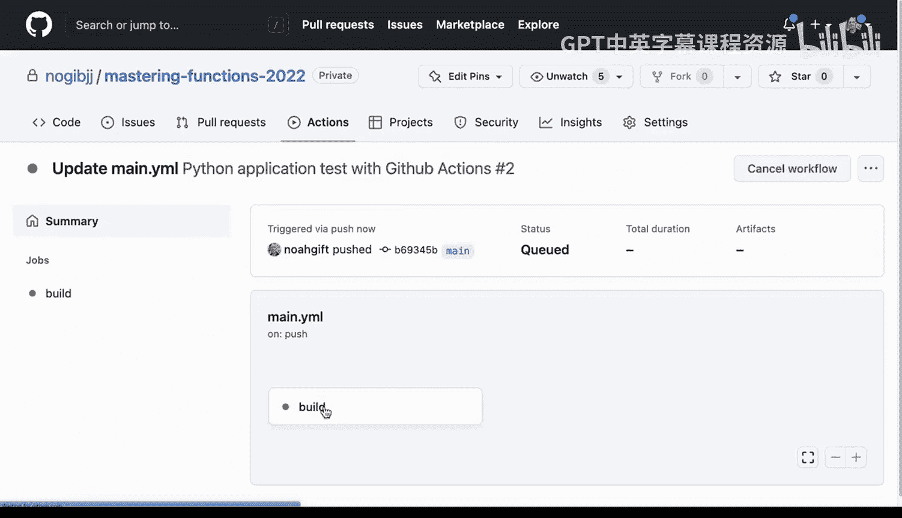

工作流将依次执行：安装依赖、代码检查、运行测试、代码格式化。

提交这个工作流文件，然后推送到仓库。在Github Actions页面，我们可以看到构建过程。它可能会因为Python具体版本号而报错，根据提示修改即可。

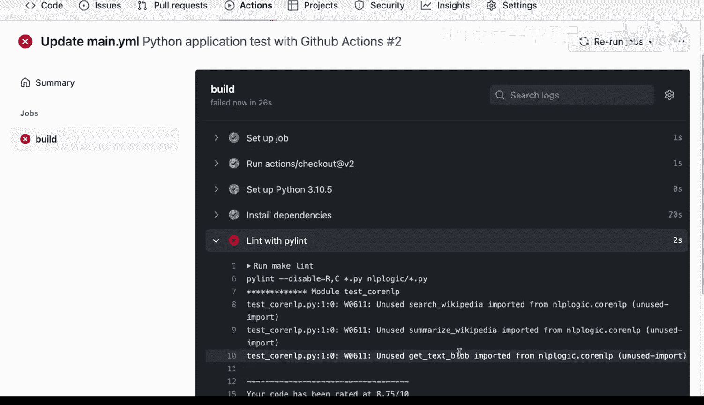

构建成功运行：安装依赖、代码检查、运行测试、格式化。一切顺利。

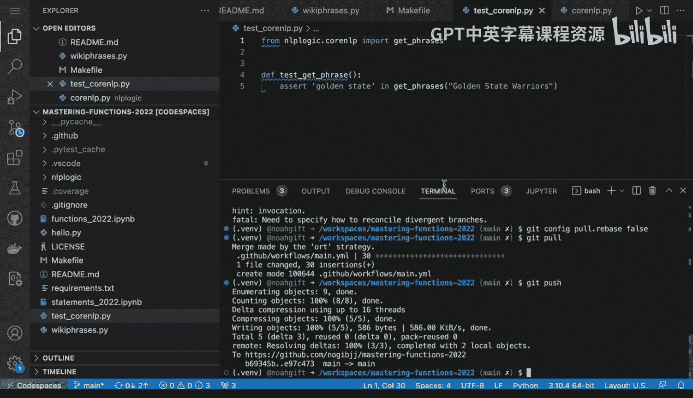

现在我们可以创建一个状态徽章，将其添加到项目的README中，让项目看起来更专业、更酷。

## 总结

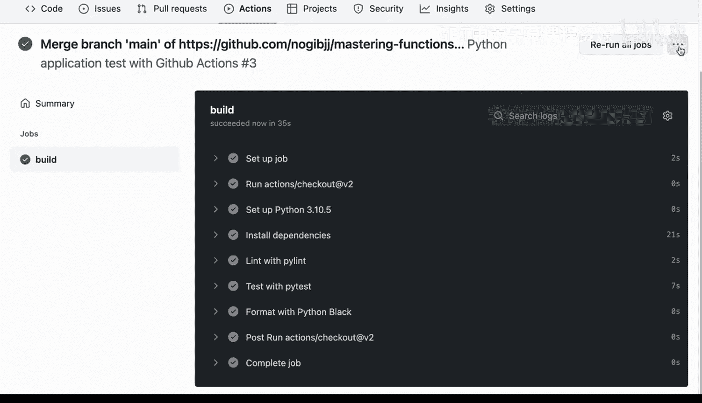

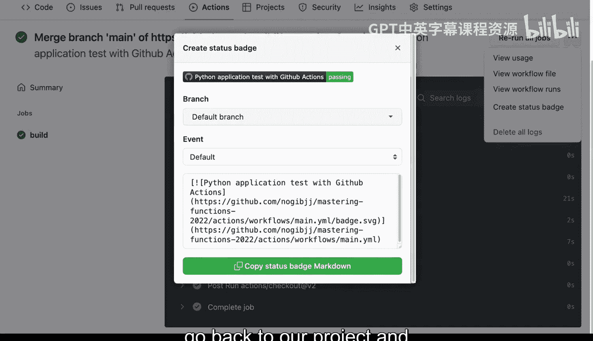

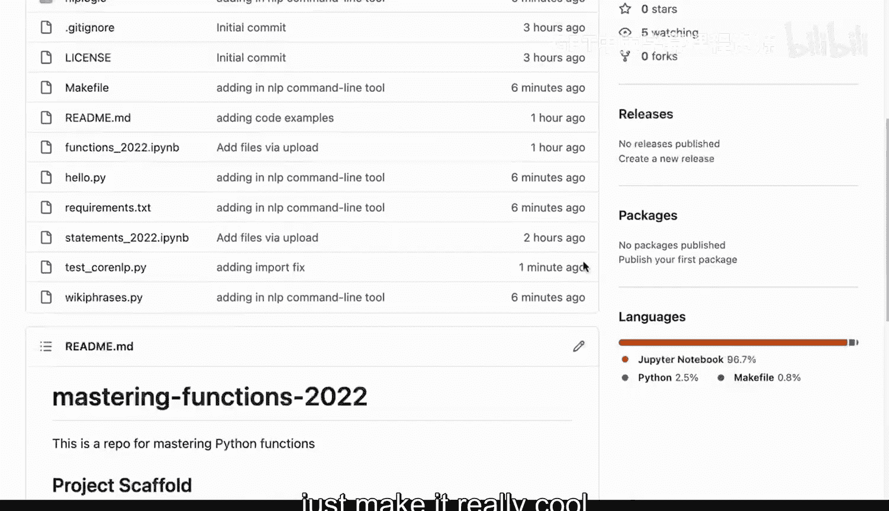

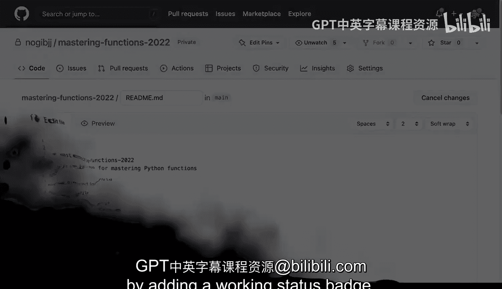

本节课中，我们一起学习了如何从零开始构建一个完整的NLP项目。我们首先将核心NLP逻辑封装在函数中，并在iPython交互环境中进行测试和调试。接着，我们利用Python Fire库，以极少的代码将函数快速转化为功能强大的命令行工具。然后，我们通过引入pytest、pylint和black等工具，为项目添加了自动化测试、代码检查和格式化功能，提升了代码质量。最后，我们配置了Github Actions工作流，实现了项目的持续集成，确保每次代码变更都能自动通过测试和质量检查。这个过程展示了函数化设计、快速原型开发与现代DevOps实践相结合的高效工作流程。