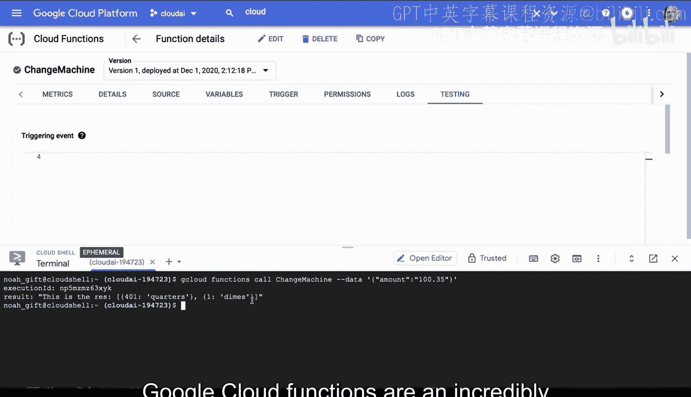

#  038：扩展Google Cloud Functions 🚀


在本节课中，我们将学习如何使用Google Cloud Functions快速构建和部署无服务器函数。我们将从创建一个简单的“Hello World”函数开始，逐步深入到更复杂的示例，例如翻译维基百科页面和计算找零。通过本教程，你将掌握使用Google Cloud Functions进行快速原型设计和数据工程任务的核心技能。

## 创建第一个函数

首先，我们访问Google Cloud Platform并搜索“Cloud Functions”。进入服务后，点击“创建函数”。

在创建函数的对话框中，我们需要配置几个关键参数：
*   **函数名称**：例如，命名为“hello”。
*   **区域**：选择一个离你近的区域。
*   **触发器**：选择“HTTP触发器”，这将允许我们通过URL（如使用`curl`或Postman）来调用函数。为了方便快速测试，我们勾选“允许未经身份验证的调用”。
*   **运行时**：选择“Python 3.9”。

创建函数时，默认会使用内联代码编辑器，并提供一个简单的“Hello World”示例代码。该函数接收一个请求，并尝试解析其中的`message`字段，如果解析失败或未提供，则默认返回“Hello World!”。

以下是示例代码：
```python
def hello_world(request):
    request_json = request.get_json()
    if request_json and 'message' in request_json:
        return request_json['message']
    return 'Hello World!'
```
配置完成后，点击“部署”。部署过程通常需要一两分钟。

## 测试与调用函数

函数部署完成后，我们可以对其进行测试。

在函数详情页，切换到“测试”标签页。这里，我们可以模拟一个HTTP请求来触发函数。例如，我们可以输入一个JSON负载：
```json
{
  "message": "你好，世界"
}
```
点击“测试函数”后，我们会看到函数的响应结果。对于上述负载，响应应为“你好，世界”。

除了在控制台测试，我们也可以通过命令行工具`gcloud`来调用函数，这对于自动化脚本或CI/CD流程非常有用。命令格式如下：
```bash
gcloud functions call hello --data '{"message":"你好，世界"}'
```

## 构建复杂函数：翻译维基百科

上一节我们创建了一个基础函数，本节中我们来看看如何构建一个更实用的函数：自动翻译维基百科摘要。

我们创建一个名为“translate_wikipedia”的新函数。这个函数需要用到两个第三方库：`wikipedia`用于获取维基百科内容，`google-cloud-translate`用于调用Google翻译API。

因此，我们需要在“requirements.txt”文件中声明这些依赖：
```
wikipedia
google-cloud-translate
```
函数的Python代码主要逻辑如下：
1.  从请求中解析出目标实体（如“Facebook”）、要获取的句子数量以及目标语言（如“Spanish”）。
2.  使用`wikipedia`库获取指定实体的维基百科摘要。
3.  使用`google-cloud-translate`库将摘要翻译成目标语言。
4.  返回翻译后的文本。

部署此函数后，我们可以通过发送如下JSON负载来测试它：
```json
{
  "entity": "Facebook",
  "sentences": 20,
  "language": "Spanish"
}
```
函数将返回Facebook维基百科页面前20句话的西班牙语翻译。这展示了如何快速组合不同服务（网络爬取和NLP）来构建有价值的应用。

## 另一个示例：找零计算器

为了进一步巩固理解，我们再构建一个函数：找零计算器。

创建一个名为“change_machine”的新函数。这个函数不需要外部库，仅使用Python标准库。其功能是：接收一个金额（美元），计算并返回需要多少枚25美分（quarter）、10美分（dime）、5美分（nickel）和1美分（penny）的硬币来凑成这个金额，并优先使用大面额硬币（贪心算法）。

以下是核心的找零计算逻辑：
```python
def make_change(amount):
    # 将美元转换为美分
    cents = int(amount * 100)
    coins = [25, 10, 5, 1]
    result = {}
    for coin in coins:
        count, cents = divmod(cents, coin)
        if count:
            result[f‘{coin}_cents’] = count
    return result
```
函数主体会从请求中提取`amount`字段，调用`make_change`函数，并返回结果字典。

部署后，我们可以通过控制台或`gcloud`命令进行测试：
```bash
gcloud functions call change_machine --data '{"amount": 1.34}'
```
这将返回类似`{"25_cents": 5, "10_cents": 0, "5_cents": 1, "1_cents": 4}`的结果，表示1.34美元需要5个25美分、1个5美分和4个1美分。

## 总结




本节课中我们一起学习了Google Cloud Functions的核心用法。我们从创建一个简单的“Hello World”函数开始，学习了如何配置、部署和测试。接着，我们探索了如何构建更复杂的函数，包括集成第三方库（如翻译维基百科）和实现具体业务逻辑（如找零计算）。通过`gcloud`命令行工具，我们还掌握了如何以编程方式调用这些函数。Google Cloud Functions作为一种无服务器解决方案，能够让你快速将想法转化为可部署的生产服务，是进行数据工程和快速原型设计的强大工具。