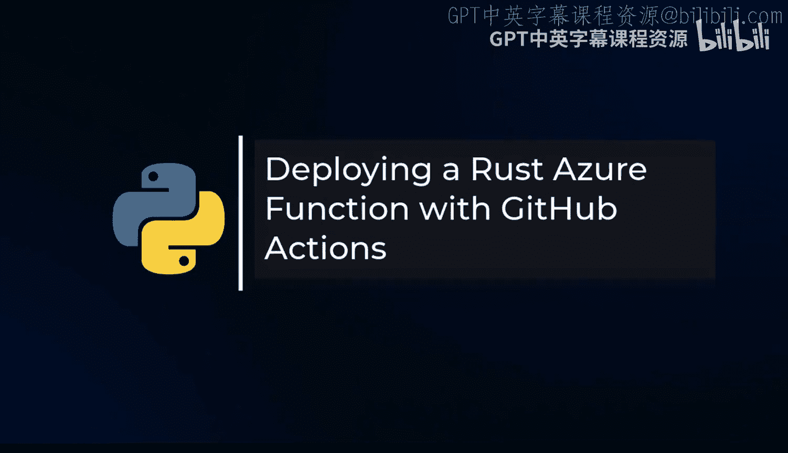
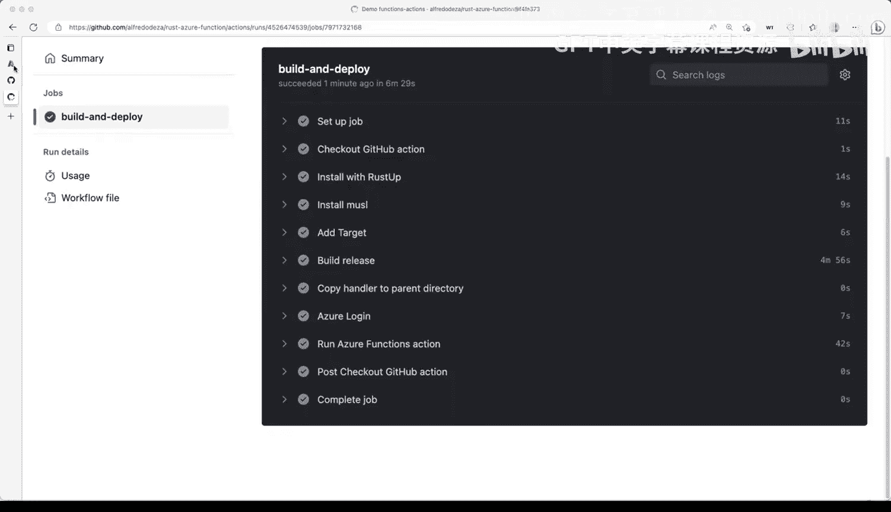
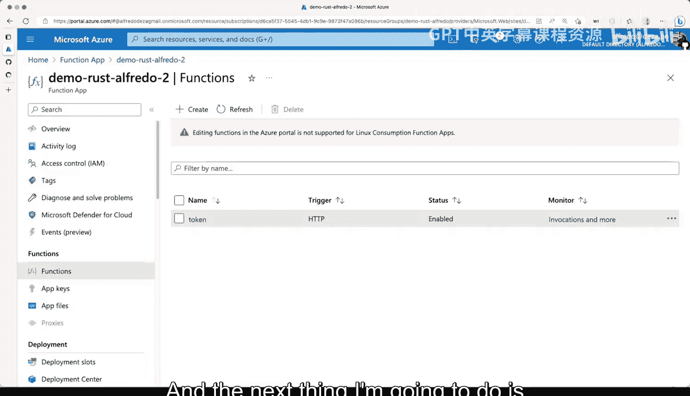
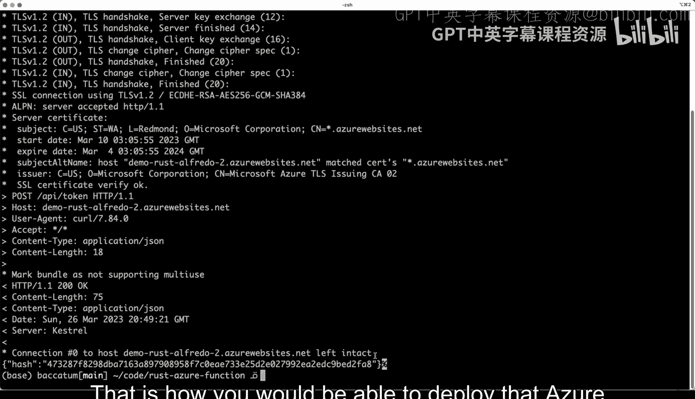
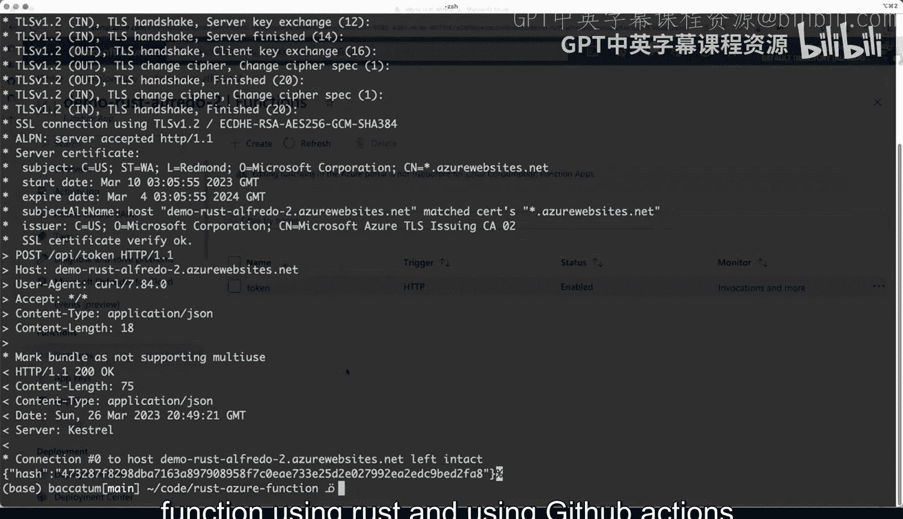
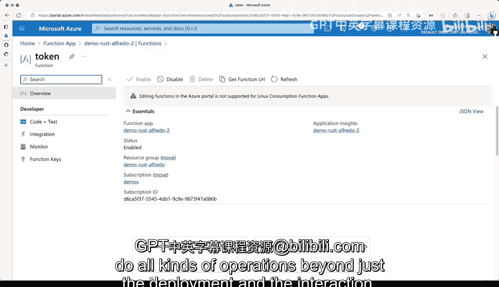

#  040：使用GitHub Actions部署Rust Azure函数 🚀



在本节课中，我们将学习如何使用GitHub Actions自动化部署一个用Rust编写的Azure函数。我们将涵盖从创建Azure函数应用、配置Rust项目，到设置GitHub Actions工作流进行自动化构建和部署的完整流程。

---

## 创建Azure函数应用

上一节我们介绍了课程背景，本节中我们来看看如何开始创建Azure函数应用。

首先，需要登录到Azure门户。在门户中，可以搜索或直接选择“函数应用”来创建新资源。

以下是创建新函数应用的步骤列表：

1.  选择正确的订阅。
2.  创建或选择一个资源组。建议创建一个名称有意义的新资源组，例如 `demo-rust-func`。
3.  为函数应用命名。此名称在 `azurewebsites.net` 域中必须是全局唯一的。
4.  在“运行时堆栈”中选择“自定义处理程序”，因为Rust没有Azure函数的原生支持。
5.  选择“Linux”作为操作系统。
6.  选择“消费（无服务器）”作为托管计划，这是默认且经济的选项。
7.  最后，检查所有配置并点击“创建”。

部署过程需要一些时间来完成初始化。

---

## 配置Rust Azure函数项目

创建好函数应用容器后，我们需要准备实际的函数代码。虽然可以通过Visual Studio Code的Azure Functions扩展生成项目文件，但这里我们直接查看一个已生成的项目结构。

一个典型的Rust Azure函数项目包含以下关键文件：

*   **`host.json`**: 函数应用的配置文件。
*   **`local.settings.json`**: 本地开发设置文件（通常不提交到仓库）。
*   **`Cargo.toml`**: Rust项目的清单文件，必须包含一个关键配置。

在 `Cargo.toml` 文件中，必须添加以下构建目标配置，以确保编译出的二进制文件能在Azure Functions环境中运行：

```toml
[package]
name = "your_function_name"

[[bin]]
name = "handler"
path = "src/main.rs"

# 关键配置：指定目标平台
[target.x86_64-unknown-linux-musl]
```

---

## 设置GitHub Actions工作流

现在，我们将配置GitHub Actions来自动化构建和部署流程。工作流定义在一个YAML文件中（例如 `.github/workflows/deploy.yml`）。

工作流的核心步骤如下：

1.  **安装Rust和musl工具链**：这是编译适用于Linux环境的静态链接二进制文件所必需的。
2.  **添加目标平台**：执行 `rustup target add x86_64-unknown-linux-musl`。
3.  **构建Release版本**：使用指定的musl目标进行编译：`cargo build --release --target x86_64-unknown-linux-musl`。
4.  **复制处理程序二进制文件**：将编译好的二进制文件复制到项目根目录，因为 `host.json` 中配置的 `executablePath` 指向它。
5.  **登录Azure**：使用Azure凭据进行身份验证。
6.  **部署到Azure Functions**：使用 `Azure/functions-action` 等官方Action完成部署。

为了让GitHub Actions能访问你的Azure订阅，需要创建一个服务主体（Service Principal）并将其凭据存储为仓库的Secret。

---

## 创建Azure服务主体

服务主体是自动化脚本访问Azure资源的身份凭证。可以通过Azure Cloud Shell或本地已安装的Azure CLI来创建。

运行以下命令创建服务主体：

```bash
az ad sp create-for-rbac \
  --name "github-actions-<your-unique-name>" \
  --role contributor \
  --scopes /subscriptions/<your-subscription-id>/resourceGroups/<your-resource-group-name>
```

命令执行后会输出一个包含 `appId`、`password`、`tenant` 等信息的JSON对象。你需要将这个完整的JSON对象保存为GitHub仓库的Secret，名称设为 `AZURE_CREDENTIALS`。

---

## 检查Rust函数代码

我们的示例函数是一个HTTP触发器，它接收一个JSON请求，计算输入文本的哈希值并返回。

函数的主要逻辑在 `src/main.rs` 中，关键点包括：
*   使用 `actix-web` 框架处理HTTP请求。
*   路由被映射到 `/api/tokenize` 路径（Azure Functions要求API路径以 `/api` 开头）。
*   函数需要绑定到由Azure运行时注入的环境变量 `FUNCTIONS_CUSTOMHANDLER_PORT` 指定的端口。

---

## 触发部署并验证

配置完成后，可以在GitHub仓库的“Actions”标签页中找到我们定义的工作流（例如“Demo Functions Actions”）。由于工作流中配置了 `workflow_dispatch`，你可以手动点击“Run workflow”按钮来触发部署。

部署完成后，回到Azure门户，在对应的函数应用中，你应该能看到名为“token”的新函数。你可以通过其提供的URL端点来测试函数。

使用 `curl` 命令测试部署的函数：

```bash
curl -X POST \
  -H "Content-Type: application/json" \
  -d '{"text": "Your input string here"}' \
  https://<your-function-app-name>.azurewebsites.net/api/tokenize
```





如果一切正常，你将收到一个计算出的哈希值作为响应。

---

## 总结







本节课中我们一起学习了使用GitHub Actions部署Rust Azure函数的完整流程。我们首先在Azure门户创建了函数应用，然后配置了Rust项目以兼容Azure环境。接着，我们设置了GitHub Actions工作流，通过自动化步骤完成代码的构建和部署，其中关键环节是创建并使用Azure服务主体进行安全认证。最后，我们触发了部署并验证了函数可以正常运行。这套流程实现了MLOps中持续集成和持续部署（CI/CD）的核心实践，能够高效、可靠地将机器学习模型或应用部署到生产环境。