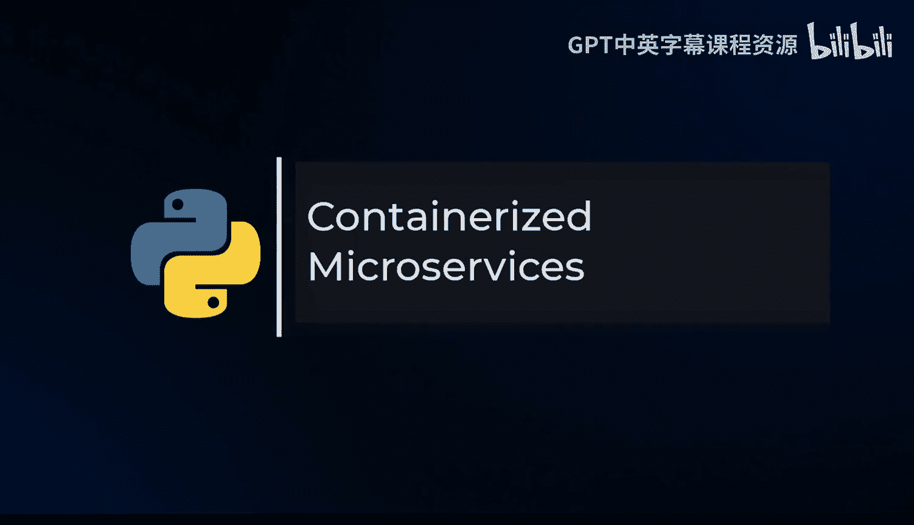
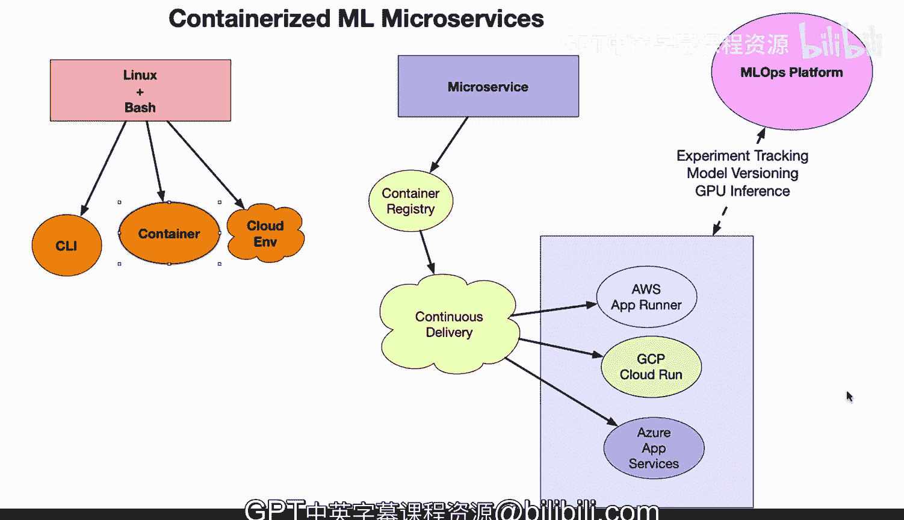

#  041：容器化微服务 🐳

在本节课中，我们将学习如何将机器学习应用构建为容器化的微服务，并探讨其部署到主流云平台的流程。

## 概述

我们将介绍一个容器化机器学习微服务的架构思路。该流程始于本地开发环境，最终通过持续交付部署到云平台。

## 开发环境

首先，我们需要一个开发环境。这可以是安装了Bash的Linux系统。

在具体实践中，我们可以通过命令行工具与Linux Bash交互。我们也可以使用容器技术，在Linux Bash环境中运行。此外，基于云的环境也是一个选择。

以下是几种常见的开发环境选项：

*   **AWS Cloud9**
*   **GitHub Codespaces**

这些环境都适合用来构建我们的容器镜像。

## 部署与云平台

上一节我们介绍了开发环境，本节中我们来看看如何将构建好的容器部署到生产环境。

当容器准备就绪后，可以将其集成到云服务商的微服务框架中进行部署。这通常通过容器注册表完成，我们需要在那里注册自己的容器镜像。

随后，通过一个持续交付流程，将应用部署到云平台提供的“平台即服务”产品上。

以下是几个主流的云平台部署服务：

*   **AWS App Runner**：这是一个对微服务友好的框架。它允许你通过AWS CodeBuild这样的构建系统，或通过你自己的构建系统（如GitHub Actions），自动部署容器。
*   **GCP Cloud Run**：谷歌云提供的类似容器化部署服务。
*   **Azure App Services**：Azure也提供了支持容器化工作流的类似服务。

## 集成MLOps平台

除了直接部署，我们还可以增加一个步骤：与MLOps平台集成。

这意味着，你可以通过API调用部署模型，然后调用部署在某处的推理端点。这个部署目标会利用MLOps平台来处理你的API请求。

此外，你的微服务可能需要与实验跟踪服务交互。例如，你可以有一个内部工具，它使用实验跟踪服务，查看具有最佳指标的最新模型版本，并自动选择该模型与“平台即服务”产品进行交互。

## 核心优势与总结

这种工作流的关键在于，**容器化技术让一切成为可能**。

通过将运行时环境与代码一起打包，容器使你能够实现这种高效的、基于微服务的持续交付。

如果你打算构建微服务，**AWS App Runner、GCP Cloud Run和Azure App Services**这三个平台是极佳的起点。

本节课中，我们一起学习了容器化机器学习微服务的完整流程：从本地或云端开发环境构建容器，到通过容器注册表和持续交付流程部署到云平台，最后探讨了与MLOps平台集成以增强模型管理能力的可能性。容器化是实现高效、可移植微服务部署的核心。