#  043：容器化机器学习 🐳

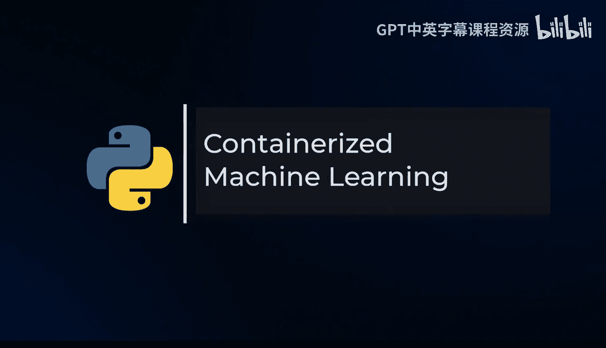


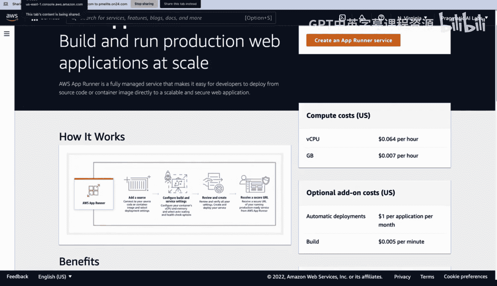

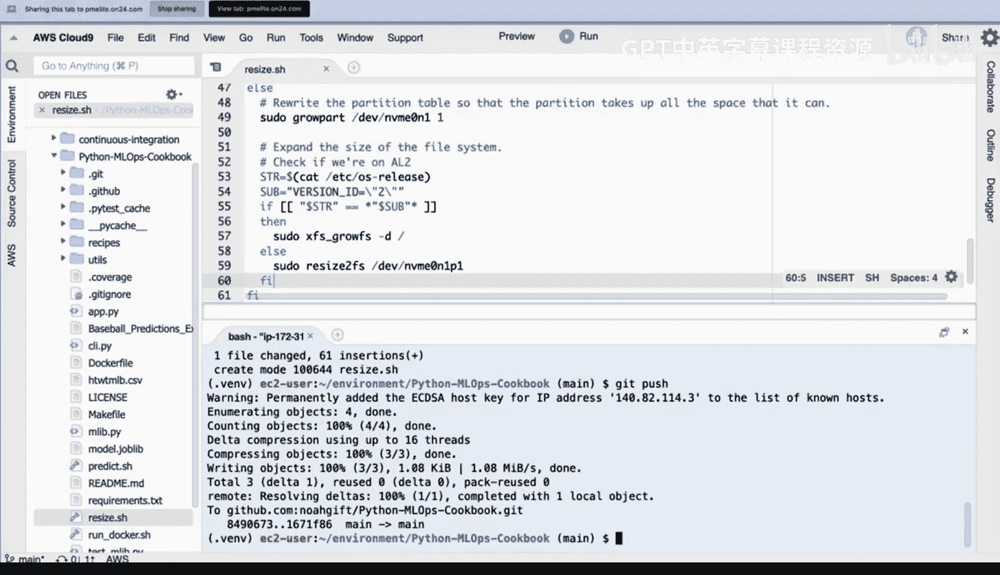

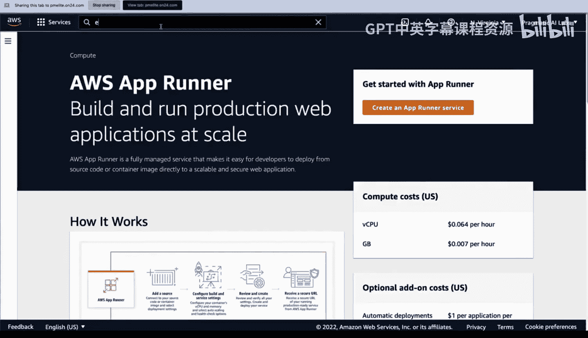

在本节课中，我们将学习如何将机器学习模型容器化，并利用AWS服务将其部署为可扩展的微服务。我们将通过两个具体示例，演示从构建Docker镜像到使用AWS App Runner进行持续部署的完整流程。

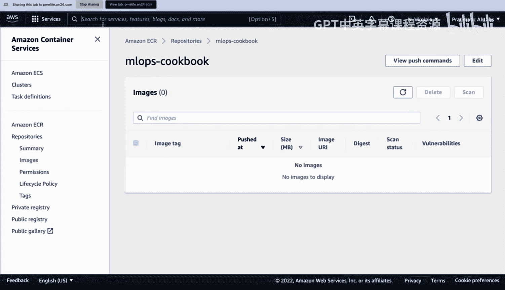

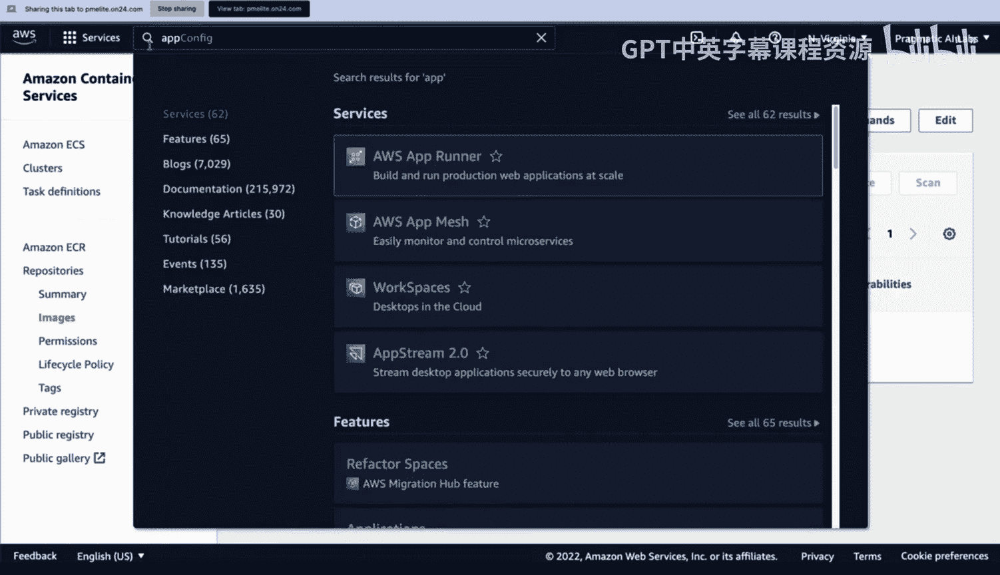

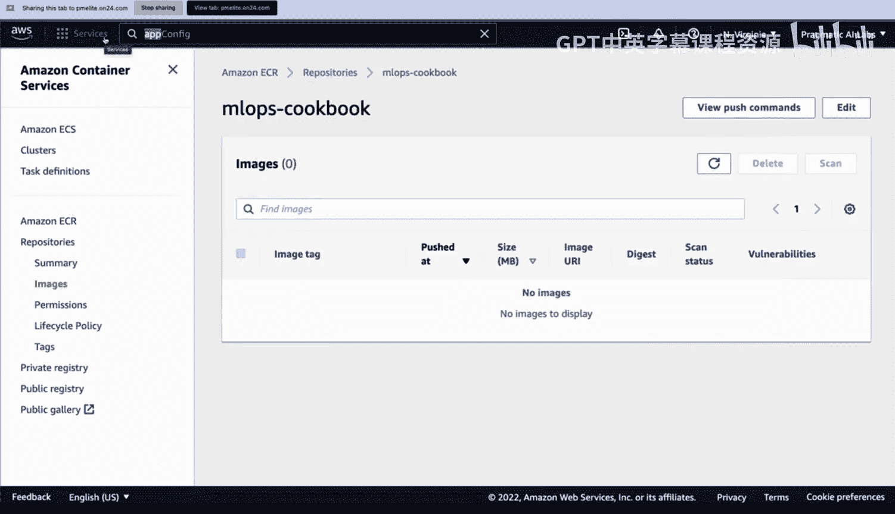

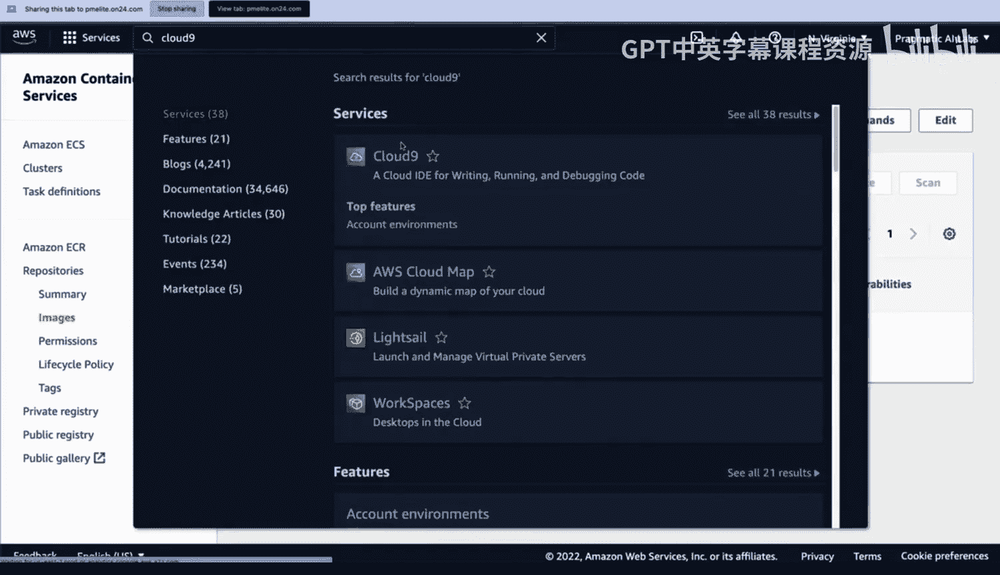

---

## 概述

容器化是MLOps中的关键环节，它将模型、代码和依赖项打包成一个标准化的单元，确保环境一致性并简化部署。本节我们将实践如何将两个不同的机器学习项目（一个身高体重预测模型和一个虚假新闻检测模型）容器化，并部署到云端。

---

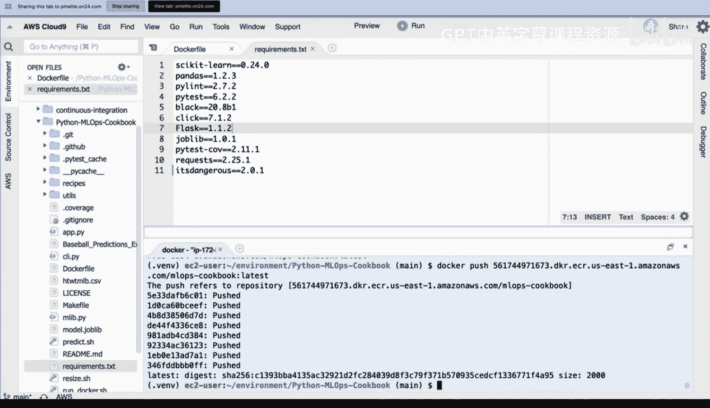

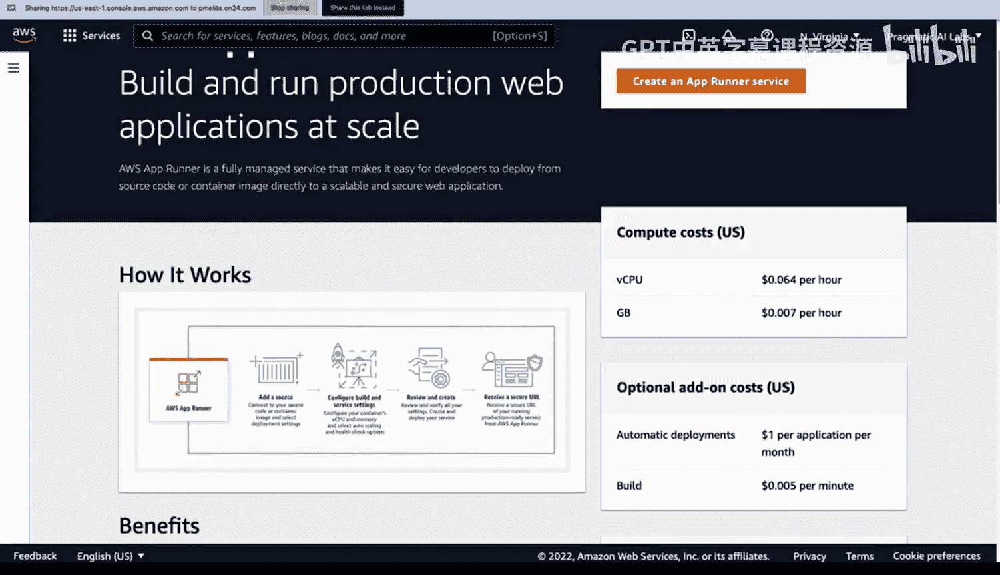

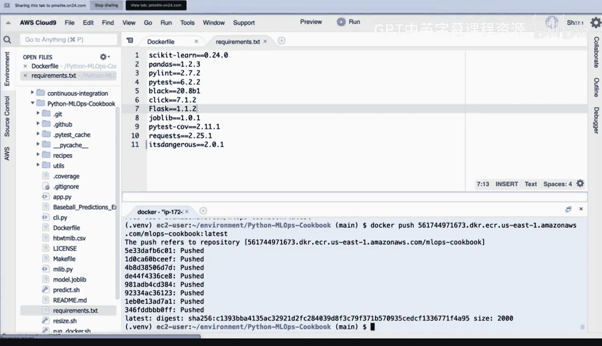

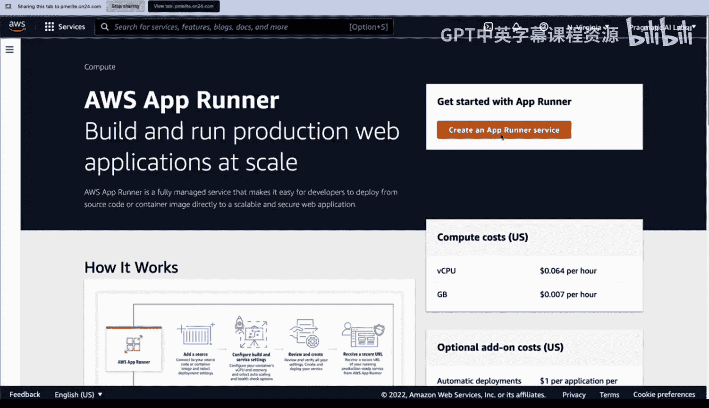

## 容器化流程详解

上一节我们介绍了模型训练和微服务的基本概念，本节中我们来看看如何将它们打包并部署。

### 第一步：准备容器注册表

首先，我们需要一个地方来存储构建好的容器镜像。我们将使用AWS的弹性容器注册表。

以下是创建ECR仓库的步骤：
1.  登录AWS管理控制台，导航到ECR服务。
2.  点击“创建仓库”。
3.  为第一个模型（身高体重预测）的仓库命名为 `mlops-cookbook`。
4.  创建完成后，ECR会提供用于推送镜像的`docker push`命令，复制并保存这些命令备用。

### 第二步：构建并测试第一个微服务

现在，我们回到Cloud9开发环境，开始构建第一个容器。

首先，我们需要登录到ECR。使用之前复制的登录命令：
```bash
aws ecr get-login-password --region <region> | docker login --username AWS --password-stdin <account-id>.dkr.ecr.<region>.amazonaws.com
```

接着，在包含`Dockerfile`和`app.py`的项目目录中，构建Docker镜像：
```bash
docker build -t mlops-cookbook .
```

在推送之前，最好先在本地测试微服务是否运行正常。我们可以运行容器并进行预测：
```bash
# 运行容器
docker run -p 8080:8080 <image-id>
# 在另一个终端中，使用curl或自定义CLI工具测试端点
./utils_cli predict --host http://localhost:8080/predict --height 70
```

### 第三步：推送镜像并部署到AWS App Runner

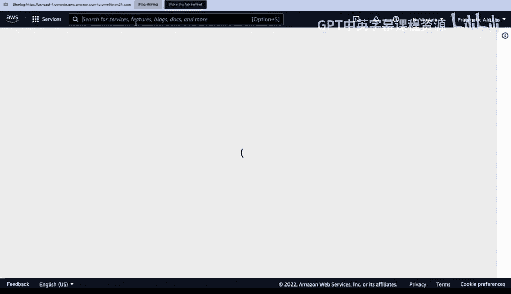

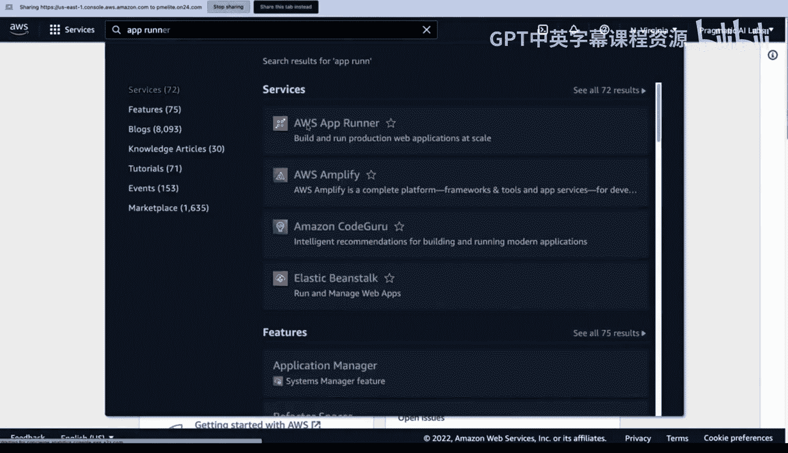

确认本地运行无误后，我们将镜像推送到ECR仓库。

使用ECR提供的命令进行标记和推送：
```bash
docker tag mlops-cookbook:latest <account-id>.dkr.ecr.<region>.amazonaws.com/mlops-cookbook:latest
docker push <account-id>.dkr.ecr.<region>.amazonaws.com/mlops-cookbook:latest
```

镜像推送成功后，即可在AWS App Runner中创建服务。
1.  在AWS控制台导航到App Runner服务。
2.  点击“创建服务”，选择“容器注册表”作为来源。
3.  选择我们刚刚推送镜像的ECR仓库（`mlops-cookbook`）。
4.  配置服务名称、访问角色等（均可使用默认设置），并确保启用“持续部署”。这样，每当ECR中有新的镜像版本时，App Runner会自动部署更新。
5.  创建服务后，App Runner会提供一个可访问的HTTPS端点。

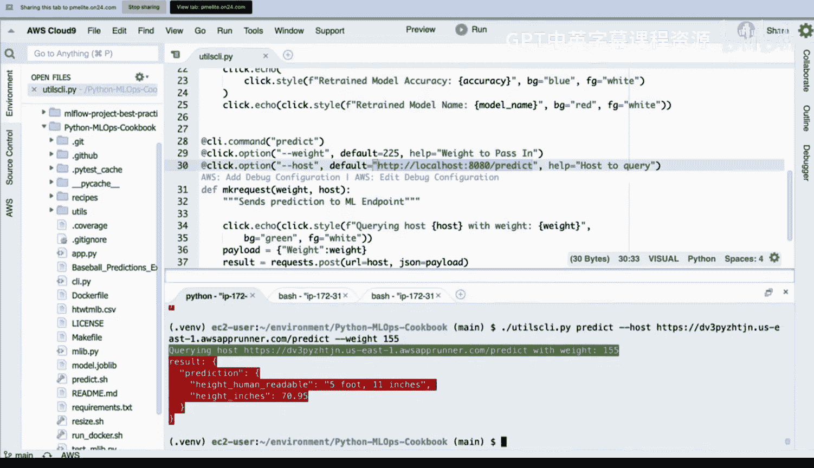

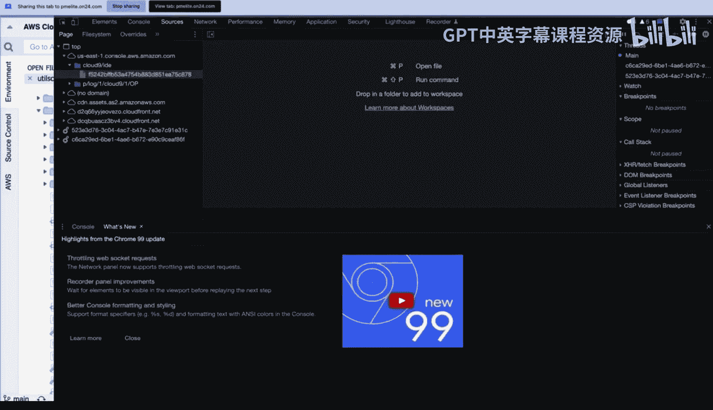

### 第四步：构建并部署第二个复杂模型

为了展示流程的通用性，我们重复上述步骤，部署第二个项目——一个基于FastAPI的虚假新闻检测模型。

首先，为这个项目在ECR中创建另一个仓库，例如 `fastapi-mlops`。

这个项目的`Dockerfile`略有不同，它使用了AWS Lambda的基础镜像，但核心步骤一致：
```dockerfile
FROM public.ecr.aws/lambda/python:3.8
COPY ./app /var/task
COPY ./requirements.txt /var/task
RUN pip install -r requirements.txt
CMD ["app.handler"]
```

同样地，在项目目录中构建、标记并推送镜像：
```bash
docker build -t fastapi-mlops .
docker tag fastapi-mlops:latest <account-id>.dkr.ecr.<region>.amazonaws.com/fastapi-mlops:latest
docker push <account-id>.dkr.ecr.<region>.amazonaws.com/fastapi-mlops:latest
```

然后，在App Runner中创建第二个服务，指向 `fastapi-mlops` 仓库。部署完成后，我们可以通过其提供的Swagger UI文档页面（通常在`/docs`路径）来交互式地测试这个虚假新闻检测API。

---

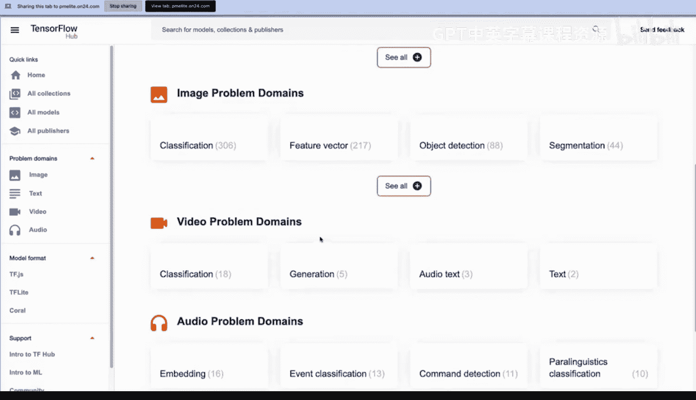

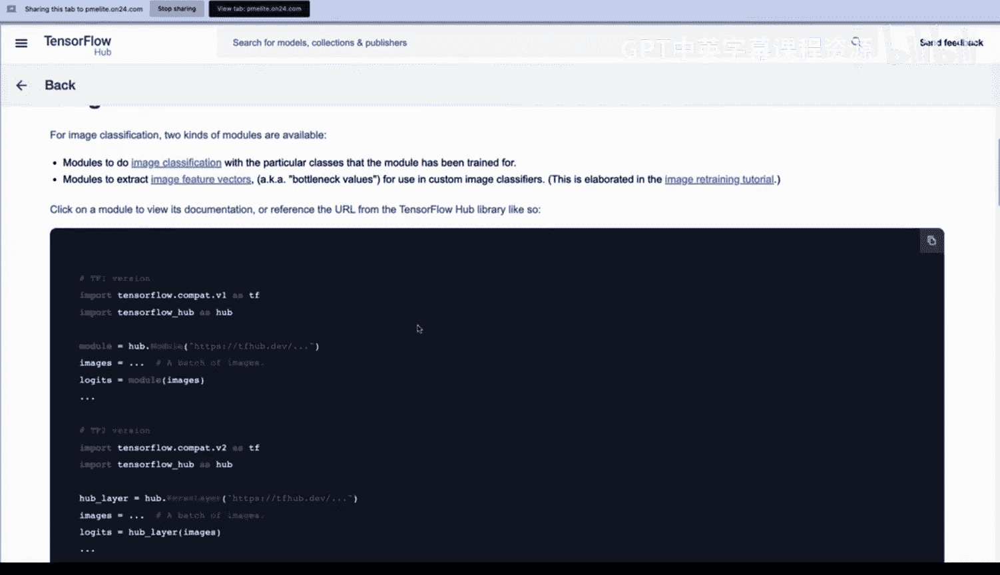

## 核心架构与不同来源的模型

通过以上实践，我们构建了一个灵活的MLOps部署架构。其核心流程可以概括为：**无论模型来自何处，最终都被封装进容器，推送到注册表，并由托管服务（如App Runner）部署为微服务**。

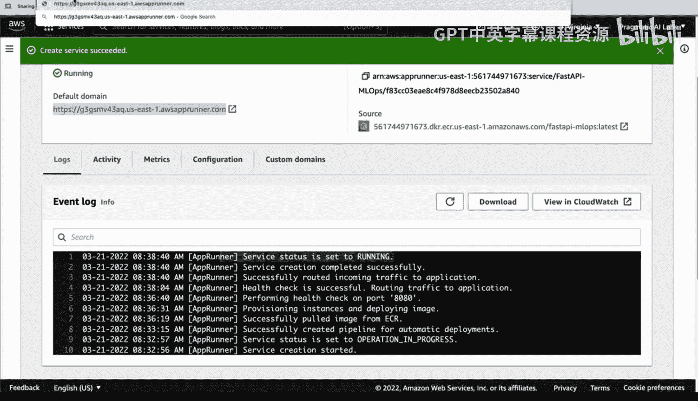

模型的来源可以多种多样，主要分为以下四种方式：

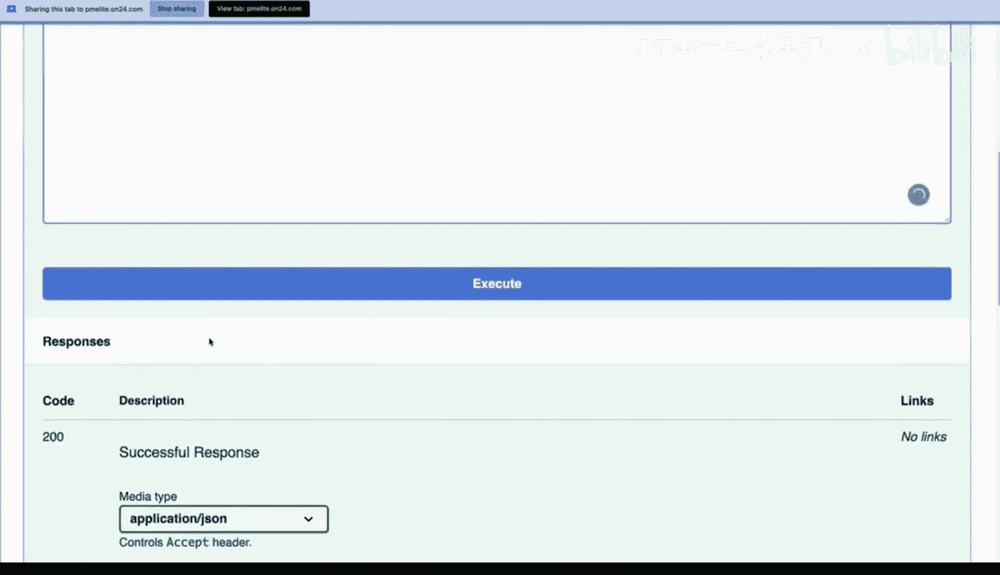

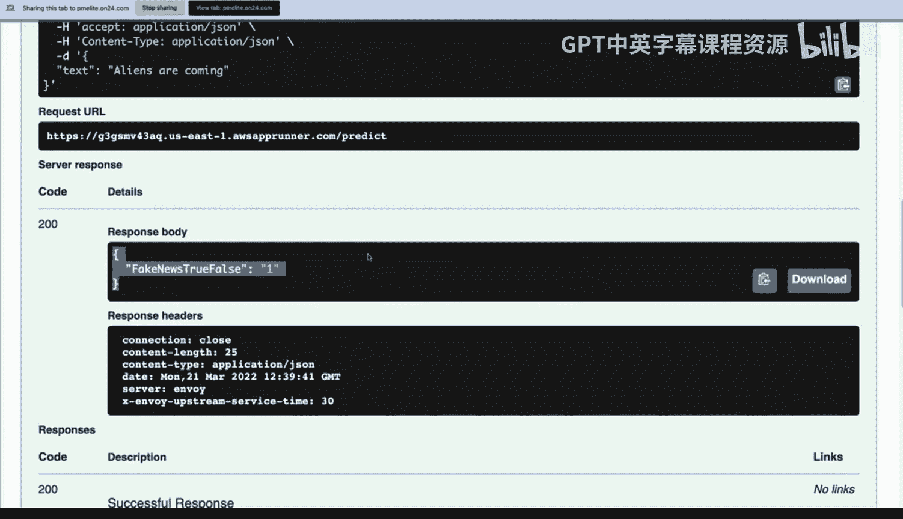

以下是不同模型来源的对比：
*   **下载预训练模型**：从模型中心（如TensorFlow Hub、Hugging Face）直接下载现成模型，进行微调或不微调直接使用。这是快速启动项目的方式。
*   **使用自动化机器学习平台**：利用Databricks、Amazon SageMaker、Azure ML等平台的AutoML功能自动生成模型。
*   **从零开始自行构建**：这是最传统的方式，完全由数据科学家手动设计、训练和调优模型。
*   **调用第三方API端点**：直接消费已有的模型服务，无需自己托管模型。这更偏向于集成而非部署。

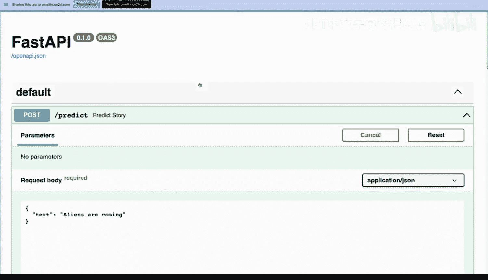

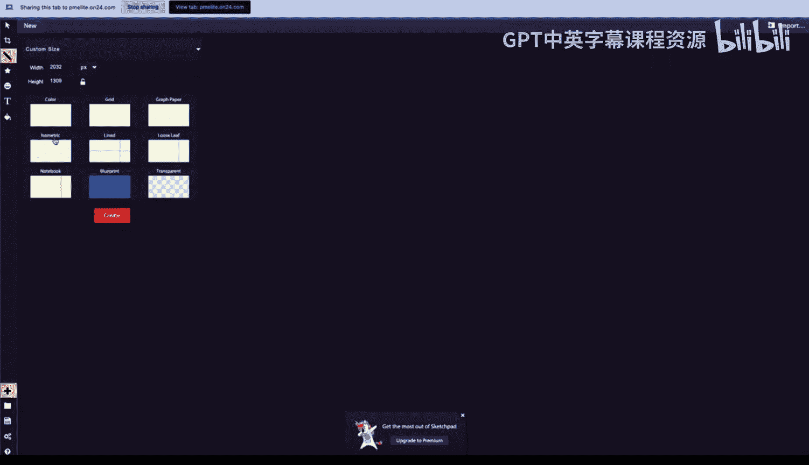

**关键点在于**：一旦我们建立了从“容器注册表”到“微服务部署”的自动化流水线，那么更新模型就变得非常简单。只需要触发新的构建，将新版本的容器镜像推送到注册表，部署就会自动完成。

---

## 总结

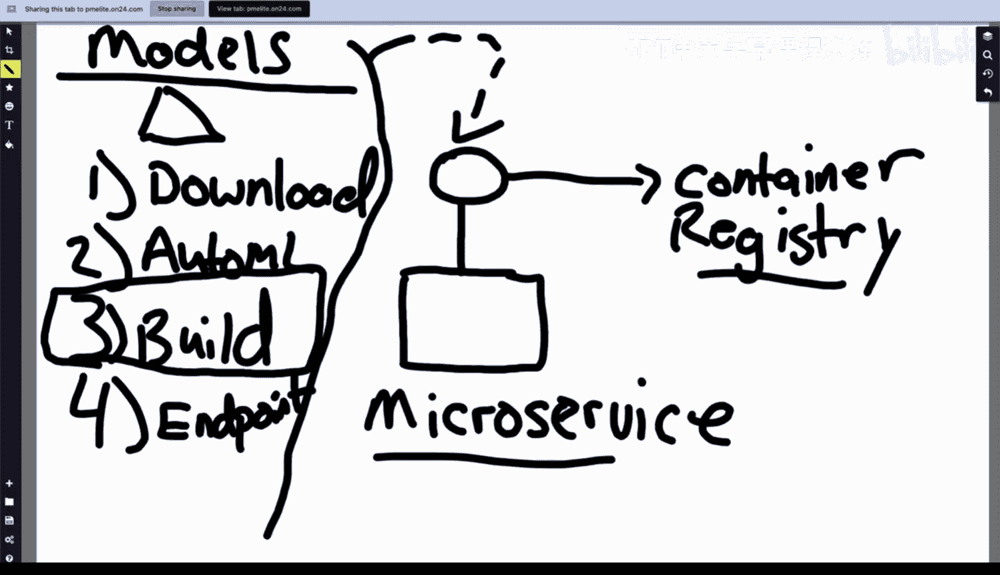

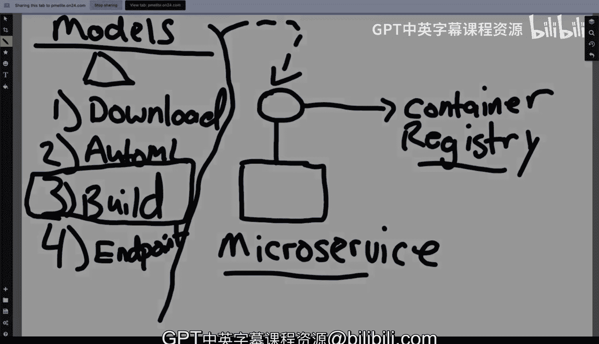

本节课中我们一起学习了机器学习模型容器化的完整流程。我们掌握了如何将不同的ML项目打包成Docker镜像，推送到AWS ECR，并利用AWS App Runner配置持续部署，最终将模型发布为可扩展的线上API服务。这套方法的核心优势在于将模型部署流程标准化和自动化，无论模型来源如何，都能通过一致的容器化路径实现高效、可靠的运维。