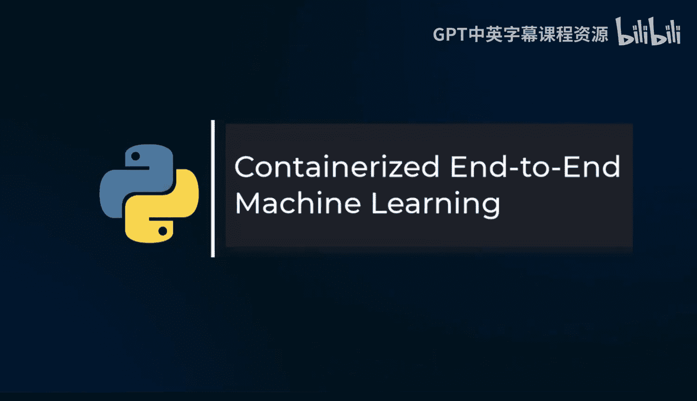
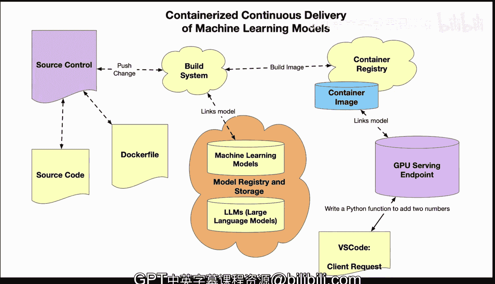

#  044：容器化端到端机器学习 🚀

在本节课中，我们将学习如何利用容器化技术实现机器学习模型的持续交付。我们将剖析一个典型的工作流程，并解释为何容器技术非常适合传统机器学习和大语言模型。

## 概述 📋

容器化持续交付系统旨在减少构建和部署机器学习应用时的摩擦。通过将代码、运行时环境和模型依赖打包进容器，可以实现自动化的构建、测试和部署流程。接下来，我们将详细拆解这个工作流程中的关键组件。

## 工作流程详解 🔄

上一节我们介绍了容器化持续交付的概念，本节中我们来看看其具体的工作流程是如何运作的。

### 源代码控制

工作流程始于源代码控制系统，例如 GitHub。以下是源代码控制系统中包含的核心内容：

*   **应用代码**：实现具体功能的代码，例如一个使用大语言模型的微服务。
*   **Dockerfile**：一个定义文件，用于精确描述运行时环境和所构建微服务的每一个方面。

代码配置完成后，会被推送到源代码控制系统中。

### 自动化构建

当变更被推送到源代码控制系统时，构建系统会自动触发后续流程。以下是构建系统执行的关键步骤：

1.  **链接模型**：模型可以是一个存放在模型注册表或专用模型服务系统中的小模型，也可以是一个存放在对象存储等存储系统中的大语言模型。
2.  **构建容器镜像**：构建系统会创建一个容器镜像，该镜像包含了调用模型所需的确切运行时环境。
3.  **推送至容器仓库**：构建完成的容器镜像被推送到云平台的容器仓库中。

### 部署与调用

容器镜像准备就绪后，即可进行部署。GPU 服务端点会引用这个容器镜像并启动服务。以下是调用流程：

1.  客户端（例如，在 VS Code 中使用 Hugging Face 的 StarCoder）向 GPU 服务端点发起请求。
2.  GPU 服务端点加载容器镜像，该镜像内嵌了确切的运行时环境，并包含对大语言模型存储位置的引用。
3.  端点处理请求（例如，“编写一个将两个数字相加的 Python 函数”）并返回结果给客户端代码编辑器。

这种设计的优势在于各个组件相互独立，但在构建时又能链接在一起。运行时环境被封装在容器镜像内，模型则通过存储系统引用，从而消除了脆弱的依赖关系。

## 总结 🎯

本节课中我们一起学习了容器化持续交付系统如何为机器学习模型部署提供高效、可靠的解决方案。通过将代码、环境和模型依赖容器化，并结合自动化构建流程，可以实现从代码提交到服务部署的无缝衔接。这种方法不仅减少了手动配置的复杂性，也保证了环境的一致性，适用于从传统机器学习模型到现代大语言模型的各种场景。