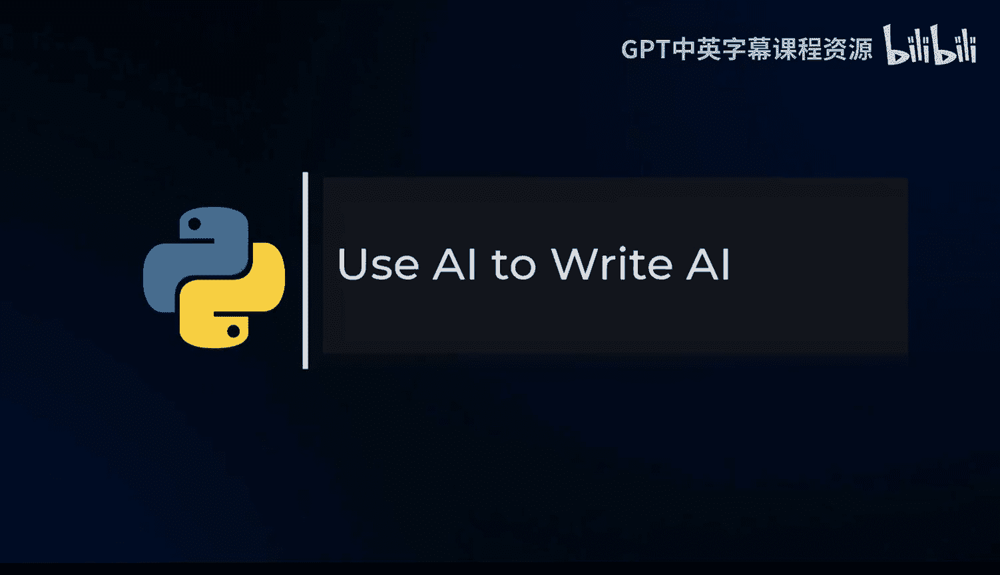
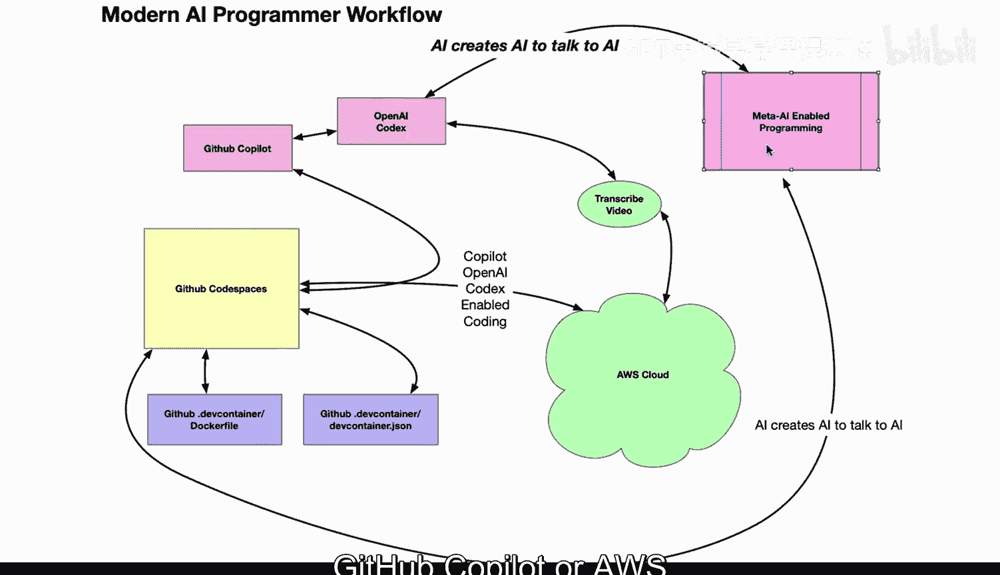

#  046：使用AI编写AI代码 🚀

在本节课中，我们将探讨一个现代AI编程工作流，其核心是“AI创建AI来与AI对话”。我们将了解如何利用基于云的开发环境和AI编程工具来加速机器学习解决方案的开发。

---

## 概述

现代AI编程工作流的核心是利用AI工具来辅助甚至生成代码，从而更快地构建AI解决方案。本节将介绍如何通过配置云开发环境，并集成像Github Copilot这样的AI编程工具来实现这一流程。

## 工作流详解

上一节我们介绍了现代AI编程的概念，本节中我们来看看这个具体的工作流是如何构建和运作的。

首先，我们可以从**Github Codespaces**开始。这是一个基于云的开发环境。你可以通过自定义的Docker文件和开发容器配置文件来配置它，使其专门为AI编程和机器学习编程进行优化。其中一个关键优化是支持使用GPU。

在构建这个环境时，你可以做的一件事就是与**Github Copilot**进行交互。那么，它是什么呢？

Github Copilot是一个AI结对编程工具，它与OpenAI Codex进行通信。Codex是一个经过预训练的模型，旨在帮助你自动补全代码。它足够智能，能够为你提供代码建议。

当你使用Copilot时，发生的情况是，你也可以通过它与云服务的SDK进行通信。例如，你可以构建一个新的系统来转录代码，或者构建与AWS中S3生态系统交互的功能。

这意味着你正在使用AI进行**元编程**。实际上，你正在使用一个经过预训练、旨在帮助创建AI解决方案的AI。这正是现代AI程序或工作流的本质：AI本身成为一个赋能者，使你能够更快地编写代码、使用更高级的工作流，并在机器学习领域以更快的速度进行开发。

因此，在构建解决方案时，考虑如何使用Github Copilot或AWS CodeWhisperer这类AI工具是非常重要的。

以下是构建此工作流的关键步骤列表：

1.  **设置云开发环境**：使用Github Codespaces，并通过Dockerfile和devcontainer.json文件进行定制化配置，以支持GPU加速。
2.  **集成AI编程助手**：在开发环境中启用并配置Github Copilot，使其能够与你的代码编辑器交互。
3.  **利用预训练模型**：Copilot后台连接的OpenAI Codex模型会分析你的代码上下文，并提供代码补全和建议。
4.  **连接云服务SDK**：通过AI助手生成的代码或建议，快速集成例如AWS S3、Azure ML等云服务的功能。
5.  **实现元编程循环**：使用AI生成的代码来构建更复杂的AI或机器学习流水线，形成“AI创建AI”的增强循环。

## 总结

本节课中，我们一起学习了现代AI编程工作流“使用AI编写AI代码”。我们了解到，通过结合云原生开发环境（如Github Codespaces）和智能编程助手（如Github Copilot），开发者可以显著提升在机器学习领域的开发效率。这种以AI赋能AI开发的方式，是当前MLOps实践中的一个重要趋势。