#  048：Amazon CodeWhisperer 与 GitHub Copilot 对比 🆚


在本节课中，我们将对比两款流行的AI结对编程工具：Amazon CodeWhisperer 和 GitHub Copilot。我们将通过实际操作，展示它们如何帮助开发者编写代码，并分析各自的优缺点。

## 概述


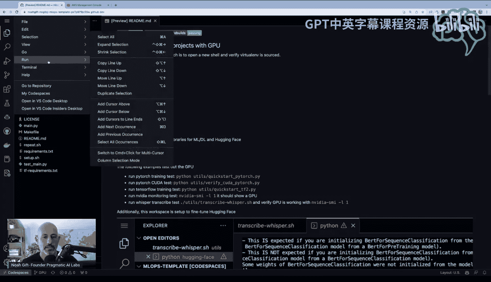

我们将首先介绍GitHub Copilot，展示其核心功能。接着，我们将切换到Amazon CodeWhisperer，进行类似的任务演示。通过对比，我们可以了解两者在代码生成速度、准确性、集成体验等方面的差异。

## GitHub Copilot 演示

上一节我们介绍了课程目标，本节中我们来看看GitHub Copilot的实际表现。我使用一个预配置了GPU的MLOps代码空间环境，它启动迅速且已安装好所有必要的扩展。

### 代码生成示例

以下是使用Copilot生成简单Python代码的步骤。

首先，我创建一个目录并编写一个注释来描述需求。

```python
# 构建一个随机水果列表
```

Copilot会根据注释自动生成代码建议。

```python
fruit = ['apple', 'banana', 'cherry', 'date', 'elderberry']
```

### 代码重构与格式化

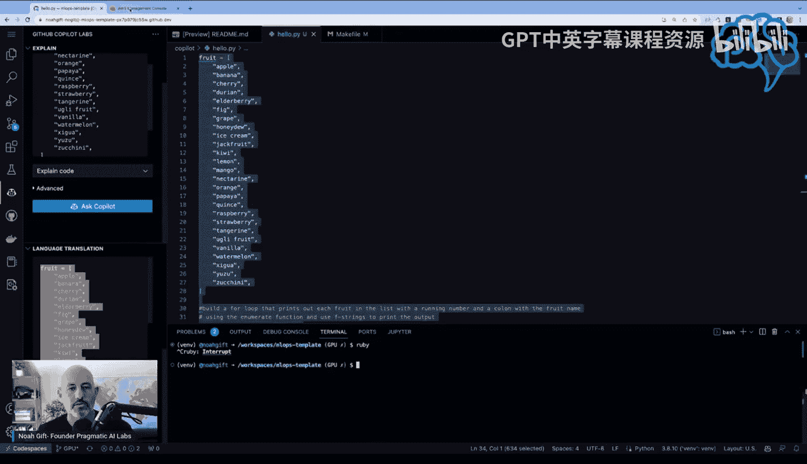

使用AI工具时，配合传统开发工具（如代码格式化器和linter）非常重要。这能确保生成的代码既智能又整洁。

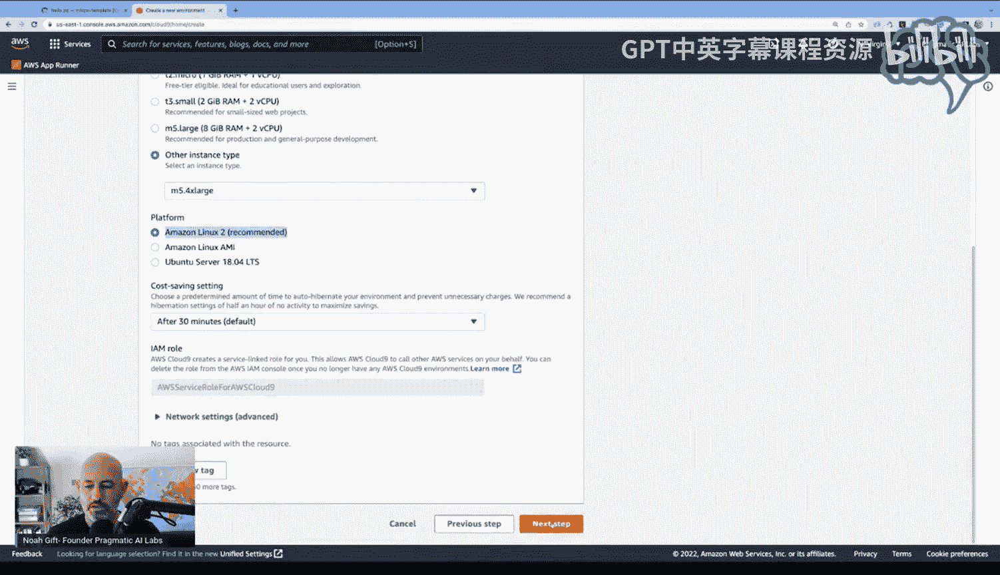

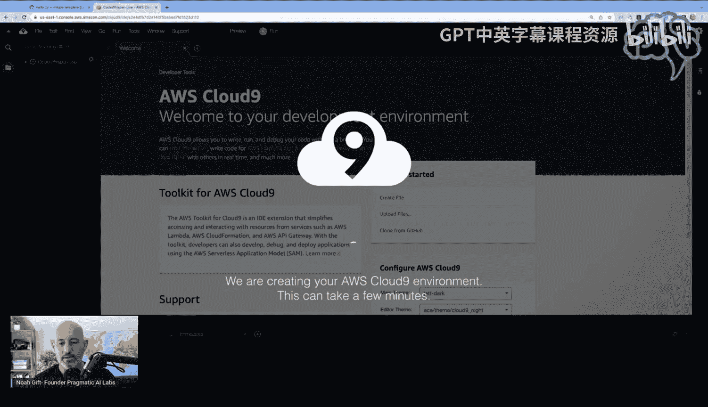

我使用一个名为`refactor`的工具来格式化和整理代码。

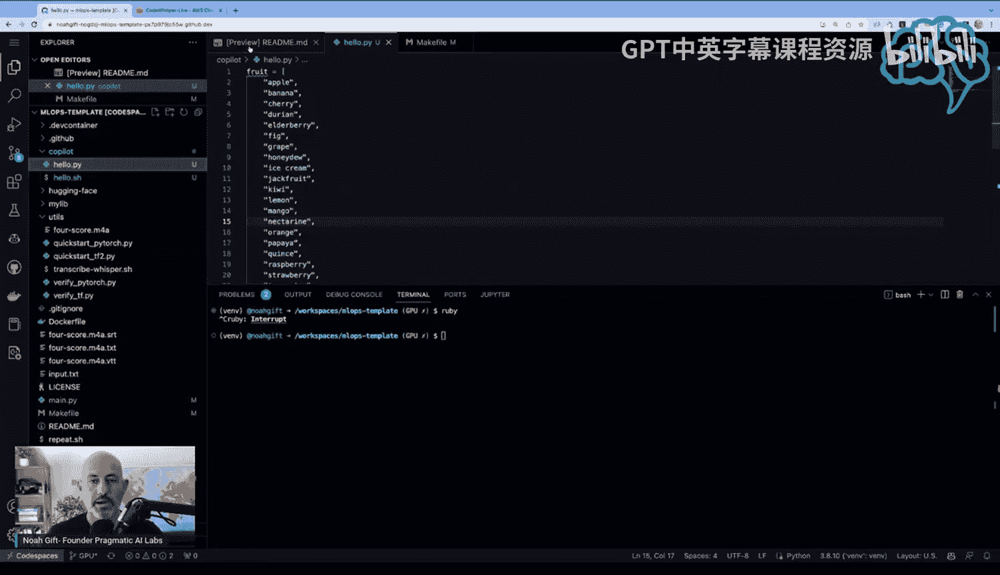


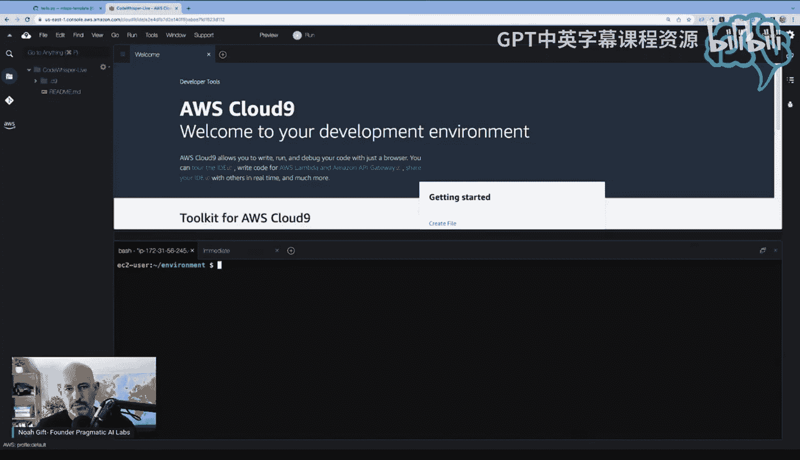

```bash
make refactor
```

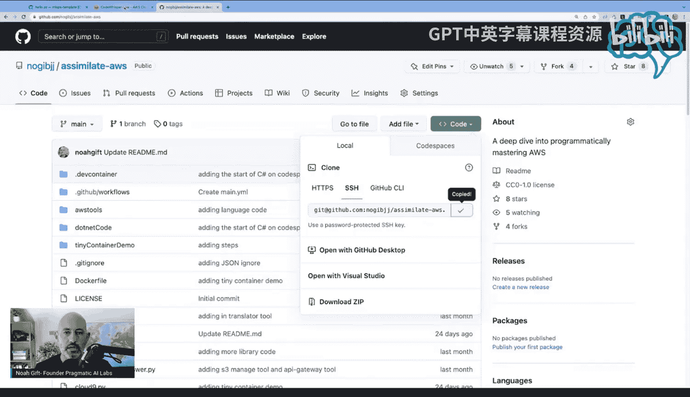

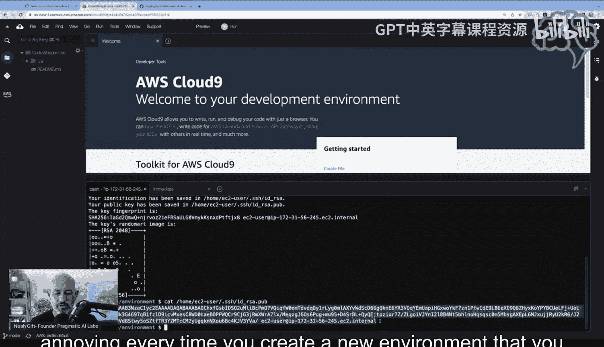

### 构建复杂循环

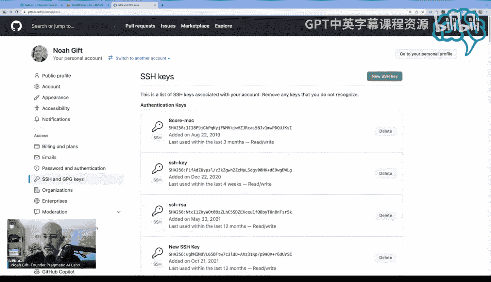

接下来，我指导Copilot构建一个更复杂的循环。

```python
# 构建一个for循环，打印出列表中每个水果及其序号，格式为“序号: 水果名”
```

Copilot生成了以下代码：

```python
for i, f in enumerate(fruit):
    print(f"{i}: {f}")
```

### 代码解释与翻译

Copilot Labs 提供了代码解释和翻译功能。我可以选中一段代码，让它解释其功能，或尝试将其翻译成其他语言（如Shell或Ruby）。虽然翻译功能目前处于测试阶段，结果可能不完美，但展示了其潜力。

## 切换到 Amazon CodeWhisperer

上一节我们体验了Copilot的流畅性，本节中我们来看看AWS的解决方案。我将在AWS Cloud9环境中使用CodeWhisperer。

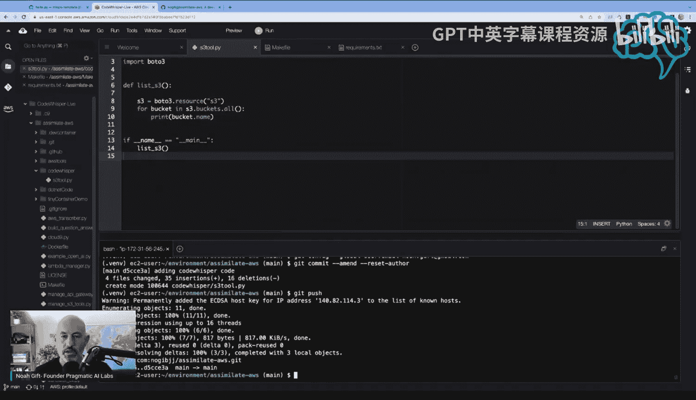

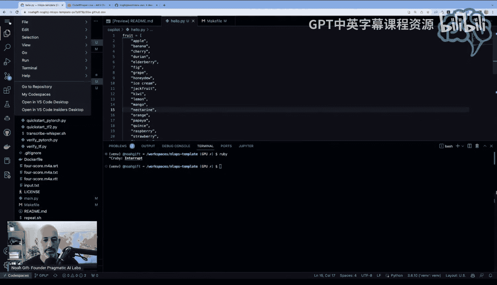


### 环境设置

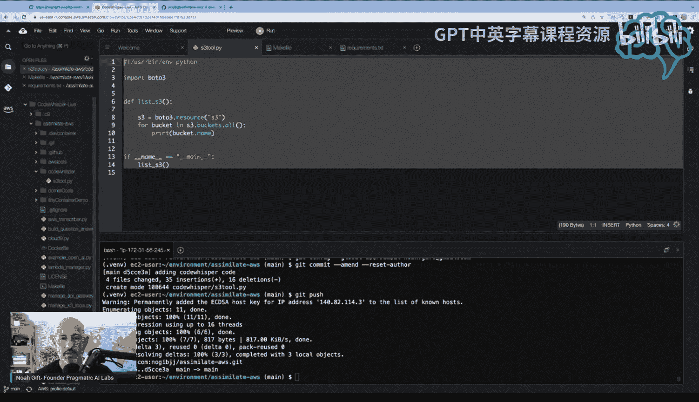

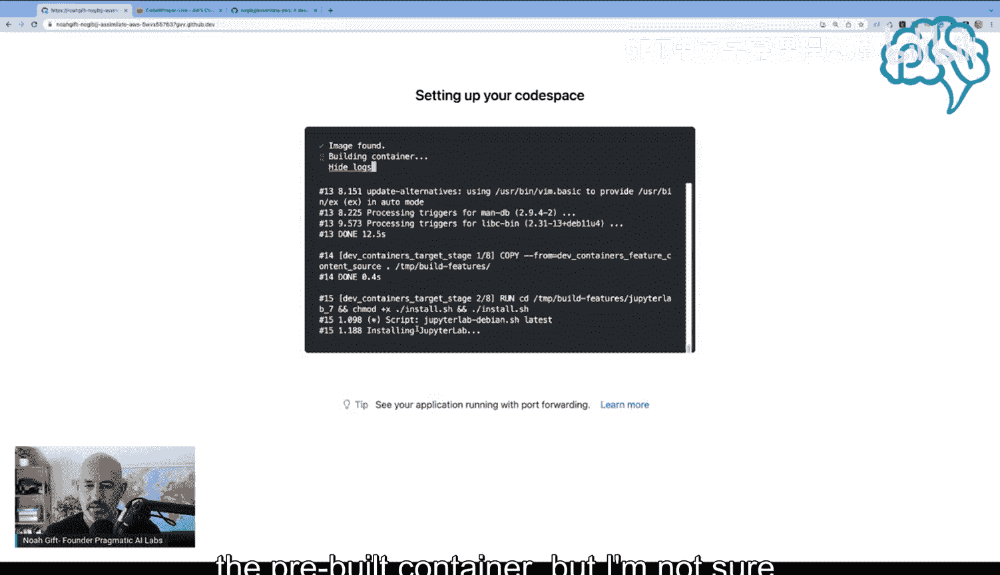

我创建了一个新的Cloud9环境。与GitHub Codespaces可以预构建环境不同，Cloud9需要手动进行一些设置，例如配置SSH密钥以克隆代码仓库。

### 启用 CodeWhisperer

Cloud9与AWS服务深度集成。我可以在IDE中直接启用CodeWhisperer预览版。

### 编写AWS工具代码

让我们测试CodeWhisperer在AWS相关任务上的能力。我创建一个工具来列出S3存储桶。

首先，我创建一个Python文件并写下初始注释。

```python
#!/usr/bin/env python
# 构建一个函数，返回我账户中的所有S3存储桶
```

CodeWhisperer 开始给出建议，首先导入了`boto3`库。

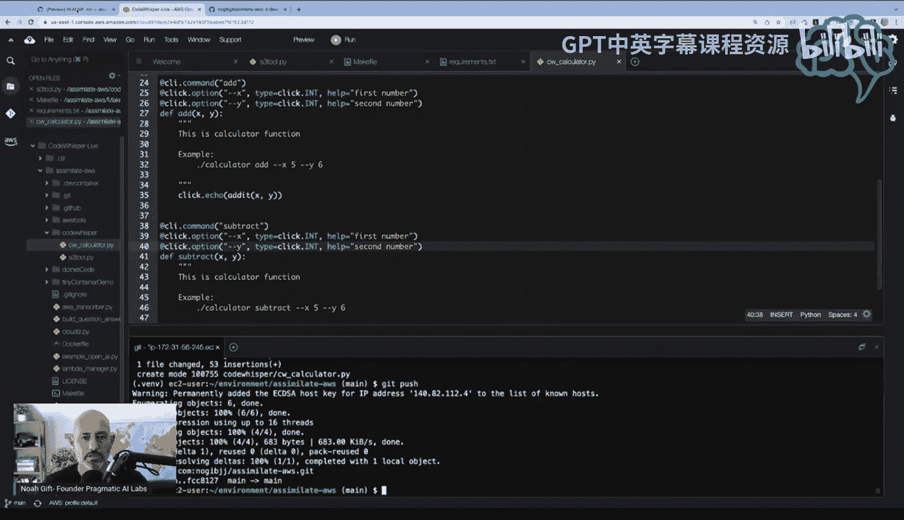

```python
import boto3
def list_s3_buckets():
    s3 = boto3.client('s3')
    response = s3.list_buckets()
    return [bucket['Name'] for bucket in response['Buckets']]
```

### 处理格式问题

我注意到CodeWhisperer生成的代码有时存在缩进问题。和之前一样，我使用`refactor`工具（结合Black和Pylint）来自动修复格式。

```bash
make refactor
```

### 构建计算器应用

为了进行更公平的对比，我尝试用CodeWhisperer构建一个与之前类似的计算器命令行工具。

代码生成质量很高，但建议的弹出速度感觉比Copilot慢一些。有时需要等待或使用Tab键来触发建议。

## 并排对比

上一节我们分别尝试了两个工具，本节中我们将它们放在一起直接对比。我同时在Copilot代码空间和CodeWhisperer Cloud9环境中构建相同的“S3存储桶文件计数”工具。

### Copilot 实现体验

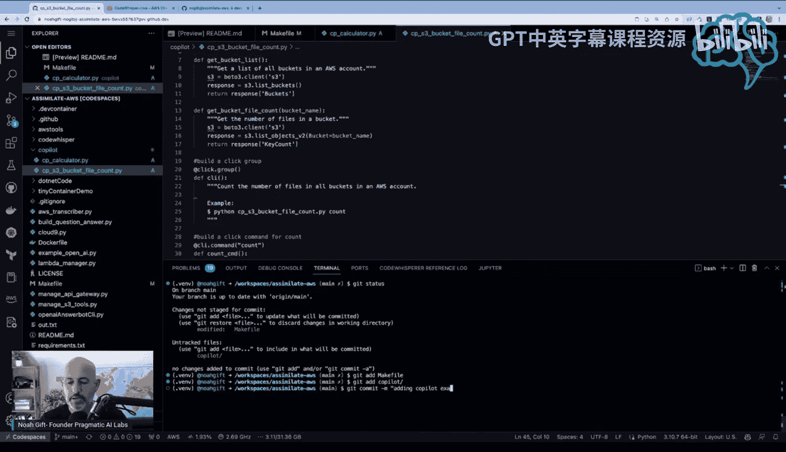

在Copilot中，我描述了需求：

```python
# 构建一个使用click的命令行工具，用于统计AWS账户中所有存储桶的文件数量。
```

Copilot的反应非常迅速，几乎能预测我的想法。它快速生成了使用`boto3`和`click`的完整代码框架，包括列出存储桶、统计文件数和组织命令行组的逻辑。整个流程感觉非常自然、快速。

### CodeWhisperer 实现体验

在CodeWhisperer中，我进行相同的尝试。它生成的代码质量也很高，结构清晰。然而，其建议速度明显较慢，并且偶尔会出现恼人的缩进错误，需要手动或通过格式化工具纠正。我需要更主动地引导代码生成过程。

## 总结与对比分析

本节课中我们一起学习并对比了GitHub Copilot和Amazon CodeWhisperer。

**GitHub Copilot 的优势：**
*   **响应速度极快**，感觉像是与思维同步。
*   **交互非常直观**，代码补全流畅自然。
*   **与开发流程集成度好**，能快速理解上下文并生成复杂代码。

**Amazon CodeWhisperer 的优势：**
*   **生成的代码质量高**，尤其针对AWS相关服务，代码通常很整洁。
*   **与AWS Cloud9环境深度集成**，对于AWS开发者非常方便。
*   作为AWS生态的一部分，对于主要使用AWS服务的团队有天然优势。

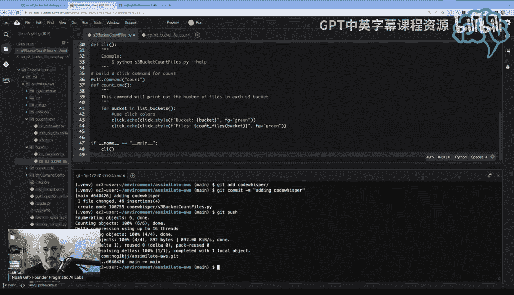

**CodeWhisperer 需要改进的方面：**
*   **建议响应速度**有待提升。
*   **代码缩进/空格问题**需要修复。
*   整体流畅度和“智能感”暂不如Copilot。

**总体而言**：
*   Copilot 提供了更优的整体开发者体验，感觉更像一个高效的结对编程伙伴。
*   CodeWhisperer 是一个非常有潜力的工具，特别是在AWS环境中。它已经比没有AI辅助要好得多，并且随着迭代一定会不断改进。
*   对于Cloud9用户来说，CodeWhisperer是一个必用的增强工具。如果AWS能进一步优化Cloud9的启动速度（例如引入预构建环境功能），体验会更上一层楼。

两款工具都是强大的“生产力增强剂”，选择哪一个可能取决于你主要的工作环境（GitHub vs. AWS）以及对速度与深度集成的不同侧重。