#  050：使用Bash在AWS CloudShell中快速原型化AI API

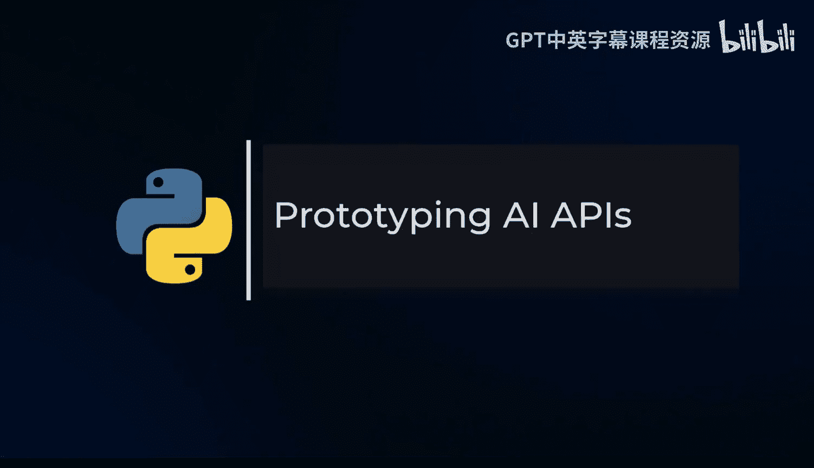


## 概述

在本节课中，我们将学习如何利用AWS CloudShell中的Bash环境，快速原型化和探索AI API。我们将使用AWS Comprehend服务，从维基百科获取数据，进行情感分析和实体提取，并通过Bash管道处理数据，从而快速验证想法，为后续的正式开发奠定基础。

## 使用AWS CloudShell和Bash进行AI API原型设计

很多时候，开发者容易陷入使用Python、C#或Ruby等语言开发API的细节中，在尚未完全理解需求前就深陷复杂的代码。

使用AWS CloudShell的一个优势是，可以利用Bash构建初始原型，以交互方式探索想法并快速尝试。我们将使用AWS CloudShell调用AWS Comprehend服务，从维基百科拉取数据，进行情感分析和实体提取，然后通过Bash管道处理，快速发现有趣的信息。之后，你可以基于在Bash中构建的原型来决定下一步的开发内容。


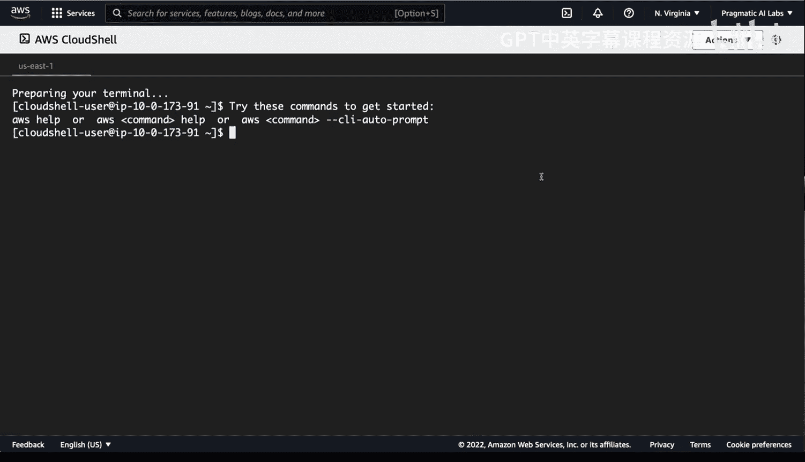

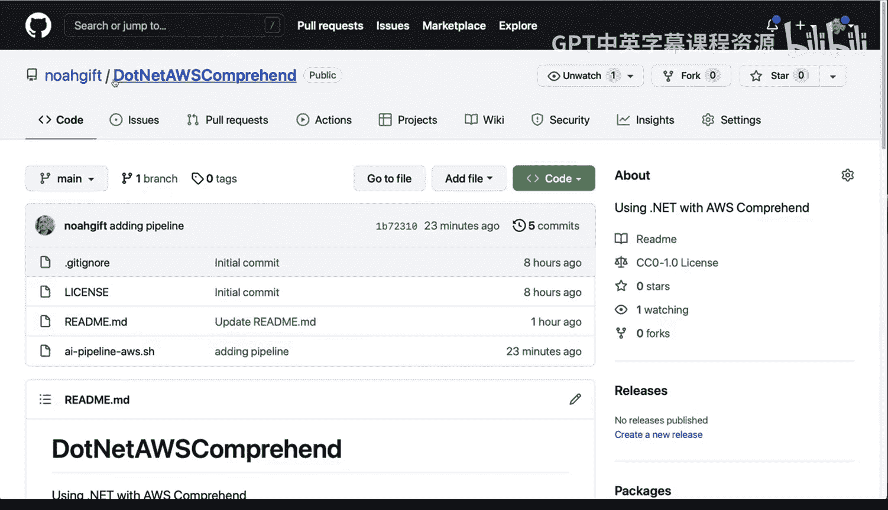

## 开始使用AWS AI服务

AWS提供了从高级文本分析、自动化代码审查、聊天机器人到预测和文档分析等各种AI服务。

我喜欢从CloudShell开始探索。CloudShell的优势在于可以快速尝试和原型化想法。如果你想查看一些完整的示例，可以访问AWS Comprehend的示例页面。现在，让我们开始实际操作。

首先，输入`aws comprehend`命令。通过输入`help`可以查看该服务能做什么。它会显示可用的子命令，例如批量检测主要语言、分类文档等。要使用这些功能，只需在命令中放入相应的子命令即可。

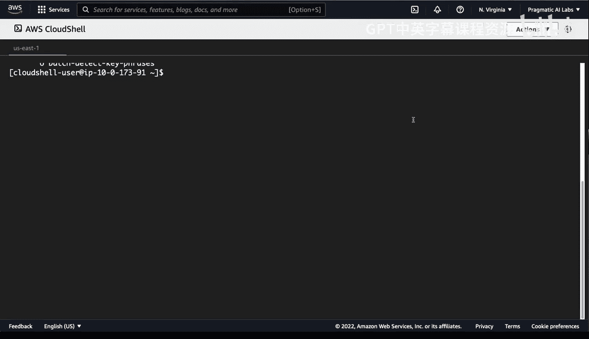

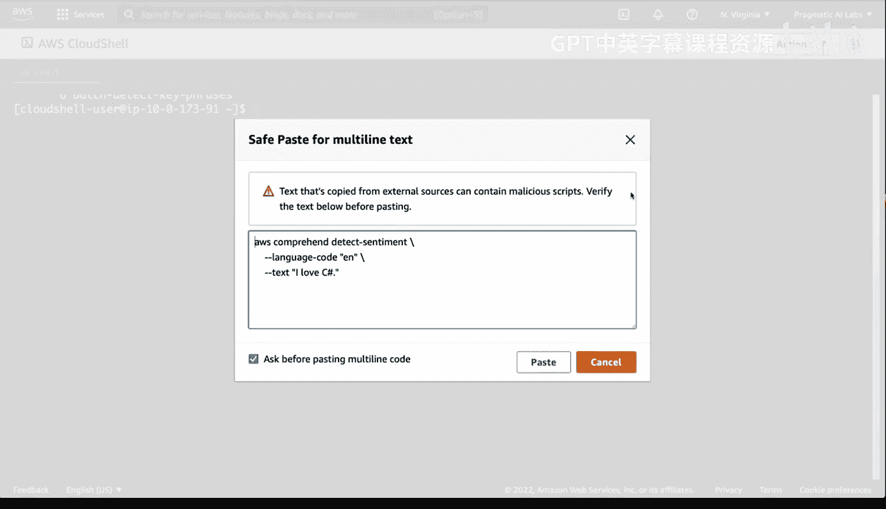

## 初步尝试情感分析

首先，我们将尝试情感分析。我们可以粘贴一整段文档内容进行测试。注意，粘贴时系统会提示安全粘贴，命令中的换行符使得每个选项单独成行，这有助于构建更复杂、更易读的命令。

以下是命令示例：
```bash
aws comprehend detect-sentiment \
    --language-code "en" \
    --text "I love C#"
```
这个命令会分析文本“I love C#”的情感是消极、积极还是中性。

执行后，结果显示情感为“积极”。这非常直接。如果你想进行AI工作，甚至无需深入编程语言，就可以从这里开始尝试。

## 处理更复杂的文本输入

这里有两个微妙的问题需要解决。第一个是如何将更复杂的文本（例如来自网站或其他数据源）输入到命令中。第二个问题是，一次可以输入多少文本。

通过输入`aws comprehend`并利用其良好的Tab自动补全功能，可以方便地探索。输入`help`可以查看所有参数的描述，例如可以更改文本输入、语言代码等。

但需要注意，从这个特定工具传入的每个字符串必须少于5000字节。如果你要传入大量文本，必须注意这一点。

## 从网络获取文本数据

接下来，我们将解决如何获取文本的问题。我们将安装一个名为`links`的工具。这是一个在20世纪80年代末和90年代初许多人用来浏览互联网的工具。它也可以用于数据科学。

我们将使用一段代码片段来演示其功能。代码使用`links`命令并加上`-dump`参数，将网页文本内容输出到Bash的标准输出。我们首先浏览目标网页，这是关于阿尔伯特·爱因斯坦的维基百科页面。

我们可以使用`links`命令将内容通过管道传递给`less`命令进行浏览。即使不做数据科学，了解可以从终端使用`links`浏览维基百科也是很有用的。

## 处理文本长度限制

接下来，我们想知道获取的内容有多少行和多少字节。`wc`（word count）命令可以帮助我们。输入`wc -c`可以查看字节数。

结果显示有超过432,000字节，远超过AWS Comprehend工具5000字节的限制。因此，我们需要创建一个变量来精确提取5000字节的文本。

我们可以构建一个命令行工具来提取5000字节。使用相同的`links -dump`命令，结合`head -c`命令，可以提取指定数量的字节。

## 将文本存入变量并与AWS Comprehend集成

现在我们已经能获取文本，接下来是如何将其用于之前的AWS Comprehend命令。查看之前的命令，发现它使用`--text`参数，这有点复杂，因为我们无法直接通过管道输入。我们需要将内容赋值给一个变量。

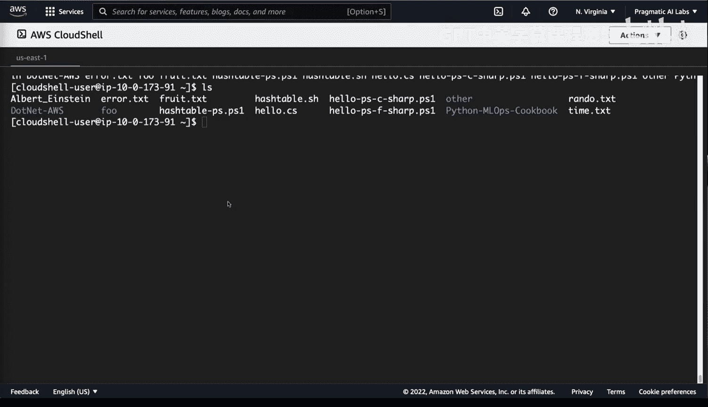

在Bash中，这很简单。我们只需将命令用反引号或`$()`括起来，然后将输出赋值给一个变量，例如`text=$(...)`。

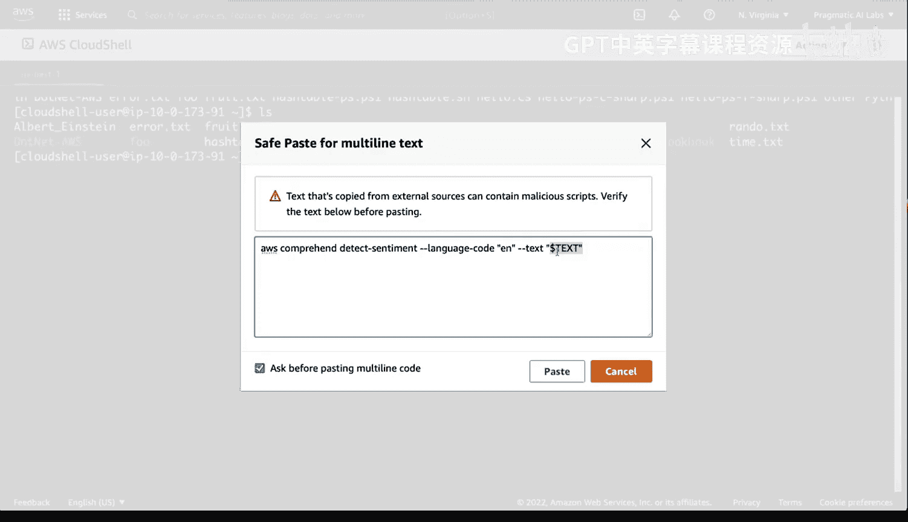

现在，如果我们输入`echo $text`，就可以看到文本已存储在变量中。但这里我们不需要单词计数，而是需要原始文本。因此，我们调整命令，使用`head -c 5000`来获取原始文本。

## 执行情感分析

现在我们已经将文本存储在变量中，接下来可以将其用于更复杂的AWS Comprehend命令。我们只需构建命令，将`--text`参数的值设置为我们的变量。

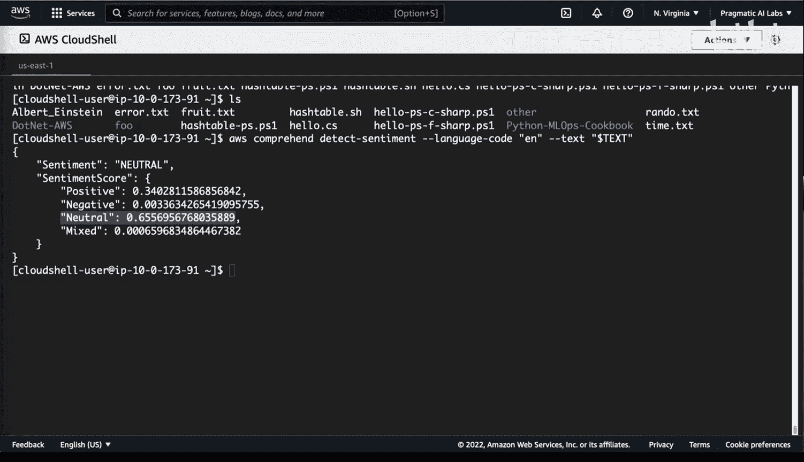

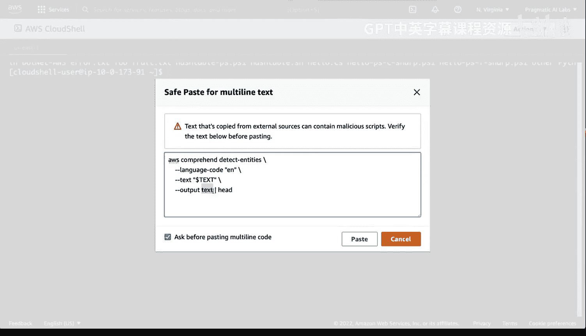

执行命令后，我们可以看到对爱因斯坦维基百科文章的情感分析结果。总体而言，文章的情感偏向中性，但也有相当一部分（约三分之一）内容表现出非常积极的情感。作为一个历史人物，爱因斯坦受到高度评价，从数据科学的角度看，这很有趣。

## 进阶：实体提取与处理

除了情感分析，我们还能做什么？另一个有趣的功能是实体提取。

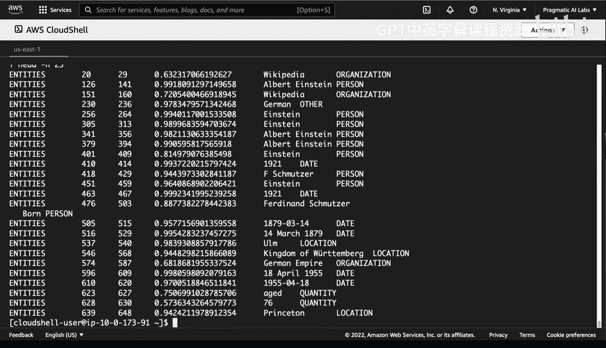

这次我们使用`detect-entities`子命令，并指定输出格式为文本。这样我们就可以利用Bash的能力来处理输出结果。

输出显示了从文本中提取的关键实体，如“Wikipedia”、“Albert Einstein”、“German”等。如果我们只查看前25个条目，可以看到更多实体。这些都是从文本中提取的关键项目。

## 构建Bash数据处理管道

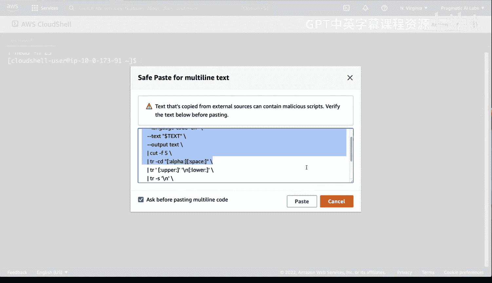

如果我们能获取实体列，并统计每个实体出现的次数，这将是一种更强大的方式，可以让我们更深入地了解维基百科文章的内容，以便进行进一步研究或用其他语言构建应用。

为了实现这个目标，我们将构建一个更复杂的Bash管道命令。首先进行实体提取，传入语言代码和文本。然后进入Bash管道处理：首先获取实体所在的列；接着清理数据，只保留字母字符并转换为小写，同时移除换行符；然后对结果进行排序；排序后，使用`uniq -c`统计每个实体出现的次数；接着按第一列（计数）进行反向排序；最后，只查看前几个最重要的实体。

运行这个管道命令后，我们得到了预期的结果：它显示了最重要的实体及其出现次数。例如，关于爱因斯坦的文章中，“Einstein”一词出现频率很高，“University”、“German”、“Empire”、“Albert”、“Kingdom”、“Zuric”等也频繁出现。这些信息对于进一步的数据科学研究可能非常有用。

## 总结

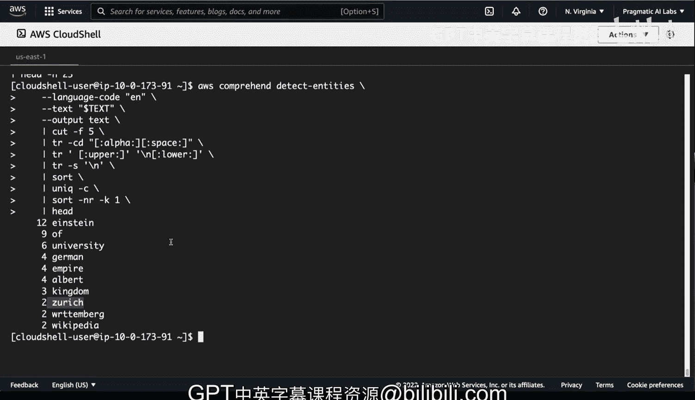


本节课中，我们一起学习了如何利用AWS CloudShell和Bash快速原型化AI API。我们使用AWS Comprehend服务对网络文本进行了情感分析和实体提取，并构建了Bash管道来处理和分析结果。这种方法证明，你并非必须使用Python、C#或R等语言才能进行复杂的数据科学探索。结合CloudShell和Bash，你可以非常快速地使用AI API原型化解决方案，验证想法，为后续开发提供清晰的思路。