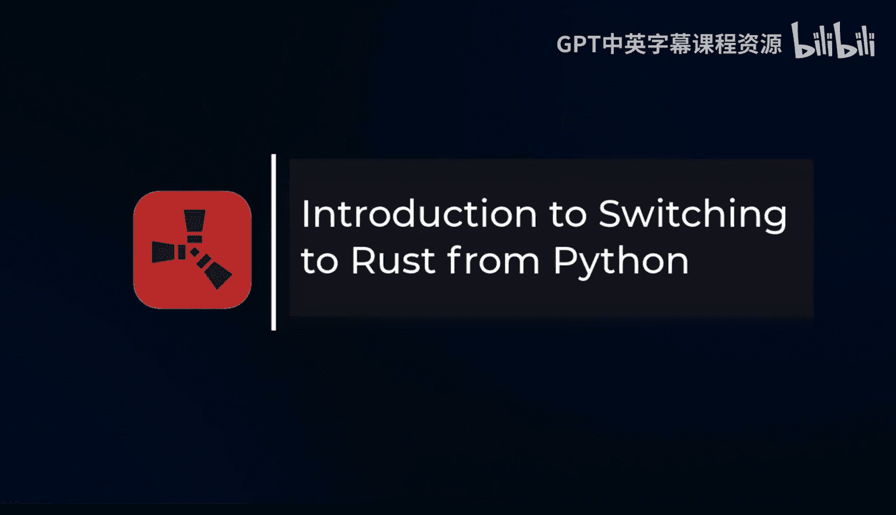

#  053：Python转Rust入门 🦀

## 概述

在本节课中，我们将探讨为什么Rust语言对于Python开发者而言是一个值得学习的强大工具。我们将从Rust的设计理念、核心优势以及它如何与现代开发实践（如AI辅助编程）结合等方面进行介绍，帮助你理解从Python转向Rust的价值和路径。

## 为什么选择Rust？

我是Noah Gift，一位O‘Reilly的常驻作者，撰写过多本技术书籍。我在杜克大学教授云计算、数据工程和机器学习运维课程。我的研究重点是如何让机器学习运维、DevOps和云计算尽可能高效和富有成效。因此，制作这个从Python转向Rust的系列教程既有趣又富有意义。

本系列将基于我当前正在进行的工作，展示Rust的一些能力。首先，让我从宏观上阐述为什么我认为Rust是未来，以及为什么如果你是Python程序员，至少应该尝试一下它。

## Rust的核心优势

Rust作为一门现代语言，拥有多项显著优势。以下是其核心特点的详细说明。

### 1. 现代化的设计

Rust的一大优势在于其诞生时间较晚。与那些已存在数十年的语言不同，Rust能够汲取其他语言的最佳实践。其中，**包管理**可能是Rust的头号优势。当你使用基于`cargo`的系统时，会立刻感受到它的强大、实用和令人耳目一新。如果你曾为Python或其他语言的包管理而苦恼，那么使用Rust的包管理会让你感到得心应手。

### 2. 卓越的性能与能效

在性能方面，Rust达到了C++级别的速度。在能效方面，同样具备C++级别的能源效率。因此，如果你确实需要充分利用成本节约和能源效率，Rust将是你的绝佳选择。

### 3. 强大的并发支持

Python由于全局解释器锁（GIL）的历史遗留问题，无法进行充分利用所有核心的多线程编程。这对Python程序员来说是一个挑战，因为线程化编程可以更高效地利用内存。而在Rust中，你只需几行代码，就可以在**线程池**中启动多个线程。同时，编译器会保护你免受多线程编程中可能出现的许多问题。

### 4. 内存安全与系统级安全

这引出了下一点：**安全性**。Rust是最安全、最安全的语言之一。它被设计为一门系统编程语言，因此在网络安全方面的许多安全特性都内置于语言本身。这就是为什么Linux内核开始采用Rust，谷歌也在采用Rust。在2023年及以后，你将会看到Rust被广泛采用。

### 5. 便捷的二进制分发

最后一点，Rust的另一个巨大优势在于分发。如果你有一个Python脚本，想交给非技术人员（比如你的祖父母）运行，即使他们有一点技术背景，运行你的脚本也可能遇到困难。而对于Rust，默认情况下，一旦你编译了包，就可以将生成的**二进制可执行文件**放在某个目录中，他们可以直接运行它。因此，Rust的二进制可执行文件交付方式是一个巨大的优势，我认为许多人都会利用这一点。

### 6. AI辅助开发的新时代

最后要提到的是，我们正处在一个使用AI辅助的新时代。特别是**GitHub Copilot**，它为本课程所重点介绍，为代码开发增添了一种惊人的方式。你从Python中已经掌握的代码检查、格式化和测试等所有技能，都可以直接通过Copilot来加速掌握Rust。这也是我将在本课程中演示的内容之一。

## 总结

总而言之，即使你对Rust感到有些畏惧，或者觉得其语法有点陌生，我将会逐步引导你如何成为一名Rust程序员。掌握这项技能，能将你公司、组织或个人业余项目的水平提升一个档次。

好的，让我们开始吧。