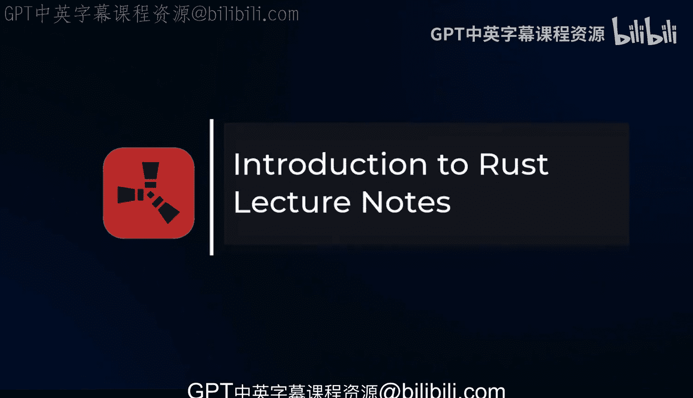
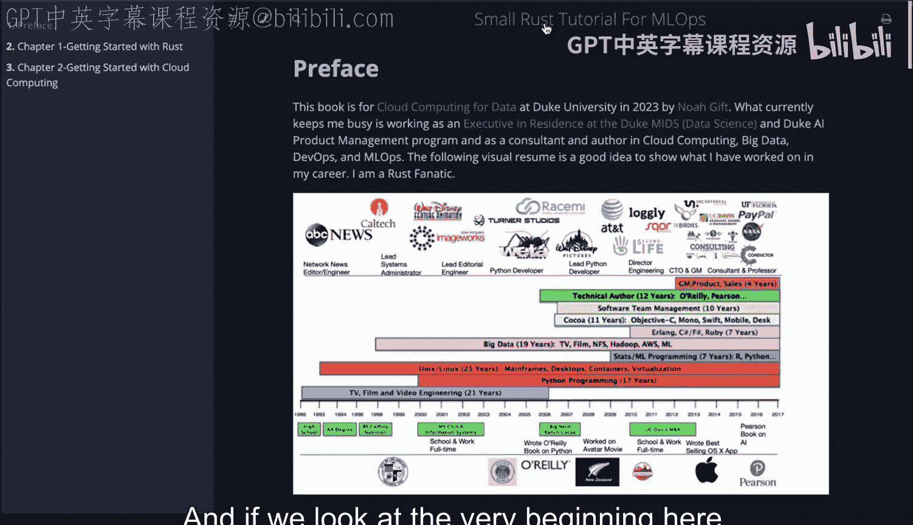
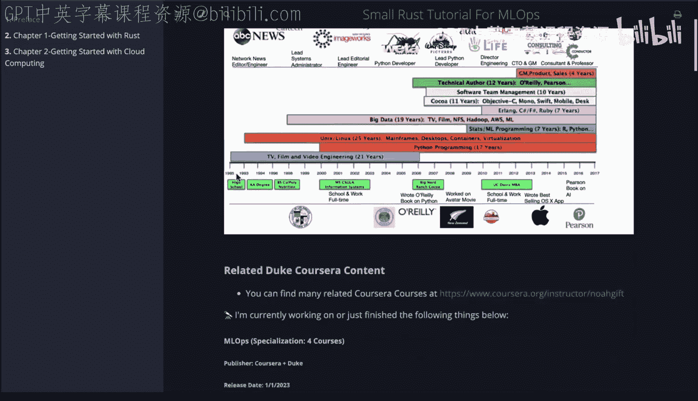
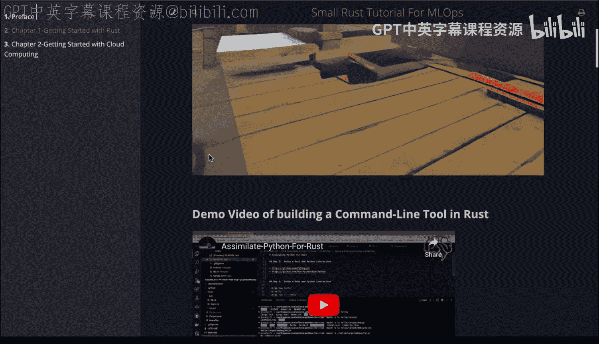
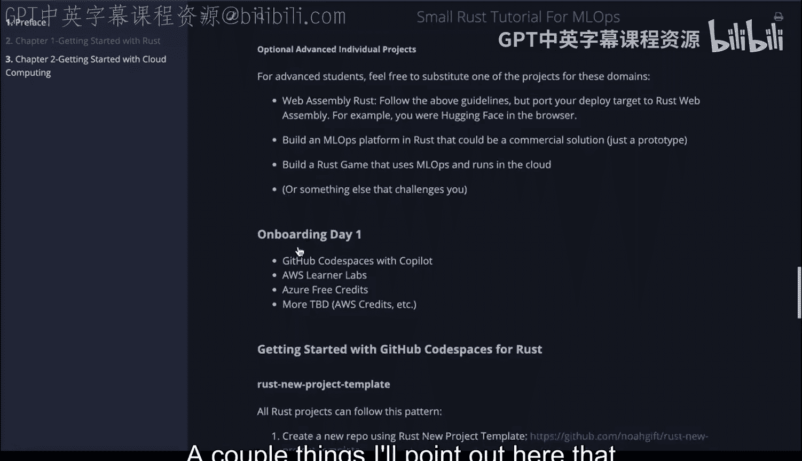
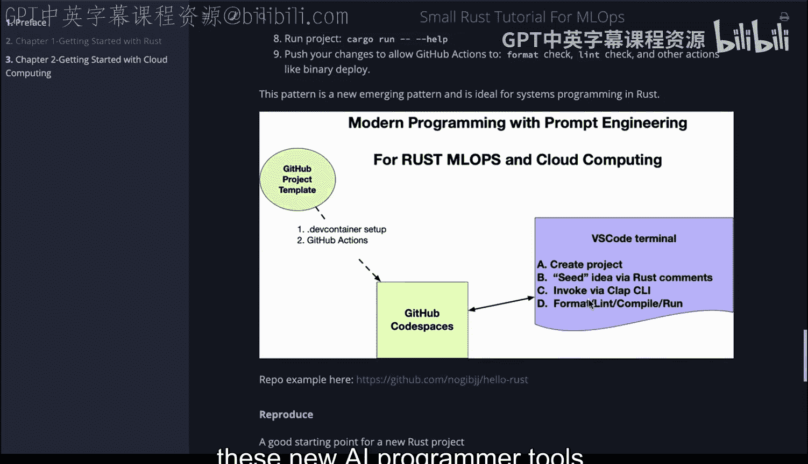
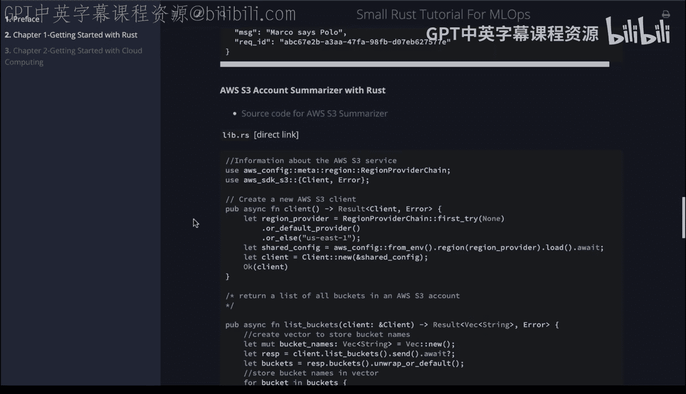

#  054：Rust讲义笔记介绍 🦀



在本节课中，我们将介绍一份用于本课程的Rust学习笔记（Rustbook），并概述其内容结构、核心学习方法以及如何利用现代开发工具链快速上手Rust，特别是用于构建命令行工具和云服务。

## 概述：Rustbook简介

这里有一份使用Markdown编写的Rust学习笔记，名为“Rustbook”。我使用它来记录本课程中将要讲解的许多讲座内容。

你可以通过Github上的URL `rustt tutorial` 查看这份笔记。笔记包含前言、第一章、第二章等内容。如果我们查看开头部分，可以看到前言，其中介绍了我的背景——我在构建系统方面拥有丰富经验，还有一些额外内容。

## 第一章内容预览









上一节我们介绍了Rustbook的整体情况，本节中我们来看看第一章的简要内容。在后续课程中，我们会深入细节。但在最开始，核心思想是：你可以通过这些演示了解研究生课程的部分教学内容，并最终学会如何使用Rust技术构建自己的项目组合。

我认为有几个有趣的点值得指出。当你开始学习时，2023年结合提示工程的现代编程工作流是一个巨大的改变，尤其是在MLOps和云计算领域使用Rust。

以下是其基本工作流程：
1.  从Github的项目模板开始（我后续会分享我的仓库模板）。
2.  使用Codespaces配置一个已预装Rust的优质开发环境。
3.  创建你的项目。
4.  通过在Rust代码中添加注释来“播种”想法，AI工具会据此给出建议。
5.  接着，你可以构建你的命令行工具。

这种 **“格式化 -> 检查 -> 编译 -> 运行”** 的循环有助于控制提示工程，并真正发挥其能力来构建你想要的工具。

因此，秘诀在于 **传统工具 + Copilot这类新型AI编程工具**。



## 实战示例：构建命令行工具

以上介绍了现代Rust开发流程，本节我们通过一个具体例子来看看如何实践。这里有一个很好的入门项目示例：我想运行一个“Marco Polo”命令行工具。

我们可以通过运行 `cargo` 命令来创建并运行一个能实现此功能的项目：我输入单词“Marco”，它会返回单词“Polo”。

相关代码非常简单。如果你熟悉Python，除了 `pub` 关键字表示此函数对另一个模块公开，以及必须声明类型（Python中类型注解是可选的）之外，没有太大区别。

以下是一个直观的代码格式示例：
```rust
if name == "Marco" {
    return "Polo";
}
```
在主函数中，我们使用了一个命令行参数解析库，它在很多方面类似于Python的`argparse`库，用来解析参数。

因此，开始构建命令行工具非常简单。我的建议就是：着手构建命令行工具。你可以参考这份教程，我也会带你逐步学习。

## 后续章节与高级应用

我们刚刚探讨了如何入门构建基础工具，接下来简要谈谈其他章节的内容。随着本系列课程的进展，会有更多内容加入。我希望能尽快分享这些信息，因此目前以草稿形式呈现。

通常，在这里向下滚动，你还可以学习构建AWS无服务器工具。这是一个演示如何在AWS内部部署Lambda函数的例子，实际上相当简单。

这里又是一个“Marco Polo” Lambda函数的示例。如果滚动到页面底部，你还可以看到一个与AWS交互的无服务器工具。再次强调，代码量不大，非常直观。如果你是Python程序员，不必担心，你会很快适应这项技术。

## 总结



本节课中我们一起学习了为本课程准备的Rustbook笔记。我们概述了其结构，介绍了结合AI提示工程的现代Rust开发工作流，并通过“Marco Polo”示例演示了如何快速构建命令行工具和云函数。请随时查看这份资料，本系列内容会频繁更新。我非常期待教授这些材料。