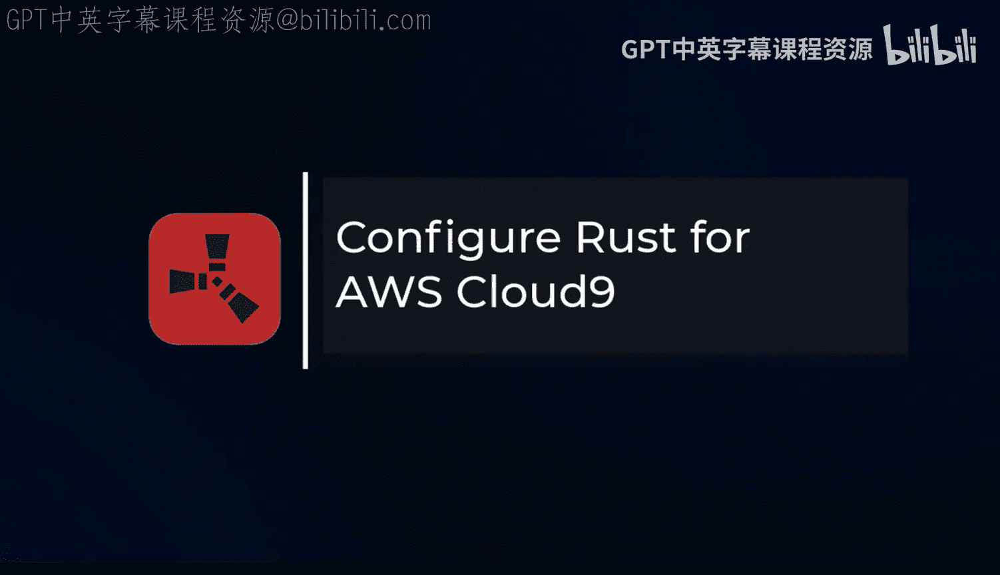
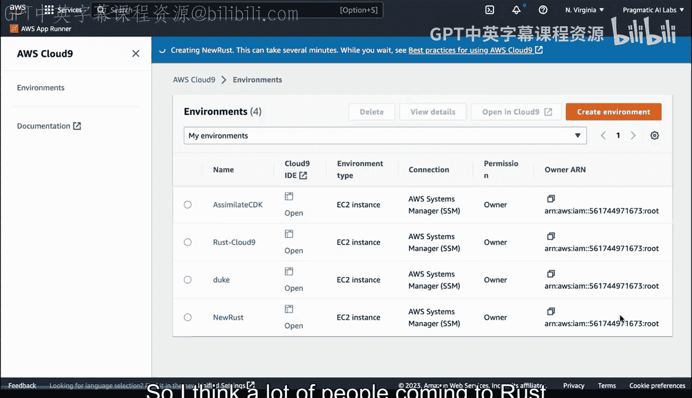
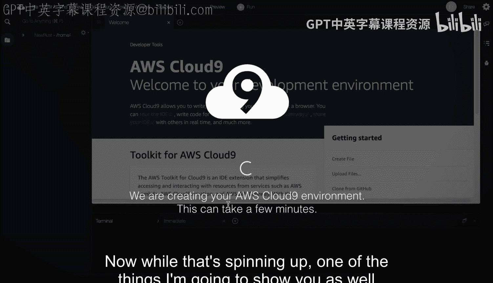
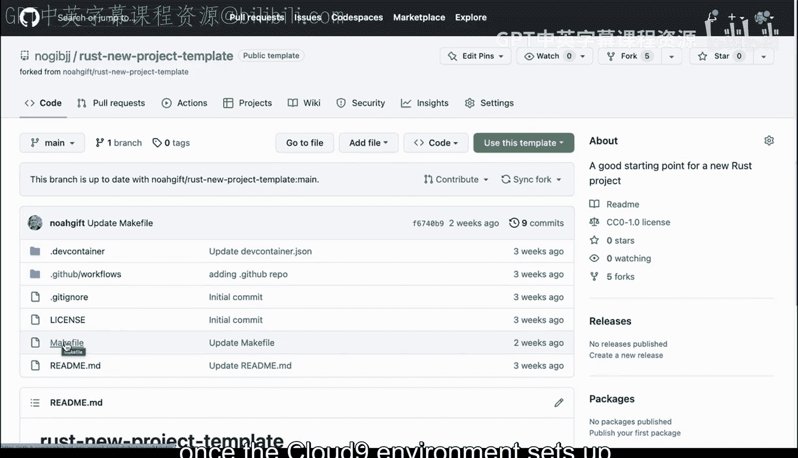
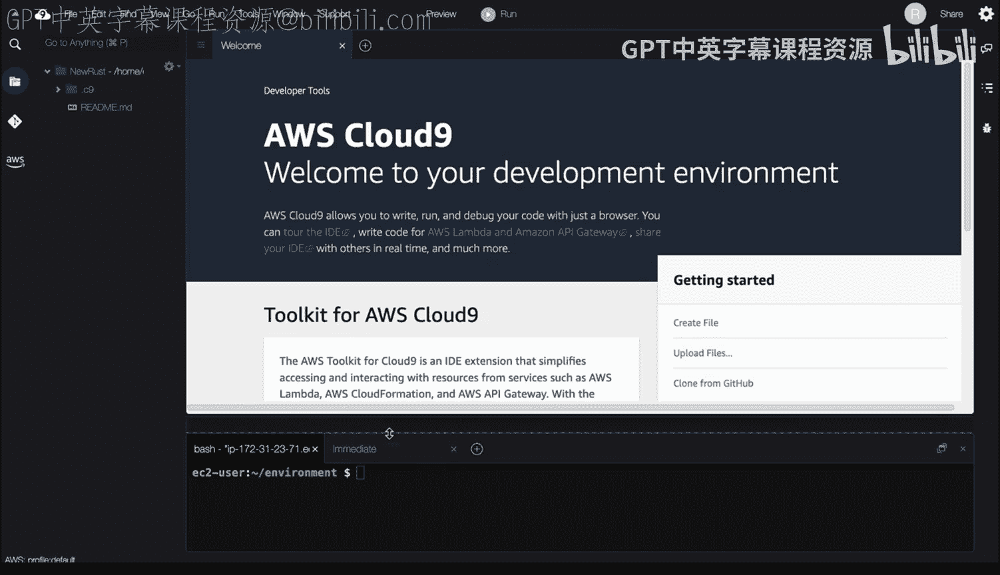
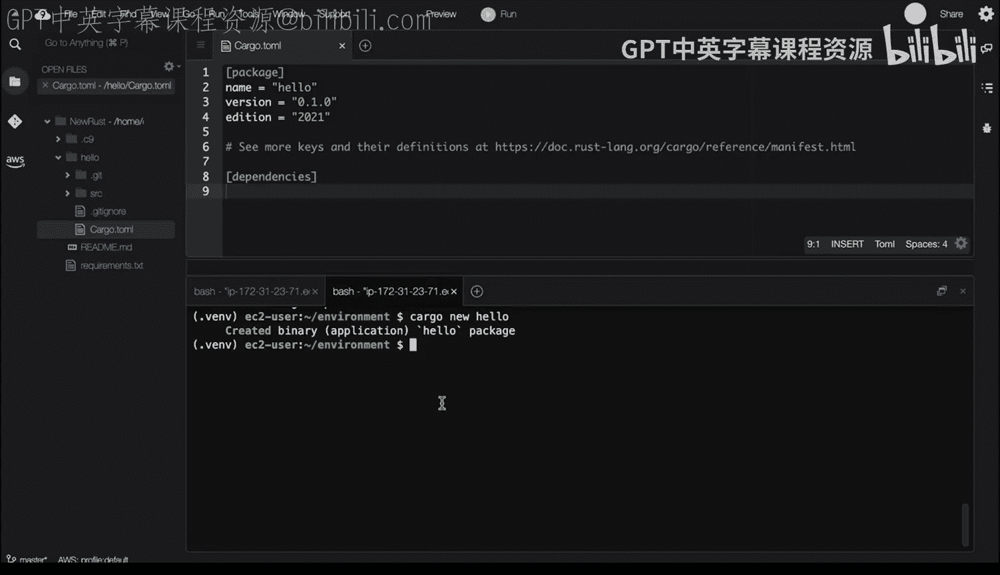
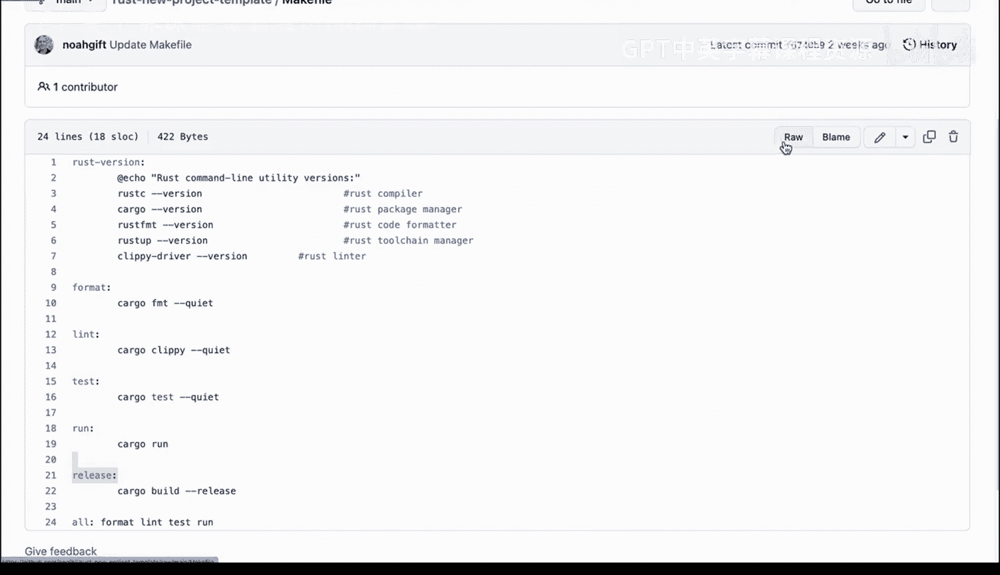
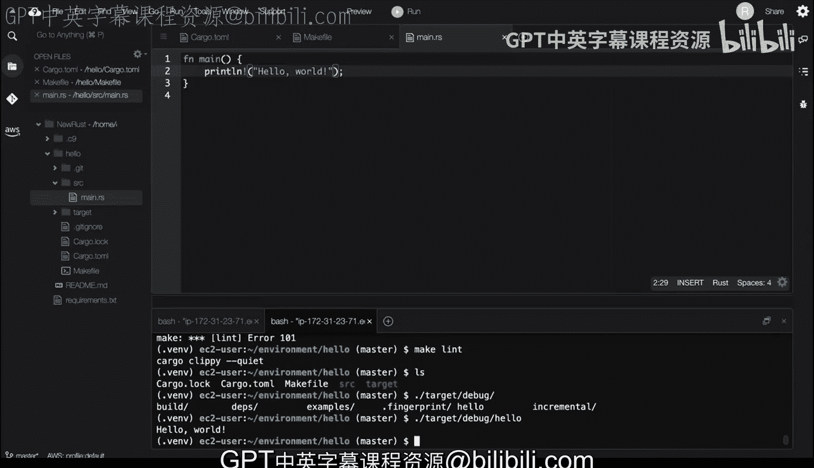

#  055：为AWS Cloud9配置Rust环境 🦀



在本节课中，我们将学习如何在AWS Cloud9环境中配置Rust编程语言。我们将通过对比Python环境的设置流程，来展示Rust工具链的简洁与高效。

---

## 概述

我们将使用`rustup`工具来安装Rust。`rustup`是Rust语言的官方安装器，它提供了一种极其简单的方式来设置开发环境。整个过程通常只需一行命令。本节将演示在AWS Cloud9中创建新环境、安装Rust、初始化项目，并介绍如何利用Makefile来统一开发工作流。





## 环境创建与Python设置对比

首先，我们在AWS Cloud9中创建一个新的环境。对于习惯使用Python的开发者来说，这个过程很熟悉。为了进行对比，我们先看看在Python环境中通常需要做哪些设置。



以下是典型的Python环境设置步骤：

1.  **创建虚拟环境**：使用Python内置的`venv`模块来隔离项目依赖。
    ```bash
    python3 -m venv ~/.venv
    ```
2.  **激活虚拟环境**：需要手动激活环境，并通常需要将其添加到shell配置文件中以便新终端自动激活。
    ```bash
    source ~/.venv/bin/activate
    ```
3.  **管理依赖**：需要手动创建`requirements.txt`文件来列出项目依赖，然后使用`pip`进行安装。
    ```bash
    pip install -r requirements.txt
    ```

这个过程虽然可行，但步骤较多，且每次新建项目都需要重复操作。



## 使用Rustup安装Rust

现在，让我们看看Rust的安装过程。相比之下，它要直接得多。

我们只需在终端中运行以下命令：
```bash
curl --proto '=https' --tlsv1.2 -sSf https://sh.rustup.rs | sh
```
或者直接使用：
```bash
rustup
```
（假设`rustup`安装脚本已下载）

执行后，`rustup`会自动完成以下工作：
*   安装最新稳定版的Rust编译器（`rustc`）。
*   安装Rust的包管理器和构建工具`cargo`。
*   安装`rustfmt`（代码格式化工具）、`clippy`（代码lint工具）和`rust-docs`（文档工具）。
*   自动将`cargo`等工具的路径添加到用户的`~/.bashrc`文件中，无需手动配置。

安装完成后，创建一个新的Rust项目非常简单：
```bash
cargo new hello
```
这个命令会生成一个完整的项目结构，包括`Cargo.toml`文件（用于管理依赖和元数据）和`src/main.rs`文件（包含一个“Hello, world!”示例程序）。从项目伊始，你就拥有了一个成熟的构建和包管理系统。

## 使用Makefile统一工作流

为了进一步提升开发体验，尤其是在使用多种语言时保持工作流一致，我们可以引入一个Makefile。

以下是一个示例Makefile的内容，它定义了一些常用任务：
```makefile
.PHONY: help format lint test run release
help:
	@echo "可用命令:"
	@echo "  make format    # 格式化代码"
	@echo "  make lint      # 运行clippy进行代码检查"
	@echo "  make test      # 运行测试"
	@echo "  make run       # 编译并运行项目"
	@echo "  make release   # 构建发布版本"

format:
	cargo fmt

lint:
	cargo clippy





test:
	cargo test

run:
	cargo run

release:
	cargo build --release
```

将这个Makefile放入你的项目根目录后，你就可以使用统一的命令来执行各种操作：
*   `make run`：编译并运行项目。
*   `make format`：使用`rustfmt`自动格式化代码。
*   `make lint`：使用`clippy`进行静态分析，检查代码中的常见问题或可改进之处。
*   `make test`：运行项目中的单元测试。
*   `make release`：构建优化后的发布版本。

这种统一的方式使得在不同项目间切换时更加得心应手。

## 总结



本节课中，我们一起学习了在AWS Cloud9中配置Rust开发环境。通过`rustup`，Rust的安装过程变得非常简洁，一键即可获得完整的工具链。`cargo`工具在项目创建之初就提供了依赖管理、构建、测试等一体化支持，体现了“生产就绪”的设计理念。最后，通过引入Makefile，我们能够建立一套统一、高效的开发工作流。对于许多MLOps或工程项目而言，Rust因其出色的性能、安全性和现代化的工具链，正成为一个非常有吸引力的Python替代选择。