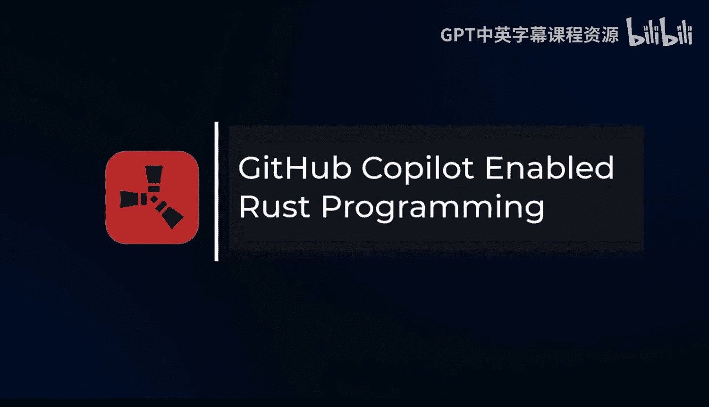
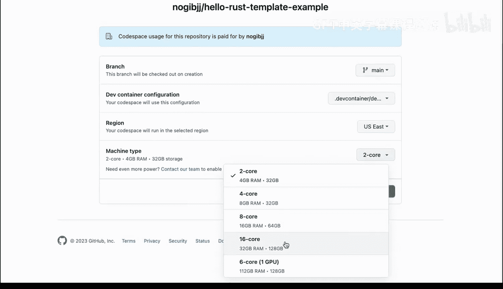
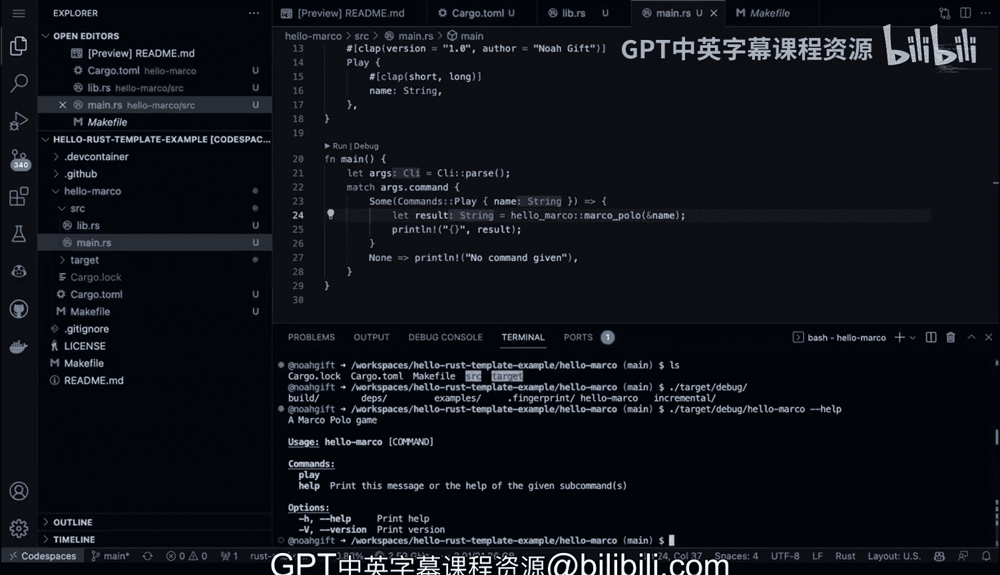

#  056：使用GitHub Copilot辅助Rust编程

## 概述

在本节课中，我们将学习如何利用GitHub生态系统（包括GitHub Copilot、Visual Studio Code和GitHub Codespaces）来辅助Rust编程。我们将探讨如何将Python程序员的知识迁移到Rust，并利用现代工具链实现更高效的开发流程。

## 开始使用GitHub生态系统进行Rust开发

上一节我们介绍了课程背景，本节中我们来看看如何开始使用GitHub生态系统进行Rust开发。

我认为这是成为一名软件工程师更令人兴奋的方式之一。这就是在GitHub生态系统中使用Copilot。不仅仅是单独使用Copilot，而是与Visual Studio Code、GitHub Codespaces和GitHub一起使用。这些工具的结合可以让你提升水平。在我刚开始使用Python的时候，感觉非常棒。我进入Python世界，觉得可以做很多事情，快速编写脚本代码，速度快如闪电，这很神奇。当你使用Copilot升级到像Rust这样更强大的语言时，那种感觉和最初的Python体验一样。但区别在于，你拥有一种现代语言和一个现代打包系统。你的能源效率提高了50倍，计算性能至少提高了25倍。由于它是一种内存效率很高的语言，内存使用也更优。

在安全性方面，你通过编译器构建了一个非常安全、并发的程序，并且从网络安全的角度来看也是安全的。因此，有所有这些很棒的优势。所以真正的问题是，使用Copilot配合一个稍微复杂一点的语言（Rust）是否值得付出代价。答案是值得的，因为你可以利用作为Python程序员已有的知识，将其应用到Rust中，从而提升你公司的水平。我认为这将成为2023年的一项新兴技能。Python程序员不必抛弃他们所学的一切，他们可以运用我将要展示的技巧来应用这些知识。

## 使用GitHub Codespaces模板创建Rust项目

上一节我们讨论了使用Rust和Copilot的优势，本节中我们来看看如何使用GitHub Codespaces模板创建Rust项目。

让我们看一下这里使用GitHub生态系统的Rust新项目模板。这确实是神奇之处，这就是为什么Copilot能让你提升现有Python程序员水平的原因。如果你想进入下一个级别，我强烈推荐GitHub Codespaces加上Copilot加上Visual Studio Code。这是秘诀。如果我们浏览这里，我们会看到一个Dockerfile，它配置了我的环境，包含了我需要的所有东西。我们还在devcontainer中配置了功能，例如Copilot。此外，这意味着我可以在任何时候用新项目启动它。所以这里的秘诀就是，我只需要说，嘿，我要使用这个，我想自动测试我的代码，一切都为我设置好了。让我们使用这个模板，创建一个新的仓库，在这里选择额外的选项，并挑选一台性能强大的机器，以便编译我的代码。

## 配置开发环境与验证

上一节我们创建了项目模板，本节中我们来看看如何配置开发环境并进行验证。

我们在这个环境中。让我们检查一下一切是否正常。我们可以做的一件事是查看这里的Makefile，这在项目初期是一个好主意。如果我输入`make rust-version`，好处是它会告诉我所有美好的东西，比如Rust的版本等等。这是免费的，这是与Python的一大区别，你不需要做任何事情，它已经准备好了。所以如果我想创建一个新项目，我该怎么做？我只需输入`cargo new hello_marco`。让我们构建一个Marco Polo应用程序。如果我浏览这里，看，我有一个打包系统已经为我设置好了。所以我需要在这里放入我关心的依赖项。我要做的是在这里放入一个命令行工具库，叫做Clap，这是一个非常流行的库。然后由我决定结构。

如果你是Python程序员，我建议你浏览这里，进入`src`目录。首先进入目录，然后`touch src`并创建一个`lib.rs`。这是我喜欢放置逻辑的地方。在这里，我们也可以通过使用Copilot构建一些惊人的东西。这确实让我们能够利用从Python带来的技能。我们可以首先在这里创建一个注释，说，一个Marco Polo游戏。

## 利用Copilot编写Rust逻辑

上一节我们设置了项目结构，本节中我们来看看如何利用Copilot编写Rust逻辑。

然后由我来创建正确的提示。所以我要做的是，我会说，如果给出的名字是“Marco”，程序用“Polo”回应。否则，我们会说“你叫什么名字？”。这看起来很不错，对吧？所以它就像一个真人。我们只需要正确地提示它。然后我还会在这里添加一些额外的提示。这又取决于我们，真的去引导它，对吧？所以我们想做一些事情。只要我们一路帮助它，它就会给你一个好的回应。在这种情况下，我们说`pub fn`，所以将这个暴露给我的主模块，我将用于命令行工具。然后看看其余的代码，它实际上非常直观。我们这里有一个字符串用于名字，我们对字符串做一些处理，然后返回一个字符串，非常非常直观。

现在让我们进入`main.rs`。这里的技巧是，很多时候所有的命令行工具库或样板代码。所以很多时候，如果我正在构建一些东西，我会从其他程序中剪切粘贴，以再次帮助我们的提示。所以我要在这里放入一些东西，一个命令行工具来玩Marco Polo游戏。这都只是样板代码。这里的要点是，你将一个子命令映射到你在库中创建的函数。这几乎与Python相同，除了我获得了25倍更好的性能。我可以部署二进制文件，以及其他很酷的东西。

## 完善代码与处理依赖

上一节我们生成了初始代码，本节中我们来看看如何完善代码并处理依赖关系。

一旦我完成了这个，我可以再看看，好的，我想传递一个名字进去，然后会发生的是，我只需让Copilot为我完成其余的工作。看看它会做什么，它说，在这种情况下，有一件事它搞错了。所以现在我们看到它已经能够生成一个合理的建议。但这并不完美，对吧？我想稍微调整一下。所以我要做的是，我不让它在这里打印名字，这不是我真正想做的，对吧？我想发送“Marco Polo”。我要做的是，我会按Tab键，然后说`let result =`。然后我会引导它注意到我有一个可以在模块中使用的命名空间。这是当你刚开始使用Rust时可能会让你有点困惑的事情之一，比如，嘿，等等，这是什么？这个命名空间是什么？实际上，这是`Cargo.toml`文件里的内容，对吧？是这个名字。所以你必须将其映射为相同的名字。现在，我可以做的是，我可以说`make format`，看看如果我格式化我的代码会发生什么，它是否会清理一下代码。这做了什么？它说“fail to use unresolved crate”。嗯，在这种情况下，它应该是已解析的，因为那实际上是……哦，实际上crate名称不正确。linter告诉了我正确的事情。所以我们必须将其改为`hello_marco`。我们必须说`hello_marco`。怎么样？好了。所以这就是类比工具的地方，Cargo系统以及Copilot一起工作。格式化工具、linter或所有这些东西一起工作。然后我只需不断迭代以获得解决方案。看，如果linter通过了，我们就处于很好的状态。

## 编译与运行程序

上一节我们解决了代码问题，本节中我们来看看如何编译和运行我们的Rust程序。

现在我可以使用最后一部分，也就是我可以实际运行`cargo`来执行它。这很像从Python解释器运行东西。我只需输入`cargo run --`。如果我们在这里使用双破折号，它会将一些命令传递回我们的程序。现在它将首次编译它。Rust编译器非常棒，因为它做了所有这些非常酷的事情来使你的程序安全且快速。我们可以看到它工作了。现在我可以输入`play`，我们可以输入`Marco`，然后它会返回。实际上，出现了意外的参数`play`，因为我们需要做`--name`。好了，`polo`。如果我输入`Bob`，它会说“你叫什么名字？”，对吧？这是一个很好的反馈循环。再看看这里的`target`目录。如果我浏览这里，我说`target/debug`，然后输入`./hello_marco`。看这里，实际上，我得到了那个可执行文件。所以在我看来，这比常规Python是一个巨大的胜利，因为这个快速的反馈循环，使用Copilot提升水平的能力，以及利用这个现有工具链获得反馈循环。所以这是Copilot提供的新结对编程工具的一个新兴特性。

## 总结

本节课中我们一起学习了如何利用GitHub Copilot、Visual Studio Code和GitHub Codespaces组成的生态系统来辅助Rust编程。我们看到了如何将Python开发经验迁移到Rust，通过Copilot生成代码、利用Cargo工具链管理依赖和构建，并最终编译运行一个简单的命令行程序。这种组合提供了高效的开发反馈循环，并能让开发者享受到Rust语言在性能、安全性和能效方面的优势。